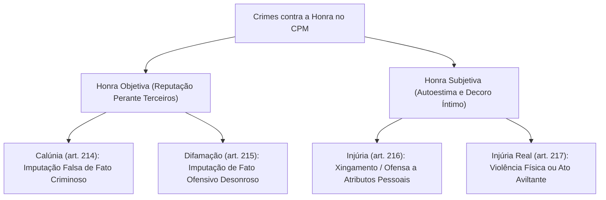

A tutela da honra assume dimensão de elevado relevo no âmbito das corporações militares. A preservação da dignidade individual, do conceito social e da consideração funcional constitui esteio indispensável para a manutenção da hierarquia, da disciplina e da respeitabilidade institucional. O Código Penal Militar tipifica os atentados contra a honra nos arts. 214 a 221, abrangendo tanto a honra individual nas dimensões objetiva e subjetiva quanto a salvaguarda da consideração pública das instituições armadas.

> [!objetivos]
> - Diferenciar calúnia, difamação e injúria a partir do objeto da imputação e da espécie de honra atingida.
> - Compreender o processamento da exceção da verdade e suas hipóteses restritivas na calúnia e na difamação.
> - Dominar as inovações da Lei nº 14.688/2023 relativas ao perdão judicial e à injúria qualificada por preconceito.
> - Analisar as causas de aumento de pena do art. 218, a ofensa às Forças Armadas e as excludentes do art. 220.

## Conceito e diferenciação dos crimes contra a honra

A dogmática penal reparte a honra em duas vertentes complementares:
1. **Honra objetiva:** consiste no juízo de valor que o meio social faz sobre o indivíduo (reputação, renome e consideração pública). É o bem jurídico tutelado na calúnia (art. 214) e na difamação (art. 215). O delito consuma-se no instante em que a imputação desonrosa chega ao conhecimento de uma terceira pessoa qualquer, estranha ao agressor e ao agredido.
2. **Honra subjetiva:** traduz o sentimento de dignidade e amor-próprio que o indivíduo nutre a respeito de si mesmo (autoestima e conceito íntimo de probidade). É protegida pelo crime de injúria (arts. 216 e 217). Consuma-se no momento em que a própria vítima toma ciência da ofensa ultrajante, dispensando a presença ou ciência de terceiros.

| Tipo Penal | Dispositivo Legal | Objeto Central da Conduta | Dimensão da Honra Atingida | Sanção Básica Cominada |
|---|---|---|---|---|
| **Calúnia** | Art. 214, caput | Imputação falsa de fato concreto tipificado como crime | Objetiva (opinião social externa) | Detenção, 6 meses a 2 anos |
| **Difamação** | Art. 215, caput | Imputação de fato concreto desonroso (criminoso ou não) | Objetiva (reputação e renome) | Detenção, 3 meses a 1 ano |
| **Injúria** | Art. 216, caput | Atribuição de adjetivos desairosos ou insultos morais | Subjetiva (autoestima pessoal) | Detenção, até 6 meses |

> [!exemplo]
> Em conversa no quartel, o militar A afirma aos colegas que o sargento B falsificou um atestado médico militar, sabendo ser mentira: pratica calúnia (art. 214), pois atribuiu falsamente fato criminoso. Se o militar A espalhar aos companheiros que o sargento B tem dívidas no comércio local e costuma contrair empréstimos sem pagar: comete difamação (art. 215), pois ataca a reputação com fato desairoso não criminoso. Por fim, se em discussão cara a cara chamar o superior de "incompetente e covarde": perfaz injúria (art. 216), ofendendo a dignidade funcional e moral da vítima.

## Calúnia no Código Penal Militar (art. 214)

A calúnia pune quem formula falsa imputação de fato definido como crime a outrem.

> [!lei] Art. 214, caput e § 1º, do Código Penal Militar
> Caluniar alguém, imputando-lhe falsamente fato definido como crime:
> Pena - detenção, de seis meses a dois anos.
> § 1º Na mesma pena incorre quem, sabendo falsa a imputação, a propala ou divulga.

Requisitos indispensáveis para a consumação da calúnia:
- **Imputação de fato determinado e circunstanciado:** não basta a afirmação vaga de que a vítima "é ladra" ou "cometeu desvios"; exige-se a descrição de episódio fático situado no tempo e espaço (exemplo: "subtraiu combustível da viatura na noite de ontem"). O insulto genérico caracteriza injúria.
- **Fato definido como infração criminal:** o fato narrado deve ostentar adequação típica abstrata a crime militar ou comum. Imputar contravenção penal não perfaz calúnia (mas difamação).
- **Falsidade da imputação:** a narrativa deve ser objetivamente contrária à verdade dos fatos, e o agente deve ter plena consciência dessa inverdade. Se o declarante acredita sinceramente na veracidade da imputação por erro justificado, afasta-se o dolo por inexistência do elemento subjetivo.
- **Propalação ou divulgação (§ 1º):** quem não inventou a acusação, mas conscientemente a repassa adiante, espalhando boatos caluniosos sabendo-os inverídicos, responde com a mesma sanção do autor inicial.

### Exceção da verdade na calúnia (art. 214, § 2º)

A regra geral na calúnia é a admissibilidade da exceção da verdade: se o acusado demonstrar em juízo que o fato criminoso narrado é estritamente verdadeiro, o crime fica excluído em virtude da ausência de falsidade. Contudo, o CPM prevê três vedações expressas em que a prova da verdade não é permitida:
1. **Crime imputado de ação privada sem sentença irrecorrível (inciso I):** visa a preservar a intimidade do ofendido quando o fato lesivo depende de queixa-crime exclusiva e ainda não transitou em julgado condenação penal.
2. **Fato imputado ao Presidente da República ou chefe de governo estrangeiro (inciso II):** tutela a estabilidade política e as relações internacionais do Estado brasileiro (remissão às autoridades do art. 218, I).
3. **Absolvição irrecorrível por crime de ação pública (inciso III):** se a Justiça já absolveu a vítima em caráter definitivo pela imputação em tela, a coisa julgada material impede qualquer reabertura da matéria probatória.

> [!bizu]
> Guarde bem a regra: na calúnia, a exceção da verdade é a regra geral e somente é repelida nas três situações taxativas do art. 214, § 2º. Diferente ocorre na difamação, onde a prova da verdade é a exceção estrita, apenas admitida quando o ofendido for servidor público ou militar e a ofensa versar sobre suas funções.

## Difamação militar (art. 215)

O crime de difamação consiste em imputar a alguém fato determinado ofensivo à sua consideração social, independentemente de ostentar natureza criminosa.

> [!lei] Art. 215 do Código Penal Militar
> Difamar alguém, imputando-lhe fato ofensivo à sua reputação:
> Pena - detenção, de três meses a um ano.
> Parágrafo único. A exceção da verdade somente se admite se a ofensa é relativa ao exercício da função pública, militar ou civil, do ofendido.

Para a configuração da difamação, o fato relatado deve ser apto a degradar a imagem do militar perante seus pares ou a sociedade (como imputar desonestidade doméstica, embriaguez habitual ou deslealdade entre colegas). A tipicidade aperfeiçoa-se ainda que o fato seja rigorosamente verídico, pois o interesse protegido é a tranquilidade da reputação social.

A exceção da verdade na difamação possui cabimento restrito: o parágrafo único admite a prova da veracidade exclusivamente quando o fato imputado vincular-se ao exercício de cargo ou função pública, militar ou civil. A ratio dessa permissão reside no interesse público na lisura e na eficiência administrativa: a sociedade e a tropa têm o direito de conhecer deslizes funcionais reais cometidos por agentes públicos. Caso a difamação diga respeito à vida íntima ou familiar do agente, a verdade é inadmissível.

| Aspecto Dogmático | Exceção da Verdade na Calúnia (Art. 214, § 2º) | Exceção da Verdade na Difamação (Art. 215, Parágrafo Único) |
|---|---|---|
| **Regra Geral** | **Admitida como regra** para excluir a tipicidade | **Inadmissível como regra geral** |
| **Exceção da Regra** | Vedada em três hipóteses expressas (ação privada, Chefe de Estado ou réu já absolvido) | Admitida unicamente se a ofensa disser respeito ao exercício da função pública ou militar |
| **Finalidade da Prova** | Demonstrar que a imputação criminosa é verdadeira | Provar o interesse público na moralidade do serviço público |

## Injúria e suas modalidades (arts. 216 e 217)

A injúria prescinde da atribuição de fato determinado, aperfeiçoando-se com a emanação de expressões injuriosas que ultrajem a dignidade (atributos morais, intelectuais ou físicos) ou o decoro (postura moral, correção de conduta e decência social).

> [!lei] Art. 216 do Código Penal Militar (com redação da Lei nº 14.688/2023)
> Injuriar alguém, ofendendo-lhe a dignidade ou o decoro:
> Pena - detenção, até seis meses.
> § 1º O juízo pode deixar de aplicar a pena:
> I – quando o ofendido, de forma reprovável, provocou diretamente a injúria;
> II – no caso de retorsão imediata, que consista em outra injúria.
> § 2º Se a injúria consiste na utilização de elementos referentes a raça, a cor, a etnia, a religião, a origem, a orientação sexual ou a condição de pessoa idosa ou com deficiência:
> Pena – reclusão, de 1 (um) a 3 (três) anos.

### Perdão judicial na injúria militar (§ 1º)

Inserido formalmente pela Lei nº 14.688/2023, o § 1º confere ao magistrado a faculdade de perdoar a injúria em dois contextos específicos:
1. **Provocação reprovável direta (inciso I):** quando a própria vítima provocou o incidente com comportamento censurável;
2. **Retorsão imediata (inciso II):** resposta instantânea a insulto prévio, mediante devolução de outra ofensa verbal na dinâmica calorosa da discussão. O perdão atinge unicamente a injúria recíproca contemporânea, não se estendendo a ofensas cometidas com intervalo reflexivo.

### Injúria preconceituosa qualificada (§ 2º)

A Lei nº 14.688/2023 introduziu figura qualificada de extrema relevância: pune com reclusão de um a três anos a injúria baseada em elementos de raça, cor, etnia, religião, origem, orientação sexual, condição de idoso ou de pessoa com deficiência. Trata-se de resposta punitiva severa que busca expurgar atos discriminatórios nas fileiras das Forças Armadas e forças auxiliares. Quando a conduta agressiva não se dirige a pessoa individualizada, mas visa a segregar ou discriminar um grupo coletivo de forma generalizada, afasta-se o tipo de injúria para incidir nos crimes de racismo da Lei nº 7.716/1989.

### Injúria real (art. 217)

A modalidade real ocorre quando a ofensa à dignidade se materializa por meio de atos físicos de agressão que, por sua natureza ou meio de execução, revestem-se de teor humilhante ou aviltante (exemplos: desferir cusparada no rosto de colega, rasgar vestimentas ou desferir tapas desmoralizantes em frente à tropa). A sanção prevista é de detenção de três meses a um ano, cumulada compulsoriamente com a pena correspondente à violência física empregada.

## Causas especiais de aumento de pena (art. 218)

As penas cominadas à calúnia, difamação e injúria sofrem exasperação em virtude do contexto subjetivo ou do meio facilitador de divulgação.

> [!lei] Art. 218 do Código Penal Militar (com redação da Lei nº 14.688/2023)
> As penas cominadas nos antecedentes artigos deste capítulo aumentam-se de um terço, se qualquer dos crimes é cometido:
> I - contra o Presidente da República ou chefe de governo estrangeiro;
> II - contra superior;
> III – contra militar ou servidor público, em razão das suas funções;
> IV – na presença de 2 (duas) ou mais pessoas ou de inferior hierárquico do ofendido, ou por meio que facilite a divulgação da calúnia, da difamação ou da injúria.
> Parágrafo único. Se o crime é cometido mediante paga ou promessa de recompensa, aplica-se a pena em dobro, se o fato não constitui crime mais grave.

O rol do caput traz quatro hipóteses de majoração obrigatória em um terço:
- **Proteção institucional (inciso I):** tutela a chefia do Poder Executivo federal e governantes estrangeiros;
- **Hierarquia militar (inciso II):** ultraje perpetrado contra militar de grau hierárquico superior, reforçando o pilar da disciplina;
- **Proteção da função pública (inciso III):** ofensa dirigida a militar ou servidor em virtude do exercício funcional;
- **Publicidade e rebaixamento disciplinar (inciso IV):** conduta perpetrada na presença de duas ou mais testemunhas, perante subordinado hierárquico do ofendido (situação que mina o comando) ou mediante redes sociais e sistemas de rádio.

> [!pegadinha]
> Distinção clássica de concurso: as causas de aumento gerais do caput do art. 218 elevam a reprimenda em um terço. Todavia, a prática do crime contra a honra mediante paga ou promessa de recompensa (mercenarismo da ofensa moral) não atrai o aumento de um terço, mas determina expressamente a aplicação da pena em dobro, conforme o parágrafo único do art. 218.

## Ofensa às Forças Armadas (art. 219)

O art. 219 tipifica delito militar autônomo que protege a honra institucional coletiva e o prestígio público das instituições armadas nacionais:

> [!lei] Art. 219 do Código Penal Militar
> Propalar fatos, que sabe inverídicos, capazes de ofender a dignidade ou abalar o crédito das Forças Armadas ou a confiança que estas merecem do público:
> Pena - detenção, de seis meses a um ano.
> Parágrafo único. A pena será aumentada de um terço, se o crime é cometido pela imprensa, rádio ou televisão.

O tipo protege a imagem corporativa do Exército, Marinha e Aeronáutica perante a população civil. A conduta reclama dolo direto com ciência induvidosa da inverdade do fato propalado. Se o agente divulgar as fake news institucionais por intermédio de veículos de comunicação de massa, a reprimenda é acrescida de um terço.

## Causas de exclusão do crime e pedido de explicações (arts. 220 e 221)

O art. 220 contempla hipóteses de imunidade material nos crimes contra a honra, afastando a tipicidade penal de manifestações necessárias, ressalvada a hipótese de dolo inequívoco de injuriar, caluniar ou difamar:
1. **Imunidade judiciária (inciso I):** argumentos expendidos em juízo pelas partes e seus advogados no calor do debate forense;
2. **Crítica artística ou científica (inciso II):** pareceres acadêmicos ou análises estéticas desfavoráveis;
3. **Apreciação institucional (inciso III):** crítica técnica formulada em relação às instituições armadas;
4. **Informação de dever de ofício (inciso IV):** avaliações funcionais em sindicâncias e relatórios de serviço. Responde pelo crime quem conferir publicidade indevida a esses pareceres restritos (parágrafo único).

Por fim, o art. 221 prevê o procedimento do pedido judicial de explicações: diante de ofensas irrogadas de maneira ambígua ou equívoca, o ofendido pode interpelar formalmente o emissor perante o juiz. Caso o requerido se recuse a esclarecer ou apresente escusas insatisfatórias, responderá pelo crime contra a honra cabível.

## Mapa do capítulo

A tabela consolida a disciplina jurídica dos crimes contra a honra no CPM:

| Tipo Penal Militar | Fundamento Legal | Sanção Básica Cominada | Nota Distintiva / Regra Procedimental |
|---|---|---|---|
| **Calúnia** | Art. 214, caput | Detenção, 6 meses a 2 anos | Falsa imputação de fato concreto criminoso; admite prova da verdade como regra |
| **Difamação** | Art. 215, caput | Detenção, 3 meses a 1 ano | Imputação desonrosa não criminosa; verdade admitida só sobre função pública |
| **Injúria Simples** | Art. 216, caput | Detenção, até 6 meses | Ultraje à dignidade ou decoro; admite perdão judicial por retorsão ou provocação |
| **Injúria Preconceituosa** | Art. 216, § 2º | Reclusão, 1 a 3 anos | Agravada por raça, cor, etnia, religião, origem, orientação sexual, idoso ou deficiência |
| **Injúria Real** | Art. 217, caput | Detenção, 3 meses a 1 ano | Agressão com violência ou ato aviltante; pena cumulada à sanção da violência |
| **Majorantes Gerais** | Art. 218, I a IV | Aumento de 1/3 da pena | Contra superior, servidor funcional, chefe de Estado, perante subordinado ou público |
| **Ofensa Mercenária** | Art. 218, parágrafo único | Pena em dobro | Prática de calúnia, difamação ou injúria mediante paga ou promessa de ganho |
| **Ofensa às Forças Armadas**| Art. 219, caput | Detenção, 6 meses a 1 ano | Boato mentiroso que abala o prestígio público militar; majorado por mídia |
| **Exclusão de Pena** | Art. 220, I a IV | Afasta a tipicidade | Imunidade judicial, crítica doutrinária e relatório funcional (salvo dolo manifesto) |
| **Interpelação Judicial** | Art. 221 | Procedimento prévio | Pedido formal de esclarecimento para ofensas de teor ambíguo |

### Para fixar

- A calúnia (art. 214) tutela a honra objetiva e exige a imputação falsa de fato concreto previsto como crime (detenção de 6 meses a 2 anos).
- A exceção da verdade na calúnia é admitida como regra geral, restando vedada em caso de ação privada sem condenação transitada, ofensa a chefe de Estado ou réu absolvido em definitivo.
- A difamação (art. 215) protege a honra objetiva imputando fato desonroso; a exceção da verdade só é permitida se a ofensa disser respeito ao exercício da função pública ou militar.
- A injúria (art. 216) resguarda a honra subjetiva (autoestima pessoal); comporta perdão judicial no caso de provocação reprovável ou retorsão imediata (§ 1º).
- A injúria preconceituosa qualificada (art. 216, § 2º, Lei nº 14.688/2023) pune com reclusão de um a três anos a discriminação por raça, cor, orientação sexual, idoso ou deficiência.
- A injúria real (art. 217) abrange atos físicos degradantes, cominando detenção cumulada obrigatoriamente com a pena decorrente da violência.
- O art. 218 eleva a sanção em um terço para quatro situações específicas (inclusive superior ou na presença de subordinado) e dobra a pena se cometida mediante paga pecuniária.
- O art. 219 protege a consideração institucional das Forças Armadas contra desinformações lesivas propaladas intencionalmente.
- O art. 220 institui imunidades para manifestações em juízo, críticas teóricas e atos de dever funcional, salvo intenção dolosa manifesta de ofender.
