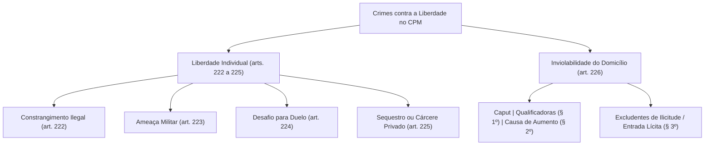

A liberdade individual constitui prerrogativa fundamental protegida com rigor pela ordem constitucional republicana. No Código Penal Militar, o Capítulo VI do Título IV disciplina os crimes contra a liberdade individual, punindo condutas que constrangem a vontade do indivíduo, cerceiam o direito de ir e vir ou violam a intimidade do asilo domiciliar. A observância desses preceitos revela-se crucial na rotina operacional militar, Isso delimita as prerrogativas de polícia e os abusos de poder.

> [!objetivos]
> - Compreender o alcance das imunidades e do pedido de explicações no fecho dos crimes contra a honra.
> - Analisar a estrutura do constrangimento ilegal militar, suas causas de duplicação de pena e excludentes típicas.
> - Identificar os elementos da ameaça militar e do desafio para duelo entre militares.
> - Dominar a graduação penal do sequestro e cárcere privado após as alterações da Lei nº 14.688/2023.
> - Examinar o crime de violação de domicílio no CPM, o conceito normativo de casa e as hipóteses de entrada lícita.

## Fecho da exclusão de ofensa e interpelação judicial

Antes do ingresso temático nos delitos contra a liberdade, convém pontuar o encerramento do regime dos crimes contra a honra disciplinado nos arts. 220 e 221 do CPM:

1. **Causas de atipicidade relativa (art. 220):** não configuram crime a manifestação proferida em juízo pelas partes e procuradores na discussão da causa (inciso I), a crítica artística ou científica (inciso II), a avaliação técnica de instituições armadas (inciso III) e o conceito desfavorável emitido por dever de ofício em sindicâncias ou relatórios funcionais (inciso IV). A salvaguarda legal cede quando demonstrada a inequívoca intenção de ofender. No caso das manifestações em juízo e dos pareceres de ofício, responde criminalmente aquele que confere publicidade indevida ao seu teor (parágrafo único).
2. **Pedido de explicações em juízo (art. 221):** quando a imputação for proferida de modo ambíguo, dissimulado ou reticente, a pessoa atingida pode manejar interpelação judicial prévia para que o emissor esclareça o sentido exato de sua manifestação. Caso o interpelado recuse explicações ou forneça justificativas reputadas insatisfatórias pelo magistrado, responderá formalmente pela ofensa irrogada.

## Constrangimento ilegal no Código Penal Militar (art. 222)

O constrangimento ilegal protege a liberdade de autodeterminação da pessoa contra imposições arbitrárias e violentas.

> [!lei] Art. 222, caput e § 1º, do Código Penal Militar (Lei nº 14.688/2023)
> Art. 222. Constranger alguém, mediante violência ou grave ameaça, ou depois de lhe haver reduzido, por qualquer outro meio, a capacidade de resistência, a não fazer o que a lei permite, ou a fazer ou a tolerar que se faça, o que ela não manda:
> Pena – detenção, de 3 (três) meses a 1 (um) ano.
> § 1º A pena aplica-se em dôbro, quando, para a execução do crime, se reúnem mais de três pessoas, ou há emprêgo de arma, ou quando o constrangimento é exercido com abuso de autoridade, para obter de alguém confissão de autoria de crime ou declaração como testemunha.

A conduta atinge a autonomia da vontade por três modos alternativos: violência física, grave ameaça moral ou redução da capacidade de resistência. O crime exige que a vítima ceda à imposição. Ela deve tolerar conduta não imposta em lei, ou deixar de praticar ato legalmente permitido.

### Causas de duplicação da pena e concurso (§§ 1º e 2º)

A reprimenda é aplicada em dobro nas seguintes hipóteses:
- **Concurso de mais de três agentes:** reunião de ao menos quatro executores no local do crime;
- **Emprego de arma:** porte ostensivo ou utilização efetiva de arma branca ou arma de fogo;
- **Abuso de autoridade funcional coercitiva:** constrangimento praticado por autoridade visando a arrancar confissão criminal de suspeito ou declaração de testemunha (ressalvada a incidência da Lei de Tortura caso haja sofrimento físico ou mental desmedido).

O § 2º determina expressamente o cúmulo material obrigatório entre a pena privativa de liberdade do constrangimento e a sanção autônoma correspondente à violência física praticada (como a lesão corporal do art. 209).

### Causas legais de exclusão do crime (§ 3º)

O ordenamento exclui a tipicidade em duas situações emergenciais:
1. **Intervenção médica de emergência (inciso I):** atuação cirúrgica sem prévia anuência do paciente ou familiares quando indispensável para debelar perigo concreto de morte ou lesão corporal severa. O próprio dispositivo ressalva expressamente que o transplante de órgãos jamais prescinde de consentimento informado.
2. **Coação para evitar suicídio (inciso II):** força física empregada para imobilizar indivíduo prestes a consumar ato de autoextermínio.

> [!exemplo]
> Durante patrulhamento em ponte urbana, uma guarnição militar avista um cidadão prestes a saltar em tentativa de autoextermínio. O oficial comandante imobiliza à força o indivíduo contra a vontade manifesta deste, contendo-o até a chegada de equipes de resgate médico. A conduta é estritamente atípica em virtude do art. 222, § 3º, II, do CPM. Por outro lado, se esse mesmo oficial trancafiar um militar subordinado em sala reservada sob ameaça de arma para que ele confesse autoria de furto interno, cometerá constrangimento ilegal qualificado com pena em dobro (art. 222, § 1º).

## Ameaça militar (art. 223)

Ameaçar traduz a promessa deliberada de infligir mal injusto e grave a outrem.

> [!lei] Art. 223 do Código Penal Militar
> Ameaçar alguém, por palavra, escrito ou gesto, ou qualquer outro meio simbólico, de lhe causar mal injusto e grave:
> Pena - detenção, até seis meses, se o fato não constitui crime mais grave.
> Parágrafo único. Se a ameaça é motivada por fato referente a serviço de natureza militar, a pena é aumentada de um terço.

Requisitos dogmáticos da ameaça:
- **Meios idôneos de comunicação:** admite expressão verbal direta, bilhete escrito, gestos intimidatórios, meios telemáticos ou símbolos característicos.
- **Natureza do mal prometido:** deve ser futuro, injusto (contrário ao direito) e grave (suscetível de infundir fundado receio na vítima comum). Anunciar a instauração regular de processo administrativo ou aplicação de corretivo disciplinar cabível constitui exercício regular de direito, descaracterizando a infração.
- **Consumação e subsidiariedade:** cuida-se de crime formal, aperfeiçoando-se com a cientificação da vítima idônea a intimidar. O tipo traz cláusula de subsidiariedade expressa, cedendo espaço se a intimidação constituir elemento integrante de delito mais reprovável (como roubo, extorsão ou coação no curso do processo).
- **Majorante funcional (parágrafo único):** se a intimidação decorrer de fato relativo ao serviço militar, a pena básica de até seis meses é elevada em um terço.

> [!bizu]
> Memorize: a ameaça militar é crime subsidiário de ação penal pública. Sempre que a promessa de mal for meio para extorquir vantagem indevida ou constranger a testemunha a calar a verdade em processo militar, o delito fim prevalecerá, absorvendo o crime menor de ameaça.

## Desafio para duelo (art. 224)

O art. 224 reprime costume militar histórico incompatível com a disciplina moderna:

> [!lei] Art. 224 do Código Penal Militar
> Desafiar outro militar para duelo ou aceitar-lhe o desafio, embora o duelo não se realize:
> Pena - detenção, até três meses, se o fato não constitui crime mais grave.

O delito é próprio, exigindo que tanto o desafiante quanto o desafiado ostentem a condição de militar da ativa ou da reserva. Consuma-se no exato instante em que o desafio é formalizado ou prontamente aceito pelo interlocutor. É irrelevante que o combate armado venha ou não a ocorrer. Caso o duelo venha a concretizar-se e dele resultem ofensas corporais ou morte, os envolvidos responderão pelos crimes de lesão corporal ou homicídio doloso consumado ou tentado. O desafio inicial resta absorvido.

## Sequestro ou cárcere privado (art. 225)

O art. 225 pune a privação ilícita da liberdade de locomoção física do ser humano. A distinção clássica aponta que o sequestro envolve a retenção da vítima com confinamento móvel ou indeterminado (como no cativeiro dissimulado ou transporte em veículo), ao passo que o cárcere privado traduz o confinamento compulsório em recinto fechado sem saída desimpedida.

> [!lei] Art. 225, caput e § 1º, do Código Penal Militar (Lei nº 14.688/2023)
> Art. 225. Privar alguém de sua liberdade, mediante seqüestro ou cárcere privado:
> Pena - reclusão, até três anos.
> § 1º A pena é de reclusão, de 2 (dois) a 5 (cinco) anos:
> I – se a vítima é ascendente, descendente, cônjuge, companheira do agente, maior de 60 (sessenta) anos, menor de 18 (dezoito) anos ou pessoa com deficiência;
> II - se o crime é praticado mediante internação da vítima em casa de saúde ou hospital;
> III - se a privação de liberdade dura mais de quinze dias.
> IV – se o crime é praticado com fins libidinosos.

A Lei nº 14.688/2023 reestruturou o § 1º, estabelecendo limites punitivos autônomos de reclusão de dois a cinco anos e incluindo a proteção de companheiros, pessoas com deficiência, idosos, internações fraudulentas, duração superior a quinze dias e a finalidade libidinosa.

Os §§ 2º e 3º consagram qualificadoras preterdolosas pelo resultado derivado de maus-tratos ou das condições desumanas do cativeiro:
- Sofrimento físico ou moral grave (§ 2º): reclusão de dois a oito anos;
- Morte culposa decorrente das condições do encarceramento (§ 3º): reclusão de doze a trinta anos.

| Modalidade Típica | Dispositivo no Art. 225 | Sanção Privativa de Liberdade |
|---|---|---|
| **Sequestro Simples** | Art. 225, caput | Reclusão, até 3 anos (mínimo de 1 ano pelo art. 58) |
| **Formas Agravadas** | Art. 225, § 1º (Lei nº 14.688/2023) | Reclusão, 2 a 5 anos |
| **Sofrimento Severo** | Art. 225, § 2º | Reclusão, 2 a 8 anos |
| **Resultado Morte** | Art. 225, § 3º | Reclusão, 12 a 30 anos |

> [!pegadinha]
> Não confunda constrangimento ilegal com sequestro: no constrangimento ilegal (art. 222), a liberdade de autodeterminação é violada para forçar a vítima a fazer ou tolerar algo; no sequestro (art. 225), atinge-se frontalmente a própria liberdade física de locomoção, retendo-se a pessoa contra sua vontade em determinado espaço.

## Violação de domicílio no Código Penal Militar (art. 226)

O art. 226 resguarda a garantia fundamental da inviolabilidade domiciliar:

> [!lei] Art. 226 do Código Penal Militar (com redação da Lei nº 14.688/2023)
> Entrar ou permanecer, clandestina ou astuciosamente, ou contra a vontade expressa ou tácita de quem de direito, em casa alheia ou em suas dependências:
> Pena - detenção, até três meses.
> § 1º Se o crime é cometido durante o repouso noturno, ou com emprego de violência ou de arma, ou mediante arrombamento, ou por duas ou mais pessoas:
> Pena - detenção, de seis meses a dois anos, além da pena correspondente à violência.
> § 2º A pena é aumentada de 1/3 (um terço) se o fato é cometido por militar em serviço ou por servidor público, fora dos casos legais, ou com inobservância das formalidades prescritas em lei ou com abuso de poder.

### Conceito jurídico de casa (§§ 4º e 5º)

A tutela do CPM estende a abrangência do vocábulo "casa" para:
- Compartimento habitado ocupado por indivíduo ou família;
- Aposento particular ocupado em habitação coletiva (quarto de hotel ocupado por hóspede ou alojamento de oficiais);
- Espaço privado não aberto ao público em geral destinado a profissão ou ofício comercial.

Em contrapartida, excluem-se do conceito tutelado os estabelecimentos de hospedagem coletiva enquanto franqueados ao público, tabernas, bares, boates e salas de jogos abertas.

### Causas legais de entrada lícita (§ 3º)

O § 3º estabelece que a entrada ou permanência em casa alheia não caracteriza crime nas seguintes circunstâncias:
1. **Durante o dia:** com observância das formalidades da lei, para cumprir mandado judicial de prisão ou diligência determinada por autoridade militar;
2. **A qualquer hora do dia ou da noite:** para prestar socorro a vítimas de desastres ou quando estiver sendo praticada infração penal no recinto (flagrante delito) ou na sua iminência inequívoca.

| Circunstância de Ingresso | Horário Permitido | Requisitos Normativos Indispensáveis |
|---|---|---|
| **Cumprimento de Mandado / Prisão** | Apenas durante o dia | Formalidades legais e ordem fundamentada da autoridade |
| **Socorro em caso de Desastre** | Dia ou noite | Perigo concreto iminente à vida ou saúde dos moradores |
| **Flagrante Delito** | Dia ou noite | Infração penal em curso ou na iminência imediata de consumação |

## Mapa do capítulo

A tabela consolida a disciplina dogmática dos crimes contra a liberdade no CPM:

| Tipo Penal Militar | Fundamento Legal | Sanção Básica Cominada | Elemento Central do Delito |
|---|---|---|---|
| **Constrangimento Ilegal** | Art. 222, caput | Detenção, 3 meses a 1 ano | Coação física ou moral para impor conduta não obrigatória em lei |
| **Constrangimento Majorado**| Art. 222, § 1º | Pena em dobro | Mais de 3 agentes, arma ou abuso funcional para confissão |
| **Ameaça Militar** | Art. 223, caput | Detenção, até 6 meses | Promessa de mal injusto e grave; majorada em 1/3 por serviço |
| **Desafio para Duelo** | Art. 224, caput | Detenção, até 3 meses | Desafio ou aceitação de duelo armado entre militares |
| **Sequestro e Cárcere** | Art. 225, caput | Reclusão, até 3 anos | Privação forçada da liberdade física de locomoção |
| **Sequestro Agravado** | Art. 225, § 1º | Reclusão, 2 a 5 anos | Vítima vulnerável, hospital, tempo superior a 15 dias ou fim sexual |
| **Sequestro Letal** | Art. 225, § 3º | Reclusão, 12 a 30 anos | Morte preterdolosa resultante dos maus-tratos no confinamento |
| **Violação de Domicílio** | Art. 226, caput | Detenção, até 3 meses | Ingresso ou permanência clandestina em casa alheia |
| **Violação Qualificada** | Art. 226, § 1º | Detenção, 6 meses a 2 anos | Repouso noturno, arma, concurso de 2 ou mais pessoas ou arrombamento |
| **Majorante da Inviolabilidade**| Art. 226, § 2º | Aumento de 1/3 da pena | Cometida por militar em serviço ou servidor com abuso de poder |

### Para fixar

- O constrangimento ilegal (art. 222) comina detenção de 3 meses a 1 ano, duplicando-se a sanção se houver arma, mais de 3 agentes ou abuso coercitivo para arrancar confissão.
- Não é constrangimento ilegal a intervenção médica urgente sem consentimento (salvo transplante) e a coação voltada a impedir suicídio.
- A ameaça (art. 223) é crime formal e subsidiário, majorado em um terço se o motivo vincular-se ao serviço militar.
- O duelo (art. 224) consuma-se com o simples desafio ou aceitação entre militares; lesões ou morte absorvem o tipo formal.
- O sequestro ou cárcere privado (art. 225) comina reclusão de 2 a 5 anos nas formas agravadas do § 1º e até 30 anos se sobrevier morte culposa (§ 3º).
- A violação de domicílio (art. 226) qualifica-se no repouso noturno, por arrombamento ou concurso de agentes, e eleva-se em um terço se praticada por militar com abuso de poder.
- O ingresso em casa alheia sem autorização é lícito a qualquer hora para socorro ou em flagrante delito; mandados de prisão exigem período diurno.
