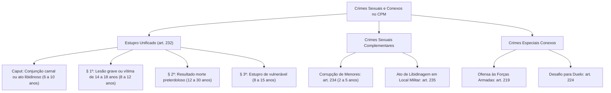

A dignidade sexual e a disciplina funcional constituem pilares de expressiva relevância no ordenamento repressivo militar. Com o advento da Lei nº 14.688/2023, o Código Penal Militar passou por modernização profunda em seu Capítulo VII do Título IV, alinhando a tipificação dos crimes sexuais às diretrizes constitucionais de igualdade e proteção integral de vulneráveis. O estudo deste módulo abrange igualmente delitos que tutelam o prestígio coletivo das instituições militares e a proibição histórica de confrontos armados privados.

> [!objetivos]
> - Compreender a unificação típica do estupro no art. 232 do CPM e a revogação do atentado violento ao pudor.
> - Dominar as qualificadoras do estupro militar, os desfechos preterdolosos e a proteção do vulnerável.
> - Diferenciar a corrupção de menores do CPM do delito correlato do ECA e analisar o ato de libidinagem do art. 235.
> - Analisar a hediondez militar dos crimes sexuais, a ofensa às Forças Armadas e o delito de duelo militar.

## Evolução e reforma dos crimes contra a dignidade sexual no CPM

Historicamente, o Código Penal Militar de 1969 mantinha tratamento defasado dos delitos sexuais. A redação original do art. 232 restringia o polo passivo do estupro à mulher forçada à conjunção carnal, remetendo os demais atos libidinosos violentos à figura autônoma do atentado violento ao pudor (art. 233).

A Lei nº 14.688/2023 promoveu revolução estrutural nesse microssistema:
1. **Unificação típica no art. 232:** reuniu no tipo de estupro a conjunção carnal e qualquer ato libidinoso diverso praticado mediante violência ou grave ameaça;
2. **Revogação formal do art. 233:** extinguiu o atentado violento ao pudor como rubrica autônoma pelo fenômeno da continuidade normativo-típica;
3. **Neutralidade de gênero:** qualquer pessoa humana pode figurar como sujeito ativo ou polo passivo da agressão sexual, sendo tanto o homem quanto a mulher potenciais autores ou vítimas vitimizadas;
4. **Inserção de qualificadoras robustas:** incorporou penas severas para resultados lesivos graves, letalidade preterdolosa e vitimização de menores ou vulneráveis.

## O crime de estupro no Código Penal Militar (art. 232)

O art. 232 tipifica a agressão máxima contra a liberdade e a dignidade sexual:

> [!lei] Art. 232 do Código Penal Militar (com redação da Lei nº 14.688/2023)
> Constranger alguém, mediante violência ou grave ameaça, a ter conjunção carnal ou a praticar ou permitir que com ele se pratique outro ato libidinoso:
> Pena – reclusão, de 6 (seis) a 10 (dez) anos.
> § 1º Se da conduta resulta lesão de natureza grave, ou se a vítima é menor de 18 (dezoito) e maior de 14 (quatorze) anos: Pena – reclusão, de 8 (oito) a 12 (doze) anos.
> § 2º Se da conduta resulta morte: Pena – reclusão, de 12 (doze) a 30 (trinta) anos.
> § 3º Se a vítima é menor de 14 (quatorze) anos ou, por enfermidade ou deficiência mental, não tem o necessário discernimento para a prática do ato ou, por qualquer outra causa, não pode oferecer resistência: Pena – reclusão, de 8 (oito) a 15 (quinze) anos.

### Elementos objetivos e atos libidinosos

O verbo central é "constranger", exigindo o emprego de violência real física (*vis corporalis*) ou grave ameaça idônea (*vis compulsiva*). A conjunção carnal restringe-se estritamente à penetração pênis-vagina. O ato libidinoso abrange toda conduta de satisfação da lascívia diversa da conjunção carnal, como coito anal, felação forçada ou toques voluptuosos íntimos.

A jurisprudência do Superior Tribunal de Justiça (STJ) firmou que toques lascivos involuntários de conotação sexual explícita e o beijo voluptuoso forçado configuram o estupro consumado, e não mera contravenção ou importunação.

### Qualificadoras e resultado morte (§§ 1º e 2º)

O § 1º impõe reclusão de oito a doze anos quando:
- Sobrevém lesão corporal grave (incapacidade superior a 30 dias, debilidade permanente, perigo de vida ou aceleração de parto);
- A vítima possui entre 14 e 18 anos incompletos.

O § 2º comina reclusão de 12 a 30 anos para o estupro qualificado pela morte. Trata-se de figura puramente preterdolosa: a morte decorre de culpa por negligência na violência física empregada. Se o agente agride a vítima e decide executá-la dolosamente para ocultar o crime sexual, há concurso material entre estupro e homicídio qualificado (art. 205, § 2º, V). Se mata antes para realizar o ato sexual com o corpo inanimado, responde por homicídio e vilipêndio a cadáver.

### Estupro de vulnerável (§ 3º)

O § 3º consagrou formalmente a figura do estupro de vulnerável no CPM com pena de reclusão de 8 a 15 anos, correspondendo em substância ao art. 217-A do CP comum. São consideradas vulneráveis:
1. Pessoas menores de 14 anos;
2. Pessoas que, por enfermidade ou deficiência mental, carecem de discernimento sexual;
3. Pessoas que, por qualquer motivo (embriaguez involuntária, coma, anestesia ou sonolência induzida), não podem oferecer resistência física.

O art. 236 do CPM mantém menção à presunção de violência, mas a doutrina e a jurisprudência assentam que a matéria encontra tratamento autônomo e definitivo no art. 232, § 3º.

| Figura do Art. 232 | Circunstância Tipificadora | Limites da Pena Privativa de Liberdade |
|---|---|---|
| **Estupro Simples (Caput)** | Violência ou grave ameaça para conjunção carnal ou ato libidinoso | Reclusão, 6 a 10 anos |
| **Grave / Idade (§ 1º)** | Lesão grave decorrente do fato ou vítima entre 14 e 18 anos | Reclusão, 8 a 12 anos |
| **Preterdoloso Letal (§ 2º)** | Morte involuntária decorrente da violência empregada | Reclusão, 12 a 30 anos |
| **Vulnerável (§ 3º)** | Vítima menor de 14 anos, sem discernimento ou impossibilitada | Reclusão, 8 a 15 anos |

> [!bizu]
> Regra do STJ sobre continuidade delitiva (Tema 1202): nos crimes contra a dignidade sexual praticados reiteradamente contra a mesma vítima vulnerável nas mesmas condições, a fração de aumento da continuidade varia de um sexto (duas infrações) até o patamar máximo de dois terços, atingido a partir da sétima conduta comprovada, conforme jurisprudência pacífica da Corte.

## Corrupção de menores e ato de libidinagem (arts. 234 e 235)

Além do estupro, o estatuto militar prevê condutas especiais destinadas a resguardar a moralidade sexual e a disciplina funcional.

### Corrupção de menores militar (art. 234)

> [!lei] Art. 234 do Código Penal Militar (com redação da Lei nº 14.688/2023)
> Induzir alguém menor de 14 (quatorze) anos a satisfazer a lascívia de outrem:
> Pena – reclusão, de 2 (dois) a 5 (cinco) anos.

O tipo pune quem persuade menor de quatorze anos a satisfazer os desejos sexuais de terceira pessoa. O sujeito ativo atua como intermediário ou facilitador do ato libidinoso alheio.

> [!pegadinha]
> Não confunda a corrupção de menores do art. 234 do CPM com o crime de corrupção de menores previsto no art. 244-B do ECA. No ECA, o crime pune quem induz ou facilita a prática de infração penal pelo jovem; no art. 234 do CPM, a conduta consiste especificamente em instigar menor de 14 anos a satisfazer a lascívia sexual de outrem.

### Ato de libidinagem em ambiente militar (art. 235)

> [!lei] Art. 235 do Código Penal Militar (com redação da Lei nº 14.688/2023)
> Praticar, ou permitir o militar que com ele se pratique, ato libidinoso em lugar sujeito à administração militar ou no exercício de função militar:
> Pena - detenção, de seis meses a um ano.

O art. 235 tutela primariamente a disciplina interna, a ordem e o recato moral das instalações militares. Historicamente denominado "pederastia ou outro ato de libidinagem", o tipo foi alvo da ADPF 291 pelo STF, que declarou a não recepção da expressão discriminatória. A Lei nº 14.688/2023 consolidou a rubrica neutra "Ato de libidinagem".

O delito independe de violência, tratando de ato sexual plenamente consentido. A ilicitude decorre exclusivamente do local (recinto militar ou viatura operacional) ou do momento funcional (durante escala de serviço militar ativo).

### Majorante geral dos crimes sexuais (art. 237)

O art. 237 prescreve a agravação da sanção se o delito sexual militar for cometido em concurso de duas ou mais pessoas, ou se praticado por oficial ou militar em escala de serviço. Na ausência de fração específica, aplica-se a majoração de um quinto a um terço balizada pelo art. 73 do CPM.

## Hediondez militar e concurso de crimes

A Lei nº 14.688/2023 inseriu o inciso VI no parágrafo único do art. 1º da Lei nº 8.072/1990 (Lei dos Crimes Hediondos). A norma estabelece que são considerados hediondos os crimes previstos no Código Penal Militar que apresentem perfeita identidade com as modalidades hediondas comuns.

Por esse critério da identidade normativa, ostentam caráter hediondo militar:
- O estupro do art. 232 em todas as suas modalidades simples e qualificadas;
- O estupro de vulnerável tipificado no art. 232, § 3º, do CPM.

Na hipótese em que o autor estupra vítima menor de 18 anos e simultaneamente filma a cena em dispositivo telefônico, a jurisprudência pacificou a incidência de concurso material entre o estupro (art. 232) e o crime de registro de pornografia infantojuvenil (art. 240 do ECA), repelindo a consunção ou absorção por se tratar de desígnios autônomos. A jurisprudência da Corte Superior mantém firme convicção de que qualquer alegação defensiva de crime único deve ser afastada perante a grande gravidade e a autonomia das condutas.

## Crimes conexos: ofensa às Forças Armadas e duelo

Examinam-se neste ponto duas condutas incriminadoras de inserção singular no Código Penal Militar:

### Ofensa às Forças Armadas (art. 219)

O art. 219 comina detenção de seis meses a um ano para quem propala fatos conscientemente inverídicos capazes de lesar o crédito e o apreço da Marinha, Exército e Aeronáutica perante a população civil. A pena sofre acréscimo de um terço se o delito for cometido por meio de imprensa, televisão ou redes digitais de ampla repercussão. O bem jurídico tutelado é o prestígio público da corporação militar nacional.

### Desafio para duelo (art. 224)

O art. 224 pune com detenção de até três meses o ato de desafiar militar para duelo armado ou aceitar a contenda. O tipo tem caráter estritamente formal e subsidiário: consuma-se com o desafio, mas é inteiramente absorvido pelos crimes de dano (lesão ou homicídio) caso os militares venham a combater-se no mundo dos fatos.

| Delito Militar | Base Legal no CPM | Pena Cominada | Natureza do Bem Jurídico Tutelado |
|---|---|---|---|
| **Estupro** | Art. 232, caput | Reclusão, 6 a 10 anos | Liberdade sexual e incolumidade individual |
| **Estupro com Morte** | Art. 232, § 2º | Reclusão, 12 a 30 anos | Resultado letal decorrente de culpa (preterdolo) |
| **Estupro de Vulnerável** | Art. 232, § 3º | Reclusão, 8 a 15 anos | Vulnerabilidade etária ou física absoluta |
| **Corrupção de Menores** | Art. 234 | Reclusão, 2 a 5 anos | Formação moral sexual de menor de 14 anos |
| **Ato de Libidinagem** | Art. 235 | Detenção, 6 meses a 1 ano | Disciplina militar em recinto ou serviço militar |
| **Ofensa às Instituições**| Art. 219 | Detenção, 6 meses a 1 ano | Crédito e respeitabilidade das Forças Armadas |
| **Desafio para Duelo** | Art. 224 | Detenção, até 3 meses | Disciplina militar perante combates privados |

## Mapa do capítulo

A tabela consolida as diretrizes fundamentais dos delitos examinados no capítulo:

| Delito Militar | Fundamento Legal | Sanção Básica Cominada | Nota Distintiva / Jurisprudência |
|---|---|---|---|
| **Estupro Geral** | Art. 232, caput | Reclusão, 6 a 10 anos | Conjunção carnal ou ato libidinoso; neutralidade de gênero |
| **Estupro Grave / Idade**| Art. 232, § 1º | Reclusão, 8 a 12 anos | Lesão grave decorrente ou vítima entre 14 e 18 anos |
| **Estupro com Morte** | Art. 232, § 2º | Reclusão, 12 a 30 anos | Homicídio preterdoloso; dolo na morte atrai concurso material |
| **Estupro Vulnerável** | Art. 232, § 3º | Reclusão, 8 a 15 anos | Vítima menor de 14 anos ou incapaz de resistir; crime hediondo |
| **Corrupção de Menores** | Art. 234 | Reclusão, 2 a 5 anos | Induzir menor de 14 anos a satisfazer lascívia de outrem |
| **Ato de Libidinagem** | Art. 235 | Detenção, 6 meses a 1 ano | Conduta consentida em local militar ou em serviço; tutela a ordem |
| **Majorante Especial** | Art. 237 | Aumento de 1/5 a 1/3 | Concurso de pessoas, praticado por oficial ou militar de serviço |
| **Ofensa às Forças Armadas**| Art. 219 | Detenção, 6 meses a 1 ano | Boato mentiroso lesivo à confiança pública; majorado por mídia |
| **Desafio para Duelo** | Art. 224 | Detenção, até 3 meses | Desafio ou aceitação de duelo armado entre pares militares |

### Para fixar

- O estupro (art. 232) unificou a conjunção carnal e atos libidinosos em tipo neutro, revogando o atentado violento ao pudor (art. 233).
- O estupro qualificado por morte (art. 232, § 2º) comina reclusão de 12 a 30 anos e é preterdoloso; morte intencional gera concurso com homicídio.
- O estupro de vulnerável (art. 232, § 3º) protege menores de 14 anos ou pessoas sem resistência, punido com reclusão de 8 a 15 anos.
- Filmar estupro de menor configura concurso material entre estupro e o crime do art. 240 do ECA.
- A corrupção de menores (art. 234) pune quem induz menor de 14 anos a satisfazer lascívia alheia, diferindo do crime do art. 244-B do ECA.
- O ato de libidinagem (art. 235) é consensual e pune a ofensa à disciplina militar em quartel ou serviço ativo.
- O estupro militar é crime hediondo por identidade legal com a Lei nº 8.072/1990.
- A ofensa às Forças Armadas (art. 219) pune notícias sabidamente falsas divulgadas para abalar o prestígio público da corporação.
- O duelo militar (art. 224) consuma-se com o simples desafio ou aceitação formal, sendo subsidiário aos crimes resultantes.
