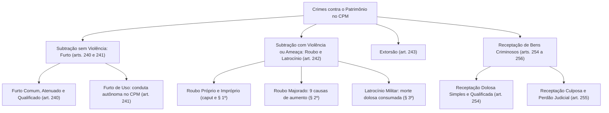
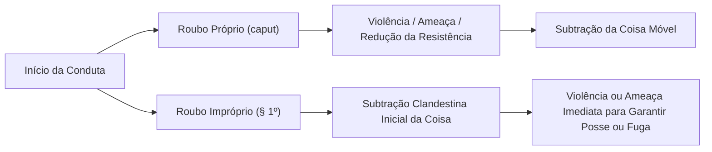
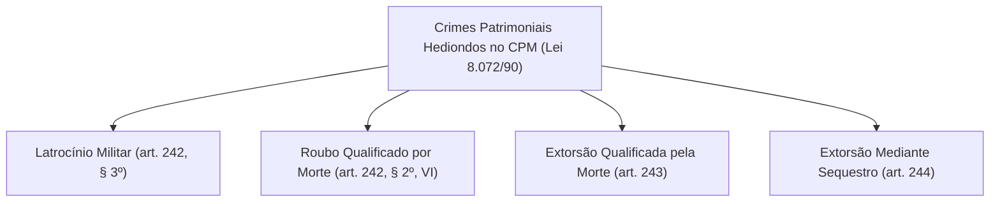

A preservação do patrimônio material assume relevância estratégica no Direito Penal Militar. A integridade dos bens pertencentes às Forças Armadas, às corporações militares estaduais e aos cidadãos sob custódia estatal garante a eficácia das operações de segurança e a regularidade do serviço público. O Código Penal Militar dedica o Título V de sua Parte Especial à disciplina dos crimes contra o patrimônio, cominando sanções severas para a subtração, a apropriação indevida, a extorsão e o acobertamento ilícito de bens e armamentos institucionais.

> [!objetivos]
> - Diferenciar a estrutura do furto comum da figura autônoma do furto de uso no CPM.
> - Dominar as qualificadoras do furto militar, com destaque para a subtração noturna e de material bélico.
> - Compreender o roubo próprio e impróprio, suas causas de aumento de pena e as alterações da Lei nº 14.688/2023.
> - Analisar o crime de latrocínio no CPM, a regra do concurso material do art. 79 e a jurisprudência sumulada.
> - Examinar a receptação dolosa e culposa, suas figuras qualificadas e as normas de hediondez patrimonial militar.

## Princípios e especificidades dos crimes contra o patrimônio no CPM

A tutela patrimonial militar abrange bens de propriedade particular e bens pertencentes à Fazenda Pública. A disciplina desses delitos aproxima-se das linhas mestras do Código Penal comum, mas apresenta peculiaridades dogmáticas expressivas:

1. **Momento consumativo:** a jurisprudência militar e dos tribunais superiores consagra a *teoria da amotio* (ou *apreensio*). O delito de furto ou roubo consuma-se no exato instante em que o infrator inverte a posse da coisa alheia móvel, retirando-a da esfera de disponibilidade da vítima, sendo irrelevante que tenha havido posse mansa ou pacífica ou que o agente seja imediatamente perseguido e capturado por guarnições militares.
2. **Condição do sujeito ativo e competência jurisdicional:** militares da ativa, da reserva e reformados respondem perante a Justiça Militar da União ou Estadual conforme o caso. Todavia, a competência para julgar civis varia: na esfera federal, o civil que atenta contra o patrimônio sob administração das Forças Armadas comete crime militar (CPM, art. 9º, III, "a") e é julgado pela Justiça Militar da União. Já na esfera estadual, a Constituição Federal veda expressamente o julgamento de civis pela Justiça Militar Estadual (art. 125, § 4º); logo, o civil que subtrai bem de quartel da Polícia Militar ou Corpo de Bombeiros Militar comete furto comum (CP, art. 155) e é processado perante a Justiça Comum Estadual (Súmula 53 do STJ).

## Furto comum e furto de uso no CPM (arts. 240 e 241)

O furto traduz a apropriação clandestina de patrimônio alheio móvel sem emprego de coação física ou grave ameaça contra a pessoa.

> [!lei] Art. 240, caput, §§ 1º a 3º, do Código Penal Militar
> Subtrair, para si ou para outrem, coisa alheia móvel:
> Pena - reclusão, até seis anos.
> § 1º Se o agente é primário e é de pequeno valor a coisa furtada, o juiz pode substituir a pena de reclusão pela de detenção, diminuí-la de um a dois terços, ou considerar a infração como disciplinar. Entende-se pequeno o valor que não exceda a um décimo da quantia mensal do mais alto salário mínimo do país.
> § 2º A atenuação do parágrafo anterior é igualmente aplicável no caso em que o criminoso, sendo primário, restitui a coisa ao seu dono ou repara o dano causado, antes de instaurada a ação penal.
> § 3º Equipara-se à coisa móvel a energia elétrica ou qualquer outra que tenha valor econômico.

### Furto simples e equiparação da energia

A conduta descrita no caput comina pena de reclusão de até seis anos (mínimo de um ano por força do art. 58 do CPM). O objeto material é a coisa móvel corpórea passível de apreensão e transporte. O § 3º equipara expressamente à coisa móvel a energia elétrica ou qualquer outra fonte de utilidade econômica (como energia térmica, solar ou genética). O Supremo Tribunal Federal (STF), no julgamento do HC 97.261, firmou entendimento de que a captação clandestina de sinal de televisão por assinatura não configura furto de energia, tendo em vista a impossibilidade de analogia prejudicial ao réu.

### Furto atenuado ou privilegiado (§§ 1º e 2º)

O ordenamento contempla benesses penais para o réu que preencha dois requisitos objetivos e subjetivos:
1. **Primariedade criminal:** ausência de condenação penal definitiva anterior;
2. **Pequeno valor do bem:** o texto legal define com precisão matemática que pequeno valor é aquele que não excede a **um décimo do maior salário mínimo** mensal vigente no país.

Presentes esses requisitos, o julgador pode:
- Substituir a pena de reclusão pela de detenção;
- Diminuir a pena privativa de liberdade de um a dois terços;
- Desclassificar a conduta para infração puramente disciplinar.

O § 2º assegura idênticas atenuações ao criminoso primário que voluntariamente devolve a coisa subtraída ao proprietário ou repara o prejuízo material integral antes da instauração formal da ação penal militar.

### Furto de uso (art. 241)

Uma das maiores distinções dogmáticas do CPM em relação ao Direito Penal comum é a tipificação do furto de uso como crime autônomo:

> [!lei] Art. 241 do Código Penal Militar (com redação da Lei nº 14.688/2023)
> Se a coisa é subtraída para o fim de uso momentâneo e, a seguir, vem a ser imediatamente restituída ou reposta no lugar onde se achava:
> Pena - detenção, até seis meses.
> Parágrafo único. A pena é aumentada de metade se a coisa usada é veículo motorizado, embarcação, aeronave ou arma, e de 1/3 (um terço) se é animal de sela ou de tiro.

Enquanto no Código Penal comum o furto de uso é conduta atípica, o legislador penal militar tutela com rigor a pronta disponibilidade dos meios materiais das Forças Armadas. Para a configuração do art. 241, exigem-se requisitos rígidos cumulativos:
- **Intenção subjetiva inicial exclusiva de uso temporário:** ausência de intenção definitiva de apossamento (*animus rem sibi habendi*);
- **Utilização efêmera e momentânea:** uso breve sem afastar a destinação funcional do bem;
- **Restituição imediata e integral no local original:** o bem deve ser devolvido sem avarias na mesma vaga ou repartição onde se encontrava guardado. Se o agente abandona o bem em via pública distante ou o danifica, responde por furto comum doloso consumado.

O parágrafo único, atualizado pela Lei nº 14.688/2023, exaspera a pena em metade se a coisa utilizada for veículo automotor, embarcação, aeronave militar ou armamento bélico, e em um terço se envolver animais de sela ou tração.

| Modalidade | Base Normativa no CPM | Pena Cominada | Requisitos Dogmáticos Centrais |
|---|---|---|---|
| **Furto Simples** | Art. 240, caput | Reclusão, até 6 anos | Intenção definitiva de apossamento; inversão da posse móvel |
| **Furto Atenuado** | Art. 240, §§ 1º e 2º | Detenção, redução ou disciplinar | Réu primário e bem até 1/10 do salário mínimo ou reparação prévia |
| **Furto de Uso** | Art. 241, caput | Detenção, até 6 meses | Uso momentâneo passageiro com devolução imediata no mesmo local |
| **Majorante de Uso** | Art. 241, parágrafo único | Aumento de 1/2 ou 1/3 | Objeto é viatura, embarcação, aeronave, arma ou animal de sela |

> [!exemplo]
> Um soldado em serviço de guarda no batalhão pega a chave da viatura oficial sem autorização para comprar um lanche em lanchonete a duas quadras do quartel. Ele retorna vinte minutos depois, estacionando o veículo intacto na vaga designada. No Código Penal comum o fato seria penalmente atípico. No Código Penal Militar, o soldado comete crime autônomo de furto de uso (art. 241), incidindo no aumento obrigatório de metade por se tratar de veículo motorizado militar.

## Qualificadoras do furto militar (art. 240, §§ 4º a 7º)

O art. 240 comina patamares punitivos agravados conforme as circunstâncias objetivas ou subjetivas da subtração:

### Furto noturno (art. 240, § 4º)

O § 4º prevê pena de reclusão de dois a oito anos se o crime for praticado durante a noite. O CPM adota o critério físico-astronômico objetivo: considera-se noite o período compreendido entre o pôr do sol e a alvorada (crepúsculo vespertino ao crepúsculo matutino). Não se exige que o furto ocorra em local habitado ou que os moradores estejam repousando, afastando a fórmula do Código Penal comum que restringe o aumento ao período do repouso noturno social.

### Furto contra a Fazenda Pública (art. 240, § 5º)

Com redação dada pela Lei nº 14.688/2023, o § 5º comina reclusão de dois a seis anos se a coisa subtraída pertencer à Fazenda Pública. A expressão abrange a Fazenda federal, estadual, distrital ou municipal, protegendo os recursos públicos administrados pelas corporações militares.

### Qualificadoras comuns (art. 240, § 6º)

O § 6º pune com reclusão de três a dez anos o furto cometido mediante:
- **Destruição ou rompimento de obstáculo à subtração da coisa (inciso I):** exige que a violência contra o obstáculo ocorra antes ou durante a subtração para possibilitar o alcance do bem;
- **Abuso de confiança ou mediante fraude, escalada ou destreza (inciso II):** o abuso de confiança exige vínculo especial de credibilidade previamente existente entre o autor e a vítima;
- **Emprego de chave falsa (inciso III):** instrumentos aptos a burlar o mecanismo da fechadura;
- **Concurso de duas ou mais pessoas (inciso IV):** reunião de agentes no plano executório.

### Subtração de armamento ou material de uso restrito (art. 240, § 6º-A)

Inserido pela Lei nº 14.688/2023, o § 6º-A comina pena de três a dez anos de reclusão quando o objeto material da subtração envolver armamento bélico, munições, artefatos explosivos ou equipamentos de destinação privativa das instituições armadas ou ostentando brasão oficial. Trata-se de qualificadora especialíssima que visa a coibir a transferência de armamentos e munições das Forças Armadas para organizações criminosas.

### Comunicação de privilégios (art. 240, § 7º)

O § 7º disciplina a possibilidade do furto híbrido (qualificado-privilegiado):
- Nas figuras qualificadas do furto noturno (§ 4º) e furto contra a Fazenda Pública (§ 5º), admitem-se plenamente as atenuações de pequeno valor (§ 1º) e de reparação prévia do dano (§ 2º);
- Nas qualificadoras mais severas dos §§ 6º e 6º-A, admite-se exclusivamente a atenuação pela restituição ou reparação do dano antes da ação penal (§ 2º), vedando-se a benesse por pequeno valor.

| Dispositivo Legal | Modalidade Qualificadora | Pena Privativa de Liberdade |
|---|---|---|
| **Art. 240, § 4º** | Furto praticado durante a noite (critério astronômico) | Reclusão, 2 a 8 anos |
| **Art. 240, § 5º** | Coisa pertencente à Fazenda Pública | Reclusão, 2 a 6 anos |
| **Art. 240, § 6º** | Rompimento de obstáculo, abuso de confiança, fraude ou concurso | Reclusão, 3 a 10 anos |
| **Art. 240, § 6º-A** | Arma, munição, explosivo ou material de uso restrito militar | Reclusão, 3 a 10 anos |

> [!bizu]
> Atenção às divergências conceituais: para o CPM (art. 240, § 4º), a qualificadora do furto noturno exige unicamente que o fato tenha ocorrido entre o pôr e o nascer do sol, independentemente de haver moradores repousando no recinto. Já no Código Penal comum (art. 155, § 1º), a causa de aumento reclama repouso noturno efetivo, com oscilação dos costumes de descanso da localidade.

## Roubo próprio e roubo impróprio (art. 242, caput e § 1º)

O roubo configura crime complexo que atinge concomitantemente o patrimônio econômico e a integridade física ou a liberdade individual do sujeito passivo.

> [!lei] Art. 242, caput e § 1º, do Código Penal Militar
> Subtrair coisa alheia móvel, para si ou para outrem, mediante emprego ou ameaça de emprego de violência contra pessoa, ou depois de havê-la, por qualquer modo, reduzido à impossibilidade de resistência:
> Pena - reclusão, de quatro a quinze anos.
> § 1º Na mesma pena incorre quem, em seguida à subtração da coisa, emprega ou ameaça empregar violência contra pessoa, a fim de assegurar a impunidade do crime ou a detenção da coisa para si ou para outrem.

A distinção cronológica e executória reparte o tipo em duas categorias:
1. **Roubo próprio (caput):** a violência física (*vis absoluta*), a grave ameaça moral (*vis compulsiva*) ou o meio redutor da resistência (narcóticos, cordas ou violência imprópria) são empregados antes ou durante a apreensão da coisa para viabilizar a subtração. A pena cominada de reclusão de quatro a quinze anos reflete o elevado rigor do código militar.
2. **Roubo impróprio (§ 1º):** o agente inicia a conduta subtraindo a coisa sem violência contra a pessoa. Todavia, logo em seguida à subtração, ao perceber que foi avistado ou perseguido, passa a empregar violência física real ou ameaça para garantir a fuga impune ou assegurar o proveito material do furto. O roubo impróprio não admite violência imprópria (apenas violência real física ou ameaça verbal e ostensiva).

## Causas especiais de aumento de pena no roubo (art. 242, § 2º)

O § 2º prevê causas especiais de exasperação que elevam a reprimenda em fração de um terço até a metade. O rol traz nove incisos taxativos:

1. **Emprego de arma (inciso I):** exige o uso real ostensivo ou disparos com arma de fogo ou instrumento pérfuro-cortante; o mero porte oculto sem exibição intimidadora não caracteriza a majorante;
2. **Concurso de duas ou mais pessoas (inciso II):** atuação conjunta de executores na ação;
3. **Transporte de valores (inciso III):** a vítima encontra-se em custódia de transporte de valores e o infrator tem ciência inequívoca dessa condição especial;
4. **Vítima em serviço de natureza militar (inciso IV):** agressão contra militar em escala operacional ativa;
5. **Lesão grave causada dolosamente (inciso V):** o autor produz intencionalmente sequela anatômica severa na vítima;
6. **Morte culposa decorrente de violência (inciso VI):** resultado letal puramente preterdoloso decorrente das agressões físicas;
7. **Transporte interestadual ou internacional de veículo (inciso VII, Lei nº 14.688/2023):** subtração de automotor transpondo divisas estaduais ou fronteiras soberanas;
8. **Restrição da liberdade da vítima (inciso VIII, Lei nº 14.688/2023):** retenção temporária do ofendido sob poder do assaltante estritamente pelo tempo indispensável para consumar o desfalque patrimonial;
9. **Armamento militar ou material de uso restrito (inciso IX, Lei nº 14.688/2023):** subtração violenta de armamentos ou equipamentos bélicos oficiais marcados.

| Inciso do § 2º | Circunstância de Majoração no Roubo | Fração de Aumento Legal |
|---|---|---|
| **Inciso I** | Violência ou ameaça exercida com emprego de arma | De 1/3 até metade |
| **Inciso II** | Prática mediante concurso de 2 ou mais pessoas | De 1/3 até metade |
| **Inciso III** | Vítima em transporte de valores (com ciência do autor) | De 1/3 até metade |
| **Inciso IV** | Vítima em serviço de natureza militar | De 1/3 até metade |
| **Inciso V** | Produção dolosa de lesão corporal grave | De 1/3 até metade |
| **Inciso VI** | Morte da vítima causada a título de culpa (preterdolo) | De 1/3 até metade |
| **Inciso VII** | Veículo automotor levado a outro Estado ou país | De 1/3 até metade |
| **Inciso VIII** | Vítima mantida sob domínio com liberdade restringida | De 1/3 até metade |
| **Inciso IX** | Subtração de arma, munição ou material bélico restrito | De 1/3 até metade |

> [!pegadinha]
> Distinção dogmática fundamental: no CPM, a morte da vítima no contexto do roubo possui dois enquadramentos radicalmente distintos. Se o óbito foi causado culposamente pelo assaltante (preterdolo), aplica-se a majorante de um terço até metade do art. 242, § 2º, VI. Contudo, se o autor matou a vítima voluntariamente com dolo para consumar o assalto ou garantir a impunidade, o delito é de latrocínio do art. 242, § 3º, punido com reclusão de 15 a 30 anos.

## Latrocínio no Direito Penal Militar (art. 242, § 3º)

O latrocínio configura o roubo qualificado pelo evento morte dolosa:

> [!lei] Art. 242, § 3º, do Código Penal Militar
> Se, para praticar o roubo, ou assegurar a impunidade do crime, ou a detenção da coisa, o agente ocasiona dolosamente a morte de alguém, a pena será de reclusão, de quinze a trinta anos, sendo irrelevante se a lesão patrimonial deixa de consumar-se. Se há mais de uma vítima dessa violência à pessoa, aplica-se o disposto no art. 79.

A configuração do latrocínio militar exige demonstração de que a morte dolosa possui vínculo de causalidade teleológico ou consequencial direto com a subtração patrimonial. A pena cominada é de reclusão de 15 a 30 anos.

O dispositivo contém duas determinações normativas de extrema relevância:
1. **Consumação pelo resultado morte:** o crime aperfeiçoa-se integralmente no momento da ocorrência da morte dolosa, sendo absolutamente irrelevante que a subtração patrimonial reste frustrada por circunstâncias alheias à vontade do agente.
2. **Pluralidade de mortes e concurso material:** havendo duas ou mais vítimas fatais da violência corporal, o próprio § 3º determina a aplicação do art. 79 do CPM (que, na vigência da Lei nº 14.688/2023, disciplina a cumulação formal das penas privativas de liberdade no concurso material), afastando a tese de crime único.

> [!jurisprudencia] STF, Súmula 610: Latrocínio Consumado e Jurisprudência dos Tribunais Superiores
> O entendimento pacificado na jurisprudência penal militar e comum orienta as seguintes diretrizes nos certames:
> 1. **Momento da consumação (Súmula 610 do STF):** "Há crime de latrocínio, quando o homicídio se consuma, ainda que não realize o agente a subtração de bens da vítima." A morte é o resultado mais gravoso do tipo complexo.
> 2. **Erro na execução (*aberratio ictus*):** se o assaltante, ao disparar contra a vítima da subtração, atinge por erro de pontaria seu comparsa ou terceira pessoa, incide no art. 38 do CPM (equivalente ao art. 73 do CP comum), respondendo por latrocínio consumado como se tivesse atingido a pessoa visada.
> 3. **Tentativa de latrocínio:** a tentativa admite-se quando o agente atua com dolo letal para subtrair os bens, mas a vítima sobrevive aos disparos por socorro médico eficaz e os bens não são subtraídos (ou mesmo se subtraídos).
> 4. **Multiplicidade de mortes e concurso de infrações:** no regime do CPM, a menção expressa ao art. 79 no § 3º afasta a teoria da unidade delitiva adotada em certos precedentes da lei penal comum, impondo o cúmulo das sanções quando a violência letal vitimar múltiplas pessoas.

| Situação Fática | Natureza do Crime no CPM | Pena Aplicável |
|---|---|---|
| **Subtração + Morte Culposa** | Roubo majorado (art. 242, § 2º, VI) | Reclusão, 4 a 15 anos aumentada de 1/3 até metade |
| **Subtração Consumada + Morte Dolosa** | Latrocínio Consumado (art. 242, § 3º) | Reclusão, 15 a 30 anos |
| **Subtração Frustrada + Morte Dolosa** | Latrocínio Consumado (Súmula 610 do STF) | Reclusão, 15 a 30 anos |
| **Subtração Consumada + Morte Tentada** | Tentativa de Latrocínio | Reclusão de 15 a 30 anos com redução da tentativa |

## Extorsão militar (art. 243)

O art. 243 do Código Penal Militar tipifica o delito de extorsão nos seguintes termos: constranger alguém, mediante o emprego de violência real física ou grave ameaça moral, com o intuito deliberado de obter para si ou para terceiro indevida vantagem econômica, a fazer, tolerar que se faça ou abster-se de fazer algo juridicamente não imposto. A pena cominada no preceito fundamental é de reclusão de quatro a dez anos.

A extorsão militar ostenta natureza de crime formal e de consumação antecipada. Em consonância com a Súmula 96 do Superior Tribunal de Justiça, o delito perfaz-se de forma completa no momento exato em que a vítima suporta a coação psicológica ou física idônea, sendo desnecessária para a consumação a efetiva obtenção do proveito patrimonial ilícito visado pelo agente (que representa mero exaurimento da conduta).

O § 1º do art. 243 determina a incidência das causas especiais de aumento previstas para o roubo (art. 242, § 2º). Dessa maneira, a resposta penal sofre majoração compulsória de um terço até a metade quando o delito é perpetrado com emprego de armas brancas ou de fogo, mediante concurso de duas ou mais pessoas, contra vítima em escala de serviço militar, ou com restrição da liberdade pessoal da vítima para compelir a entrega de recursos financeiros.

## Receptação no Código Penal Militar (arts. 254 a 256)

A receptação reprime o aproveitamento ou circulação de coisas obtidas mediante infrações penais prévias, resguardando a incolumidade do patrimônio público e particular.

> [!lei] Art. 254 do Código Penal Militar (com redação da Lei nº 14.688/2023)
> Adquirir, receber ou ocultar em proveito próprio ou alheio, coisa proveniente de crime, ou influir para que terceiro, de boa-fé, a adquira, receba ou oculte:
> Pena - reclusão, até cinco anos.
> § 1º São aplicáveis os §§ 1º e 2º do art. 240.
> § 2º Se a coisa é arma, munição, explosivo ou outro material militar de uso restrito ou que contenha sinal indicativo de pertencer a instituição militar:
> Pena – reclusão de 3 (três) a 10 (dez) anos.

### Modalidades de receptação dolosa (art. 254)

A conduta divide-se em:
- **Receptação dolosa própria:** adquirir, receber ou ocultar bem com ciência inequívoca de sua origem criminosa;
- **Receptação dolosa imprópria:** atuar como intermediário desleal, influenciando terceiro inocente de boa-fé a negociar ou guardar coisa proveniente de crime.

O § 1º permite a aplicação das figuras atenuadas de pequeno valor e reparação voluntária prévia do dano (art. 240, §§ 1º e 2º).

O § 2º, incluído pela Lei nº 14.688/2023, consagrou figura qualificada autônoma: se a coisa for armamento, munição, explosivo ou material bélico restrito militar, a pena salta para reclusão de três a dez anos.

### Receptação culposa e perdão judicial (art. 255)

O art. 255 pune a aquisição ou recebimento de bem em que o agente atua com inobservância do dever de cuidado: a natureza da coisa, a manifesta desproporção entre o valor de mercado e o preço vil ajustado, ou a condição duvidosa de quem a oferece apontavam indícios veementes de origem delituosa. A pena é de detenção de até um ano.

O parágrafo único faculta o perdão judicial: se o infrator for primário e o valor do bem não ultrapassar um décimo do salário mínimo, o magistrado pode deixar de aplicar a sanção penal.

### Autonomia da receptação (art. 256)

O art. 256 estatui que a receptação é punível ainda que o autor do delito patrimonial originário seja inteiramente desconhecido, foragido ou pessoalmente isento de pena (como no caso de menoridade do autor do furto primário). Exige-se apenas a comprovação da existência material do crime antecedente (*crime acessório*).

> [!atencao]
> Princípio da consunção na receptação: o autor ou partícipe do furto antecedente que guarda a coisa furtada não responde por furto em concurso com receptação. O apossamento posterior constitui mero exaurimento impunível do crime patrimonial principal (*post factum impunível*). A receptação exige que o agente seja terceira pessoa estranha à execução do delito originário.

> [!esquema]
> - Receptação dolosa básica (art. 254): ciência da origem espúria -> Reclusão de até 5 anos.
> - Receptação qualificada bélica (art. 254, § 2º): armas ou munições militares -> Reclusão de 3 a 10 anos.
> - Receptação culposa (art. 255): desproporção ou suspeita negligente -> Detenção de até 1 ano.
> - Perdão judicial culposo (art. 255, parágrafo único): primário e até 1/10 do salário mínimo.
> - Regra da acessoriedade (art. 256): subsiste mesmo sem condenação do autor do crime anterior.

## Hediondez militar nos crimes contra o patrimônio

A Lei nº 14.688/2023 pacificou controvérsia histórica a respeito da aplicabilidade da Lei nº 8.072/1990 (Lei dos Crimes Hediondos) no âmbito da Justiça Militar. A reforma inseriu o inciso VI no parágrafo único do art. 1º daquele diploma, estabelecendo que ostentam natureza de crime hediondo militar todas as figuras delituosas previstas no Código Penal Militar que apresentem correspondência material e identidade descritiva com os delitos hediondos da legislação comum.

Sob esse postulado da identidade normativa estrita, revestem-se de hediondez patrimonial militar:
1. **Latrocínio militar (art. 242, § 3º):** roubo com resultado morte dolosa, independentemente de haver a consumação do desfalque patrimonial;
2. **Roubo qualificado pelo resultado morte culposa (art. 242, § 2º, VI):** figura preterdolosa com evento letal;
3. **Extorsão qualificada pela morte (art. 243 c/c art. 242, § 3º):** coação econômica com desfecho letal consumado;
4. **Extorsão mediante sequestro no ambiente militar (art. 244 do CPM):** privação da liberdade com exigência de resgate financeiro.

A categorização hedionda acarreta reflexos gravosos na execução penal militar, tais como vedação de anistia, graça e indulto, além de exigir prazos mais rigorosos e cumprimento de frações diferenciadas para a concessão de livramento condicional e progressão de regime prisional.

## Mapa do capítulo

A tabela consolida as figuras penais patrimoniais no Código Penal Militar:

| Delito Militar | Fundamento Legal | Sanção Básica Cominada | Nota Distintiva / Inovações da Lei 14.688/2023 |
|---|---|---|---|
| **Furto Simples** | Art. 240, caput | Reclusão, até 6 anos | Inversão da posse sem violência; mínimo de 1 ano pelo art. 58 |
| **Furto de Uso** | Art. 241, caput | Detenção, até 6 meses | Uso momentâneo com devolução imediata; majorado por viatura |
| **Furto Noturno** | Art. 240, § 4º | Reclusão, 2 a 8 anos | Critério astronômico objetivo entre pôr e nascer do sol |
| **Furto Fazenda Pública**| Art. 240, § 5º | Reclusão, 2 a 6 anos | Protege bens do erário sob custódia das forças armadas |
| **Furto Qualificado Bélico**| Art. 240, § 6º-A | Reclusão, 3 a 10 anos | Subtração de armamento, munição ou material de uso restrito |
| **Roubo Simples** | Art. 242, caput | Reclusão, 4 a 15 anos | Violência própria, ameaça ou redução da resistência |
| **Roubo Impróprio** | Art. 242, § 1º | Reclusão, 4 a 15 anos | Violência posterior para assegurar impunidade ou posse |
| **Roubo Majorado** | Art. 242, § 2º | Aumento de 1/3 a 1/2 | Emprego de arma, concurso, veículo interestadual ou armas |
| **Latrocínio Militar** | Art. 242, § 3º | Reclusão, 15 a 30 anos | Morte dolosa consumada; concurso material do art. 79 |
| **Extorsão** | Art. 243, caput | Reclusão, 4 a 10 anos | Constrangimento para vantagem econômica; crime formal |
| **Receptação Dolosa** | Art. 254, caput | Reclusão, até 5 anos | Aquisição ou ocultação com ciência de origem delitiva |
| **Receptação Bélica** | Art. 254, § 2º | Reclusão, 3 a 10 anos | Material restrito militar ou marcado; figura qualificada |
| **Receptação Culposa** | Art. 255, caput | Detenção, até 1 ano | Desproporção do preço ou condição duvidosa de venda |

### Para fixar

- O furto comum comina reclusão de até seis anos; o furto atenuado beneficia o réu primário de pequeno valor (até 1/10 do salário mínimo) ou reparação prévia.
- O furto de uso (art. 241) é crime no CPM punido com detenção de até 6 meses, com aumento de metade para viaturas, embarcações, aeronaves ou armas.
- O furto noturno qualifica a infração (reclusão de 2 a 8 anos) pelo critério astronômico, sendo irrelevante haver repouso noturno.
- A subtração de armamento ou material restrito militar é qualificadora autônoma do furto (art. 240, § 6º-A) e da receptação (art. 254, § 2º).
- O roubo próprio antecede a subtração com violência; o roubo impróprio comete violência posterior para assegurar a impunidade ou a posse da coisa.
- O latrocínio militar (art. 242, § 3º) exige dolo letal e comina reclusão de 15 a 30 anos, consumando-se com a morte ainda que a subtração patrimonial reste frustrada.
- Havendo multiplicidade de mortes no latrocínio, aplica-se o art. 79 do CPM (concurso material de penas).
- A receptação culposa (art. 255) admite perdão judicial para réu primário e valor diminuto, subsistindo a punibilidade ainda que o autor do crime principal seja desconhecido.
- Latrocínio e roubo qualificado por morte são crimes hediondos por identidade com a Lei nº 8.072/1990.
