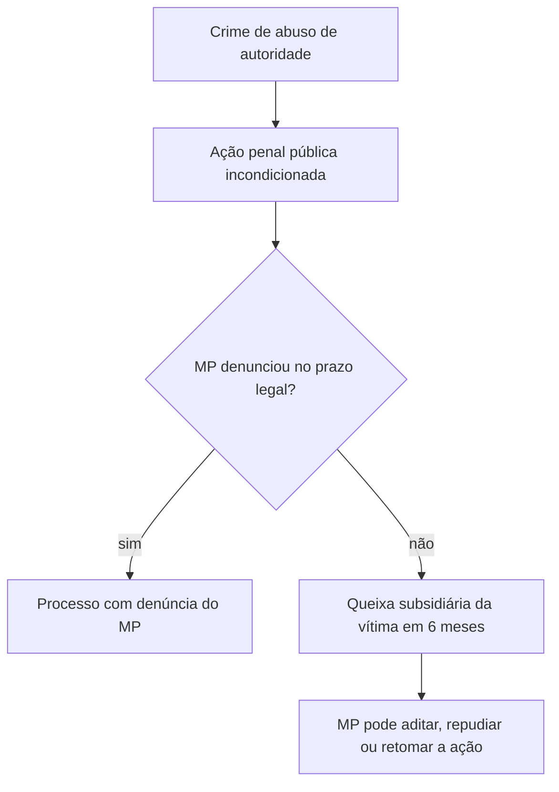

A Lei 13.869/2019 define os crimes de abuso de autoridade e substituiu a antiga Lei 4.898/1965. O assunto tem duas camadas. A primeira é o que a lei diz sobre quem pode ser punido, quando há crime e o que acontece depois da condenação. A segunda é o que ela significa para o militar que exerce poder de polícia, de prisão ou de fiscalização. Este capítulo trata da parte geral da lei (arts. 1º a 8º). Os crimes em espécie ficam para o capítulo seguinte.

> [!objetivos]
> - Explicar quando uma conduta descrita na lei é crime de abuso de autoridade.
> - Identificar quem pode praticar o crime e quem é a vítima.
> - Descrever a ação penal, inclusive a ação privada subsidiária.
> - Listar os efeitos da condenação e as penas restritivas de direitos.
> - Aplicar a relação entre a sentença penal e as esferas civil e administrativa.

## Âmbito da lei e o elemento subjetivo

A lei define os crimes de abuso de autoridade praticados por **agente público**, servidor ou não, que, no exercício das funções ou a pretexto de exercê-las, abusa do poder que lhe foi dado (art. 1º). A expressão "a pretexto de exercê-las" amplia o alcance: o agente que usa o cargo como desculpa para uma conduta ilegal também responde.

Os crimes previstos na lei só existem quando há **dolo específico**. A conduta descrita deve ser praticada com a finalidade de:

- prejudicar outra pessoa;
- beneficiar a si mesmo ou a terceiro; ou
- agir por mero capricho ou satisfação pessoal.

Não existe abuso de autoridade na forma culposa. O agente que erra por descuido ou ignorância não comete o crime.

> [!lei] Lei 13.869/2019, art. 1º, § 2º
> A divergência na interpretação de lei ou na avaliação de fatos e provas não configura abuso de autoridade.

Esse parágrafo protege quem decide com base em uma leitura possível da lei. Se dois juízes ou dois delegados interpretam a lei de modos diferentes, a divergência não é crime, a menos que o agente aja com a finalidade específica do § 1º. A jurisprudência já entendia assim antes da lei, mas o texto expresso reforça a regra.

> [!exemplo] Dolo específico na prática
> O oficial de dia manda um soldado ficar sem comunicação com a família por 24 horas depois de uma briga no alojamento. Ele acredita que a medida mantém a ordem. Se agiu por entendimento errado do regulamento, mas sem querer prejudicar o soldado nem se favorecer, falta o dolo específico, e não há crime de abuso de autoridade (poderá haver questão disciplinar). Se agiu para humilhar o soldado, por antipatia, e não por dever de ofício, o dolo está presente.

> [!pegadinha] Abuso culposo
> A banca afirma que o agente responde por abuso de autoridade "ainda que tenha agido sem intenção". A afirmação está errada: a lei exige a finalidade específica prevista no art. 1º, § 1º.

## Sujeito ativo e sujeito passivo

O **sujeito ativo** é todo aquele que exerce função pública, tenha ou não vínculo de servidor, em qualquer órgão da administração (direta, indireta ou fundações) dos Poderes da União, dos Estados, do Distrito Federal, dos Municípios e dos Territórios (art. 2º). O rol da lei é exemplificativo, pois diz que a enumeração não é exaustiva. Entram:

- servidores públicos e **militares**, ou pessoas equiparadas;
- membros do Poder Legislativo, do Executivo e do Judiciário;
- membros do Ministério Público;
- membros dos tribunais e conselhos de contas.

O parágrafo único amplia o conceito. Basta exercer cargo, emprego, função ou mandato nessas entidades, ainda que por pouco tempo e sem receber nada, e qualquer que seja a forma de ingresso: eleição, nomeação, designação ou contrato. O contratado temporário e o voluntário com função pública entram na regra.

O **sujeito passivo** é duplo. A vítima direta é a pessoa que sofre a conduta. O Estado também é sujeito passivo, porque a administração é lesada pelo desvio de poder.

| Elemento | Quem é |
| --- | --- |
| Sujeito ativo | agente público de qualquer Poder e ente, inclusive militares |
| Sujeito passivo principal | a pessoa lesada pela conduta |
| Sujeito passivo secundário | o Estado |

O militar estadual, como o bombeiro militar, é sujeito ativo da lei. Onde ele é julgado depende de o fato ser ou não crime militar. Desde a Lei 13.491/2017, o art. 9º, II, do Código Penal Militar considera crime militar também os crimes previstos na legislação penal comum, quando praticados nas situações desse inciso, como o do militar em serviço ou atuando em razão da função. Por isso, o abuso de autoridade cometido por militar estadual em serviço passou a ser crime militar por extensão, da competência da Justiça Militar estadual (CF, art. 125, § 4º).

> [!atencao] Súmula 172 do STJ: superada
> A Súmula 172 do STJ mandava o militar acusado de abuso de autoridade, mesmo em serviço, para a Justiça comum. Ela foi editada quando o crime só podia ser militar se estivesse no próprio Código Penal Militar. Depois da Lei 13.491/2017, a súmula é tida como superada: questão antiga que dá a Justiça comum como regra para o militar em serviço está desatualizada. Uma consequência prática: na Justiça Militar não se aplica a Lei 9.099/1995 (Lei 9.099/1995, art. 90-A), apesar da remissão genérica do art. 39 da Lei de Abuso de Autoridade.

## Ação penal

Em regra, o Ministério Público promove a ação penal por conta própria, sem depender de pedido da vítima. É a **ação penal pública incondicionada** (art. 3º).

Existe uma garantia para a vítima. Se o Ministério Público não oferecer denúncia no prazo legal, admite-se a **ação penal privada subsidiária da pública** (art. 3º, § 1º). Nesse caso:

- o Ministério Público pode aditar a queixa, repudiá-la e oferecer denúncia substitutiva;
- pode intervir em todos os termos do processo, fornecer provas e recorrer;
- pode retomar a ação como parte principal, a qualquer tempo, se o querelante for negligente.

O prazo para a queixa é de **seis meses**, contados do dia em que se esgota o prazo para o oferecimento da denúncia (art. 3º, § 2º).

> [!pegadinha] Ação privada não é a regra
> A alternativa errada diz que esses crimes dependem de queixa da vítima ou de representação. O correto é pública incondicionada, com a ação privada apenas como subsidiária, no caso de omissão do Ministério Público.

## Efeitos da condenação

Condenado, o agente sofre efeitos além da pena. A lei prevê três (art. 4º):

> [!lei] Lei 13.869/2019, art. 4º
> São efeitos da condenação: I - tornar certa a obrigação de indenizar o dano causado pelo crime, devendo o juiz, a requerimento do ofendido, fixar na sentença o valor mínimo para reparação dos danos causados pela infração, considerando os prejuízos por ele sofridos; II - a inabilitação para o exercício de cargo, mandato ou função pública, pelo período de 1 (um) a 5 (cinco) anos; III - a perda do cargo, do mandato ou da função pública.
> Parágrafo único. Os efeitos previstos nos incisos II e III do caput deste artigo são condicionados à ocorrência de reincidência em crime de abuso de autoridade e não são automáticos, devendo ser declarados motivadamente na sentença.

Em resumo, a condenação gera a obrigação de reparar o dano, com valor mínimo fixado pelo juiz a pedido da vítima. Gera também a proibição temporária de ocupar função pública, de um a cinco anos, e a perda do cargo. Essas duas últimas consequências exigem que o agente seja reincidente e dependem de fundamentação expressa do juiz. Na primeira condenação, portanto, só vale a reparação do dano.

## Penas restritivas de direitos

As penas de prisão previstas na lei podem ser trocadas por **penas restritivas de direitos** (art. 5º). São duas: trabalho em favor da comunidade ou de entidades públicas, e o afastamento do agente do cargo, da função ou do mandato durante um a seis meses, sem pagamento de vencimentos nem de vantagens. O juiz pode aplicá-las separadamente ou em conjunto. A suspensão do cargo, portanto, é pena, e não efeito da condenação.

A diferença importa para a prova. O efeito da condenação decorre da sentença e depende de declaração motivada. A pena restritiva substitui a prisão, e o juiz a escolhe na sentença. A banca costuma confundir os dois grupos ao propor que a inabilitação é pena restritiva ou que a suspensão do cargo é efeito da condenação.

> [!bizu] Efeito não é pena
> Efeito da condenação: indenizar, inabilitar, perder o cargo (depende de reincidência). Pena substitutiva: serviços à comunidade e suspensão do cargo de 1 a 6 meses. A banca troca "suspensão" por "inabilitação" e erra o prazo.

## Independência das instâncias

O agente que comete abuso de autoridade pode responder em três esferas: penal, civil e administrativa. A lei organiza essa relação assim:

- As penas da lei são aplicadas **independentemente** das sanções civis ou administrativas cabíveis (art. 6º).
- A notícia de crime que descrever falta funcional é informada à autoridade competente para apuração.
- As responsabilidades civil e administrativa são independentes da criminal. Há uma exceção: quando o juízo criminal decide a existência do fato ou a autoria, essas questões **não podem ser rediscutidas** nas outras esferas (art. 7º).
- Faz **coisa julgada** na esfera cível e na administrativo-disciplinar a sentença penal que reconhecer estado de necessidade, legítima defesa, estrito cumprimento de dever legal ou exercício regular de direito (art. 8º).

Na prática, se o juiz criminal reconhece que o policial agiu em legítima defesa, ele não será responsabilizado por aquele fato nem no processo disciplinar nem na ação de indenização. Mas se o juiz absolve por falta de provas, a sentença não impede que a Administração apure a falta funcional.

> [!atencao] Quando a decisão criminal vincula
> A decisão penal só vincula as outras esferas quando decide a existência do fato, a autoria ou uma das excludentes do art. 8º. Absolvição por insuficiência de provas não impede a apuração administrativa.

## Mapa do capítulo

A tabela organiza as regras gerais da lei e as pistas de prova.

| Tema | Regra | Artigo |
| --- | --- | --- |
| Elemento subjetivo | dolo específico: prejudicar, beneficiar-se ou agir por capricho | 1º, § 1º |
| Divergência de interpretação | não é abuso de autoridade | 1º, § 2º |
| Sujeito ativo | agente público, inclusive militar | 2º |
| Ação penal | pública incondicionada; privada subsidiária em 6 meses | 3º |
| Efeitos da condenação | indenização; inabilitação (1 a 5 anos) e perda do cargo, só se reincidente e motivados | 4º |
| Penas restritivas | serviços à comunidade; suspensão do cargo por 1 a 6 meses | 5º |
| Instâncias | independentes, salvo fato, autoria e excludentes decididos no crime | 6º a 8º |

### Para fixar
- O crime exige dolo específico: prejudicar, beneficiar-se ou agir por capricho ou satisfação pessoal.
- A divergência de interpretação da lei ou das provas não é abuso de autoridade.
- Qualquer agente público é sujeito ativo, inclusive o militar; o rol do art. 2º é exemplificativo.
- A ação penal é pública incondicionada; cabe a ação privada subsidiária se o MP não denunciar no prazo.
- O prazo da ação privada subsidiária é de seis meses, contado do fim do prazo da denúncia.
- Efeitos da condenação: indenizar, inabilitar por 1 a 5 anos e perder o cargo.
- A inabilitação e a perda do cargo exigem reincidência e declaração motivada na sentença.
- As penas restritivas são a prestação de serviços e a suspensão do cargo por 1 a 6 meses, com perda dos vencimentos.
- As instâncias civil e administrativa são independentes da criminal, salvo se esta decidir fato, autoria ou excludente.
- A sentença que reconhece legítima defesa, estado de necessidade, estrito cumprimento do dever legal ou exercício regular de direito faz coisa julgada no cível e no disciplinar.
