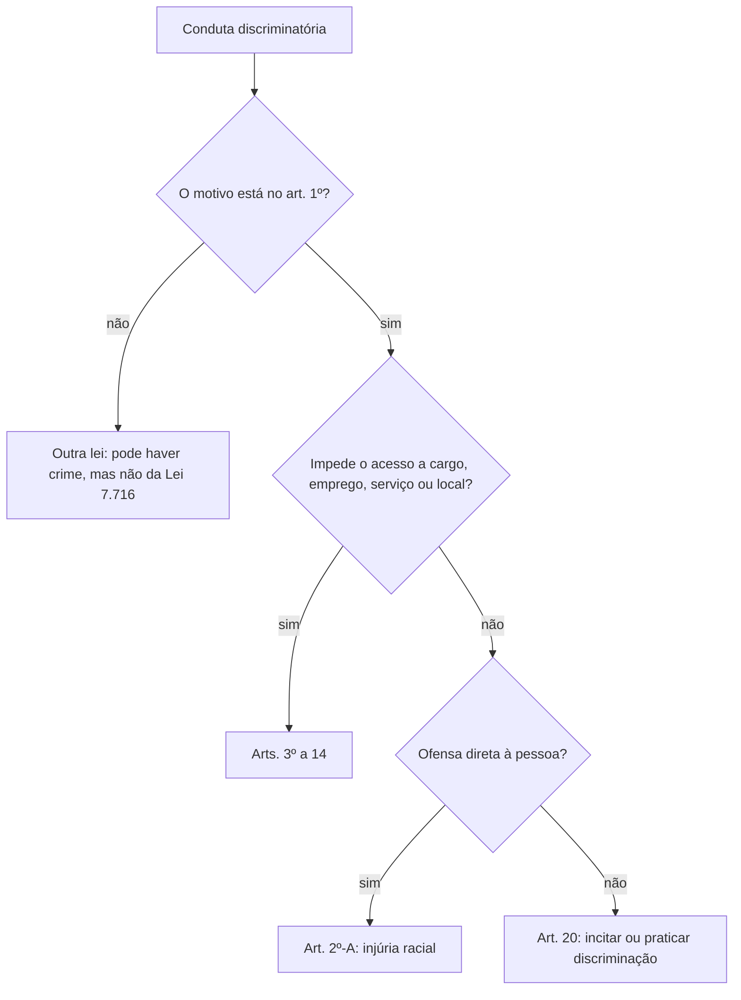

A Lei 7.716/1989 pune os crimes resultantes de discriminação ou preconceito. O texto original falava só em raça e cor, e as alterações posteriores acrescentaram etnia, religião e procedência nacional. A Lei 14.532/2023 reforçou a proteção, ao incluir a injúria racial na própria lei e criar aumentos de pena. O tema é cobrado de forma literal pela banca: o rol de motivos, as penas de cada crime, as causas de aumento e a ideia de que o racismo é crime inafiançável e imprescritível. Este capítulo organiza esses pontos e traz a jurisprudência do STF que a prova mais explora.

> [!objetivos]
> - Delimitar os motivos de discriminação protegidos pela lei.
> - Reconhecer os crimes de impedimento de acesso e as penas de cada um.
> - Distinguir a injúria racial, do art. 2º-A, do crime de incitação, do art. 20.
> - Aplicar os aumentos de pena e os efeitos da condenação.
> - Citar o entendimento do STF sobre racismo, imprescritibilidade e homotransfobia.

## Alcance da lei e conceitos

O art. 1º delimita o campo de aplicação: a lei só alcança o crime cujo motivo é discriminar, ou ter preconceito contra alguém, pela **raça, pela cor, pela etnia, pela religião ou pela procedência nacional**. O rol é taxativo. A discriminação por idade, sexo ou estado civil é punida por outras leis específicas, e não por esta.

Os conceitos que a prova explora:

- **Discriminação** é a separação, a segregação. Nem toda discriminação é ilegítima. As políticas de ação afirmativa, como as cotas para acesso a universidades, são formas de discriminação positiva, voltadas a corrigir desigualdades.
- **Preconceito** é a ideia ou o sentimento formado antes de conhecer a pessoa, favorável ou desfavorável. Só o preconceito ligado aos motivos do art. 1º é punido pela lei.
- **Raça**, para a lei, é uma construção social e política. Hoje a ciência afirma que não há subdivisões biológicas da espécie humana. Por isso o STF decidiu, no caso Ellwanger (HC 82.424), que o racismo é conceito social, e que a prática contra judeus é racismo.
- **Cor** se refere à tonalidade da pele.
- **Etnia** diz respeito à origem de uma comunidade e abrange características físicas e elementos culturais, como dialeto, religião e costumes.
- **Religião** é a crença comum, em geral manifestada em ritos.
- **Procedência nacional** é o país, ou mesmo a região, o estado ou a cidade de origem.

Normalmente chamamos os crimes da lei de "crimes de racismo". Racismo, no sentido estrito, é a crença na superioridade de uma raça, mas, na prova, a expressão designa os crimes da Lei 7.716/1989.

> [!jurisprudencia] STF, ADO 26 e MI 4.733
> O STF decidiu que a discriminação por orientação sexual e identidade de gênero (homofobia e transfobia) pode ser punida com base na Lei 7.716/1989, até que o Congresso edite lei específica. O tribunal ressalvou a liberdade religiosa: ministros religiosos podem pregar e externar suas convicções, desde que não incitem discriminação, hostilidade ou violência.

> [!pegadinha] Rol de motivos
> A banca amplia o art. 1º para incluir "idade", "deficiência" ou "classe social" como motivos diretos da lei. Esses motivos não constam do art. 1º. A homotransfobia entra apenas por decisão do STF, com a técnica da equiparação, e não por previsão do texto.

## Racismo e injúria racial: imprescritível e inafiançável

A Constituição manda tratar o racismo como crime **sem fiança, que nunca prescreve** e que é punido com reclusão (CF, art. 5º, XLII). É o que sustenta a ideia de que os crimes da Lei 7.716/1989 não prescrevem.

A injúria racial, hoje prevista no art. 2º-A da Lei 7.716/1989, é espécie do gênero racismo. O STF decidiu que o crime de injúria racial é imprescritível (HC 154.248), e o STJ já havia entendido do mesmo modo. A Lei 14.532/2023 retirou a injúria por raça, cor, etnia e procedência nacional do Código Penal e a levou para a lei de racismo, com pena maior. Os entendimentos anteriores continuam valendo para o tipo novo.

> [!lei] Lei 7.716/1989, art. 2º-A
> Injuriar alguém, ofendendo-lhe a dignidade ou o decoro, em razão de raça, cor, etnia ou procedência nacional. Pena: reclusão, de 2 (dois) a 5 (cinco) anos, e multa. Parágrafo único. A pena é aumentada de metade se o crime for cometido mediante concurso de 2 (duas) ou mais pessoas.

Dois pontos de comparação com o Código Penal:

- A **injúria qualificada** do Código Penal (parágrafo terceiro do artigo 140) passou a tratar apenas da injúria que usa elementos referentes a **religião**, ou à condição de **pessoa idosa ou com deficiência**. A pena é de reclusão, de 1 a 3 anos, e multa.
- A injúria por raça, cor, etnia ou procedência nacional está no art. 2º-A da Lei 7.716/1989 (reclusão de 2 a 5 anos, e multa).

> [!atencao] Qual injúria?
> A banca pergunta qual lei tipifica a injúria ligada à cor. A resposta atual é o art. 2º-A da Lei 7.716/1989, e não o Código Penal. A injúria religiosa, por sua vez, continua no parágrafo terceiro do artigo 140 do Código Penal.

## Crimes de impedimento de acesso e de discriminação

Os arts. 3º a 14 punem condutas de impedir, recusar ou obstar o acesso de alguém a um espaço, serviço ou direito, por motivo de discriminação. O núcleo comum é o verbo **impedir, recusar ou obstar**. A pena é de reclusão, e a diferença entre os tipos está no lugar e na pena.

| Art. | Onde ocorre a discriminação | Pena (reclusão) |
| --- | --- | --- |
| 3º | acesso a cargo da administração direta, indireta ou de concessionárias; promoção funcional | 2 a 5 anos |
| 4º | emprego em empresa privada | 2 a 5 anos |
| 5º | estabelecimento comercial (recusa de atendimento) | 1 a 3 anos |
| 6º | inscrição ou ingresso de aluno em estabelecimento de ensino | 3 a 5 anos |
| 7º | hotel, pensão e similares | 3 a 5 anos |
| 8º | restaurantes, bares e confeitarias | 1 a 3 anos |
| 9º | estabelecimentos esportivos, casas de diversão e clubes sociais abertos ao público | 1 a 3 anos |
| 10 | salões de cabeleireiro, barbearias, termas e casas de massagem | 1 a 3 anos |
| 11 | entradas sociais e elevadores de edifícios | 1 a 3 anos |
| 12 | transportes públicos | 1 a 3 anos |
| 13 | ingresso nas Forças Armadas | 2 a 4 anos |
| 14 | casamento e convivência familiar e social | 2 a 4 anos |

Os pontos de cada tipo que a prova mais cobra:

- **Art. 3º.** O sujeito ativo é o agente público com poder de decisão sobre o acesso ao cargo (um chefe, um membro da banca, um dirigente). O sujeito passivo é o Estado e, em segundo lugar, a pessoa ofendida. A pessoa deve estar "devidamente habilitada". O parágrafo único pune quem obsta a promoção funcional, por motivo de discriminação de raça, cor, etnia, religião ou procedência nacional.
- **Art. 4º.** O § 1º pune quem, por discriminação de raça ou cor, ou por práticas de preconceito de descendência ou origem nacional ou étnica, deixa de conceder equipamentos necessários ao empregado em igualdade de condições, impede ascensão funcional ou dá tratamento diferente, sobretudo no salário. O § 2º impõe multa e prestação de serviços à comunidade a quem, em anúncio de vaga, exige aparência própria de raça ou etnia quando as atividades não justificam a exigência.
- **Art. 6º.** O parágrafo único aumenta a pena em um terço quando a vítima é menor de dezoito anos.
- **Art. 13.** É o tipo que protege o acesso ao serviço militar, nas Forças Armadas, com pena de 2 a 4 anos.

> [!bizu] Faixas de pena dos arts. 3º a 14
> Pense em quatro faixas. Serviço público e emprego privado: 2 a 5 anos. Escola e hotel: 3 a 5 anos. Forças Armadas e convivência familiar: 2 a 4 anos. Estabelecimentos abertos ao público, transportes e entradas de prédio: 1 a 3 anos.

> [!pegadinha] Art. 13 e a polícia militar
> O art. 13 fala em "qualquer ramo das Forças Armadas". Quem pergunta sobre o acesso à Polícia Militar ou ao Corpo de Bombeiros estadual não está no art. 13, mas no art. 3º (cargo da administração direta). A banca troca os dois.

## Incitação à discriminação e crimes de divulgação

O art. 20 pune quem **pratica, induz ou incita** a discriminação ou o preconceito de raça, cor, etnia, religião ou procedência nacional. A pena é de reclusão de 1 a 3 anos e multa. Esse tipo é central porque cobre manifestações verbais, escritas e simbólicas, sem exigir acesso negado a um serviço.

As formas qualificadas e especiais:

| Dispositivo | Conduta | Pena |
| --- | --- | --- |
| Art. 20, § 1º | fabricar, comercializar, distribuir ou veicular símbolos, emblemas ou propaganda com a cruz suástica ou gamada, para divulgar o nazismo | reclusão, 2 a 5 anos, e multa |
| Art. 20, § 2º | crime do art. 20 cometido pelos meios de comunicação, redes sociais, internet ou publicação de qualquer natureza | reclusão, 2 a 5 anos, e multa |
| Art. 20, § 2º-A | crime do art. 20 cometido em atividades esportivas, religiosas, artísticas ou culturais abertas ao público | reclusão, 2 a 5 anos, e proibição de frequentar esses locais por 3 anos |
| Art. 20, § 2º-B | obstar, impedir ou empregar violência contra manifestações ou práticas religiosas | mesmas penas do caput, sem prejuízo da violência |

No § 3º, o juiz pode determinar, ouvido o Ministério Público ou a pedido deste, **antes mesmo do inquérito policial**, e sob pena de desobediência: o recolhimento ou a busca e apreensão do material; a cessação das transmissões de rádio, televisão ou eletrônicas, ou da publicação; e a interdição de mensagens ou páginas na internet. Constitui efeito da condenação a **destruição do material apreendido** (§ 4º).

Ainda no art. 20, a Constituição e a jurisprudência desenham um limite. A liberdade de expressão não cobre o discurso de ódio: o STF afirmou, no caso Ellwanger, que escrever, editar, divulgar e comerciar livros que pregam o antissemitismo constitui crime de racismo, sujeito às cláusulas de inafiançabilidade e imprescritibilidade.

> [!exemplo] Rede social e estádio
> Um torcedor publica em rede social ofensas dirigidas aos moradores de uma região do país, incitando o ódio contra eles pela procedência. O crime do art. 20 está presente, na forma do § 2º, porque foi praticado pela internet (reclusão de 2 a 5 anos). Se o mesmo torcedor grita as ofensas na arquibancada durante um jogo, o § 2º-A pode se aplicar, com proibição de frequentar estádios por 3 anos.

## Aumentos de pena e efeitos da condenação

A lei tem causas de aumento específicas para o contexto de prática do crime.

1. **Contexto de recreação (art. 20-A).** Todos os crimes da lei têm a pena aumentada de **um terço até a metade** quando acontecem em ambiente de brincadeira ou com a intenção de divertir, descontrair ou recrear, o chamado "racismo recreativo".
2. **Crime praticado por funcionário público, no art. 20-B.** Os crimes dos arts. 2º-A (injúria racial) e 20 têm a pena aumentada de **um terço até a metade** quando cometidos por funcionário público, no exercício das funções ou a pretexto de exercê-las. O conceito de funcionário público vem do artigo 327 do Código Penal.
3. **Concurso de pessoas (art. 2º-A, parágrafo único).** Aumento de **metade** quando a injúria racial é cometida por duas ou mais pessoas.
4. **Menor de 18 anos (art. 6º, parágrafo único).** Aumento de **um terço** quando a vítima de recusa de matrícula é menor.

Os efeitos da condenação estão no art. 16: a **perda do cargo ou da função**, no caso de servidor público, e a **suspensão do funcionamento do estabelecimento particular por até três meses**. Esses efeitos **não são automáticos** e precisam ser declarados na sentença, motivadamente, nos termos do art. 18.

O art. 20-C é uma regra de interpretação: o juiz deve considerar discriminatória qualquer atitude ou tratamento que cause constrangimento, humilhação, vergonha, medo ou exposição indevida a uma pessoa ou grupo minoritário, e que normalmente não se dispensaria a outros grupos, em razão de cor, etnia, religião ou procedência. O art. 20-D exige que a vítima de racismo, em todos os atos processuais, cíveis e criminais, seja acompanhada de advogado ou defensor público.

> [!pegadinha] Efeitos automáticos
> A banca afirma que a condenação por racismo "acarreta automaticamente" a perda do cargo ou o fechamento do estabelecimento. A lei diz o contrário: os efeitos precisam ser declarados motivadamente na sentença.

## Outras leis que tratam do racismo

Algumas normas fora da Lei 7.716/1989 também dão ao motivo racial uma consequência penal:

- **Redução à condição análoga à de escravo** (artigo 149 do Código Penal): a pena aumenta de metade quando o crime tem motivação de preconceito contra raça, cor, etnia, religião ou origem (§ 2º, II).
- **Tortura** (Lei 9.455/1997, art. 1º, I, c): constitui tortura constranger alguém, com violência ou grave ameaça, causando sofrimento físico ou mental em razão de discriminação racial ou religiosa. A pena é de reclusão de 2 a 8 anos.
- **Estatuto da Igualdade Racial** (Lei 12.288/2010): foi criado para garantir à população negra a efetivação da igualdade de oportunidades e a defesa de seus direitos. Reúne conceitos como discriminação racial ou étnico-racial, desigualdade racial e ações afirmativas, e considera população negra o conjunto de pessoas que se autodeclaram pretas e pardas, segundo o quesito cor ou raça do IBGE. O Estatuto não define crimes; serve de apoio para interpretar a Lei 7.716/1989.

Essas normas se completam. A Lei 7.716/1989 tipifica as condutas de discriminação. O Código Penal e a Lei de Tortura agravam crimes comuns quando o motivo é racial ou religioso. O Estatuto traz as definições e as políticas públicas de combate à desigualdade. Na prova, a pergunta costuma pedir a lei correta para cada situação, e por isso convém lembrar que apenas a Lei 7.716/1989 define crimes de discriminação por raça, cor, etnia, religião e procedência.

## Mapa do capítulo

O quadro resume o capítulo para revisão rápida.

| Tema | Regra | Pista de prova |
| --- | --- | --- |
| Motivos protegidos | raça, cor, etnia, religião e procedência nacional | rol taxativo; homotransfobia entra por decisão do STF |
| Natureza do crime | inafiançável e imprescritível (CF, art. 5º, XLII) | vale também para injúria racial |
| Injúria racial | art. 2º-A, reclusão de 2 a 5 anos | aumenta de metade em concurso de pessoas |
| Impedimento de acesso | arts. 3º a 14, reclusão | faixas de pena de 1 a 3, 2 a 4, 2 a 5 e 3 a 5 anos |
| Incitação | art. 20, reclusão de 1 a 3 anos; 2 a 5 nos §§ 1º, 2º e 2º-A | internet, esporte, nazismo |
| Aumentos | art. 20-A (recreação) e art. 20-B (funcionário público), de um terço até metade | funcionário público: arts. 2º-A e 20 |
| Efeitos | perda do cargo e suspensão do estabelecimento por até 3 meses | não automáticos |

### Para fixar
- A Lei 7.716/1989 protege contra discriminação de raça, cor, etnia, religião e procedência nacional.
- O racismo é crime inafiançável e imprescritível, e o STF aplica o mesmo à injúria racial (HC 154.248).
- Raça é uma construção social; o STF reconheceu o antissemitismo como racismo (HC 82.424).
- A injúria racial (art. 2º-A) tem pena de reclusão de 2 a 5 anos, aumentada de metade em concurso de pessoas.
- A injúria religiosa e a contra idoso ou pessoa com deficiência ficam no parágrafo terceiro do artigo 140 do Código Penal.
- Os arts. 3º a 14 punem impedir ou recusar acesso, com penas de reclusão de 1 a 5 anos conforme o tipo.
- O art. 13 trata do acesso às Forças Armadas; o acesso a cargo público em geral é do art. 3º.
- O art. 20 pune praticar, induzir ou incitar a discriminação (1 a 3 anos), com pena de 2 a 5 anos nas formas qualificadas.
- Os arts. 20-A e 20-B preveem aumento de um terço até a metade (recreação e funcionário público).
- A perda do cargo e a suspensão do estabelecimento por até três meses não são automáticas e exigem fundamentação na sentença.
