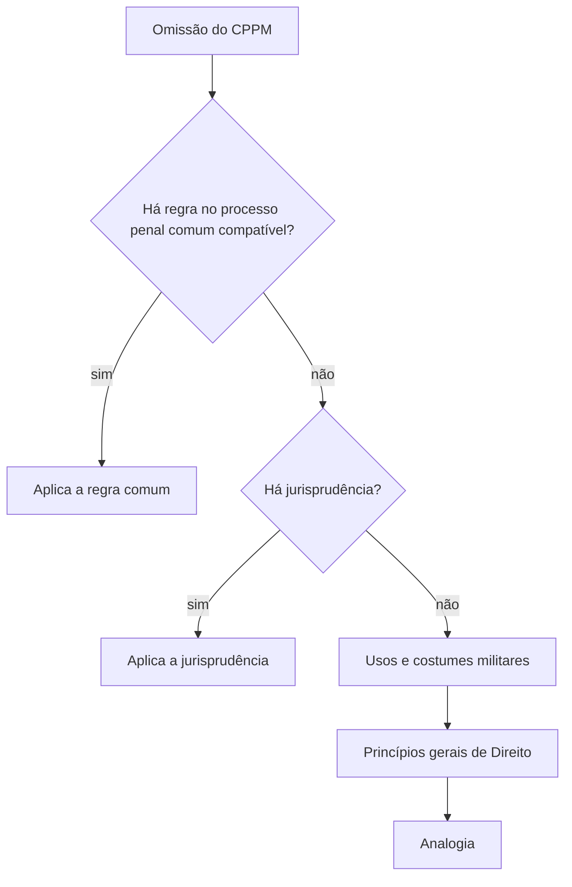

O processo penal militar é o caminho que a lei oferece para apurar e julgar o crime militar. Ele nasce da mesma Constituição que protege qualquer acusado, mas carrega as marcas da vida na caserna: a hierarquia, a disciplina, o comando que investiga e a Justiça Militar que julga. Quem estuda o tema precisa conhecer o Código de Processo Penal Militar (Decreto-Lei 1.002/1969) porque dele depende o inquérito que um comandante pode ser chamado a presidir e o processo ao qual qualquer militar pode responder. Este capítulo cuida das portas de entrada: o que o Código é, como interpretá-lo, o que fazer quando ele é omisso e onde, quando e para quem vale.

> [!objetivos]
> - Distinguir os sistemas processuais inquisitivo, acusatório e misto e dizer qual deles o processo penal militar adota.
> - Enumerar os princípios constitucionais e as peculiaridades do processo penal militar.
> - Aplicar as regras de interpretação e de integração do Código (arts. 2º e 3º).
> - Indicar a aplicação da lei no espaço, no tempo e à Justiça Militar estadual (arts. 4º a 6º).

## O que é o processo penal militar

O **direito processual penal militar** reúne as normas que disciplinam como se investiga, se acusa e se julga o crime militar. O crime militar é aquele que a lei penal militar define como tal (Código Penal Militar, Decreto-Lei 1.001/1969), e a competência para julgá-lo é da Justiça Militar. O processo penal militar não existe para punir a qualquer custo: serve para impedir que alguém seja punido sem as garantias do devido processo legal, e para que o Estado possa responsabilizar o militar que quebra a lei penal castrense.

Três ideias organizam o assunto.

1. **Fonte principal**: o Código de Processo Penal Militar (CPPM), de 1969, que continua em vigor, com alterações pontuais (como as Leis 6.174/1974, 9.299/1996 e 13.964/2019).
2. **Fonte maior**: a Constituição, que impõe as garantias do acusado e dá à Justiça Militar sua moldura (arts. 124, 125 e 142).
3. **Fontes auxiliares**: tratados internacionais, legislação processual comum, jurisprudência, usos e costumes militares, princípios gerais de Direito e analogia.

> [!bizu] Ordem de leitura
> Em prova, pense no processo penal militar como uma escada de três degraus: Constituição no alto, CPPM no meio e fontes auxiliares embaixo. Quando o enunciado fala em "caso omisso", você desce até os degraus de baixo, na ordem que o art. 3º indica.

## Sistemas processuais

Chama-se **sistema processual** o modo como a lei organiza as funções de acusar, defender e julgar. Há três modelos clássicos.

| Sistema | Quem acusa e julga | Características | Onde aparece |
| --- | --- | --- | --- |
| Inquisitivo | a mesma autoridade investiga, acusa e julga | processo sigiloso, escrito, sem contraditório pleno | modelos antigos, ou fases investigativas |
| Acusatório | acusação, defesa e julgador são pessoas diferentes | contraditório, publicidade, igualdade entre as partes, juiz imparcial | processo judicial moderno |
| Misto | fase investigativa inquisitiva e fase judicial acusatória | inquérito sigiloso + processo com acusação e defesa | a maioria dos ordenamentos, inclusive o brasileiro |

O processo penal militar brasileiro é **misto**. Na primeira fase, o **inquérito policial militar** tem caráter sumário e sigiloso, é presidido pela autoridade militar e não exige contraditório pleno. Na segunda fase, a **ação penal**, a acusação é feita pelo Ministério Público Militar, a defesa tem plena participação, e o julgamento é feito por órgão independente, a Justiça Militar. A Constituição reservou ao Ministério Público a **promoção privativa da ação penal pública** (art. 129, I), o que reforça a feição acusatória do processo.

> [!esquema] Duas fases, dois modelos
> | Fase | Natureza | Presidida por | Finalidade |
> | --- | --- | --- | --- |
> | Inquérito policial militar | inquisitiva, sigilosa e sumária | autoridade militar | reunir elementos para a denúncia |
> | Ação penal militar | acusatória, pública e contraditória | juiz ou Conselho de Justiça | julgar a acusação |

## Princípios do processo penal militar

O processo penal militar obedece aos princípios do processo penal em geral e a alguns que decorrem da natureza da instituição militar. Os principais são estes.

| Princípio | Conteúdo | Base |
| --- | --- | --- |
| Devido processo legal | ninguém é privado da liberdade ou dos bens sem processo legal | CF, art. 5º, LIV |
| Juiz natural | só julga o órgão previamente competente; vedados juízos ou tribunais de exceção | CF, art. 5º, XXXVII e LIII |
| Contraditório e ampla defesa | o acusado conhece a acusação, se manifesta e produz provas | CF, art. 5º, LV |
| Presunção de inocência | ninguém é considerado culpado antes do trânsito em julgado de sentença condenatória | CF, art. 5º, LVII |
| Vedação de provas ilícitas | prova obtida por meio ilícito é inadmissível | CF, art. 5º, LVI |
| Publicidade | os atos processuais são públicos, salvo as restrições legais | CF, art. 5º, LX |
| Oficialidade e indisponibilidade da ação penal | o Estado, por seus órgãos, promove a acusação, e o titular não pode abrir mão dela por simples conveniência | CF, art. 129, I |

Há dois princípios típicos do mundo militar. O primeiro é o da **hierarquia e disciplina**, que a Constituição reconhece como base das instituições militares (arts. 42 e 142). Ele explica por que o inquérito é conduzido por autoridade militar, por que a delegação do encarregado respeita a precedência de postos e por que existem regras especiais sobre prisão e detenção. O segundo é o da **proteção das instituições militares**, que justifica a existência de uma Justiça especializada para os crimes definidos em lei penal própria.

> [!pegadinha] Hierarquia não suspende garantias
> A banca costuma insinuar que, por ser militar, o acusado teria menos direitos. A resposta correta é que a hierarquia e a disciplina organizam a instituição, mas não afastam as garantias constitucionais do acusado. O oficial e a praça têm direito à defesa, ao contraditório e ao juiz natural como qualquer cidadão.

### Tribunal ou conselho: quem julga

Na Justiça Militar estadual, o julgamento se divide. Os crimes militares cometidos contra civis e as ações contra atos disciplinares são julgados pelo juiz de direito, de forma monocrática. Os demais crimes militares são julgados pelo Conselho de Justiça, presidido pelo juiz de direito e composto por militares (art. 125, § 5º, da Constituição). Essa estrutura mista de juiz togado e militares é uma peculiaridade do processo penal militar, e a banca costuma cobrá-la.

## Fontes e integração: o art. 3º

O Código de Processo Penal Militar tem lacunas, e a lei sabe disso. Por isso o art. 3º indicou, em ordem, cinco fontes para suprir os casos omissos.

> [!lei] CPPM, art. 3º
> Os casos omissos neste Código serão supridos: a) pela legislação de processo penal comum, quando aplicável ao caso concreto e sem prejuízo da índole do processo penal militar; b) pela jurisprudência; c) pelos usos e costumes militares; d) pelos princípios gerais de Direito; e) pela analogia.

| Ordem | Fonte | Observação |
| --- | --- | --- |
| a | legislação de processo penal comum | aplica-se só se compatível com a índole do processo militar |
| b | jurisprudência | decisões reiteradas dos tribunais |
| c | usos e costumes militares | prática consolidada na caserna |
| d | princípios gerais de Direito | normas fundamentais do ordenamento |
| e | analogia | aplicar a regra de um caso semelhante |

> [!bizu] Mnemônico para o art. 3º
> Pense em "lei comum, juízes, costumes, princípios, analogia". A ordem das letras a a e segue essa sequência, e a banca cobra tanto a presença de cada fonte quanto a posição da legislação comum no topo.

> [!atencao] Aplicação da lei comum tem um filtro
> A legislação de processo penal comum é a primeira fonte supletiva, mas só se aplica "sem prejuízo da índole do processo penal militar". Se a regra comum é incompatível com a estrutura militar (por exemplo, com a hierarquia ou com o rito próprio), ela não é aplicada. Quem lê "sempre se aplica" erra.

## Aplicação e interpretação da lei processual penal militar

### Art. 1º: o Código rege o processo em paz e em guerra

O art. 1º afirma que o processo penal militar rege-se pelas normas do Código, **em tempo de paz e em tempo de guerra**, ressalvada a legislação especial que lhe for estritamente aplicável. Dois parágrafos completam a regra.

- **Tratados e convenções**: se houver divergência entre as normas do Código e as de convenção ou tratado de que o Brasil seja signatário, **prevalecem as últimas** (§ 1º). A regra reconhece a força dos tratados de direitos humanos, como a Convenção Americana.
- **Subsidiariedade**: as normas do Código aplicam-se, de forma subsidiária, aos processos regulados em leis especiais (§ 2º).

### Art. 2º: interpretação

A regra de partida do art. 2º é ler a lei processual militar **ao pé da letra**, e os termos técnicos têm o seu sentido próprio, salvo se o texto claramente os usou de outra forma. A interpretação **extensiva** ou **restritiva** é admitida quando é manifesto que a expressão da lei é mais estrita ou mais ampla do que sua intenção. O § 2º impõe três freios a essas interpretações mais flexíveis. Elas ficam proibidas quando:

1. diminuírem a defesa pessoal do acusado;
2. mudarem o andamento regular do processo ou lhe descaracterizarem a natureza;
3. alterarem, de saída, as razões que levaram à acusação.

| Tipo | O que faz | Exemplo |
| --- | --- | --- |
| Literal | segue o texto | a regra do prazo de 20 dias significa 20 dias |
| Extensiva | amplia o sentido para alcançar a intenção da lei | "oficial" entendido como incluindo oficiais da reserva, se a lei quis protegê-los |
| Restritiva | reduz o sentido para respeitar a intenção da lei | norma que fala em "militar" mas trata só de oficiais |

> [!pegadinha] Interpretação não pode prejudicar a defesa
> A interpretação extensiva ou restritiva é admitida, mas jamais quando limitar a defesa do acusado, desvirtuar o processo ou alterar a acusação. Se a alternativa fala em "interpretação restritiva que reduza a defesa", ela contraria o art. 2º, § 2º.

### Art. 4º: aplicação no espaço

O art. 4º trata do alcance territorial do Código, respeitados os tratados e as normas internacionais. Em **tempo de paz**, o Código vale, antes de tudo, em todo o território nacional. Vale também fora dele em quatro situações: quando o crime ofende as instituições militares ou a segurança nacional em lugar de extraterritorialidade brasileira, mesmo que o agente já tenha sido processado no exterior; em zonas sob a administração ou a vigilância de tropa brasileira, ou onde força estrangeira atue ligada a ela em missão internacional; a bordo de navios, embarcações e aeronaves, ainda que privados, quando estiverem sob comando militar ou forem usados por ordem de autoridade militar; e a bordo de navios e aeronaves estrangeiros situados em local sob administração militar, se a infração atentar contra as instituições militares ou a segurança nacional.

Em **tempo de guerra**, valem os mesmos casos, e o Código alcança ainda o espaço onde operam as forças brasileiras ou aliadas, os lugares cuja defesa interessa à segurança nacional ou ao êxito das operações, e o território estrangeiro militarmente ocupado.

### Art. 5º: aplicação no tempo

As normas do Código aplicam-se a partir de sua vigência, **inclusive nos processos pendentes**, sem prejuízo da validade dos atos realizados sob a lei anterior. Isso aplica o princípio do **tempus regit actum**: o ato processual se rege pela lei vigente quando é praticado. A lei processual nova tem efeito imediato, mas respeita os atos já feitos.

> [!exemplo] Lei nova e processo em curso
> Em 2019, a Lei 13.964 criou o artigo 16-A do CPPM, que assegura defensor ao militar investigado por uso da força letal. Um IPM instaurado em 2018 e ainda em andamento passa a ser regido pela regra nova a partir da vigência, mas os atos praticados antes não são anulados por esse motivo.

### Art. 6º: Justiça Militar estadual

O art. 6º leva o Código à **Justiça Militar estadual**, para os processos de crimes definidos na lei penal militar nos quais figurem oficiais e praças das Polícias Militares e dos Corpos de Bombeiros Militares. A aplicação tem exceções: não se aplicam ao processo estadual, por regra do Código, as normas sobre **organização da Justiça, recursos e execução de sentença**, que são regidas pela legislação estadual e pela Constituição.

> [!lei] CPPM, art. 6º
> Obedecerão às normas processuais previstas neste Código, no que forem aplicáveis, salvo quanto à organização de Justiça, aos recursos e à execução de sentença, os processos da Justiça Militar Estadual, nos crimes previstos na Lei Penal Militar a que responderem os oficiais e praças das Polícias e dos Corpos de Bombeiros, Militares.

Para os militares estaduais, como os de Pernambuco, é essa regra que conecta o CPPM à realidade deles. A competência da Justiça Militar estadual vem da Constituição: ela processa e julga os militares dos Estados nos crimes militares definidos em lei e as ações contra atos disciplinares militares, ressalvada a competência do júri quando a vítima for civil (art. 125, § 4º). Por isso, o crime doloso contra a vida de civil praticado por militar vai ao Tribunal do Júri, e o inquérito policial militar é remetido à Justiça comum.

> [!jurisprudencia] STJ, Súmula 78
> O policial de corporação estadual é julgado pela Justiça Militar mesmo que o delito tenha sido cometido em outra unidade da Federação.

> [!jurisprudencia] STJ, Súmula 53
> O civil que comete crime contra as instituições militares estaduais é processado e julgado pela Justiça comum estadual, e não pela Justiça Militar.

## Os princípios na prática do quartel

Os princípios só têm valor quando se traduzem em atos concretos. Alguns exemplos mostram como eles aparecem no dia a dia de quem pode ser chamado a conduzir um IPM.

- **Devido processo legal**: o encarregado do inquérito segue o roteiro do Código (portaria, oitivas, relatório) e não improvisa diligências que a lei não prevê.
- **Contraditório e ampla defesa**: o indiciado é ouvido, pode ser assistido por advogado e, nos casos de uso da força letal, deve ser citado e ter defensor (artigo 16-A, introduzido pela Lei 13.964/2019).
- **Presunção de inocência**: o indiciamento não equivale a condenação, e a prisão antes da sentença exige fundamento legal (flagrante, detenção em IPM ou prisão preventiva).
- **Juiz natural**: ninguém escolhe o julgador depois do fato. A competência é fixada em lei e na Constituição, e o Conselho de Justiça é formado por sorteio, conforme a lei de organização judiciária.
- **Vedação de provas ilícitas**: a busca em local protegido sem os requisitos legais e a confissão obtida sob coação não podem ser usadas.

### Do pacote anticrime ao uso da força letal

A Lei 13.964, de 2019, acrescentou ao CPPM o artigo 16-A, hoje um dos pontos mais cobrados do tema. O artigo garante que o policial militar ou o bombeiro militar investigado por fatos relacionados ao uso da força letal, em serviço, de forma consumada ou tentada, possa **constituir defensor**. Ele deve ser citado da instauração do procedimento e tem 48 horas para indicar o defensor. Se não o fizer, a autoridade intima a instituição, que dispõe de mais 48 horas para indicar um defensor, de preferência da Defensoria Pública. O dispositivo vale também para militares das Forças Armadas, quando os fatos digam respeito a missões de garantia da lei e da ordem.

> [!atencao] Quem é intimado, e em quantas horas
> O investigado tem 48 horas para constituir defensor; se silenciar, a instituição tem mais 48 horas para indicar. A banca costuma trocar os prazos ou o destinatário da intimação, que é a instituição a que o militar estava vinculado, e não o comandante pessoalmente.

## O contexto constitucional da Justiça Militar

A Constituição organiza a Justiça Militar em dois blocos. A **Justiça Militar da União** julga os crimes militares definidos em lei e tem como órgãos o Superior Tribunal Militar e os tribunais e juízes militares. A **Justiça Militar estadual** é composta, em primeiro grau, por juízes de direito e Conselhos de Justiça, e, em segundo grau, pelo Tribunal de Justiça ou, nos Estados em que o efetivo militar ultrapassa vinte mil integrantes, por tribunal de justiça militar próprio (art. 125, § 3º). A Emenda Constitucional 45/2004 ampliou a competência estadual para incluir as ações judiciais contra atos disciplinares militares e fixou que o juiz de direito julga monocraticamente os crimes militares praticados contra civis e essas ações.

Para o aluno, a lição é que o CPPM não está sozinho: ele convive com a Constituição, com a lei de organização judiciária de cada Estado e com as leis que alteraram o processo. Daí a insistência da prova em perguntar quem decide o quê: o Código define o rito, a Constituição define a competência, e a lei estadual define a organização do tribunal.

### Crime doloso contra a vida de civil

Desde a Lei 9.299/1996, os crimes dolosos contra a vida praticados por militar contra civil são da competência da Justiça comum, pelo Tribunal do Júri. A Constituição, no art. 125, § 4º, reforça a regra ao ressalvar a competência do júri quando a vítima é civil. Nesses casos, o inquérito policial militar é remetido à Justiça comum, e não à Justiça Militar. A regra existe porque a morte de civil provocada por militar ofende um bem protegido pela justiça comum e passa pelo julgamento popular.

> [!bizu] Vítima civil, dolo contra a vida, júri
> A cadeia de ideias é: crime doloso contra a vida + vítima civil = júri. Se a vítima for militar, ou se o crime for culposo, a competência permanece com a Justiça Militar. A banca costuma trocar "dolosos" por "culposos" ou "civil" por "militar" para confundir.

## Tempo de guerra e mobilização

O Código de Processo Penal Militar é dividido em duas grandes partes: o processo em tempo de paz e o processo em tempo de guerra. O art. 1º já avisa que o Código vale nos dois momentos. Em tempo de guerra, com a mobilização das Forças Armadas, o processo ganha rito mais rápido, com regras de exceção para prisão e julgamento, e a Justiça Militar da União pode atuar nos teatros de operações. O aluno de concurso estadual raramente enfrenta questões detalhadas sobre esse tema, mas deve saber que o Código regula a guerra e que a aplicação no espaço inclui o território militarmente ocupado e as zonas de operações.

Uma lembrança útil: a guerra é uma situação reconhecida por declaração do Presidente da República, com autorização do Congresso, e a mobilização é o conjunto de medidas que prepara o país para ela. Essas situações mudam a lei penal e a processual militar aplicáveis, mas a matéria do concurso estadual concentra-se no tempo de paz.

## O processo militar como ramo especial

O processo penal militar é um ramo especial do processo penal, e especial não quer dizer menor. Ele existe porque o crime militar ofende bens que a lei comum trata de modo diferente: a hierarquia, a disciplina, o serviço, o dever militar e o patrimônio sob administração militar. Por isso, a competência, o rito e algumas medidas (como a detenção do indiciado no curso do IPM) têm regras próprias. O que a especialidade não pode fazer é **suprimir** garantia constitucional. Quando a regra militar restringe um direito além do que a Constituição permite, ela é invalidada, e o intérprete aplica a garantia.

Esse ponto tange a prova com frequência. A banca descreve uma situação em que o rito militar parece mais duro e pergunta se ela é válida. A resposta passa por duas perguntas: a regra tem base legal e é compatível com a Constituição? Se a resposta for não, a regra cede, mesmo sendo antiga ou "tradicional" na caserna. A Convenção Americana de Direitos Humanos, incorporada ao ordenamento brasileiro, reforça essa leitura e, pelo art. 1º, § 1º, prevalece em caso de divergência com o Código.

> [!exemplo] Agressão a superior e garantias do acusado
> Um soldado é acusado de agredir um superior durante a formatura. Mesmo sendo a conduta grave, sujeita a rito militar, ele tem direito de ser ouvido, de ter defensor, de conhecer a acusação e de ser julgado por órgão competente. Se, na prática, o comandante decidisse puni-lo com prisão sem observar o procedimento legal, a medida seria ilegal por ofensa ao devido processo. A natureza grave do fato não afasta o rito nem as garantias.

### Aplicação irrestrita? Não

Quem lê o art. 1º pode ter a impressão de que o Código é aplicável sem exceção. A leitura correta é a de que ele rege o processo penal militar, mas com três limites: a Constituição, os tratados internacionais de que o Brasil seja parte e a legislação especial estritamente aplicável a um caso concreto. A Lei 14.751/2023 (Lei Orgânica Nacional das Polícias Militares e dos Corpos de Bombeiros Militares) é um exemplo de norma recente que organiza as corporações e dialoga com o regime disciplinar e processual, sem substituir o CPPM. Para o aluno de concurso estadual, vale guardar que a ordem de aplicação é: Constituição, tratados, legislação especial e, por fim, o Código no que sobrar de regra geral.

Há quem pergunte se o Código ainda é ordinário, isto é, se é o diploma mais geral. A resposta é afirmativa, porque ele continua sendo a norma processual de referência para a Justiça Militar, mesmo tendo sido editado há mais de meio século. As atualizações (como as de 1974, 1996 e 2019) mostram que a legislação adotou, com o tempo, correções pontuais e não uma reforma integral.

### Os órgãos de primeiro grau e o Superior Tribunal Militar

Na **Justiça Militar da União**, o primeiro grau é formado pelos **juízes federais da Justiça Militar** e pelos **Conselhos de Justiça**. O Conselho é composto pelo juiz federal, que o preside, e por quatro juízes militares. Há dois tipos. O **Conselho Especial de Justiça** julga os oficiais, é constituído para cada processo e se dissolve ao fim dele. O **Conselho Permanente de Justiça** julga as praças e funciona por períodos fixos, de três meses. Desde a Lei 13.774/2018, os civis acusados de crime militar são julgados **monocraticamente pelo juiz federal da Justiça Militar**, e não mais pelo Conselho. Os oficiais-generais são julgados originariamente pelo Superior Tribunal Militar.

O **Superior Tribunal Militar** tem quinze ministros vitalícios, nomeados pelo Presidente da República depois de aprovação pelo Senado: três oficiais-generais da Marinha, quatro do Exército e três da Aeronáutica, todos da ativa e do posto mais elevado da carreira, e cinco civis. Os civis são três advogados de notório saber jurídico e conduta ilibada, um juiz federal da Justiça Militar e um membro do Ministério Público Militar (art. 123 da Constituição).

> [!esquema] Primeiro grau da Justiça Militar da União
> | Órgão | Quem julga | Funcionamento |
> | --- | --- | --- |
> | Juiz federal da Justiça Militar | civis, monocraticamente | permanente |
> | Conselho Especial de Justiça | oficiais | constituído para cada processo |
> | Conselho Permanente de Justiça | praças | períodos fixos de três meses |
> | Superior Tribunal Militar | oficiais-generais, originariamente; recursos | tribunal de segundo grau |

Esses desenhos valem para a União. Na Justiça Militar estadual, a estrutura é a da Constituição estadual e da lei de organização judiciária, com o juiz de direito e os Conselhos de Justiça, como visto antes.

### Juizados especiais e interrogatório

Dois temas de aplicação costumam aparecer em provas. O primeiro é que a **Lei 9.099/1995 não se aplica à Justiça Militar** (artigo 90-A, incluído pela Lei 9.839/1999). Por isso, a transação penal e a suspensão condicional do processo da Lei dos Juizados Especiais não alcançam os crimes militares, nem mesmo os de menor potencial ofensivo. O segundo é o **interrogatório do acusado**. O texto original do CPPM o previa no início da instrução, mas o STF decidiu, em 2016, que ele deve ser o **último ato** da instrução também no processo penal militar, para que a defesa conheça toda a prova antes de falar. A decisão aplica o contraditório e a ampla defesa e supera, nesse ponto, a ordem do Código.

> [!jurisprudencia] STF, HC 127.900
> No processo penal militar, o interrogatório do réu deve ser feito ao final da instrução, depois da produção das demais provas, em homenagem à ampla defesa.

## Fontes do processo penal militar em quadro

| Tipo de fonte | Exemplos | Papel |
| --- | --- | --- |
| Constituição | art. 5º (garantias), arts. 124 e 125 (Justiça Militar), art. 142 (militares) | fundamento e limite |
| Tratados internacionais | Convenção Americana de Direitos Humanos | prevalecem sobre o CPPM em caso de divergência (art. 1º, § 1º) |
| Código de Processo Penal Militar | Decreto-Lei 1.002/1969 | norma central |
| Legislação especial | Lei 9.299/1996, Lei 13.964/2019 | altera ou completa o Código |
| Legislação processual comum | Código de Processo Penal | supre omissões, se compatível |
| Jurisprudência | súmulas do STF, STJ e STM | orienta a interpretação |
| Usos e costumes militares | prática da caserna | supre omissões (art. 3º, c) |

> [!resolvido] Qual fonte?
> **Situação:** o CPPM não regula determinado incidente sobre prova testemunhal, e o Código de Processo Penal tem regra clara que não contraria a índole do processo militar. O que fazer?
>
> **Resposta:** aplica-se a regra do processo penal comum (art. 3º, a), por ser a primeira fonte supletiva e compatível com o processo militar. Se não houvesse regra ou se ela fosse incompatível, o intérprete passaria à jurisprudência, depois aos usos e costumes militares, aos princípios gerais de Direito e à analogia.

## Mapa do capítulo

O capítulo tem uma lógica de funil: primeiro o modelo (sistema misto), depois as garantias (princípios), em seguida as regras de leitura e de integração (arts. 1º a 3º) e, por fim, a aplicação no espaço, no tempo e à Justiça estadual (arts. 4º a 6º).

| Tema | Regra central | Armadilha |
| --- | --- | --- |
| Sistema | misto: inquérito inquisitivo e processo acusatório | chamar o processo todo de inquisitivo |
| Princípios | devido processo, contraditório, presunção de inocência, juiz natural | achar que a hierarquia afasta garantias |
| Art. 1º | tratados prevalecem sobre o CPPM em caso de divergência | inverter a prevalência |
| Art. 2º | interpretação literal; extensiva e restritiva com limites | admitir interpretação que prejudique a defesa |
| Art. 3º | lei comum, jurisprudência, costumes, princípios, analogia | trocar a ordem das fontes |
| Art. 5º | aplicação imediata, respeitados os atos anteriores | aplicar a lei nova com efeito retroativo |
| Art. 6º | aplicação à Justiça Militar estadual, com exceções | esquecer organização, recursos e execução |

### Para fixar
- O processo penal militar é misto: inquérito sigiloso e inquisitivo, ação penal acusatória.
- O Ministério Público promove privativamente a ação penal pública (CF, art. 129, I).
- A hierarquia e a disciplina organizam a instituição, mas não afastam o devido processo legal nem o contraditório.
- Casos omissos: processo penal comum, jurisprudência, usos e costumes militares, princípios gerais de Direito e analogia, nessa ordem.
- Se o CPPM divergir de tratado de que o Brasil seja signatário, prevalece o tratado (art. 1º, § 1º).
- A interpretação é literal; a extensiva e a restritiva não podem cercear a defesa nem alterar a acusação.
- O CPPM vale em tempo de paz e de guerra, no território nacional e em hipóteses de extraterritorialidade.
- A lei processual nova aplica-se aos processos pendentes, preservados os atos anteriores.
- O CPPM aplica-se à Justiça Militar estadual, salvo organização da Justiça, recursos e execução da sentença.
- Quando a vítima do crime doloso contra a vida é civil, a competência é do júri.
