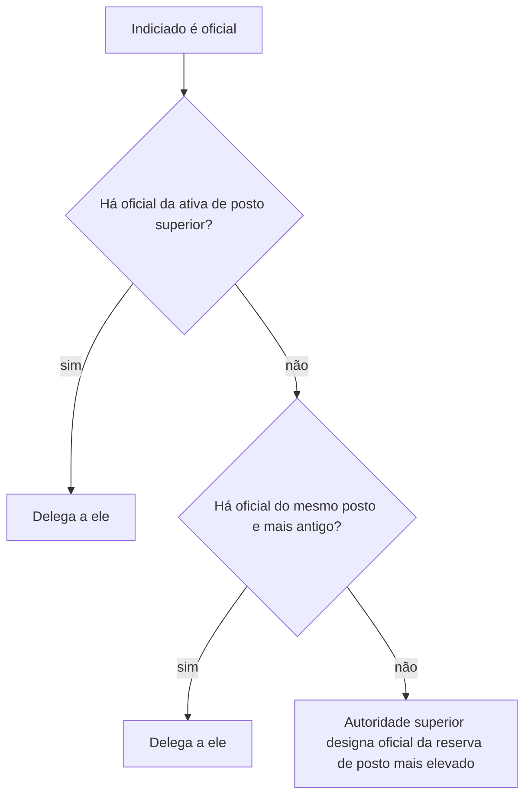

Quando um fato que parece crime militar acontece no quartel, quem investiga? Não é a polícia civil, e não é preciso esperar o juiz. Quem investiga é a própria autoridade militar, com a função que o Código chama de **polícia judiciária militar**. É uma função, e não uma corporação: ela é exercida por comandantes, diretores e chefes, que podem delegá-la a outros oficiais. A prova adora perguntar quem exerce, quem pode receber a delegação e o que a polícia judiciária militar pode e não pode fazer. Este capítulo cobre os arts. 7º e 8º do Código de Processo Penal Militar.

> [!objetivos]
> - Explicar o que é polícia judiciária militar e distingui-la da polícia ostensiva e da polícia civil.
> - Indicar quem exerce a função, conforme a jurisdição e a hierarquia.
> - Aplicar as regras de delegação, especialmente as de precedência de posto para o IPM.
> - Enumerar as competências do art. 8º.

## O que é polícia judiciária militar

A polícia judiciária militar é a atividade de **apurar a infração penal militar e a sua autoria**, auxiliando a Justiça Militar e o Ministério Público. Ela atua **depois do fato**, o que a distingue da polícia ostensiva e de preservação da ordem pública, que atua antes, para evitar a infração.

| Atividade | Quando atua | Quem exerce | Exemplo |
| --- | --- | --- | --- |
| Polícia ostensiva | antes do fato, para prevenir | a corporação em policiamento | patrulha, bloqueio de via |
| Polícia judiciária militar | depois do fato, para apurar crime militar | autoridades militares com poder de comando | instauração de IPM |
| Polícia judiciária civil | depois do fato, para apurar crime comum | polícias civis e Polícia Federal | inquérito policial |

A Constituição reservou às polícias civis a apuração das infrações penais, **ressalvada a competência da União e as infrações militares** (art. 144, § 4º). É essa ressalva que sustenta a existência da polícia judiciária militar: o crime militar não é apurado pela polícia civil, e sim por autoridade militar.

> [!bizu] Função, e não instituição
> A palavra "polícia" engana. Não há uma "Polícia Judiciária Militar" como órgão com quadro próprio. O que há é a função de investigar crimes militares, que a lei atribui a autoridades militares pelo cargo que ocupam. Se a alternativa disser que a polícia judiciária militar é um órgão autônomo, desconfie.

## Quem exerce: o art. 7º

O art. 7º lista as autoridades que exercem a polícia judiciária militar, "conforme as respectivas jurisdições". O texto trata das Forças Armadas: ministros militares, chefes de estado-maior, comandantes de Exército e de Esquadra, comandantes de região militar, distrito naval ou zona aérea, diretores e chefes de órgãos e serviços e comandantes de forças, unidades ou navios. A lógica é a do **comando**: quem comanda uma unidade responde por apurar as infrações ocorridas no âmbito dela.

Nas corporações militares dos Estados, a ideia é a mesma: a função cabe ao **Comandante-Geral**, aos comandantes de unidades, aos diretores e chefes de órgãos, nos limites do respectivo comando e conforme a lei estadual de organização. O CPPM serve de modelo e aplica-se à Justiça Militar estadual (art. 6º), e a lei estadual e os regulamentos da corporação indicam quais autoridades correspondem às do art. 7º.

> [!atencao] Não decore o rol, entenda o critério
> Questões que listam autoridades de uma Força Armada e pedem se elas exercem polícia judiciária militar costumam ser resolvidas pelo critério da jurisdição: quem tem comando, direção ou chefia sobre a unidade ou o órgão em que ocorreu o fato. Memorizar a lista exata é menos útil do que entender essa lógica.

### Jurisdição

O exercício acompanha o **âmbito de comando**. O ministro exerce em relação às forças e órgãos do seu Ministério, o comandante de unidade, na unidade; o diretor, no órgão que dirige. O fato ocorrido fora do âmbito de comando da autoridade não é, em regra, de sua atribuição, e a autoridade deve comunicar o fato a quem tenha jurisdição.

## Delegação do exercício

Dentro do art. 7º, os parágrafos tratam da **delegação**, instrumento essencial para o IPM. A autoridade que exerce a função não precisa conduzir pessoalmente o inquérito: pode delegar as atribuições a outro oficial.

1. **Quem recebe** (§ 1º): oficial da ativa, para fins especificados e por tempo limitado, respeitadas as normas de jurisdição, hierarquia e comando.
2. **Delegação para o IPM** (§ 2º): quem recebe a tarefa precisa ter **posto acima do indiciado**, qualquer que seja a situação deste (ativa, reserva com ou sem remuneração, ou reformado).
3. **Impossibilidade** (§ 3º): sem oficial de posto acima, serve um oficial do **mesmo posto**, desde que seja **mais antigo** que o indiciado.
4. **Indiciado da reserva ou reformado** (§ 4º): a antiguidade de posto não prevalece para a delegação.
5. **Falta absoluta de oficial** (§ 5º): se o posto e a antiguidade do indiciado tornarem impossível achar outro oficial da ativa nas condições do § 3º, o ministro competente escolhe oficial da reserva, de posto mais alto, e, se o inquérito já começou, pode avocá-lo para tomar essa providência.

| Situação do indiciado | Quem pode presidir o IPM | Regra |
| --- | --- | --- |
| Oficial da ativa | oficial de posto superior; na falta, mesmo posto e mais antigo | art. 7º, §§ 2º e 3º |
| Oficial da reserva ou reformado | oficial de posto superior, sem exigir antiguidade | art. 7º, § 4º |
| Praça | oficial, conforme a delegação | art. 7º, § 1º |
| Impossibilidade de designar oficial da ativa nas condições | oficial da reserva de posto mais elevado, designado pela autoridade superior | art. 7º, § 5º |

> [!pegadinha] Delegar a quem tem posto inferior
> A regra é que o encarregado tenha posto **superior** ao indiciado (ou, na falta, o mesmo posto e mais antigo). Nunca se delega o IPM de um coronel a um capitão. A banca costuma apresentar situações em que o encarregado é de posto inferior e pergunta se a delegação é válida. A resposta é negativa. Por outro lado, quando o indiciado é praça, o requisito de posto é cumprido por qualquer oficial.

### Delegação não é transferência de responsabilidade

A delegação transfere a **execução**, e não a titularidade. A autoridade que delegou mantém o dever de acompanhar o inquérito e, ao final, recebe o relatório para homologar a solução. Por isso o art. 22, § 2º, permite que ela **avoque** o inquérito se discordar da solução. Essa característica será vista no capítulo seguinte, mas convém saber que a delegação é sempre limitada no tempo e nos fins.

> [!exemplo] Delegação em ação
> O Comandante de uma unidade de bombeiros toma conhecimento de que um tenente teria desviado material do almoxarifado. Ele é a autoridade com jurisdição sobre a unidade e pode instaurar o IPM. Como o indiciado é tenente, o Comandante delega a condução a um capitão ou a oficial superior. Se não houver oficial de posto superior disponível no âmbito da unidade, ele pede à autoridade superior que designe outro oficial.

## Competência da polícia judiciária militar: o art. 8º

O art. 8º lista o que compete à polícia judiciária militar. O rol é extenso e abrange tanto a investigação quanto a cooperação com a Justiça.

| Letra | Competência | Natureza |
| --- | --- | --- |
| a | investigar o crime militar e também aquele que lei especial submeta à jurisdição militar, além de descobrir quem o praticou | investigação |
| b | fornecer à Justiça Militar e ao Ministério Público os dados de que precisem para instruir e julgar, e cumprir as diligências que eles pedirem | cooperação |
| c | executar as ordens de prisão que a Justiça Militar emitir | execução de ordem |
| d | levar ao juiz o pedido de prisão preventiva ou de exame de insanidade mental do indiciado | provocação |
| e | obedecer às decisões da Justiça Militar sobre os presos que estejam sob sua custódia | guarda de presos |
| f | pedir às autoridades civis dados e providências que ajudem a esclarecer a infração | cooperação com civis |
| g | exigir da polícia civil e dos órgãos técnicos civis as pesquisas e perícias que completem o inquérito | requisição técnica |
| h | apresentar a uma autoridade civil, se o pedido for legal e fundamentado, o militar ou o funcionário da repartição militar que ela procura, respeitados os regulamentos | cooperação |

Há distinções que a prova explora.

- A polícia judiciária militar **solicita** informações a autoridades civis (letra f), mas **requisita** pesquisas e exames da polícia civil e de repartições técnicas civis (letra g). Solicitar e requisitar não são a mesma coisa: a requisição é uma ordem que a lei autoriza.
- A polícia judiciária militar **representa** pela prisão preventiva e pela insanidade mental (letra d), mas **não decreta** a prisão preventiva. Quem decreta é a autoridade judiciária militar.
- Ela **cumpre** os mandados de prisão (letra c), e não os expede.

> [!lei] CPPM, art. 8º, a
> Compete à Polícia judiciária militar apurar os crimes militares, bem como os que, por lei especial, estão sujeitos à jurisdição militar, e sua autoria.

A letra a é a competência central, e as demais giram em torno dela: informar a Justiça, executar suas ordens, pedir ou exigir ajuda técnica e provocar o juiz.

> [!resolvido] Solicitar ou requisitar?
> **Enunciado:** o encarregado de um IPM precisa de um laudo pericial que só a repartição técnica civil pode produzir. Ele pode exigi-lo?
>
> **Resposta:** sim. O art. 8º, g, dá à polícia judiciária militar o poder de **requisitar** pesquisas e exames da polícia civil e dos órgãos técnicos civis, quando completam o IPM. Já informações a autoridades civis (letra f) são **solicitadas**, não requisitadas.

### O que a polícia judiciária militar não faz

Algumas atribuições escapam à polícia judiciária militar. Ela não **denuncia** (função do Ministério Público), não **julga** (função da Justiça Militar), não **decreta prisão preventiva** (função do juiz) e não **arquiva** o inquérito (o art. 24 veda à autoridade militar mandar arquivar autos de IPM, ainda que concluam pela inexistência de crime ou pela inimputabilidade). Seu papel termina com a apuração e o encaminhamento do inquérito à Justiça.

## Polícia judiciária militar e as corporações estaduais

No âmbito dos Estados, é importante conectar o CPPM à estrutura local. A Lei 14.751/2023 organiza em âmbito nacional as polícias militares e os corpos de bombeiros militares, e a lei estadual define o comando, a hierarquia e as funções de cada unidade. A polícia judiciária militar acompanha esse desenho: o Comandante-Geral é a maior autoridade da corporação, os comandantes de unidades exercem a função dentro de suas jurisdições e os oficiais recebem delegação para conduzir os inquéritos.

Duas observações práticas completam o quadro. Primeiro, o crime militar praticado por bombeiro militar é apurado em IPM pela própria corporação, ainda que o fato tenha repercussão fora dela. Segundo, quando o fato não é crime militar, mas crime comum, a autoridade militar não instaura IPM e comunica o fato à autoridade policial civil competente (art. 10, § 3º), conforme se verá adiante.

## Aplicação prática: quem faz o quê numa unidade

Imagine a cadeia de comando de uma unidade de bombeiros. O comandante da unidade é a autoridade com jurisdição e, se houver subcomandante, este atua nas ausências e por delegação. O chefe da seção de recursos humanos, o diretor de um órgão de apoio e o chefe de um serviço exercem a função no âmbito do que dirigem. Quando uma infração ocorre num serviço subordinado, quem responde pela primeira providência é o comandante ou o oficial de dia, de serviço ou de quarto, mesmo antes da delegação formal (como se verá no capítulo sobre o IPM). O secretário de uma estrutura administrativa pode ser incumbido da tarefa se for oficial e se a delegação lhe for dirigida de modo expresso.

Essa lógica funciona em manobras e operações de campo. Em uma manobra, o oficial que comanda o exercício responde pela primeira apuração, e o comandante da unidade a que pertence a tropa instaura o inquérito. O ponto é que o comando acompanha a tropa, e a polícia judiciária militar acompanha o comando.

> [!atencao] Prazo prescricional corre durante a delegação
> Enquanto a autoridade busca um oficial com posto adequado, a prescrição continua a correr. Um fato ilícito relatado tardiamente pode prescrever antes que o IPM chegue ao fim. Por isso o Código prevê a designação de oficial do mesmo posto, mais antigo, ou da reserva, para que a falta de um oficial de posto superior não paralise a apuração.

### Os antigos Territórios e o texto do Código

O Código de 1969 fala em "Distrito Federal e Territórios" em vários pontos, porque, à época, existiam territórios federais. Hoje não há territórios com corporações militares próprias, mas o texto permanece, e a banca raramente o cobra. A lição é de leitura: o Código tem partes antigas, e o candidato deve concentrar-se nas regras que se mantêm úteis, como a delegação e a competência.

## Mapa do capítulo

O capítulo se resume em quatro perguntas: o que é, quem exerce, como se delega e o que compete.

| Pergunta | Resposta | Armadilha |
| --- | --- | --- |
| O que é? | função de apurar infração penal militar e sua autoria | achar que é um órgão autônomo |
| Quem exerce? | autoridades com comando, direção ou chefia, conforme a jurisdição | decorar a lista sem entender o critério |
| Como se delega? | a oficial da ativa; para IPM, posto superior ao do indiciado | delegar a oficial de posto inferior |
| O que compete? | apurar, informar, cumprir mandados, representar, requisitar | confundir representar com decretar |
| Limites | não denuncia, não julga, não arquiva | atribuir ao encarregado o poder de arquivar |

### Para fixar
- A polícia judiciária militar apura, depois do fato, a infração penal militar e sua autoria.
- É uma função exercida por autoridades com comando, direção ou chefia, e não um órgão autônomo.
- A Constituição ressalva as infrações militares da apuração pela polícia civil (art. 144, § 4º).
- A delegação recai em oficial da ativa, para fins especificados e por tempo limitado.
- No IPM, o encarregado deve ter posto superior ao do indiciado; na falta, mesmo posto e mais antigo.
- Se o indiciado é da reserva ou reformado, a antiguidade de posto não prevalece.
- A polícia judiciária militar representa pela prisão preventiva, mas não a decreta.
- Ela requisita da polícia civil e das repartições técnicas civis os exames necessários ao IPM.
- A autoridade militar não pode arquivar autos de inquérito (art. 24).
- Solicitar informações a civis (letra f) é diferente de requisitar exames técnicos (letra g).
