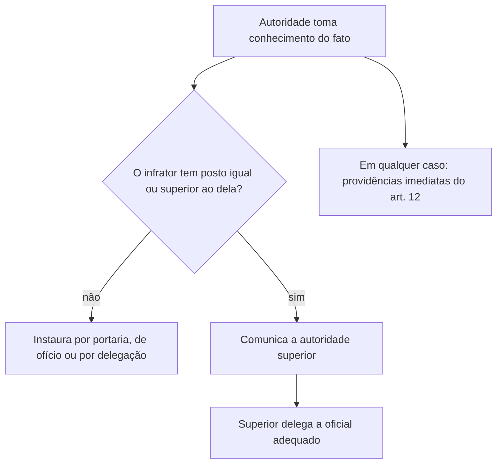

O inquérito policial militar, o famoso IPM, é a primeira resposta formal do Estado a um fato que parece crime militar. Quase todo oficial, em algum momento da carreira, será chamado a instaurar um IPM ou a presidi-lo. Por isso a prova de concurso exige conhecimento detalhado: o que é o IPM, quem pode determinar a sua abertura, como se abre, quem o conduz e o que a lei manda fazer logo de início. Este capítulo percorre os arts. 9º a 15 do Código de Processo Penal Militar; o seguinte trata do sigilo, da detenção, dos prazos, do relatório e do arquivamento.

> [!objetivos]
> - Definir o IPM e indicar a sua finalidade e as suas características.
> - Enumerar as formas de instauração e a autoridade competente.
> - Aplicar as regras para o caso de infrator de posto igual ou superior ao da autoridade.
> - Indicar as providências imediatas e as atribuições do encarregado, do escrivão e do assistente do Ministério Público.

## Conceito e finalidade (art. 9º)

O IPM é a **investigação rápida de um fato que a lei considera crime militar, com a identificação de quem o praticou**. A definição está no art. 9º. Sumária quer dizer breve e resumida: o inquérito não é o processo, e não produz decisão sobre culpa. Ele tem caráter de **instrução provisória**, e a sua finalidade principal é fornecer ao Ministério Público os elementos necessários à propositura da ação penal.

O parágrafo único do art. 9º contém uma exceção de prova: os **exames, as perícias e as avaliações** realizados no curso do inquérito, regularmente, por peritos idôneos e com observância das formalidades do Código, são efetivamente instrutórios da ação penal. Em outras palavras, o que o IPM produz como perícia entra no processo como prova, e não apenas como informação.

> [!lei] CPPM, art. 9º
> O inquérito policial militar é a apuração sumária de fato que, nos termos legais, configure crime militar, e de sua autoria.

| Aspecto | Regra |
| --- | --- |
| Natureza | apuração sumária, instrução provisória |
| Finalidade | fornecer ao Ministério Público elementos para a ação penal |
| Valor probatório | em regra, informativo; exames, perícias e avaliações regulares valem como prova |
| Quem conduz | autoridade militar (encarregado) |
| Obrigatoriedade | não é indispensável (art. 28 permite dispensa) |

> [!bizu] Informativo, mas com exceção
> A regra é que o inquérito é peça informativa, que serve para formar a convicção do acusador. A exceção são as perícias e os exames feitos de forma regular, que contam como prova. Se a alternativa disser que "nada do IPM vale como prova", está errada; se disser que "todo o IPM é prova", também.

## Características do IPM

A lei e a doutrina destacam as seguintes características.

1. **Sumário**: breve, para evitar demora.
2. **Sigiloso**: o inquérito é sigiloso, embora o encarregado possa permitir que o advogado do indiciado tome conhecimento (art. 16).
3. **Inquisitivo**: conduzido pela autoridade, sem contraditório pleno nesta fase.
4. **Escrito e formal**: as peças são reunidas, numeradas e rubricadas (art. 21).
5. **Oficial e indisponível**: a autoridade militar não pode arquivá-lo (art. 24).
6. **Dispensável**: pode ser dispensado nas hipóteses do art. 28.
7. **Discricionário quanto às diligências**: o encarregado escolhe os meios para esclarecer o fato, dentro dos limites da lei.

Esse retrato combina com o sistema misto: a fase de investigação é inquisitiva, e a fase judicial é acusatória.

> [!atencao] Inquisitivo não é arbitrário
> Dizer que o IPM é inquisitivo não autoriza ignorar direitos. Em casos de uso da força letal, por exemplo, o artigo 16-A (incluído em 2019) garante ao investigado a possibilidade de constituir defensor desde o início. A fase é inquisitiva, mas a Constituição e a lei protegem o investigado.

## Instauração: a portaria (art. 10)

O inquérito é iniciado por **portaria**. A portaria é o ato escrito da autoridade que determina a abertura do inquérito, descreve o fato em linhas gerais e designa o encarregado. O art. 10 enumera seis situações em que a portaria pode ser expedida.

| Letra | Origem da instauração | Comentário |
| --- | --- | --- |
| a | por iniciativa da própria autoridade militar que comanda a área onde o crime ocorreu, respeitada a hierarquia do infrator | iniciativa do comandante |
| b | por ordem ou delegação de um superior | se houver urgência, a ordem pode vir por telégrafo ou rádio, e é confirmada depois por ofício |
| c | por requisição do Ministério Público | o MP determina; a autoridade cumpre |
| d | por decisão do Superior Tribunal Militar, em caso de novas provas depois de um arquivamento | referência ao art. 25 |
| e | a pedido do ofendido ou de seu representante, ou por comunicação autorizada de quem saiba da infração militar | provocação de interessado ou de terceiro |
| f | quando uma sindicância militar revelar indício de crime militar | a sindicância desemboca em IPM |

> [!pegadinha] "Requisição" e "requerimento"
> Quando o Ministério Público **requisita**, a autoridade militar deve instaurar o inquérito. Quando a parte ofendida **requer**, a autoridade avalia o pedido. A banca troca as duas palavras para ver se o candidato percebe quem manda e quem pede.

### Infrator de posto superior ou igual

Se o infrator tem posto igual ou maior que o do comandante, diretor ou chefe da área em que o fato ocorreu, o comandante não pode abrir o IPM sozinho. Deve avisar a autoridade superior, que fará a delegação a um oficial adequado (art. 10, § 1º). Isso aplica a regra de precedência de posto vista no capítulo anterior.

Enquanto a delegação não vem, o oficial responsável pelo comando, ou aquele que o substitui ou esteja de dia, de serviço ou de quarto, **não fica parado**: tem o dever de tomar ou determinar as providências imediatas do art. 12 (art. 10, § 2º).

### Outras situações previstas no art. 10

- **Infração evidentemente não militar** (§ 3º): a autoridade comunica o fato à autoridade policial competente e lhe apresenta o infrator. Se o infrator for civil menor de dezoito anos, a apresentação é feita ao Juiz de Menores (hoje, a autoridade competente da infância e juventude).
- **Oficial general como infrator** (§ 4º): o fato é sempre comunicado ao ministro e ao chefe do Estado-Maior competentes, pelos trâmites regulamentares.
- **Indícios contra oficial de posto superior ou mais antigo, no curso do inquérito** (§ 5º): o encarregado toma as providências para que as suas funções sejam delegadas a outro oficial.

> [!exemplo] Do fato à portaria
> Durante um curso, um cadete encontra uma arma desaparecida do armamento da unidade. O comandante, tomando conhecimento, entende que o fato configura crime militar e tem competência sobre a unidade. Ele expede portaria, de ofício, designa um capitão como encarregado e determina a abertura do IPM. Se o suspeito fosse um coronel, o comandante comunicaria à autoridade superior, que faria a delegação.

## Escrivão do inquérito (art. 11)

A designação do escrivão cabe ao **encarregado**, se a autoridade que delegou o inquérito não a tiver feito. O escrivão deve ser **segundo ou primeiro-tenente**, se o indiciado for oficial, e **sargento, subtenente ou suboficial**, nos demais casos. O escrivão presta o **compromisso** de manter o sigilo do inquérito e de cumprir fielmente as determinações do Código.

| Indiciado | Escrivão |
| --- | --- |
| Oficial | segundo ou primeiro-tenente |
| Praça ou civil | sargento, subtenente ou suboficial |

A razão da regra é proteger a hierarquia: o escrivão acompanha o encarregado em todos os atos do inquérito, ouve depoimentos, lavra termos e rubrica folhas. Se o indiciado for oficial, ter como escrivão uma praça criaria constrangimento e abriria brecha para contestação da validade dos atos. O compromisso de sigilo é obrigatório, e a violação do sigilo pode gerar responsabilização. Em termos práticos, o escrivão é o "braço escrito" do encarregado, e a falta de assinatura ou de rubrica nas peças pode ser apontada como irregularidade, embora nem toda irregularidade anule o inquérito.

## Providências imediatas (art. 12)

Logo que a autoridade tome conhecimento de infração penal militar verificável na ocasião, deve, se possível:

1. **Dirigir-se ao local** e cuidar para que o estado das coisas não seja alterado, enquanto necessário.
2. **Apreender** os instrumentos e todos os objetos relacionados ao fato.
3. **Efetuar a prisão** do infrator, observado o art. 244 (situações de flagrante).
4. **Colher todas as provas** que esclareçam o fato e as circunstâncias.

Essas medidas são **preliminares** e urgentes, e não dependem da portaria. Têm como objetivo preservar a prova antes que desapareça. A lei exige que sejam tomadas pela primeira autoridade que tenha conhecimento do fato, mesmo que ela não seja a que vai presidir o inquérito.

> [!atencao] Preservar o local
> O dever de dirigir-se ao local e impedir alterações é o primeiro passo da cadeia de custódia da prova. Questões costumam perguntar o que fazer ao encontrar um local de crime: preservar, apreender, prender em flagrante se for o caso e colher provas. Alterar o local "para organizar" é erro grave.

## O encarregado e o que ele faz (art. 13)

O encarregado do inquérito, para formá-lo, deve:

| Letra | Atribuição |
| --- | --- |
| a | cuidar das medidas preliminares do art. 12, se ninguém ainda o fez |
| b | ouvir o ofendido |
| c | ouvir o indiciado |
| d | ouvir testemunhas |
| e | proceder a reconhecimento de pessoas e coisas e a acareações |
| f | determinar exame de corpo de delito e outros exames e perícias |
| g | mandar avaliar e identificar o bem furtado, desviado, destruído, estragado ou apropriado indevidamente |
| h | fazer buscas e apreensões, nos termos dos arts. 172 a 189 |
| i | adotar medidas de proteção de testemunhas, peritos ou ofendido, quando coagidos ou ameaçados |

O parágrafo único permite a **reprodução simulada dos fatos** (reconstituição) para testar se o crime pode ter ocorrido de certo modo, com a condição de não ferir a moral nem a ordem pública e de respeitar a hierarquia e a disciplina. Essa trava é típica do mundo militar: a reconstituição que humilhe o investigado ou desrespeite a hierarquia é proibida.

> [!bizu] Ouvidos na ordem do rol
> A sequência da lei é ofendido, indiciado e testemunhas. O desenho prático é ouvir o ofendido primeiro, depois o indiciado, e então as testemunhas, mas a lei não impõe rigidez absoluta. Em prova, o que se cobra é a presença de cada um desses atos, e não a ordem exata.

### Assistência do Ministério Público (art. 14)

Quando o fato é de **excepcional importância** ou de **difícil elucidação**, o encarregado pode solicitar ao procurador-geral a indicação de um procurador para lhe dar assistência. O pedido é uma faculdade do encarregado, e a indicação é feita pelo chefe do Ministério Público Militar.

### Perfil do encarregado (art. 15)

Sempre que possível, o encarregado deve ser **oficial de posto não inferior ao de capitão** (ou capitão-tenente). Quando se trata de infração contra a **segurança nacional**, deve ser, sempre que possível, **oficial superior**, atendida a hierarquia do indiciado, se este for oficial.

| Situação | Perfil do encarregado |
| --- | --- |
| Caso comum | oficial não inferior a capitão |
| Infração contra a segurança nacional | oficial superior (major, tenente-coronel ou coronel), sempre que possível |
| Indiciado oficial | respeitar a hierarquia: posto superior ou, na falta, mesmo posto e mais antigo |

> [!resolvido] Quem pode ser encarregado?
> **Situação:** um primeiro-tenente é indiciado em IPM. A autoridade quer designar como encarregado um segundo-tenente.
>
> **Resposta:** não pode. Além de o art. 15 pedir, sempre que possível, oficial com posto não inferior ao de capitão, o art. 7º, § 2º, exige que o encarregado tenha posto superior ao do indiciado. Um segundo-tenente tem posto inferior ao de um primeiro-tenente. O encarregado deve ser capitão ou oficial de posto superior.

## Mapa do capítulo

O capítulo segue a ordem natural do inquérito: o que é, como começa, quem o conduz, o que se faz primeiro e quem ajuda.

| Tema | Regra | Armadilha |
| --- | --- | --- |
| Finalidade | fornecer elementos ao MP para a ação penal | achar que o IPM condena |
| Valor probatório | informativo; perícias regulares são prova | dizer que nada vale ou que tudo vale |
| Instauração | portaria, nas seis hipóteses do art. 10 | confundir requisição e requerimento |
| Infrator de posto igual ou superior | comunica a autoridade superior, que delega | instaurar por si |
| Escrivão | tenente (se oficial indiciado) ou sargento/subtenente/suboficial | trocar os postos |
| Providências imediatas | local, apreensão, prisão em flagrante, provas | esperar a portaria para agir |
| Encarregado | capitão ou superior; oficial superior em segurança nacional | designar oficial de posto inferior |

### Para fixar
- O IPM é apuração sumária de fato que configure crime militar e de sua autoria, e serve de instrução provisória.
- Exames, perícias e avaliações feitos regularmente no IPM valem como prova na ação penal.
- O inquérito começa por portaria, nas hipóteses do art. 10 (de ofício, delegação, requisição do MP, decisão do STM, requerimento do ofendido ou sindicância).
- Se o infrator tem posto igual ou superior ao da autoridade, ela comunica o superior para que este delegue.
- As providências do art. 12 (local, apreensão, prisão, provas) são imediatas e não aguardam a delegação.
- O escrivão é tenente se o indiciado for oficial; nos demais casos, sargento, subtenente ou suboficial, e presta compromisso de sigilo.
- O encarregado deve, sempre que possível, ser capitão ou oficial de posto superior.
- Em infração contra a segurança nacional, o encarregado deve ser oficial superior, sempre que possível.
- A reconstituição dos fatos não pode contrariar a moralidade, a ordem pública, a hierarquia ou a disciplina.
- O encarregado pode pedir ao procurador-geral a indicação de procurador para assisti-lo em casos de excepcional importância.
