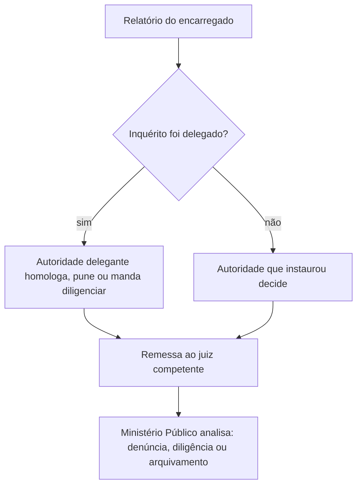

Abrir o IPM é o começo. Depois vêm as regras que mais caem em prova: o inquérito é sigiloso, mas o advogado pode ver? O indiciado pode ficar preso? Por quanto tempo? Em quantos dias o inquérito precisa terminar? O encarregado pode arquivá-lo? Quando o auto de prisão em flagrante dispensa o inquérito? Este capítulo responde a essas perguntas com base nos arts. 16 a 28 do Código de Processo Penal Militar e, para cobrir o edital inteiro, nas regras do auto de prisão em flagrante (arts. 243 a 253).

> [!objetivos]
> - Explicar o sigilo do IPM e o acesso do advogado, inclusive na hipótese do artigo 16-A.
> - Aplicar os prazos de incomunicabilidade, detenção e conclusão do inquérito.
> - Descrever o relatório e o destino dos autos, com as regras de arquivamento e de novo inquérito.
> - Identificar as hipóteses de flagrante, o procedimento do auto e os prazos da nota de culpa e da remessa ao juiz.

## Sigilo e acesso do advogado (art. 16)

O inquérito é **sigiloso**. A razão é proteger a investigação e a imagem do investigado até que a acusação se forme. O encarregado, porém, **pode permitir** que o advogado do indiciado tome conhecimento do que consta nos autos. É uma permissão do encarregado, e não um direito expresso no texto original do artigo. Hoje, porém, a defesa pode invocar a Súmula Vinculante 14 do STF, que garante ao advogado acesso às provas já documentadas no procedimento investigatório, relativas ao exercício do direito de defesa.

No caso de policiais e bombeiros militares investigados por fatos relacionados ao uso da força letal, o artigo 16-A (acrescentado em 2019) assegura o direito de **constituir defensor**: o investigado é citado, tem 48 horas para constituir defensor e, se não o fizer, a instituição é intimada a indicar um, em mais 48 horas, preferencialmente da Defensoria Pública.

> [!jurisprudencia] STF, Súmula Vinculante 14
> O advogado tem direito de ver as provas já documentadas em procedimento investigatório de órgão com competência de polícia judiciária, desde que digam respeito ao exercício do direito de defesa do seu cliente. As diligências em andamento podem ficar protegidas.

> [!pegadinha] Sigiloso para o público, não para a defesa
> A banca afirma que "o IPM é sigiloso, e nem o advogado pode ter acesso". A afirmativa é falsa: o sigilo vale para o público, e o advogado do indiciado pode conhecer o que já foi documentado.

## Incomunicabilidade e detenção (arts. 17 e 18)

O Código permite duas medidas restritivas no curso do inquérito.

- **Incomunicabilidade** (art. 17): o encarregado pode manter incomunicável o indiciado que estiver legalmente preso, por **no máximo três dias**. Parte da doutrina entende que esse dispositivo não foi recebido pela Constituição de 1988, porque o preso tem direito à assistência de advogado e à comunicação com a família. Em prova, vale o texto do Código.
- **Detenção** (art. 18): independentemente de flagrante, o indiciado pode ficar **detido durante as investigações por até trinta dias**, e a detenção é comunicada à autoridade judiciária competente. O prazo pode ser **prorrogado por mais vinte dias**, pelo comandante da região, do distrito naval ou da zona aérea, mediante solicitação fundamentada do encarregado e por via hierárquica.

> [!lei] CPPM, art. 18
> Independentemente de flagrante delito, o indiciado poderá ficar detido, durante as investigações policiais, até trinta dias, comunicando-se a detenção à autoridade judiciária competente.

Se entender necessário, o encarregado pode solicitar, dentro do prazo ou da prorrogação, a decretação de **prisão preventiva** ou de **menagem** do indiciado, sempre com justificativa. A prisão preventiva é decretada pelo juiz, e a menagem é uma forma de custódia menos gravosa, em que o militar permanece em local determinado, sob compromisso.

| Medida | Prazo máximo | Quem determina | Observação |
| --- | --- | --- | --- |
| Incomunicabilidade | 3 dias | encarregado | só para quem está legalmente preso |
| Detenção | 30 dias | encarregado, com comunicação ao juiz | prorrogável por mais 20 dias |
| Prorrogação da detenção | +20 dias | comandante da região, distrito ou zona, por solicitação fundamentada | por via hierárquica |
| Prisão preventiva ou menagem | conforme decisão judicial | juiz, a pedido do encarregado | pedido dentro do prazo ou da prorrogação |

> [!atencao] Detenção e a Constituição
> A Constituição só admite prisão sem ordem judicial em flagrante ou nos casos de **transgressão militar ou crime propriamente militar**, definidos em lei (art. 5º, LXI). Por isso a detenção do art. 18 é cabível, em regra, nos crimes propriamente militares. A prova cobra o prazo (30 dias, mais 20), e as questões mais refinadas, a limitação constitucional.

## Como se colhem os depoimentos (art. 19)

O Código regula o horário e a duração das oitivas.

1. Testemunhas e indiciado devem ser ouvidos **durante o dia**, entre **sete e dezoito horas**, salvo urgência inadiável, que deve constar da assentada.
2. O escrivão registra o dia e a hora do início, das interrupções e do encerramento das inquirições.
3. A testemunha não é inquirida por mais de **quatro horas consecutivas**, com descanso de **meia hora** se as declarações forem além disso.
4. O depoimento que não terminar às dezoito horas é encerrado e continua no dia seguinte, em hora marcada pelo encarregado. Se o dia seguinte não for útil, a inquirição pode ser adiada para o primeiro dia útil, salvo urgência.

## Prazo para terminar o inquérito (art. 20)

O prazo depende da situação do indiciado.

| Situação | Prazo | Marco inicial |
| --- | --- | --- |
| Indiciado preso | 20 dias | dia em que se executar a ordem de prisão |
| Indiciado solto | 40 dias | data da instauração do inquérito |
| Prorrogação (indiciado solto) | +20 dias | pela autoridade militar superior, se faltar exame ou perícia iniciados ou diligência indispensável |
| Prorrogações além disso | excepcional | só por dificuldade insuperável, a juízo do ministro de Estado |

O pedido de prorrogação deve ser feito em tempo oportuno, para ser atendido antes do fim do prazo. Os laudos que não ficarem prontos e os documentos colhidos depois da prorrogação são remetidos ao juiz para juntada ao processo, e o encarregado pode indicar, no relatório, as testemunhas que deixaram de ser ouvidas. Deduzem-se do prazo os períodos de interrupção por troca de encarregado (art. 10, § 5º).

> [!bizu] 20 para o preso, 40 para o solto
> A lógica é simples: quem está preso precisa de resposta mais rápida. Preso, 20 dias; solto, 40 dias, com prorrogação de mais 20 só para o solto. Cuidado com a contagem: para o preso, a partir da execução da ordem de prisão; para o solto, a partir da instauração.

## Organização das peças e relatório (arts. 21 e 22)

Todas as peças são reunidas por **ordem cronológica**, em um só processado, com folhas numeradas e rubricadas pelo escrivão. Cada documento juntado é precedido de despacho do encarregado, e o escrivão lavra o termo respectivo com a data.

O inquérito é encerrado com **relatório minucioso**, em que o encarregado menciona as diligências feitas, as pessoas ouvidas e os resultados, com indicação do dia, da hora e do lugar do fato. Na conclusão, informa se há **infração disciplinar a punir** ou **indício de crime**, e, neste caso, pronuncia-se de forma justificada sobre a conveniência da prisão preventiva do indiciado.

Quando a abertura do inquérito foi delegada, o encarregado envia os autos à autoridade que delegou, para que ela:

1. **homologue ou não** a solução;
2. **aplique penalidade**, se foi apurada infração disciplinar; ou
3. **determine novas diligências**, se necessário.

Se a autoridade discordar da solução, pode **avocar** o inquérito e dar solução diferente (art. 22, § 2º).

## Remessa, arquivamento e novo inquérito (arts. 23 a 26)

Os autos são remetidos ao juiz competente (nas Justiças Militares da União, o auditor da circunscrição; na Justiça Militar estadual, o juiz de direito do juízo militar), com os instrumentos do crime e os objetos de interesse para a prova.

O ponto mais importante é este: a **autoridade militar não pode mandar arquivar** autos de inquérito, **ainda que ele conclua pela inexistência de crime ou pela inimputabilidade** do indiciado (art. 24). Quem decide o arquivamento é a Justiça, a requerimento do Ministério Público.

O arquivamento não impede a abertura de **novo inquérito**, se surgirem novas provas sobre o fato, o indiciado ou terceiro, ressalvados a coisa julgada e os casos de extinção da punibilidade (art. 25). Nesse caso, o juiz remete os autos ao Ministério Público, que pode requisitar a abertura. O Ministério Público também pode requerer o arquivamento, se entender inadequada a instauração.

Por fim, os autos só podem ser devolvidos à autoridade militar em duas situações: (1) por **requisição do Ministério Público**, para diligências imprescindíveis ao oferecimento da denúncia; e (2) por **determinação do juiz**, antes da denúncia, para cumprir formalidades ou complementar prova. Em qualquer dos casos, o juiz marca prazo de, no máximo, **vinte dias** para a restituição (art. 26).

> [!pegadinha] Quem arquiva
> A afirmação "o encarregado, ao concluir que não houve crime, arquiva o inquérito" é falsa. O encarregado conclui no relatório; o arquivamento é pedido pelo Ministério Público e determinado pelo juiz. A autoridade militar jamais arquiva.

## Quando o flagrante basta e quando o inquérito é dispensado (arts. 27 e 28)

Se o **auto de prisão em flagrante** for suficiente, por si só, para esclarecer o fato e a autoria, ele constitui o inquérito e dispensa outras diligências. Ficam ressalvados o exame de corpo de delito, nos crimes que deixam vestígios, a identificação da coisa e a avaliação, quando o valor influir na pena. A remessa ao juiz é feita sem demora, com breve relatório.

O inquérito pode ser **dispensado**, sem prejuízo das diligências que o Ministério Público requisitar, quando:

- o fato e a autoria já estiverem esclarecidos por documentos ou outras provas materiais;
- nos crimes contra a honra decorrentes de escrito ou publicação, se o autor já estiver identificado;
- nos crimes dos arts. 341 e 349 do Código Penal Militar.

## Auto de prisão em flagrante (arts. 243 a 253)

O flagrante é a prisão de quem é surpreendido no momento ou logo depois do crime. Qualquer pessoa pode prender quem esteja em flagrante, e os militares **devem** fazê-lo (art. 243). O Código considera em flagrante quem:

1. **está cometendo** o crime;
2. **acaba de cometê-lo**;
3. é **perseguido logo após** o fato, em situação que faça acreditar ser o autor;
4. é **encontrado logo depois** com instrumentos, objetos ou papéis que façam presumir sua participação.

Nas infrações permanentes, o agente está em flagrante enquanto não cessar a permanência.

### Passos do auto

| Passo | Regra |
| --- | --- |
| Apresentação do preso | ao comandante ou oficial de dia, de serviço ou de quarto, ou à autoridade judiciária |
| Oitivas | condutor, testemunhas e indiciado, com auto assinado por todos |
| Falta de testemunhas | não impede o auto; assinam duas pessoas que presenciaram a apresentação |
| Recolhimento | se houver fundada suspeita, o preso é recolhido, com exame de corpo de delito e apreensões |
| Nota de culpa | em 24 horas, com motivo da prisão, nome do condutor e das testemunhas |
| Remessa ao juiz | imediata, e no máximo em cinco dias se depender de diligência |
| Preso | fica à disposição do juiz competente depois de lavrado o auto |

Se a autoridade verificar a **manifesta inexistência de infração militar** ou a não participação do conduzido, **relaxa a prisão**; se a infração for comum, remete o preso à autoridade civil (art. 247, § 2º). O juiz pode conceder **liberdade provisória** quando o auto mostrar que o agente agiu nas condições de certas excludentes do Código Penal Militar (art. 253).

> [!resolvido] Prazos do flagrante
> **Situação:** o soldado A é preso em flagrante por crime propriamente militar às 10 horas de segunda. Em que prazo deve receber a nota de culpa e quando o auto vai ao juiz?
>
> **Resposta:** a nota de culpa deve ser entregue em até 24 horas da prisão, com o motivo e os nomes do condutor e das testemunhas. O auto segue **imediatamente** ao juiz competente; se depender de diligência prevista no art. 246, o prazo máximo é de cinco dias.

## Mapa do capítulo

| Tema | Regra | Armadilha |
| --- | --- | --- |
| Sigilo | o inquérito é sigiloso, mas o advogado pode ter acesso | negar acesso do advogado |
| Incomunicabilidade | até 3 dias para o preso | confundir com a detenção |
| Detenção | 30 dias, mais 20 | contar a prorrogação por outra autoridade |
| Prazo do IPM | 20 dias preso, 40 solto (+20) | trocar os prazos |
| Relatório | indica infração disciplinar ou indício de crime | esquecer a conclusão |
| Arquivamento | só pelo juiz, a pedido do MP | atribuir ao encarregado |
| Flagrante | nota de culpa em 24 horas; remessa imediata | confundir prazos |

### Para fixar
- O IPM é sigiloso, mas o encarregado pode permitir acesso do advogado, e a SV 14 garante acesso às provas documentadas.
- O artigo 16-A assegura defensor ao militar investigado por uso da força letal: 48 horas para constituir, mais 48 para a instituição indicar.
- A incomunicabilidade do preso é de no máximo 3 dias; a detenção, de até 30 dias, prorrogável por mais 20.
- O IPM termina em 20 dias se o indiciado está preso e em 40 dias se está solto, com prorrogação de 20 dias para o solto.
- Depoimentos são tomados entre 7 e 18 horas, e a testemunha não passa de 4 horas seguidas.
- O relatório conclui se há infração disciplinar a punir ou indício de crime.
- A autoridade militar não arquiva o IPM; o arquivamento é judicial, a pedido do Ministério Público.
- O arquivamento não impede novo inquérito diante de novas provas.
- O auto de flagrante pode constituir o inquérito se bastar para esclarecer o fato e a autoria.
- A nota de culpa é entregue em 24 horas, e o auto segue ao juiz imediatamente, com prazo máximo de cinco dias se houver diligência.
