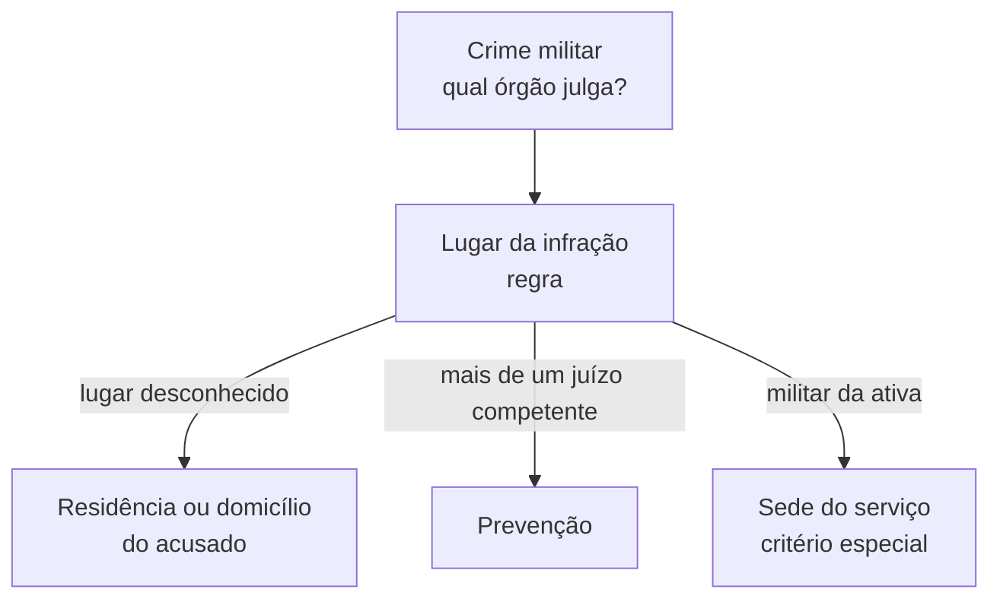

Quando um policial militar ou um bombeiro militar comete um crime militar, quem deve julgá-lo? A resposta passa por dois conceitos que parecem iguais e não são: jurisdição e competência. Este capítulo mostra como a Constituição divide o trabalho entre a Justiça Militar da União e as Justiças Militares dos Estados, quem está sujeito ao foro militar e quais critérios o Código de Processo Penal Militar (CPPM) usa para escolher o órgão que cuidará de cada caso. É uma base cobrada com frequência, em especial a regra sobre crimes dolosos contra a vida de civis.

> [!objetivos]
> - Diferenciar jurisdição e competência e citar as classificações usuais da jurisdição.
> - Distinguir a Justiça Militar da União da Justiça Militar estadual quanto às pessoas e às matérias.
> - Listar quem se submete ao foro militar e conhecer a exceção dos crimes dolosos contra a vida de civil.
> - Aplicar os critérios do art. 85 do CPPM: lugar da infração, domicílio, prevenção e sede do serviço.

## Jurisdição e competência

**Jurisdição** é o poder de aplicar o direito ao caso concreto. É atribuída aos magistrados, é una e indivisível. **Competência** é a medida dessa jurisdição: define em que momento e para que tipo de causa cada juiz pode exercê-la. Por isso se diz que todo juiz tem jurisdição, mas nem todo juiz é competente para todas as causas. Um juiz do trabalho, por exemplo, tem jurisdição, mas não pode julgar um crime militar, que pertence à Justiça Militar.

Embora una, a jurisdição é classificada por critérios que ajudam a descobrir qual órgão atua. Os principais são os seguintes.

| Critério | Espécies |
| --- | --- |
| Hierarquia | Superior e inferior |
| Matéria | Penal e civil |
| Organismo jurisdicional | Estadual e federal |
| Objeto | Contenciosa e voluntária |
| Função | Ordinária e especial |
| Limitação da competência | Plena e limitada |
| Fonte do direito | Legal e convencional |
| Delimitação a certos crimes | Exclusiva e cumulativa |

> [!bizu] Frase de bolso
> Jurisdição é o poder, competência é a medida do poder. Se o enunciado tratar os dois termos como sinônimos, desconfie.

## Base constitucional

A Constituição trata da Justiça Militar em dois dispositivos. O art. 124 dá à Justiça Militar da União a missão de processar e julgar os crimes militares definidos em lei, e a lei que define o crime militar é o Código Penal Militar. O art. 125, § 4º, cuida da Justiça Militar dos Estados.

> [!lei] CF, art. 125, § 4º
> Compete à Justiça Militar estadual processar e julgar os militares dos Estados, nos crimes militares definidos em lei e as ações judiciais contra atos disciplinares militares, ressalvada a competência do júri quando a vítima for civil.

Dessa estrutura saem duas diferenças que as bancas exploram.

| Aspecto | Justiça Militar da União | Justiça Militar estadual |
| --- | --- | --- |
| Quem pode ser julgado | Militares e também **civis** que cometam crime militar | Apenas **policiais e bombeiros militares** |
| Matéria | Somente crimes militares | Crimes militares e **ações contra atos disciplinares** |

Os crimes militares são os mesmos nos dois âmbitos; muda quem os julga. Para um militar estadual (um bombeiro militar de Pernambuco, por exemplo), o caminho normal é a Justiça Militar estadual. A organização interna de cada Justiça estadual obedece à lei do respectivo Estado, mas o CPPM continua sendo a regra processual aplicada.

> [!atencao] Civil e Justiça Militar estadual
> A Justiça Militar estadual **não julga civil**. Se um civil comete crime em concurso com um militar estadual, o civil responde na Justiça comum e o militar, pelo crime militar, na Justiça Militar estadual. Já na esfera da União o civil pode ser julgado pela Justiça Militar.

## Foro militar: quem se sujeita

O foro militar é um foro **especial**. Em tempo de paz, nos crimes militares definidos em lei, ficam sujeitos a ele:

1. os militares em situação de atividade;
2. os militares da reserva convocados para o serviço ativo;
3. os reservistas convocados ou mobilizados, em manobras ou no desempenho de funções militares;
4. os oficiais e praças das Polícias e dos Corpos de Bombeiros Militares incorporados às Forças Armadas;
5. os militares da reserva remunerada e os reformados que cometam crimes militares;
6. os civis, mas **somente na Justiça Militar da União**.

Em tempo de guerra, a lei especial pode ampliar o rol, desde que a previsão seja anterior ao fato. Isso respeita a legalidade e a proibição de tribunal de exceção.

### A exceção dos crimes dolosos contra a vida de civil

O foro militar tem uma exceção importante: nos crimes **dolosos contra a vida praticados contra civil**, a competência é do Tribunal do Júri. O art. 82, § 2º, do CPPM manda a Justiça Militar enviar os autos do inquérito à Justiça comum. O art. 9º, § 1º, do Código Penal Militar tem a mesma regra: esses crimes, quando cometidos por militar contra civil, são da competência do Tribunal do Júri.

O § 2º do art. 9º, incluído pela Lei 13.491/2017, abre exceções, mas apenas para os militares das **Forças Armadas**. Eles são julgados pela Justiça Militar da União quando o crime ocorre em contextos como cumprimento de atribuições definidas pelo Presidente da República ou pelo Ministro da Defesa, ação ligada à segurança de instituição ou de missão militar, ou atividades de natureza militar, operação de paz e garantia da lei e da ordem.

> [!pegadinha] Exceção só para as Forças Armadas
> As exceções do art. 9º, § 2º, do Código Penal Militar alcançam militares das Forças Armadas. O bombeiro militar e o policial militar que matam dolosamente um civil continuam sujeitos ao Tribunal do Júri, mesmo em serviço.

## Critérios gerais de competência (art. 85)

Definido que o caso é da Justiça Militar, é preciso saber qual órgão atuará. O art. 85 do CPPM fixa os critérios.

> [!lei] CPPM, art. 85
> A competência do foro militar será determinada: I – de modo geral: a) pelo lugar da infração; b) pela residência ou domicílio do acusado; c) pela prevenção; II – de modo especial, pela sede do lugar de serviço.

No texto do CPPM, a Justiça Militar de primeira instância aparece com o nome de **Auditoria**, dentro de circunscrições judiciárias. Em Pernambuco, a primeira instância é o juízo militar estadual, mas a lógica dos critérios é a mesma.

Dentro de cada circunscrição, o art. 86 prevê a competência por especialização, distribuição e disposição especial. Hoje todas as Auditorias têm competência mista e, onde há mais de uma na mesma sede, atua a **distribuição**, de forma paritária.

O art. 87 lista o que **afasta** os critérios gerais: conexão ou continência, prerrogativa de posto ou de função e desaforamento. Esses temas ficam para o próximo capítulo.

## Lugar da infração

A regra é que o lugar do crime determine a competência (art. 88). No caso de **tentativa**, vale o lugar do **último ato de execução**.

O Código Penal Militar define o lugar do crime pela teoria mista (art. 6º): nos crimes comissivos, vale a **ubiquidade**, e o lugar é tanto onde se praticou a conduta quanto onde ocorreu o resultado; nos crimes omissivos, vale a teoria da atividade, e o lugar é aquele em que a ação omitida deveria ter sido realizada.

O CPPM tem regras especiais para situações em que o lugar é difícil de apontar.

| Situação | Quem é competente |
| --- | --- |
| Navio sob comando militar, ou tomado militarmente, atracado em porto brasileiro ou navegando em lago ou rio de fronteira (art. 89) | Auditoria da circunscrição do local onde o navio está |
| Navio em águas territoriais (art. 89, parte final) | O texto aponta a 1ª Auditoria da Marinha, extinta; o STM aplica o lugar do serviço |
| Aeronave militar, ou tomada militarmente, no espaço aéreo brasileiro (art. 90) | Auditoria da circunscrição em que a aeronave pousar depois do crime |
| Crime militar cometido fora do território nacional (art. 91) | Em regra, a Auditoria da Capital da União, em Brasília |
| Crime iniciado no exterior e consumado no Brasil (art. 92, a) | Auditoria da circunscrição do resultado, ainda que ele fosse apenas esperado |
| Crime iniciado no Brasil e consumado fora (art. 92, b) | Auditoria do lugar do último ato de execução |

Um exemplo ajuda. Se uma aeronave decola do Recife rumo a Porto Alegre e, depois de um crime a bordo, o comandante decide pousar em São Paulo, a Auditoria de São Paulo é a competente. A segunda parte do art. 90, sobre pouso em local remoto, caiu em desuso, porque hoje há Auditorias que cobrem todo o território.

O art. 92, parágrafo único, trata das circunscrições com mais de uma Auditoria: se ficam na mesma sede, vale a distribuição; se as sedes são diferentes, atende-se ao lugar da infração. Apenas Rio de Janeiro, São Paulo e Brasília têm mais de uma Auditoria na mesma sede.

> [!bizu] Resultado esperado também vale
> No crime que começa no exterior, o lugar do resultado fixa a competência mesmo que o resultado não venha a ocorrer. A palavra "devia" no texto legal (lugar em que o crime produziu ou **devia produzir** o resultado) é o detalhe que cai em prova.

## Domicílio e residência do acusado

Se o lugar da infração for desconhecido, a competência segue a **residência ou domicílio** do acusado (art. 93). É um critério **subsidiário**: só se usa quando não é possível saber onde o crime aconteceu. O CPPM trata os dois termos como equivalentes, mas no direito civil o domicílio é a residência com ânimo definitivo. O militar tem **domicílio necessário** no lugar onde serve (art. 76 do Código Civil), o que aproxima esse critério do da sede do serviço, visto no próximo capítulo. Na prática, quando o crime tem local incerto e o acusado é militar da ativa, o foro costuma ser o da unidade em que ele serve.

## Prevenção

A prevenção ocorre quando dois ou mais juízes são igualmente competentes: o que primeiro praticou algum ato do processo ou de medida a ele relativa, mesmo antes da denúncia, passa a ser o competente (art. 94). Se o juiz substituto pratica ato no inquérito policial militar, ele fica prevento.

O art. 95 lista os casos em que a prevenção pode ocorrer:

- lugar da infração incerto, por ter sido praticada na divisa entre duas ou mais jurisdições;
- limite territorial incerto entre jurisdições;
- infração continuada ou permanente praticada em mais de uma jurisdição;
- acusado com mais de uma residência, sem residência, ou vários acusados com residências diferentes.

A divisa incerta é o exemplo clássico. Um crime ocorrido na região de Petrolina e Juazeiro, separadas pelo Rio São Francisco, pode deixar dúvida de qual margem foi o local, e a prevenção resolve. A distribuição entre Auditorias da mesma sede é considerada, pela doutrina, uma espécie de prevenção.

## Mapa do capítulo

| Tema | Ideia central | Como cai em prova |
| --- | --- | --- |
| Jurisdição × competência | Poder x medida do poder | Tratar como sinônimos |
| JMU × Justiça estadual | Civis só na União; ações disciplinares só nos Estados | Trocar quem é julgado |
| Foro militar | Rol de pessoas; civis só na União | Incluir civil na estadual |
| Doloso contra a vida de civil | Júri; exceção só para Forças Armadas | Aplicar a exceção ao bombeiro |
| Art. 85 | Lugar, domicílio, prevenção e sede do serviço | Ordem e natureza de cada critério |
| Lugar do crime | Ubiquidade nos comissivos | Tentativa e crime a distância |

### Para fixar

1. Jurisdição é o poder de julgar; competência é a medida desse poder em cada caso.
2. A Justiça Militar da União julga militares e civis em crimes militares; a Justiça Militar estadual julga apenas policiais e bombeiros militares, e também as ações contra atos disciplinares.
3. Quem pratica crime doloso contra a vida de civil responde perante o Tribunal do Júri; as exceções do art. 9º, § 2º, do Código Penal Militar valem só para as Forças Armadas.
4. O art. 85 do CPPM fixa como critérios gerais o lugar da infração, o domicílio ou residência do acusado e a prevenção, e como critério especial a sede do lugar de serviço.
5. Na tentativa, a competência é do lugar do último ato de execução.
6. O Código Penal Militar adota a ubiquidade nos crimes comissivos e a teoria da atividade nos omissivos.
7. O domicílio do acusado é critério subsidiário, aplicado quando o lugar da infração é desconhecido.
8. A prevenção só entra quando houver mais de um juízo igualmente competente e fixa a competência no que praticou primeiro algum ato do processo ou de medida a ele relativa.
9. O militar tem domicílio necessário no lugar em que serve.
