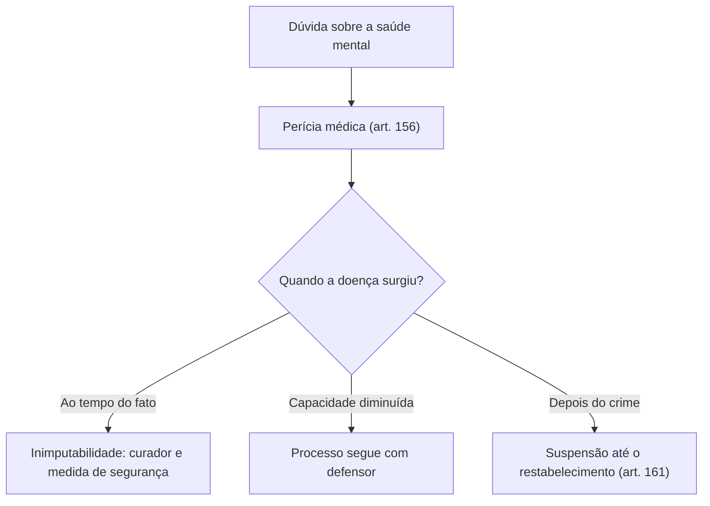

Durante um processo, podem surgir questões que não fazem parte da acusação, mas precisam ser resolvidas antes ou durante o julgamento. O Código de Processo Penal Militar chama de incidentes esses episódios paralelos e disciplina dois: o de insanidade mental do acusado e o de falsidade de documento. Em ambos, o objetivo é proteger a justiça da decisão final: no primeiro, saber se o acusado podia entender o que fez; no segundo, saber se uma prova documental é autêntica.

> [!objetivos]
> - Indicar quando cabe o incidente de insanidade mental e quem pode pedi-lo.
> - Descrever internação, prazo do laudo, quesitos obrigatórios e efeitos da conclusão pericial.
> - Distinguir inimputabilidade, inimputabilidade relativa e doença mental superveniente.
> - Reproduzir o procedimento do incidente de falsidade de documento.

## Incidente de insanidade mental

Quando há dúvida sobre a **imputabilidade** do acusado, por doença ou deficiência mental, ele é submetido a perícia médica (art. 156). A imputabilidade é a capacidade de entender o caráter ilícito do fato e de agir de acordo com esse entendimento. O Código Penal Militar adota o critério **biopsicológico**: não basta existir a doença; é preciso que ela, ao tempo da ação ou omissão, tenha retirado ou reduzido a capacidade de entender e de se determinar. Por isso o incidente é cabível sempre que houver indício de que o acusado não estava em plena posse de suas faculdades mentais.

## Quem pede e quando

O juiz pode determinar a perícia por conta própria ou atender a pedido de uma destas pessoas: o promotor, o defensor, o curador, o cônjuge, um ascendente, um descendente ou um irmão do acusado. Isso pode acontecer **em qualquer fase do processo**, e também durante o **inquérito policial militar**, por iniciativa do encarregado ou a pedido dessas mesmas pessoas.

| Fase | Quem determina |
| --- | --- |
| Processo | Juiz, de ofício ou a requerimento do MP, do defensor, do curador ou de familiares próximos |
| Inquérito policial militar | Encarregado do inquérito, por iniciativa própria ou a pedido dessas pessoas |

## Internação para a perícia e prazo do laudo

Para o exame, o acusado **preso** será internado em manicômio judiciário, onde houver. Se estiver **solto**, só será internado se os peritos pedirem, e em estabelecimento adequado designado pelo juiz (art. 157).

> [!atencao] "Manicômio judiciário" é termo antigo
> O texto do CPPM ainda usa essa expressão. Mas o Código Penal Militar, após a Lei 14.688/2023, passou a falar em internação em **estabelecimento de custódia e tratamento** ou em seção especial de estabelecimento penal (art. 110, § 1º, I). A mudança retirou um termo pejorativo. Em prova, leia o enunciado: se ele pedir o texto do CPPM, o termo é manicômio judiciário; se pedir a norma atual de medidas de segurança, é custódia e tratamento.

O laudo deve ser apresentado em **quarenta e cinco dias**, e o juiz pode prorrogar o prazo se os peritos demonstrarem que precisam de mais tempo (art. 157, § 1º). Se isso não prejudicar o andamento do processo, o juiz pode autorizar que os autos sejam entregues aos peritos para facilitar o trabalho, o que também pode fazer o encarregado do inquérito (art. 157, § 2º).

## O que acontece com o processo durante a perícia

A determinação da perícia **não paralisa tudo**. As diligências que poderiam ficar prejudicadas com o adiamento continuam. O que fica sustado é a produção de provas que exijam a presença do acusado submetido ao exame (art. 158).

## Quesitos

Os peritos respondem aos quesitos das partes e, obrigatoriamente, a quatro perguntas (art. 159):

1. se o acusado sofre de doença mental, de desenvolvimento mental incompleto ou retardado;
2. se, no momento da ação ou omissão, estava em algum desses estados;
3. se, por causa disso, ele compreendia que o fato era ilícito e conseguia controlar a própria conduta;
4. se a doença ou deficiência, sem suprimir, **diminuiu consideravelmente** essa capacidade.

Os quesitos são formulados pelas partes, primeiro pelo Ministério Público, e depois pela defesa. Quando a causa for **embriaguez completa decorrente de caso fortuito ou força maior**, formulam-se quesitos semelhantes, adaptados ao caso.

## Efeitos da conclusão do laudo

| Conclusão dos peritos | Efeito no processo |
| --- | --- |
| Inimputabilidade (art. 48, caput, do CPM) | O juiz, se concordar com o laudo, nomeia curador e declara por sentença a inimputabilidade, aplicando a medida de segurança correspondente |
| Inimputabilidade relativa (art. 48, parágrafo único, do CPM) | Inquérito ou processo prossegue, com defensor no processo; se houver condenação, aplica-se a medida de segurança do art. 113 do CPM |

> [!pegadinha] Relativa não suspende nem extingue
> A inimputabilidade **relativa** (capacidade diminuída) não impede o prosseguimento do processo. Quem tem capacidade apenas reduzida continua sendo julgado, com a presença de defensor, e pode ser condenado. A declaração de inimputabilidade com medida de segurança, por sua vez, é a consequência da inimputabilidade plena.

Há quem sustente que o art. 160 não foi recepcionado pela Constituição quando autoriza a medida de segurança imediata, por afronta ao contraditório e à ampla defesa (art. 5º, LV). O Superior Tribunal Militar prefere ler o dispositivo conforme a Constituição, assegurando a defesa antes da medida.

## Doença mental superveniente

Se a doença mental surge **depois do crime**, o inquérito ou o processo ficam **suspensos** até que o acusado se restabeleça, sem prejuízo das diligências que o adiamento possa prejudicar (art. 161). Nesse caso, ele pode ser internado em manicômio judiciário ou estabelecimento semelhante. Quando se restabelece, o processo retoma seu curso e o acusado pode pedir a repetição de depoimentos e diligências em que sua presença teria sido indispensável.

## Autos apartados

A verificação de insanidade corre em **autos apartados**, apensados ao processo principal só depois do laudo (art. 162). O pedido de exame de um acusado não impede o julgamento dos demais, se o laudo não tiver chegado até a data marcada. No inquérito, o rito é parecido, e ele pode ser encerrado antes do laudo, que seguirá depois ao juiz.

## Incidente de falsidade de documento

O segundo incidente verifica a autenticidade de documento que já está nos autos e sobre o qual pesam indícios de falsidade. Ela pode ser **material** (a forma, como uma assinatura forjada) ou **ideal** (o conteúdo, como uma declaração mentirosa em documento autêntico).

O procedimento é simples (art. 163): arguida a falsidade, se o juiz a reputar necessária à decisão da causa, ele:

1. manda autuar a impugnação em **apartado** e ouve a parte contrária, que responde em **quarenta e oito horas**;
2. abre prazo de **três dias** (tríduo) para as provas;
3. pode ordenar diligências e decide;
4. se reconhecer a falsidade, por decisão **irrecorrível**, manda desentranhar o documento e o remete, com os autos do incidente, ao Ministério Público.

Outras regras completam o quadro:

- a arguição pode ser **oral**, e então o juiz a reduz a termo e a autua como processo incidente (art. 164);
- quando feita por procurador, exige **poderes especiais** (art. 165);
- a verificação pode ser feita **de ofício** (art. 166);
- se o documento veio de repartição sob outra jurisdição, a verificação se faz naquele juízo, salvo se a falsidade for evidente ou puder ser apurada por perícia no juízo do feito (art. 167);
- o juiz pode sustar o processo até a apuração, se ela for imprescindível para condenar ou absolver, sem prejuízo das diligências independentes (art. 168);
- qualquer que seja a decisão, ela **não faz coisa julgada** em prejuízo de ulterior processo penal (art. 169).

| Etapa | Prazo ou característica |
| --- | --- |
| Resposta da parte contrária | 48 horas |
| Dilação probatória | 3 dias |
| Decisão que reconhece a falsidade | Irrecorrível |
| Efeito da decisão em outro processo penal | Sem coisa julgada |

> [!bizu] Números do incidente de falsidade
> Grave o par **48 horas e 3 dias**: 48 horas para a resposta, três dias para as provas. A banca costuma trocar um prazo pelo outro ou transformar a decisão em recorrível.

> [!lei] CPPM, art. 169
> Art 169 . Qualquer que seja a decisão, não fará coisa julgada em prejuízo de ulterior processo penal.

## Mapa do capítulo

| Tema | Ideia central | Armadilha |
| --- | --- | --- |
| Cabimento | Dúvida sobre imputabilidade por doença ou deficiência mental | Limitar a fase do processo |
| Quem pede | Juiz, MP, defensor, curador, cônjuge, ascendente, descendente ou irmão | Excluir familiares |
| Laudo | 45 dias, prorrogáveis pelo juiz | Trocar o prazo |
| Quesitos | Quatro obrigatórios, mais os das partes | Omitir o da capacidade diminuída |
| Inimputabilidade | Curador, sentença e medida de segurança | Confundir com a relativa |
| Superveniente | Suspensão até o restabelecimento | Dizer que o processo continua |
| Falsidade | 48 horas, 3 dias, decisão irrecorrível | Admitir recurso ou coisa julgada |

### Para fixar

1. O incidente de insanidade mental cabe quando há dúvida sobre a imputabilidade do acusado por doença ou deficiência mental.
2. A perícia pode ser ordenada em qualquer fase do processo e também no inquérito policial militar.
3. O laudo é apresentado em quarenta e cinco dias, prorrogáveis pelo juiz se os peritos demonstrarem necessidade.
4. A determinação da perícia susta apenas as provas que dependem da presença do acusado examinado.
5. Os quesitos obrigatórios tratam da doença, do estado ao tempo do fato, da capacidade de entender e de se determinar e da capacidade diminuída.
6. Reconhecida a inimputabilidade, o juiz nomeia curador e aplica medida de segurança; na relativa, o processo prossegue com defensor.
7. A doença mental superveniente ao crime suspende o inquérito ou o processo até o restabelecimento.
8. A verificação de insanidade corre em autos apartados, apensados ao principal após o laudo.
9. No incidente de falsidade, a resposta da outra parte vem em quarenta e oito horas e as provas em três dias.
10. A decisão que reconhece a falsidade é irrecorrível, e nenhuma decisão do incidente faz coisa julgada em ulterior processo penal.
