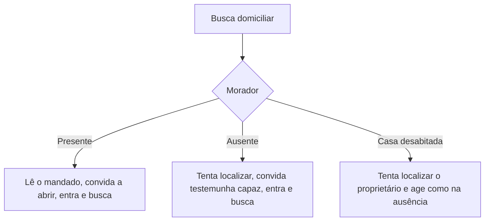

Para provar um crime, o Estado muitas vezes precisa entrar em uma casa, revistar uma pessoa ou recolher objetos. Essas providências atingem direitos fundamentais, como a inviolabilidade do domicílio e a propriedade, e por isso o Código de Processo Penal Militar as cerca de regras: quando podem ocorrer, quem as ordena, como se executam e o que acontece com o que foi apreendido. Este capítulo trata das **medidas preventivas e assecuratórias**, no ponto em que elas recaem sobre coisas ou pessoas: a busca e a apreensão, além das regras de restituição dos bens apreendidos.

> [!objetivos]
> - Distinguir busca domiciliar de busca pessoal (revista) e indicar as finalidades da busca.
> - Delimitar o conceito de "casa", o horário e as exigências do mandado.
> - Descrever o passo a passo do executor da busca e o conteúdo do auto.
> - Aplicar as regras de apreensão, de restituição e do destino das coisas apreendidas.

## Busca: espécies e finalidade

A busca pode ser **domiciliar** ou **pessoal** (art. 170). A domiciliar é a procura material portas adentro da casa. Já a revista, que é o nome da busca pessoal e consiste na procura nas vestes, pastas, malas e demais objetos que estejam com a pessoa e, quando necessário, no próprio corpo (art. 180).

A busca domiciliar só se faz quando **fundadas razões** a autorizarem, e para uma das finalidades do art. 172:

- capturar criminosos;
- recolher coisas conseguidas por meio de crime ou mantidas de forma ilícita;
- apreender instrumentos de falsificação ou contrafação;
- apreender armas, munições e instrumentos usados no crime ou destinados a fim delituoso;
- localizar objetos úteis para provar a infração ou para a defesa do acusado;
- apreender correspondência destinada ao acusado ou em seu poder, quando houver fundada suspeita de que seu conteúdo seja útil à elucidação do fato;
- apreender pessoas vítimas de crime;
- colher elemento de convicção.

> [!bizu] A busca serve também à defesa
> Entre as finalidades está encontrar objetos úteis à prova da infração **ou à defesa do acusado**. Alternativa que limite a busca à produção de prova de acusação erra ao ignorar essa parte do art. 172.

## O que é "casa"

Como a casa tem proteção constitucional (art. 5º, XI), o CPPM define o termo (art. 173). Compreende:

1. qualquer compartimento habitado;
2. o aposento ocupado de habitação coletiva;
3. o espaço fechado ao público em que alguém exerce profissão ou atividade.

Ficam fora do conceito (art. 174): hotel, hospedaria e outras habitações coletivas **enquanto abertas** (salvo o espaço ocupado como domicílio ou local de trabalho fechado ao público); taverna, boate, casa de jogo e semelhantes; e a moradia usada como cenário de infrações penais.

| Compreendido como "casa" | Não compreendido |
| --- | --- |
| Compartimento habitado | Hotel e hospedaria abertos ao público |
| Quarto de habitação coletiva ocupado por alguém | Taverna, boate, casa de jogo e semelhantes |
| Escritório ou consultório fechado ao público | Habitação usada para a prática de crimes |

## Quando, por quem e com que ordem

A busca domiciliar é executada **de dia**, salvo para acudir vítimas de crime ou desastre. Com consentimento expresso do morador, pode ser feita à noite (art. 175).

Quem a determina? O **juiz**, de ofício ou a requerimento das partes, ou a **autoridade policial militar**. O representante do Ministério Público que assessora o inquérito pode solicitar ao encarregado que a realize (art. 176).

Se a busca não for feita pelo próprio juiz ou pela autoridade que preside o inquérito, ela deve ser precedida de **mandado** (art. 177). O mandado precisa conter (art. 178):

| Elemento | Conteúdo |
| --- | --- |
| Identificação | Indicar, o mais precisamente possível, a casa e o nome do morador ou proprietário; na revista, o nome da pessoa ou os sinais que a identifiquem |
| Finalidade | Mencionar o motivo e os fins da diligência |
| Autenticação | Subscrição do escrivão e assinatura da autoridade que determinou a diligência |
| Prisão | Se houver ordem de prisão, ela consta do próprio mandado |

> [!lei] CPPM, art. 175
> A busca domiciliar será executada de dia, salvo para acudir vítimas de crime ou desastre. Se houver consentimento expresso do morador, poderá ser realizada à noite.

## Como a busca é executada

O executor segue passos que variam conforme o morador esteja presente, ausente ou a casa desabitada (art. 179).

**Morador presente.** O executor lê o mandado ou, se ele próprio é o autor da ordem, identifica-se e diz o que pretende. Convida o morador a abrir a porta, sob pena de forçar a entrada se não for atendido. Dentro da casa, convida o morador a apresentar a pessoa ou coisa procurada. Se não for atendido, ou se a pessoa ou coisa for incerta, faz a busca. Havendo resistência, usa a força necessária para vencê-la e pode arrombar móveis ou compartimentos em que presumivelmente estejam as coisas ou pessoas buscadas.

**Morador ausente.** Tenta localizá-lo para lhe dar ciência e espera sua chegada, se puder ser imediata. Se não o encontra ou ele não vem com presteza, convida pessoa capaz, que será identificada no auto, para testemunhar a diligência. Entra, arrombando a casa se necessário, e faz a busca, rompendo obstáculos em móveis ou compartimentos.

**Casa desabitada.** Tenta localizar o proprietário e procede como na ausência do morador.

Três cuidados valem em todos os casos:

- o rompimento de obstáculos deve causar **o menor dano possível**, com a intervenção de serralheiro ou outro profissional habilitado, sempre que possível;
- livros, documentos e objetos que **não foram apreendidos** devem ser repostos nos lugares originais;
- em casa habitada, a busca não deve molestar os moradores além do indispensável ao êxito da diligência.

## Busca pessoal (revista)

A revista é feita quando há **fundada suspeita** de que alguém oculte consigo instrumento ou produto do crime ou elementos de prova (art. 181). Ela **independe de mandado** (art. 182) em cinco situações:

1. quando acompanha a captura de quem deve ser preso;
2. no curso de uma busca domiciliar;
3. quando houver fundada suspeita de que a pessoa oculta instrumento ou produto do crime;
4. quando houver fundada suspeita de que o revistando traz objetos ou papéis que constituam corpo de delito;
5. quando acontece diante do juiz ou de quem preside o inquérito.

A busca em **mulher** será feita por outra mulher, se isso não causar retardamento ou prejuízo à diligência (art. 183).

Quem executa? Por mandado, no curso do processo, o **oficial de justiça**; no curso do inquérito, um **oficial** designado pelo encarregado, atendida a hierarquia do posto ou da graduação de quem sofre a busca, se militar (art. 184). A autoridade militar também pode requisitar à autoridade policial civil a realização da busca (art. 184, parágrafo único).

> [!pegadinha] Hierarquia na busca
> Quando a pessoa que sofre a busca é militar, o executor deve ser de posto ou graduação compatível. Alternativa que dispense essa atenção à hierarquia ignora a parte final do art. 184.

## Apreensão

Encontradas as pessoas ou coisas dos arts. 172 e 181, o executor as apreende. Apreende também armas ou objetos pertencentes às Forças Armadas ou de uso exclusivo de militares, quando estiverem em posse indevida ou for incerta a propriedade (art. 185). A correspondência, aberta ou não, destinada ao indiciado ou acusado ou em seu poder é apreendida se houver fundadas razões para suspeitar de sua utilidade à elucidação do fato (art. 185, § 1º).

A regra tem uma exceção importante: **não é permitida a apreensão de documento em poder do defensor** do acusado, salvo quando constituir elemento do corpo de delito (art. 185, § 2º).

O executor que persegue pessoa ou coisa pode penetrar em território de **outra jurisdição** (art. 186), considerando-se que a persegue quando a segue sem interrupção, mesmo que a perca de vista, ou quando vai em seu encalço sabendo por informações fidedignas que está sendo removida em certa direção. Ao entrar, deve apresentar-se à autoridade civil ou militar local, o que pode ser feito após a diligência se a urgência não permitir pausa (art. 187). O que for descoberto é imediatamente apreendido e posto sob custódia da autoridade ou de seus agentes (art. 188).

### Auto de busca e apreensão

Terminada a diligência, lavra-se auto circunstanciado, assinado por **duas testemunhas** (art. 189), com:

- lugar, dia e hora;
- identificação de quem sofreu a diligência e de quem dela participou ou assistiu;
- registro de todos os incidentes;
- relação e descrição das coisas apreendidas, no corpo do auto ou em anexo rubricado.

Na descrição das coisas, indicam-se a marca, o tipo e, se possível, a origem, o número e a data de fabricação, para máquinas, veículos, instrumentos e armas; título e autor, para livros; natureza, para documentos.

## Restituição de coisas apreendidas

A regra geral é que as coisas apreendidas **não podem ser restituídas enquanto interessarem ao processo** (art. 190). Duas categorias têm tratamento especial:

| Coisa | Restituição |
| --- | --- |
| Instrumentos do crime cujo fabrico, uso, porte ou detenção seja ilícito (CPM, art. 109, II, a), e coisas de uso exclusivo militar ou das Forças Armadas em poder indevido (CPM, art. 119, I e II) | Nunca, em tempo algum (art. 190, § 1º) |
| Produto do crime ou proveito obtido pelo agente (CPM, art. 109, II, b) | Somente ao lesado ou a terceiro de boa-fé (art. 190, § 2º) |

Para restituir, a autoridade policial militar ou o juiz podem ordenar, por termo nos autos, desde que (art. 191): a coisa não seja irrestituível, já não interesse ao processo e não haja dúvida quanto ao direito do reclamante.

### Direito duvidoso

Se o direito do reclamante for duvidoso, somente o juiz pode decidir. O pedido é autuado em apartado, com **cinco dias** para a prova, e o juiz decide em seguida; cabe **recurso ao Superior Tribunal Militar** (art. 192). Se a matéria for de alta indagação, o reclamante é remetido ao juízo cível, e as coisas continuam apreendidas até a solução.

### Coisa em poder de terceiro de boa-fé

Se a coisa foi apreendida em poder de **terceiro de boa-fé** (art. 193):

1. se a restituição for pedida só pelo terceiro, o juiz pode ordená-la, se estiverem presentes os requisitos do art. 191;
2. se for pedida pelo acusado ou pelo lesado e também pelo terceiro, o incidente é autuado em apartado, com **cinco dias** para provas e **três dias** para as razões, e o juiz decide, cabendo recurso ao STM.

Persistindo a dúvida sobre a propriedade, os reclamantes são remetidos ao juízo cível. O juiz pode nomear **depositário** idôneo até a solução.

O Ministério Público é **sempre ouvido** em pedido ou incidente de restituição. A decisão que ordenar a restituição é impugnável por recurso, com efeito suspensivo, ao STM (art. 194).

## Destino final das coisas

| Situação | Destino |
| --- | --- |
| Coisa facilmente deteriorável | Avaliada e levada a leilão público; dinheiro depositado em estabelecimento oficial de crédito (art. 195) |
| Após 90 dias do trânsito em julgado de sentença condenatória: coisas do art. 109, II, a, do CPM | Inutilizadas, recolhidas a Museu Criminal ou entregues às Forças Armadas, se lhes interessarem (art. 196, a) |
| Após 90 dias do trânsito em julgado de sentença condenatória: outros bens | Avaliados e vendidos em leilão; o que não couber ao lesado ou terceiro de boa-fé vai ao fundo da organização militar do Conselho de Justiça (art. 196, b) |
| Sentença absolutória transitada em julgado | Se houve confisco, destino do art. 196, a; nos demais casos, restituição a quem teve a coisa apreendida (art. 197) |
| Bens não reclamados em 90 dias do trânsito da sentença final | Leilão, com saldo à disposição do juiz de ausentes (art. 198) |

> [!atencao] Noventa dias em dois momentos
> O prazo de noventa dias aparece em dois contextos próximos: após o trânsito da sentença condenatória (art. 196) e como prazo para reclamar os objetos não reclamados (art. 198). A banca explora a troca entre os dois, ou a mudança do número.

## Como a banca cobra este assunto

As questões costumam testar: o conceito de "casa" e o que não se enquadra nele; o horário (dia, salvo consentimento ou vítimas); a diferença entre a busca com e sem mandado; a **proibição de apreender documento em poder do defensor**; o prazo de cinco dias do incidente de restituição; o cabimento de recurso ao STM; e o destino das coisas depois da sentença. Muitas trocam "de dia" por "de noite", ou admitem a apreensão de qualquer documento do advogado.

> [!resolvido] Questão comentada: documento com o defensor
> Durante uma busca no escritório do defensor do acusado, a autoridade encontra um documento que interessa à investigação, mas que não constitui elemento do corpo de delito. Pode apreendê-lo?
>
> **Resolução.** Não. O art. 185, § 2º, veda a apreensão de documento em poder do defensor do acusado, salvo se ele for elemento do corpo de delito. Como o documento é só de interesse da investigação, a apreensão é irregular.

> [!exemplo] Busca em casa fechada
> Em um quartel, o executor chega à casa de um suspeito ao meio-dia com mandado, mas o morador não está. Ele tenta localizá-lo, aguarda alguns minutos, convida um vizinho capaz para testemunhar, entra e faz a busca com o menor dano possível. Ao final, repõe os papéis que não apreendeu e lavra o auto com duas testemunhas.

## Mapa do capítulo

| Tema | Ideia central | Armadilha |
| --- | --- | --- |
| Espécies | Domiciliar e pessoal | Confundir com apreensão |
| Casa | Compartimento habitado, aposento de habitação coletiva e local fechado de trabalho | Incluir hotel aberto ou boate |
| Horário | De dia; à noite com consentimento ou para acudir vítimas | Admitir a noite sem ressalva |
| Mandado | Exigido, salvo busca feita pelo juiz ou pelo presidente do inquérito | Dispensar sempre |
| Revista | Independe de mandado nos casos do art. 182 | Exigir mandado em toda revista |
| Apreensão | Documento do defensor só se for corpo de delito | Permitir apreender qualquer documento |
| Auto | Duas testemunhas, lugar, dia, hora e relação de coisas | Esquecer as testemunhas |
| Restituição | Só se não interessa ao processo e sem dúvida sobre o direito | Restituir durante o processo |
| Recurso | Ao STM, nos casos do art. 192 e do art. 194 | Trocar o órgão julgador |
| Destino | Leilão, Museu Criminal ou restituição, conforme o caso | Misturar condenação e absolvição |

### Para fixar

1. A busca pode ser domiciliar ou pessoal; a domiciliar exige fundadas razões e uma das finalidades do art. 172.
2. O conceito de casa inclui o compartimento habitado, o aposento de habitação coletiva e o local fechado ao público onde se exerce atividade.
3. Hotel aberto, boate, casa de jogo e habitação usada para o crime não são "casa" para esse fim.
4. A busca domiciliar é feita de dia, salvo para acudir vítimas ou com consentimento do morador.
5. O mandado exige indicação da casa, motivo e fins, subscrição do escrivão e assinatura da autoridade.
6. A revista independe de mandado nos casos do art. 182, e a busca em mulher é feita por outra mulher se não houver prejuízo.
7. A apreensão de documento em poder do defensor só é possível se ele for elemento do corpo de delito.
8. O auto de busca e apreensão é assinado por duas testemunhas e descreve as coisas apreendidas.
9. A restituição só ocorre se a coisa não interessa mais ao processo, não é irrestituível e não há dúvida sobre o direito do reclamante.
10. Direito duvidoso vai ao juiz, com cinco dias para provas e recurso ao STM; a coisa deteriorável é levada a leilão.
