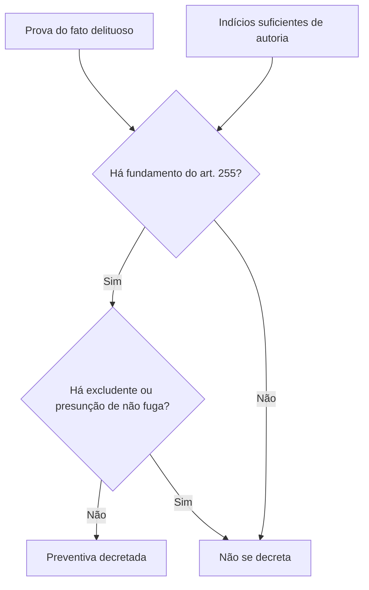

A prisão em flagrante é a porta de entrada da prisão provisória. A **prisão preventiva** é a que a sucede, ou a substitui, quando a liberdade do acusado põe em risco a investigação, o processo ou a disciplina militar. Ao lado dela existem alternativas e instrumentos próprios do processo penal militar: o **comparecimento espontâneo**, a **menagem**, a **liberdade provisória** e a **aplicação provisória de medidas de segurança**. Este capítulo trata de todas elas, com atenção aos requisitos, aos prazos e às vedações que a banca costuma cobrar.

> [!objetivos]
> - Indicar quem decreta a prisão preventiva, seus requisitos e fundamentos.
> - Aplicar as hipóteses em que a preventiva não é decretada ou deve ser revogada.
> - Explicar o comparecimento espontâneo e a menagem, com limite de pena, lugar e cassação.
> - Reconhecer os casos de liberdade provisória e de medidas de segurança provisórias.

## Prisão preventiva

A prisão preventiva é outra espécie de prisão provisória. Quem a decreta é o **auditor** ou o **Conselho de Justiça**, por iniciativa própria, a pedido do Ministério Público ou por representação do encarregado do inquérito, **em qualquer fase** da investigação ou do processo (art. 254). Na instrução de processo originário do Superior Tribunal Militar, a decisão cabe ao **relator**.

### Requisitos e fundamentos

A decretação exige, em todos os casos, dois requisitos do art. 254: **prova do fato delituoso** e **indícios suficientes de autoria**. São os requisitos gerais das medidas cautelares: a probabilidade de o fato ter ocorrido e de o acusado ser o autor.

Além deles, a prisão deve se fundar em pelo menos um dos casos do art. 255:

| Fundamento | Ideia |
| --- | --- |
| Garantia da ordem pública | Evitar reiteração do crime e perigo ao meio social |
| Conveniência da instrução criminal | Proteger a coleta de provas e evitar interferência |
| Periculosidade do indiciado ou acusado | Risco concreto que ele representa |
| Segurança da aplicação da lei penal militar | Evitar fuga e garantir que a pena possa ser cumprida |
| Manutenção da hierarquia e da disciplina | Quando a liberdade do acusado ameaçar ou atingir esses princípios |

O último fundamento é peculiar da Justiça Militar. Ele não existe no processo penal comum e reflete os valores dos quais depende a vida na caserna.

> [!bizu] Dois requisitos mais um fundamento
> Para decretar a preventiva, junte **dois requisitos** (prova do fato e indícios suficientes de autoria) a **pelo menos um fundamento** do art. 255. Alternativa que dispense os dois primeiros ou que exija todos os cinco fundamentos ao mesmo tempo está errada.

O despacho que decreta ou nega a preventiva é **sempre fundamentado**, assim como o pedido ou a requisição, que deve demonstrar os requisitos do art. 254 (art. 256).

### Quando não se decreta

O juiz deixa de decretar a preventiva quando, por qualquer circunstância evidente dos autos, pela profissão, pelas condições de vida ou pelo interesse do acusado, presumir que ele não fugirá, não influenciará testemunha ou perito e não atrapalhará a ação da justiça (art. 257). Essa decisão pode ser revogada a qualquer tempo, se mudarem as condições.

Há ainda uma **proibição absoluta**: a preventiva não é decretada se as provas dos autos mostrarem que o agente agiu em uma das situações dos arts. 35, 38 (com o art. 40), 39 e 42 do Código Penal Militar (art. 258). São hipóteses de erro de direito, coação irresistível ou obediência hierárquica, estado de necessidade e outras excludentes de crime ou de culpabilidade.

### Revogação, execução e recurso

O juiz pode **revogar** a preventiva quando, no curso do processo, notar a falta de motivos para mantê-la, e pode decretá-la de novo se surgirem razões que a justifiquem. A **prorrogação** depende de prévia audiência do Ministério Público (art. 259).

A preventiva é executada por **mandado**, com os requisitos do art. 225. Se o acusado já estiver detido, é notificado do despacho pelo escrivão, que certifica nos autos (art. 260). Decretada, o preso passa à disposição da autoridade judiciária, observado o art. 237 (art. 261).

Da decisão que decreta, nega ou revoga a preventiva cabe **recurso em sentido estrito** (art. 516, h), em regra **sem efeito suspensivo** (art. 516, parágrafo único).

## Comparecimento espontâneo

Se o indiciado ou acusado **comparece espontaneamente**, tomam-se por termo as declarações que fizer. Quando o comparecimento não se dá perante a autoridade judiciária, o termo e o indiciado ou acusado são apresentados a ela, que delibera sobre a **prisão preventiva ou outra medida cabível** (art. 262). O termo é assinado por **duas testemunhas** presenciais; se o declarante não souber ou não puder assinar, outra pessoa assina a seu rogo, além das testemunhas.

O comparecimento espontâneo não garante a liberdade, mas é circunstância que o juiz pondera ao decidir se a prisão é necessária.

## Menagem

A menagem é instituto próprio do processo penal militar: o acusado fica sob o compromisso de permanecer em um local determinado, em vez de ser preso. Funciona como uma prisão provisória fora do cárcere ou, para parte da doutrina, também como uma forma de liberdade provisória condicionada.

### Requisitos e lugar

O juiz pode conceder menagem nos crimes cujo **máximo da pena privativa de liberdade não exceda quatro anos**, atentando à natureza do crime e aos antecedentes do acusado (art. 263). O lugar depende de quem a recebe (art. 264):

| Quem | Lugar da menagem |
| --- | --- |
| Militar | Onde residia ao tempo do crime ou na sede do juízo; ou, conforme o posto ou graduação, em quartel, navio, acampamento ou estabelecimento ou sede de órgão militar |
| Civil | Na sede do juízo, ou em lugar sujeito à administração militar, se a autoridade que a concede entender necessário |

O Ministério Público é ouvido previamente, com **três dias** para emitir parecer (art. 264, § 1º). Para menagem em lugar sujeito à administração militar, pede-se informação ao comando ou à direção sobre a conveniência (art. 264, § 2º).

### Cassação e cessação

A menagem é **cassada** de quem se retirar do lugar fixado ou faltar, sem causa justificada, a qualquer ato judicial para o qual tenha sido intimado ou a que devesse comparecer sem intimação especial (art. 265).

O **insubmisso** tem o quartel por menagem, independentemente de decisão judicial, mas a autoridade militar pode cassá-la por conveniência de disciplina (art. 266).

A menagem **cessa** com a sentença condenatória, ainda que não transitada em julgado, e o juiz pode ordená-la a cessar a qualquer tempo se a julgar desnecessária (art. 267). A menagem concedida em residência ou cidade **não é computada** no cumprimento da pena (art. 268). Ao **reincidente** não se concede menagem (art. 269).

> [!pegadinha] Menagem e detração
> A menagem concedida em residência ou cidade não é computada no cumprimento da pena (CPPM, art. 268). Já o tempo de prisão provisória é computado na pena privativa de liberdade (CPM, art. 67). Não troque as duas regras: a banca explora a diferença para derrubar alternativas.

> [!lei] CPPM, art. 263
> A menagem poderá ser concedida pelo juiz nos crimes cujo máximo da pena privativa da liberdade não exceda a quatro anos, tendo-se em atenção a natureza do crime e os antecedentes do acusado.

## Liberdade provisória

O indiciado ou acusado se livra **solto** quando a infração não tem pena privativa de liberdade cominada (art. 270). Pode também livrar-se solto (art. 270, parágrafo único):

- na infração **culposa**, exceto as do Livro I, Título I, da Parte Especial do Código Penal Militar (crimes contra a segurança externa do país);
- na infração punida com **detenção não superior a dois anos**, salvo os crimes que o próprio dispositivo enumera, por remissão a artigos do Código Penal Militar.

A liberdade provisória pode ser **suspensa** quando sobrevier qualquer dos motivos do art. 255, por despacho da autoridade que a concedeu, de ofício ou a requerimento do Ministério Público (art. 271).

## Aplicação provisória de medidas de segurança

Antes da sentença irrecorrível, o juiz pode, no curso do inquérito (mediante representação do encarregado) ou do processo (de ofício ou a requerimento do Ministério Público), aplicar **provisoriamente** medidas de segurança (art. 272) a:

1. quem sofre de doença mental, desenvolvimento mental incompleto ou retardado, ou outra grave perturbação de consciência;
2. os ébrios habituais;
3. os toxicômanos;
4. os do art. 115 do Código Penal Militar.

Respeitado o art. 111 do CPM, o juiz pode ainda decretar, por tempo não superior a **cinco dias**, a **interdição de estabelecimento, sociedade ou associação** nas hipóteses do art. 118 do CPM, para realizar busca, apreensão ou outra diligência (art. 272, § 1º). O despacho é fundamentado.

Não cabe recurso do despacho que decreta ou nega a medida provisória, mas ela pode ser revogada, substituída ou modificada a critério do juiz, a requerimento do Ministério Público, do acusado ou do representante legal, nos casos de doença mental e toxicomania (art. 273). A medida provisória para doença mental **não dispensa** a perícia médica dos arts. 156 e 160 (art. 274). Decretada, aplicam-se, no que couber, as regras da execução da sentença definitiva (art. 275).

## Como a banca cobra este assunto

As armadilhas mais frequentes são: confundir os **requisitos** (art. 254) com os **fundamentos** (art. 255); esquecer que a hierarquia e a disciplina são fundamento exclusivo do processo militar; trocar o limite de **quatro anos** da menagem; dizer que o reincidente pode ter menagem; afirmar que a sentença condenatória não faz cessar a menagem até o trânsito em julgado; e confundir o prazo de **três dias** do parecer do Ministério Público com outros prazos.

> [!resolvido] Questão comentada: menagem
> Um acusado de crime com pena máxima de cinco anos requer menagem. O juiz pode concedê-la?
>
> **Resolução.** Não. O art. 263 permite a menagem apenas nos crimes cujo máximo da pena privativa de liberdade não exceda quatro anos. Com pena máxima de cinco anos, a menagem não pode ser concedida, ainda que os antecedentes sejam bons.

> [!exemplo] Preventiva por indisciplina
> Um sargento acusado de insubordinação grave ameaça colegas e continua frequentando o quartel. O juiz entende que a liberdade do sargento ameaça a disciplina. Presentes prova do fato e indícios de autoria, ele pode decretar a preventiva fundada na exigência de manutenção da hierarquia e da disciplina.

## Mapa do capítulo

| Tema | Ideia central | Armadilha |
| --- | --- | --- |
| Competência | Auditor ou Conselho de Justiça; relator no STM | Atribuir só ao juiz federal |
| Requisitos | Prova do fato e indícios suficientes de autoria | Trocar pelos fundamentos |
| Fundamentos | Cinco hipóteses do art. 255, incluindo hierarquia e disciplina | Exigir todos juntos |
| Vedação | Não se decreta nas excludentes dos arts. 35, 38, 39, 40 e 42 do CPM | Esquecer a proibição |
| Recurso | Em sentido estrito, em regra sem efeito suspensivo | Dizer que cabe apelação |
| Comparecimento espontâneo | Termo com duas testemunhas; juiz delibera sobre a medida | Dizer que garante liberdade |
| Menagem | Pena máxima de até 4 anos; não ao reincidente | Trocar o limite |
| Cessação | Com a sentença condenatória, ainda que não definitiva | Exigir o trânsito |
| Liberdade provisória | Sem pena de liberdade, culposos e detenção até 2 anos, com exceções | Ignorar as exceções |
| Medidas de segurança provisórias | Sem recurso do despacho; revogáveis | Dispensar a perícia |

### Para fixar

1. A preventiva é decretada pelo auditor ou pelo Conselho de Justiça, em qualquer fase, e pelo relator na instrução originária do STM.
2. Os requisitos são prova do fato delituoso e indícios suficientes de autoria; além deles, exige-se um fundamento do art. 255.
3. Entre os fundamentos está a exigência de manutenção da hierarquia e da disciplina militares.
4. O despacho que decreta ou nega a preventiva é sempre fundamentado.
5. Não se decreta a preventiva se o agente agiu nas condições de excludentes dos arts. 35, 38, 39, 40 e 42 do CPM.
6. Da decisão sobre a preventiva cabe recurso em sentido estrito, em regra sem efeito suspensivo.
7. No comparecimento espontâneo, tomam-se por termo as declarações, e a autoridade judiciária delibera sobre a preventiva ou outra medida.
8. A menagem só cabe em crimes com pena máxima de até quatro anos e não se concede ao reincidente.
9. A menagem é cassada se o acusado sair do lugar ou faltar a ato judicial, e cessa com a sentença condenatória, ainda que não definitiva.
10. A liberdade provisória pode ser suspensa quando surgir motivo do art. 255, e a medida de segurança provisória não dispensa a perícia médica.
