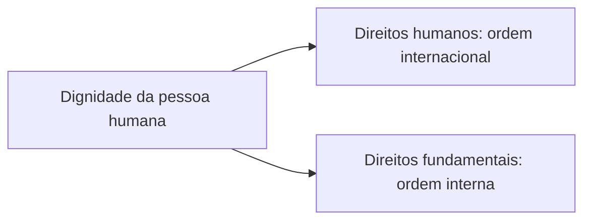

Antes de estudar tratados, declarações e tribunais, é preciso saber do que se está falando. O que são direitos humanos? São o mesmo que direitos fundamentais? Em que se diferenciam das liberdades públicas? E como a doutrina os organiza? A prova de concurso trata esse conteúdo de modo conceitual: o candidato precisa reconhecer termos, distinguir classificações e não se confundir com nomes parecidos. Este capítulo oferece o vocabulário básico da disciplina.

> [!objetivos]
> - Definir direitos humanos e dignidade da pessoa humana e relacioná-los à cidadania e à democracia.
> - Distinguir direitos humanos, direitos fundamentais e outras expressões.
> - Aplicar a teoria dos status de Jellinek e a leitura objetiva do caso Lüth.
> - Reconhecer a estrutura dos direitos humanos em direito-pretensão, direito-liberdade, direito-poder e direito-imunidade.

## Conceito

Os direitos humanos são o conjunto de direitos ligados à **dignidade da pessoa humana**, que limitam o arbítrio do Estado e colocam a igualdade no centro das relações sociais. A doutrina costuma citar a definição de Antonio Perez Luño: direitos humanos são as faculdades e instituições que, a cada época, traduzem em direito as exigências de dignidade, de liberdade e de igualdade, e que precisam ser aceitas pelas ordens jurídicas nacionais e internacionais.

Três ideias saem dessa definição.

1. O núcleo dos direitos humanos é a **dignidade**.
2. Eles são **históricos**: mudam conforme as exigências de cada época.
3. Para existir de fato, precisam ser **reconhecidos pelo direito**, no plano interno e no internacional.

A dignidade, nas palavras de Comparato, é a convicção de que todos os seres humanos merecem ser tratados com igual respeito, pelo simples fato de serem humanos. Em termos práticos, tratar alguém com dignidade é respeitá-lo e dar-lhe tratamento igualitário, independentemente de condição social, cultural ou econômica.

> [!bizu] Dignidade e ideia central
> A ideia central dos direitos humanos é **fornecer meios e instrumentos jurídicos para a defesa da dignidade das pessoas**. Quando uma alternativa resume a matéria em "proteção da dignidade", ela está no caminho certo.

### Cidadania e democracia

Vale estudar ainda a relação entre direitos humanos, cidadania e democracia. A **cidadania** é a condição de quem participa da vida política e social e pode exigir direitos, e a Constituição a coloca entre os fundamentos da República (art. 1º, II). A **democracia** é o regime em que o poder pertence ao povo, que o exerce por representantes ou diretamente (art. 1º, parágrafo único). Os três conceitos se sustentam: sem direitos humanos, a democracia perde a proteção das minorias; sem democracia, os direitos dependem da vontade do governante; sem cidadania, as pessoas não têm como reivindicar o que lhes cabe.

Hannah Arendt e, no Brasil, Celso Lafer chamam a atenção para o **direito a ter direitos**: antes de discutir qualquer direito, é preciso ser reconhecido como sujeito de direitos. Quem é excluído dessa condição, como os apátridas e os refugiados, fica sem proteção.

### A dignidade na Constituição brasileira

A Constituição de 1988 escolheu a dignidade da pessoa humana como um dos fundamentos da República (art. 1º, III). Isso tem consequências práticas: a dignidade orienta a interpretação das normas, serve de limite à atuação estatal e pode, segundo parte da doutrina, vincular comportamentos e sustentar decisões judiciais como qualquer outro princípio com força normativa.

> [!lei] CF, art. 1º, III
> Art. 1º A República Federativa do Brasil, formada pela união indissolúvel dos Estados e Municípios e do Distrito Federal, constitui-se em Estado Democrático de Direito e tem como fundamentos:
> (...)
> III - a dignidade da pessoa humana;

### Por que o oficial bombeiro deve conhecer a matéria

O agente público que usa a força, que presta socorro, que conduz pessoas e que lida com vítimas está, todos os dias, no ponto de encontro entre o poder do Estado e a dignidade da pessoa. Por isso os direitos humanos não são apenas conteúdo de prova: orientam a abordagem, o tratamento de vítimas e de presos, o respeito a crianças, idosos e pessoas com deficiência e o uso proporcional dos meios. Quem comanda tropa responde também por ensinar esses limites.

## Terminologia

Diversas expressões convivem no vocabulário jurídico, e muitas são tratadas como sinônimos nas provas, salvo quando o examinador provoca a distinção.

| Expressão | Sentido |
| --- | --- |
| Direitos humanos | direitos reconhecidos na ordem internacional, universalmente aceitos |
| Direitos fundamentais | direitos reconhecidos na ordem interna de um Estado, em geral na Constituição |
| Direitos do homem e do cidadão | expressão ligada à Revolução Francesa de 1789, com direitos civis e políticos |
| Direitos naturais | direitos inerentes ao ser humano, independentes de norma positiva |
| Liberdades públicas | direitos de defesa do indivíduo contra o Estado, sem os direitos sociais |
| Direitos individuais | direitos da pessoa em si, em especial os da primeira geração |

A diferença mais cobrada é entre **direitos humanos** e **direitos fundamentais**. O conteúdo é o mesmo, a proteção da dignidade, e o que muda é o plano de positivação: humanos são os direitos na ordem internacional; fundamentais são os direitos positivados na ordem interna.

Quatro observações completam o quadro.

- Há quem diga que "direitos humanos" é um **pleonasmo**, porque só o ser humano é sujeito de direitos. Ainda assim, a expressão se consagrou, porque lembra que esses direitos valem para todos pela condição humana.
- Fala-se em **centralidade** dos direitos humanos, porque não há Estado democrático de direito sem a proteção da dignidade e sem limites ao poder estatal.
- Os direitos humanos se apoiam em uma **sociedade inclusiva**, em que toda pessoa é reconhecida como sujeito de direitos.
- Os direitos convivem e se limitam entre si, e o debate jurídico trata do **conflito** entre eles em cada caso.

> [!pegadinha] Dignidade não tem conceito fechado
> Uma questão afirmou que o principal fundamento dos direitos humanos seria a dignidade, "com consenso sobre o seu conteúdo", e que ela se aplicaria só aos direitos explícitos na Constituição. A afirmativa é falsa: não há consenso sobre o conteúdo da dignidade, e há direitos implícitos, que decorrem de princípios.

## Classificação dos direitos humanos

A classificação serve para organizar a matéria e mostra como os direitos foram aplicados ao longo do tempo. Duas visões são as mais cobradas.

### Teoria dos status de Jellinek

Georg Jellinek analisou a relação entre o indivíduo e o Estado e identificou quatro posições, os **status**.

| Status | Também chamado | Ideia | Exemplo |
| --- | --- | --- | --- |
| Subjectionis | passivo | o indivíduo está sujeito às ordens e proibições do Estado | dever de pagar tributos |
| Libertatis | negativo | o indivíduo tem espaço livre, em que o Estado não pode interferir | liberdade de expressão |
| Civitatis | positivo | o indivíduo pode exigir prestações do Estado | saúde, educação |
| Activus | ativo | o indivíduo participa da formação da vontade do Estado | voto, ação popular |

Dessas posições decorrem três grupos de direitos: os **direitos de defesa** (negativos, ligados às liberdades), os **direitos prestacionais** (positivos, ligados à igualdade) e os **direitos de participação** (de natureza mista, porque exigem tanto abstenção quanto prestação, como o direito de votar e a realização de eleições periódicas).

Peter Häberle propõe falar em um **status ativo processual**: o cidadão também participa das decisões públicas por meios como o amicus curiae e as audiências públicas.

> [!resolvido] Qual status?
> **Questão:** pela teoria dos status, o direito à saúde é de qual natureza?
>
> **Resposta:** é um direito prestacional, em que a pessoa pode exigir do Estado os meios para uma vida saudável. Corresponde ao **status positivo (civitatis)**.

### Classificação do caso Lüth

A segunda leitura nasce de uma decisão do Tribunal Constitucional alemão, em 1958. Erich Lüth defendeu publicamente o boicote ao filme de um diretor ligado à propaganda nazista, e foi condenado por isso na jurisdição civil. O Tribunal entendeu que os direitos fundamentais não valem só contra o Estado: eles têm uma **dimensão objetiva**, irradiam efeitos por todo o ordenamento e alcançam também as **relações entre particulares**.

A visão de Jellinek é **subjetiva**, voltada à relação entre o sujeito e o Estado. A leitura do caso Lüth é **objetiva** e considera a coletividade. Nela, todos os direitos têm, ao mesmo tempo, uma face negativa e uma positiva: os direitos prestacionais têm carga positiva mais forte, e os de defesa têm carga abstencionista mais intensa, mas ambos têm as duas faces.

| Aspecto | Jellinek | Caso Lüth |
| --- | --- | --- |
| Visão | subjetiva | objetiva |
| Relação analisada | indivíduo e Estado | todos os direitos, inclusive entre particulares |
| Ideia central | quatro status | dimensão objetiva e eficácia horizontal |

## Estrutura dos direitos humanos

André de Carvalho Ramos, a partir da teoria das relações jurídicas, descreve quatro estruturas possíveis para um direito humano.

| Estrutura | O que impõe | Exemplo |
| --- | --- | --- |
| Direito-pretensão | o titular pode exigir uma conduta do Estado ou de outro particular | direito à educação |
| Direito-liberdade | impõe abstenção ao Estado ou a terceiros | liberdade de crença |
| Direito-poder | o titular pode exigir a sujeição do Estado ou de outro para a observância do direito | direito à assistência jurídica |
| Direito-imunidade | impede que o Estado ou outra pessoa interfira no direito | vedação de prisão, salvo flagrante ou decisão judicial |

O foco da prova não é decorar quatro nomes, mas reconhecê-los no enunciado. Se a questão fala em "exigir uma prestação", é pretensão; se fala em "não interferir", é liberdade ou imunidade; se fala em "obrigar alguém a se submeter", é poder.

> [!atencao] Classificações servem para reconhecer
> O aluno não precisa memorizar autores, mas os rótulos. A banca raramente pede o nome do jurista; pede o tipo de direito descrito no enunciado.

## Características e dimensões

Duas listas completam a teoria geral e aparecem juntas em muitas provas.

### Características

A doutrina atribui aos direitos humanos um conjunto de atributos, que asseguram sua proteção por serem essenciais a uma vida digna.

| Característica | Significado |
| --- | --- |
| Universalidade | valem para todas as pessoas, pela condição humana |
| Historicidade | surgem e se transformam ao longo da história |
| Imprescritibilidade | não se perdem pelo decurso do tempo sem exercício |
| Inalienabilidade | não podem ser vendidos, doados ou negociados; não têm valor econômico |
| Irrenunciabilidade | o titular não pode abrir mão deles de modo definitivo |
| Indisponibilidade | o titular não dispõe livremente deles |
| Interdependência e indivisibilidade | formam um conjunto, e a violação de um afeta os demais |
| Limitabilidade (relatividade) | podem ser limitados quando entram em conflito com outros direitos |

A **inalienabilidade** é a característica que impede atribuir valor econômico aos direitos para negociação ou venda. Ninguém pode vender, por exemplo, a própria liberdade ou a própria integridade física.

> [!pegadinha] Rol aberto e proteção mais ampla
> Os direitos humanos não têm rol exaustivo: novos direitos são reconhecidos com o tempo. E a proteção internacional dos direitos humanos, por abranger todos os que a ordem internacional reconhece, é mais ampla do que a dos direitos fundamentais de um único Estado. Questões que afirmem o contrário costumam estar erradas.

### Dimensões (ou gerações)

A doutrina agrupa os direitos conforme o momento histórico em que foram reconhecidos. Prefere-se hoje o termo **dimensões**, porque uma dimensão não substitui a anterior, e sim se soma a ela.

| Dimensão | Valor | Exemplos |
| --- | --- | --- |
| Primeira | liberdade (direitos civis e políticos, de titularidade individual) | liberdade de crença, direito à vida, voto |
| Segunda | igualdade (direitos econômicos, sociais e culturais) | educação, saúde, trabalho, previdência |
| Terceira | solidariedade ou fraternidade (titularidade difusa ou coletiva) | paz, meio ambiente equilibrado, patrimônio histórico e cultural, autodeterminação |

Há doutrina que fala em quarta dimensão (direitos ligados à democracia, à informação e ao pluralismo, ou à bioética) e em quinta (a paz, para alguns). Para a prova, as três primeiras são o essencial. Uma questão pode pedir a dimensão de uma lista de direitos: a **liberdade de crença** e o direito ao **reconhecimento da pessoa humana** vão na primeira; **educação** e **saúde**, na segunda; a **conservação do patrimônio histórico e cultural** e o **meio ambiente**, na terceira.

## Mapa do capítulo

| Tema | Ideia | Armadilha |
| --- | --- | --- |
| Conceito | direitos ligados à dignidade, históricos e reconhecidos pelo direito | tratar a dignidade como conceito fechado |
| Terminologia | humanos são internacionais; fundamentais são internos | achar que o conteúdo é diferente |
| Jellinek | quatro status: passivo, negativo, positivo e ativo | trocar o nome latino pelo apelido |
| Lüth | dimensão objetiva e eficácia entre particulares | achar que direitos só valem contra o Estado |
| Estrutura | pretensão, liberdade, poder e imunidade | confundir pretensão com poder |

### Para fixar
- Direitos humanos são direitos ligados à dignidade, que limitam o arbítrio do Estado e afirmam a igualdade.
- A dignidade é o valor central, e o seu conteúdo não tem um conceito único.
- Direitos humanos estão na ordem internacional; direitos fundamentais, na ordem interna do Estado.
- Cidadania e democracia são fundamentos da República e dependem da proteção dos direitos humanos.
- Jellinek descreve os status passivo, negativo, positivo e ativo.
- Direitos de defesa são negativos; prestacionais, positivos; de participação, mistos.
- O caso Lüth reconheceu a dimensão objetiva dos direitos e a sua aplicação entre particulares.
- Na estrutura dos direitos, a pretensão exige conduta, a liberdade exige abstenção, o poder impõe sujeição e a imunidade impede interferência.
- O direito a ter direitos, de Arendt e Lafer, é a condição para qualquer outro direito.
- Quase todas as expressões equivalem a direitos humanos, salvo se a questão provocar a distinção.
