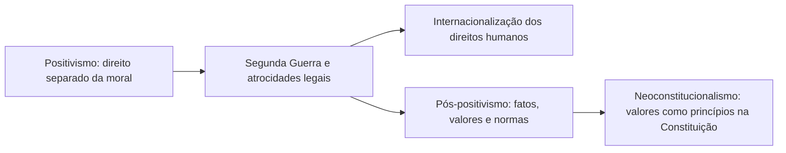

Por que existem direitos humanos? Em que se apoiam? São criação do Estado, herança da natureza humana ou conquista da razão? A pergunta é filosófica, mas as provas a tratam de forma objetiva: pedem que o candidato reconheça as correntes, saiba qual prevalece e compreenda a estrutura das normas de direitos humanos. O capítulo apresenta as correntes que negam e as que afirmam um fundamento, mostra como a dignidade se tornou o ponto de convergência e explica por que os direitos humanos se formam sobretudo por princípios, num contexto chamado de pós-positivismo.

> [!objetivos]
> - Distinguir a corrente que nega a possibilidade de fundamento dos direitos humanos das que o afirmam.
> - Identificar os fundamentos jusnaturalista, racional, positivista e moral e a crítica a cada um.
> - Explicar a dignidade como fundamento aceito e seus usos pela jurisprudência.
> - Diferenciar regras e princípios e aplicar a ideia de estrutura normativa aberta.
> - Relacionar o pós-positivismo à Segunda Guerra Mundial, à teoria tridimensional de Reale e ao neoconstitucionalismo.

## Fundamentos dos direitos humanos

Fundamentos são as razões que legitimam e motivam o reconhecimento dos direitos humanos. A doutrina se divide em duas linhas: a que acha impossível definir um fundamento e a que aponta vários. A prova trabalha com as duas.

### A corrente que nega o fundamento

Alguns autores sustentam que não é possível estabelecer um fundamento absoluto. Norberto Bobbio apresenta três motivos.

1. **Divergência sobre o conjunto de direitos**: não há acordo sobre quais direitos fazem parte do rol, e sem isso não se define uma base única.
2. **Historicidade**: os direitos humanos mudam com o tempo, e o que parece fundamental hoje pode ser outro amanhã.
3. **Heterogeneidade**: o conjunto é formado por direitos diferentes, às vezes conflitantes, que exigem ponderação.

Perez Luño acrescenta um quarto argumento: os direitos humanos se apoiam em **juízos de valor** e em opções morais, que por natureza não se comprovam, apenas se aceitam por convicção. Além disso, como não existe uma norma suprema internacional comparável à Constituição de um Estado, cada organização poderia compreender o fundamento conforme suas concepções. A estrutura aberta dos direitos humanos seria o obstáculo.

> [!bizu] Os três motivos de Bobbio
> Para decorar: **abrangência** (quais direitos?), **historicidade** (mudam) e **heterogeneidade** (conflitam). Se a questão atribuir a Bobbio um fundamento único e eterno, está errada.

### As correntes que afirmam o fundamento

| Fundamento | Ideia central | Crítica |
| --- | --- | --- |
| Jusnaturalista | os direitos derivam de normas anteriores e superiores ao Estado, de origem divina ou da natureza humana | os direitos são históricos, conquistados pela sociedade, e não preexistentes a tudo |
| Racional | os direitos decorrem da razão humana, que distingue o homem dos demais seres; ganha força com o Iluminismo | a razão não é igual para todas as culturas |
| Positivista | só são direitos os que a norma estatal positiva; antes disso são valores morais | se a lei é omissa ou contrária à dignidade, o direito se enfraquece |
| Moral | os direitos são morais e extraem validade diretamente dos valores da coletividade | a validade fica dependente de consensos morais |

**Fundamento jusnaturalista.** Para essa corrente, os direitos humanos equivalem aos direitos naturais. Ela tem caráter **metafísico**: aceita um direito preexistente ao produzido pelo homem, seja de **razão divina** (a lei humana só vale se concordar com a divina), seja da **natureza humana** (conjunto de direitos inerente à existência da pessoa). A religião, em especial a Igreja Católica, contribuiu para a ideia de respeito à pessoa. O STF, em algumas decisões, reconheceu valores de direito natural no chamado bloco de constitucionalidade e chamou o direito de greve de direito natural, sem que isso faça do jusnaturalismo a tese dominante.

**Fundamento racional.** É uma visão laica, que dispensa a religião e vê na razão a fonte dos direitos. O Iluminismo coloca o homem no centro, e do que a reflexão racional estabelece como inerente à condição humana nasce a base dos direitos.

**Fundamento positivista.** Opõe-se ao jusnaturalismo e nega a existência de direitos preexistentes: o fundamento é a **lei positiva**, cuja validade vem de ter sido editada conforme a Constituição. A vantagem é a segurança jurídica, pois a norma escrita estabiliza as relações. O ponto fraco é que, se a lei se calar ou contrariar a dignidade, não haveria direito a proteger.

**Fundamento moral.** Vê os direitos humanos como direitos morais, que valem por si, a partir dos princípios de justiça e equidade da coletividade, sem depender de regra prévia.

> [!atencao] Nenhuma corrente vence sozinha
> Para a prova, adota-se o **conjunto** dos fundamentos, voltado à realização da dignidade da pessoa. Quem marca "o único fundamento é o jusnaturalista" ou "só vale o que está na lei" erra. Bobbio chega a dizer que importa mais realizar os direitos do que escolher um fundamento.

## A dignidade como ponto de convergência

O que as correntes têm em comum é a ideia de que existe um **núcleo de direitos básicos**, os direitos da dignidade. A universalidade dos direitos humanos, a rejeição do positivismo puro e a ideia de que os direitos são construídos historicamente levam a um bloco de valores que realizam a dignidade e são a razão de ser da matéria.

### Conteúdo da dignidade

Não há conceito único de dignidade, e não cabe só ao Direito defini-la: é um conceito multidimensional, formado por várias áreas do saber e pelas relações sociais, culturais, históricas e políticas. Para a prova, vale a síntese de André de Carvalho Ramos: dignidade é a qualidade intrínseca e distintiva de cada pessoa, que a protege de tratamento degradante e de discriminação odiosa e lhe assegura condições materiais mínimas de sobrevivência. Dela decorrem dois elementos.

| Elemento | Conteúdo |
| --- | --- |
| Negativo | vedação a tratamento discriminatório, ofensivo ou degradante |
| Positivo | garantia de condições mínimas de sobrevivência (mínimo existencial) |

A dignidade tem **força normativa**: não é mero enfeite, e pode vincular comportamentos e fundamentar decisões como qualquer princípio.

### Usos da dignidade na jurisprudência

A análise de André de Carvalho Ramos identifica quatro usos principais do termo nas decisões do STF.

| Uso | Exemplo |
| --- | --- |
| Fundamento de novos direitos | criação do direito à busca da felicidade |
| Parâmetro de interpretação | a celeridade do processo, que é parte da dignidade, deve ser interpretada à luz dela |
| Limite à atuação do Estado | restrição ao uso de algemas |
| Auxílio na ponderação de interesses | prevalência do direito à informação genética sobre a coisa julgada em ação de paternidade |

Há um alerta: a **banalização**. Se tudo se fundamenta na dignidade, o termo perde a capacidade de distinguir o que é mais importante. Por isso, a prova pode cobrar a ideia de que a dignidade, embora seja o centro valorativo do ordenamento, não deve servir de argumento genérico para qualquer pretensão.

## Estrutura normativa dos direitos humanos

As normas jurídicas se dividem em **regras** e **princípios**. Entender essa divisão é a chave da estrutura normativa dos direitos humanos, que é **aberta**.

| Aspecto | Regras | Princípios |
| --- | --- | --- |
| Natureza | mandados de determinação | mandados de otimização (Robert Alexy) |
| Aplicação | subsunção | ponderação de interesses |
| Lógica | tudo ou nada | mais ou menos |
| Exemplo | quem causa dano a imagem de outro deve reparar | razoável duração do processo |

As regras descrevem uma situação e a consequência: se o fato acontece, a consequência incide. Os princípios mandam que algo seja realizado **na maior medida possível**, conforme as circunstâncias. O art. 5º, LXXVIII, da Constituição garante a razoável duração do processo, mas não diz quanto tempo é razoável. Num processo trabalhista, que trata de verbas de caráter alimentar, dois anos podem ser demais; num processo criminal, cinco anos podem ser razoáveis, por causa da necessidade de ampla defesa e de decisão cuidadosa. É a ponderação que decide.

> [!lei] CF, art. 5º, LXXVIII
> A todos, no âmbito judicial e administrativo, são assegurados a razoável duração do processo e os meios que garantam a celeridade de sua tramitação.

A estrutura dos direitos humanos é formada **principalmente por princípios**. Isso explica, por exemplo, que um caso de trabalho em condições degradantes possa ser identificado como condição análoga à de escravo mesmo quando não há as características formais clássicas de escravidão: o aplicador pondera os princípios e as regras envolvidos. E lembra que **princípios são normas**, dotadas de força vinculante: hoje não se aceita mais a ideia de que sirvam apenas como orientação para a interpretação.

> [!pegadinha] Princípio não é só enfeite
> A afirmação "princípios são apenas instrumentos de interpretação e não obrigam" é falsa. Regras e princípios são espécies de normas, e o julgador pode fundamentar a decisão exclusivamente em um princípio.

## Pós-positivismo e direitos humanos

O positivismo jurídico separava o direito da moral: o que importava era a validade formal da norma. A Segunda Guerra Mundial mostrou o perigo dessa separação, porque regimes que se diziam de Direito, apoiados em leis válidas, legitimaram o extermínio e os campos de concentração. A perplexidade da comunidade internacional levou a duas consequências:

1. A **internacionalização** dos direitos humanos, com a criação de sistemas como a ONU e a OEA e de tratados como o Pacto Internacional dos Direitos Civis e Políticos e a Convenção Americana.
2. A **reaproximação entre direito e moral**: os valores éticos passam a ser considerados na positivação, na interpretação e na aplicação das normas. Esse movimento é o **pós-positivismo**.

O pós-positivismo **não** abandona o positivismo nem volta ao jusnaturalismo. Ele reconhece que o direito se forma por um tripé: **fatos, valores e normas**. É a ideia de Miguel Reale na **teoria tridimensional do direito**: o fenômeno jurídico tem norma, fato e valor, que se implicam mutuamente, num processo histórico e social chamado de **nomogênese jurídica**.

O pós-positivismo está ligado ao **neoconstitucionalismo**, movimento que leva valores, moral e ética para dentro da ordem constitucional, em especial os direitos e as garantias fundamentais, ou seja, os direitos humanos que cada Estado incorpora ao seu ordenamento interno. Daí a força dos princípios e a aplicação direta da Constituição.

> [!exemplo] Do nazismo ao Tribunal de Nuremberg
> Os julgamentos de Nuremberg enfrentaram a defesa de que os acusados apenas cumpriam leis do regime. A resposta do tribunal, de que há crimes que ofendem a humanidade independentemente do que a lei local diga, é um símbolo da virada pós-positivista: a validade formal da lei não basta quando ela ofende a dignidade.

## A cláusula de abertura e o bloco de constitucionalidade

A estrutura aberta dos direitos humanos aparece também no texto constitucional brasileiro. O art. 5º, § 2º, estabelece que os direitos e garantias expressos na Constituição **não excluem outros** decorrentes do regime e dos princípios por ela adotados, nem dos tratados internacionais de que o Brasil seja parte. É a chamada cláusula de abertura, que permite reconhecer direitos implícitos e liga o direito interno ao internacional.

> [!lei] CF, art. 5º, § 2º
> Os direitos e garantias expressos nesta Constituição não excluem outros decorrentes do regime e dos princípios por ela adotados, ou dos tratados internacionais em que a República Federativa do Brasil seja parte.

Dessa abertura vem a noção de **bloco de constitucionalidade**. No sentido estrito, restringe-se às normas que funcionam como medida do controle de constitucionalidade. No sentido amplo, abrange o conjunto de normas do ordenamento que têm status constitucional, o que inclui, para a doutrina, normas de direitos humanos e os tratados de direitos humanos aprovados na forma constitucional. É por isso que um direito pode ser reconhecido como constitucional mesmo sem estar escrito no texto da Constituição.

## Como cada fundamento explica um mesmo caso

Um exercício útil é aplicar cada corrente a um caso concreto, o da proibição da tortura.

| Fundamento | Por que a tortura é proibida |
| --- | --- |
| Jusnaturalista | porque viola a natureza do ser humano ou a ordem divina, qualquer que seja a lei |
| Racional | porque a razão revela que ninguém aceitaria ser torturado e que todos devem ser tratados como fins em si mesmos |
| Positivista | porque a Constituição e as leis proíbem a tortura e a tratam como crime |
| Moral | porque a coletividade reconhece que a tortura ofende a justiça e a equidade, independentemente de regra prévia |
| Dignidade | porque é tratamento degradante que nega a condição humana, o que reúne todos os argumentos anteriores |

Observe que as cinco explicações chegam à mesma proibição por caminhos diferentes. É esse **encontro de argumentos** que faz da dignidade o fundamento aceito. A escolha entre eles interessa mais ao filósofo do que ao aplicador do direito, que precisa proteger o direito concretamente.

> [!resolvido] Qual fundamento?
> **Trecho:** "Os direitos humanos só existem quando estão previstos em lei, pois antes disso são apenas valores morais sem força jurídica."
>
> **Resolução:** o trecho descreve o fundamento **positivista**, que condiciona o direito à positivação. Sua crítica é que, se a lei se omite ou contraria a dignidade, o direito fica sem proteção, o que a experiência da Segunda Guerra tornou inaceitável.

## Lei injusta e a fórmula de Radbruch

O debate entre positivismo e pós-positivismo ficou conhecido com a chamada fórmula de Radbruch. O jurista alemão Gustav Radbruch, após a guerra, sustentou que uma lei **extremamente injusta** perde a natureza de direito: quando a injustiça atinge um grau insuportável, a lei deve ceder à justiça. A ideia ajudou a justificar a responsabilização de pessoas que cumpriram ordens legais do regime nazista. Embora a prova não costume pedir o nome, a lógica ajuda a entender por que o direito contemporâneo aceita que a validade formal não é suficiente e que os direitos humanos funcionam como limite ao legislador.

> [!atencao] Pós-positivismo não é desprezo pela lei
> O movimento não diz que a lei não importa: diz que a lei **não basta**. Em sede de concurso, a alternativa que afirma que o pós-positivismo "abandona o positivismo" ou "retorna ao direito natural" está incorreta. A resposta correta é a que fala em reaproximação entre direito e moral, num tripé de fatos, valores e normas.

## Historicidade e universalidade

Dois traços dos direitos humanos parecem opostos e são complementares. A **universalidade** diz que os direitos valem para todos, pela condição humana. A **historicidade** diz que eles surgiram em momentos específicos, como resposta a violações, e continuam em construção. A tensão entre os dois explica por que há debates sobre se um novo direito, como o acesso à internet ou o direito ao meio ambiente equilibrado, é ou não um direito humano. A resposta passa pela dignidade e pelos tratados: o que protege a dignidade em cada época tende a ser reconhecido.

Em resumo, a ideia de que "os direitos humanos nascem de uma vez" é falsa. Bobbio e Arendt falam de um processo de constante reconstrução, que será visto no capítulo seguinte, dedicado à afirmação histórica.

## Ponderação aplicada ao serviço de bombeiros

A ponderação deixa de ser abstrata quando se pensa numa ocorrência. Um incêndio em edifício residencial exige a evacuação imediata dos moradores. De um lado, está o direito de permanecer em casa e de decidir sobre o próprio patrimônio (liberdade e propriedade). De outro, estão a vida e a integridade física dos moradores e das equipes de salvamento. Não há regra que diga, de antemão, até onde a ordem de evacuar pode ir. O comandante da operação pondera: o risco é iminente? A remoção forçada é o meio menos gravoso? A restrição dura só o tempo necessário?

O raciocínio segue o mesmo caminho dos princípios: busca-se realizar cada direito na maior medida possível, sem sacrificar totalmente nenhum. Em outras palavras, a ordem é legítima, mas deve ser **adequada**, **necessária** e **proporcional**. Quando esse caminho é seguido, o ato administrativo se sustenta; quando se ignora, pode haver abuso.

> [!bizu] Ponderar não é escolher o que se prefere
> Ponderar é comparar o peso dos princípios no caso concreto e justificar a escolha. A decisão sem justificativa não é ponderação, é arbítrio, o exato oposto do que os direitos humanos pretendem combater.

Esse exemplo mostra por que a estrutura aberta dos direitos humanos não é uma fragilidade: ela permite adaptar a proteção à variedade de situações da vida. A contrapartida é o dever de **fundamentar** cada decisão, o que vale para o juiz, para o administrador e para o oficial que comanda uma operação.

## Mapa do capítulo

| Tema | Ideia central | Armadilha |
| --- | --- | --- |
| Corrente negativista | Bobbio: abrangência, historicidade, heterogeneidade; Perez Luño: juízos de valor | achar que nega os direitos, e não o fundamento único |
| Fundamentos | jusnaturalista, racional, positivista e moral | eleger um deles como o único |
| Dignidade | ponto de convergência, com elemento negativo e positivo | tratá-la como conceito fechado |
| Estrutura normativa | regras (subsunção) e princípios (ponderação) | dizer que princípios não obrigam |
| Pós-positivismo | reaproximação do direito e da moral após a Segunda Guerra | confundi-lo com volta ao jusnaturalismo |

### Para fixar
- Fundamentos são as razões que legitimam o reconhecimento dos direitos humanos.
- Bobbio nega o fundamento único por três motivos: abrangência, historicidade e heterogeneidade.
- Os fundamentos clássicos são o jusnaturalista, o racional, o positivista e o moral, e nenhum prevalece sozinho.
- O conjunto dos fundamentos converge para a dignidade da pessoa humana.
- A dignidade tem elemento negativo (vedação a tratamento degradante) e positivo (mínimo existencial).
- A jurisprudência usa a dignidade para criar direitos, interpretar, limitar o Estado e ponderar interesses.
- Regras são mandados de determinação aplicados por subsunção; princípios são mandados de otimização aplicados por ponderação.
- A estrutura normativa dos direitos humanos é aberta e predominantemente principiológica.
- O pós-positivismo reaproxima o direito da moral depois da Segunda Guerra, sem abandonar o positivismo.
- A teoria tridimensional de Reale reúne fato, valor e norma, e o neoconstitucionalismo leva esses valores para a Constituição.
