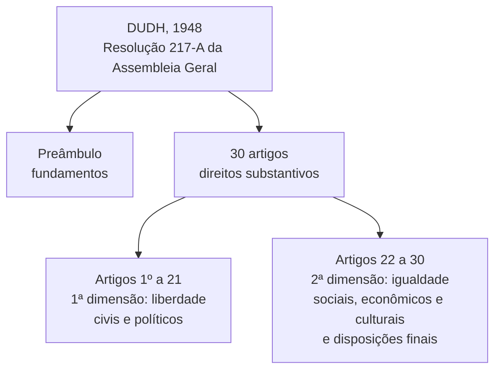

Em 10 de dezembro de 1948, poucos anos depois do fim da Segunda Guerra Mundial, a Assembleia Geral da ONU aprovou um texto curto, de trinta artigos, que se tornou a referência moral e jurídica de todo o sistema de proteção da pessoa humana. É a Declaração Universal dos Direitos Humanos, a DUDH. Quase toda prova de direitos humanos traz ao menos uma questão sobre ela, e as bancas gostam de três assuntos: quando e como ela foi aprovada, se ela obriga ou apenas recomenda e quais direitos ela contém. Este capítulo trata dos dois primeiros e do preâmbulo. Os direitos de cada artigo ficam para os capítulos seguintes.

> [!objetivos]
> - Situar a DUDH no tempo, no órgão que a aprovou e na forma em que foi editada.
> - Explicar por que uma resolução tem força jurídica, com os dois argumentos clássicos.
> - Reconhecer a estrutura do texto e a relação entre os blocos de artigos e as dimensões dos direitos.
> - Identificar as ideias do preâmbulo: dignidade como núcleo, reação à barbárie, Estado de Direito e educação.

## A DUDH em poucas linhas

A DUDH foi **adotada e proclamada pela Assembleia Geral da ONU em 1948, pela Resolução 217-A (III)**. Não é um tratado nem uma convenção: é uma resolução. Esse detalhe é cobrado com frequência e puxa a discussão sobre a sua força obrigatória, que veremos adiante.

Ela é o principal instrumento do **Sistema Global** de proteção e a maior contribuição para a **universalização** dos direitos humanos. A ideia central é que a proteção da dignidade decorre da simples condição de ser humano, e não de concessão de um governo. Junto com os dois Pactos de 1966, o de Direitos Civis e Políticos e o de Direitos Econômicos, Sociais e Culturais, ela forma o conjunto chamado de *Carta Internacional de Direitos Humanos* (*International Bill of Rights*).

A adesão ao texto foi ampla: nenhum Estado votou contra, e houve apenas poucas abstenções. Por essa aceitação e pelo contexto de reconstrução do pós-guerra, a doutrina a considera a **fonte motriz** dos sistemas de direitos humanos que vieram depois, globais e regionais. Ela marca o movimento de **internacionalização** dos direitos humanos: a relação do Estado com os seus nacionais deixa de ser assunto exclusivamente interno e passa a interessar à comunidade internacional.

> [!bizu] Três marcas para decorar
> Ano **1948**, órgão **Assembleia Geral da ONU**, forma de **resolução** (217-A). Se o enunciado disser que a DUDH é um tratado ratificado pelos Estados, ou que foi aprovada pelo Conselho de Segurança, a alternativa está errada.

## O embate entre liberdade e igualdade na elaboração

Na redação da DUDH, os Estados concordaram com facilidade em incluir os direitos de **liberdade**, civis e políticos, que compõem a primeira dimensão. A resistência veio com os direitos **sociais, econômicos e culturais**, da segunda dimensão.

O motivo foi o cenário político. Estados Unidos e União Soviética tinham sido aliados na guerra e saíram dela fortalecidos, mas com visões opostas de Estado. O primeiro defendia pouca intervenção estatal e deixava ao mercado a organização da vida em comunidade. A segunda defendia forte intervenção para garantir direitos sociais. O confronto se aprofundou nos anos seguintes e deu origem à Guerra Fria, e já aparecia na discussão do texto da Declaração.

O resultado foi uma solução de equilíbrio: os direitos de liberdade e os de igualdade entraram no mesmo documento, com igual valor. Consolidou-se a leitura, dominante até hoje, de que os direitos humanos formam um conjunto **indivisível e interdependente**. Não existe uma categoria de direitos que valha mais do que a outra.

### E a terceira dimensão?

Há discussão sobre a presença dos direitos de solidariedade, como o direito ao meio ambiente, na DUDH. Parte da doutrina vê neles uma presença ligada à fraternidade do art. 1º. A posição mais segura para a prova é esta: a DUDH **não desenvolve** os direitos de terceira dimensão e não os trata de forma específica, o que ocorre a partir da década de 1950. Há apenas uma menção que alerta para a sua existência. Por isso se diz que ela é um **marco teórico** para o desenvolvimento dos direitos de solidariedade, sem explicitá-los como faz com os de primeira e de segunda dimensão.

> [!atencao] Cuidado com a terceira dimensão
> Duas redações opostas aparecem em prova. "A DUDH desenvolve de forma detalhada os direitos de terceira dimensão" é errada. "A DUDH é marco teórico para os direitos de solidariedade, embora não os explicite" é a formulação aceita. Leia o verbo com atenção: *prever expressamente* é diferente de *servir de marco*.

## Estrutura do texto

O documento se divide em dois blocos. O primeiro é o **preâmbulo**, que apresenta os fundamentos: a dignidade da pessoa e a reação da comunidade internacional às atrocidades da Segunda Guerra, com a defesa de relações amistosas entre os Estados. O segundo reúne os **artigos**, que enunciam os direitos substantivos.

A divisão dos artigos pelas dimensões ajuda a memorizar. Observe como o texto vai do indivíduo diante do Estado para o indivíduo na sociedade.

| Bloco do texto | Dimensão predominante | Como foi a discussão |
| --- | --- | --- |
| Artigos 1º a 21 | Primeira: liberdade, direitos civis e políticos | Consenso na comunidade internacional |
| Artigos 22 a 30 | Segunda: igualdade, direitos sociais, econômicos e culturais, mais as disposições finais | Houve debate, em especial entre Estados Unidos e União Soviética, mas prevaleceu a proteção |
| Terceira dimensão | Sem previsão específica | Esses direitos foram concebidos depois |

> [!bizu] Duas metades
> Do 1º ao 21: **liberdade** e participação política. Do 22 ao 30: **igualdade social** e deveres. Quando a questão pedir "em qual bloco está o direito ao trabalho?", pense: trabalho, saúde, educação e cultura estão depois do artigo 21.

## Natureza jurídica: resolução vincula?

Os tratados são normas obrigatórias para os Estados que os assinam e ratificam. As resoluções da Assembleia Geral, em regra, são recomendações, sem força vinculante. Como a DUDH foi editada sob a forma de resolução, muitos estudiosos disseram, no início, que seria só uma carta de boas intenções.

Hoje a corrente **majoritária**, no Brasil e na comunidade internacional, sustenta que a DUDH **tem caráter jurídico e vincula**. A doutrina de Flávia Piovesan resume dois argumentos principais.

1. **Interpretação autorizada da Carta da ONU.** A Carta, no art. 1º, item 3, coloca entre os propósitos da organização o incentivo ao respeito pelos direitos humanos. No art. 55, os membros assumem o compromisso de favorecer a observância geral desses direitos, sem distinção de raça, sexo, língua ou religião. A Carta, porém, não diz o que são "direitos humanos". A DUDH preenche essa lacuna e, por isso, é a interpretação autorizada da expressão. Sendo a Carta um tratado obrigatório, a interpretação que a completa também obriga.
2. **Direito costumeiro e princípios gerais.** Com o tempo, o conteúdo da DUDH foi absorvido como costume internacional e princípio geral do direito. Sinais disso: constituições, como a brasileira, incorporaram seus preceitos; a ONU faz remissões a ela em vários documentos, apontando o seu caráter obrigatório; e cortes internacionais a citam como fonte do direito.

O jurista Fábio Konder Comparato acrescenta que a DUDH representa **norma de direito costumeiro**, porque reúne direitos aceitos de forma reiterada pela comunidade das nações. A Corte Internacional de Justiça, por sua vez, tratou a Declaração como *higher law*, isto é, norma de hierarquia superior, que não se pode ignorar pela gravidade dos assuntos de que cuida.

| Argumento | Ideia-chave | Palavra para memorizar |
| --- | --- | --- |
| 1º | Interpretação autorizada de "direitos humanos" na Carta da ONU (arts. 1º, 3 e 55) | Carta |
| 2º | Costume internacional e princípio geral, com reflexo nas constituições e nas decisões de cortes | Costume |

> [!atencao] "Resolução" não quer dizer "sem força"
> A forma é de resolução, mas a corrente majoritária reconhece o caráter **vinculante** da DUDH. Uma alternativa que diga "por ser resolução, a DUDH é apenas recomendação e não tem valor jurídico" costuma ser a errada. Já a que diga "a DUDH é um tratado" também erra: ela não tem a forma de tratado.

### Quadro-resumo

Para fixar, junte tudo em uma linha de raciocínio: a DUDH **foi editada como resolução**, mas **é vinculante**, porque interpreta a Carta da ONU, virou norma costumeira ou princípio geral, influencia as constituições dos Estados e serve de fundamento para decisões de cortes internacionais.

## Preâmbulo: os fundamentos

O preâmbulo é a parte do documento que explica **por que** a Declaração existe. Os pontos centrais são os seguintes.

**Dignidade como núcleo.** O texto abre dizendo que a liberdade, a justiça e a paz no mundo dependem de reconhecer a dignidade que todos os seres humanos têm desde o nascimento, bem como seus direitos iguais, que ninguém pode tirar.

> [!lei] DUDH, preâmbulo, § 1º
> Considerando que o reconhecimento da dignidade inerente a todos os membros da família humana e de seus direitos iguais e inalienáveis é o fundamento da liberdade, da justiça e da paz no mundo.

A dignidade decorre da **condição humana** e não depende de concessão política da sociedade. É por isso que o núcleo do direito internacional dos direitos humanos é a dignidade da pessoa.

**Reação à barbárie.** O texto lembra que ignorar e desrespeitar os direitos humanos levou a crueldades que chocaram a consciência de toda a humanidade. As atrocidades das duas guerras mundiais foram determinantes para o processo de internacionalização. A maior aspiração do ser humano comum, segundo o texto, é um mundo com liberdade de palavra e de crença e sem **medo** nem **miséria**.

**Estado de Direito.** Para o preâmbulo, é indispensável que a ordem jurídica de um Estado de Direito ampare esses direitos. Assim, ninguém precisaria recorrer à revolta contra governos tirânicos e opressores. Em termos simples: se a lei protege, a revolta deixa de ser a única saída.

**Relações amistosas.** O preâmbulo também defende o desenvolvimento de relações amistosas entre as nações e lembra que os povos da ONU reafirmaram, na Carta, a fé nos direitos fundamentais, na dignidade e no valor da pessoa e na igualdade de direitos entre homens e mulheres. Um dos objetivos da organização é evitar a repetição de conflitos armados.

**Compromisso dos Estados.** Os Estados-Membros assumiram, junto com a ONU, o compromisso de fazer valer esses direitos em todo o mundo. Para cumpri-lo, o preâmbulo diz que é muito importante que todos entendam esses direitos da mesma forma.

**Ideal comum e implementação.** Na parte final, a Assembleia proclama a Declaração como a meta comum de todos os povos e nações. Cada pessoa e cada órgão da sociedade deve trabalhar, pelo **ensino e pela educação**, a favor do respeito a esses direitos e, por **medidas progressivas, nacionais e internacionais**, buscar o seu reconhecimento e a sua observância em toda parte.

Repare no que o preâmbulo **não** faz. Diferentemente dos tratados e das convenções de direitos humanos, a DUDH **não cria mecanismos de fiscalização** do cumprimento. Ela declara direitos e aponta dois caminhos: a educação em direitos humanos e as medidas nacionais e internacionais. Os tratados que vieram depois é que criaram comitês, relatórios e cortes.

> [!pegadinha] Declarar não é fiscalizar
> "A DUDH instituiu um comitê para fiscalizar o cumprimento dos direitos por ela previstos" é afirmação errada. O texto declara direitos e indica a educação e as medidas internas e internacionais como forma de efetivá-los. Os mecanismos de controle aparecem em tratados posteriores, como os Pactos de 1966.

### Resumo do preâmbulo

| Ideia | O que lembrar |
| --- | --- |
| Núcleo | Dignidade da pessoa, que decorre da condição humana |
| Contexto | Atrocidades das guerras mundiais e internacionalização |
| Proteção | Estado de Direito para evitar a rebelião contra a tirania |
| Relações entre Estados | Amizade e prevenção de novos conflitos |
| Implementação | Educação em direitos humanos e medidas nacionais e internacionais |

## Como a banca cobra este assunto

Os enunciados trabalham sempre com troca de um elemento. Exemplos de trocas comuns:

- no lugar de *Assembleia Geral*, aparece *Conselho de Segurança* ou *Corte Internacional de Justiça*;
- no lugar de *resolução*, aparece *tratado* ou *convenção*;
- no lugar de *dignidade*, como núcleo do preâmbulo, aparece *soberania* ou *propriedade*;
- na estrutura, os direitos sociais são deslocados para antes do artigo 22 ou os direitos políticos para depois.

> [!resolvido] Questão comentada
> **Enunciado:** a internacionalização dos direitos humanos, que é um objetivo central da DUDH, pode ser entendida como uma resposta ao mal absoluto de regimes como o nazismo. Certo ou errado?
>
> **Resolução:** certo. A criação da ONU e a edição da DUDH são marcos do processo de internacionalização, e a barbárie das guerras mundiais é a razão histórica da mudança. O preâmbulo fala justamente de atos bárbaros que ultrajaram a consciência da humanidade. A assertiva só estaria errada se atribuísse à DUDH um papel meramente regional ou nacional.

## Mapa do capítulo

| Tema | Ideia central | Como cai em prova |
| --- | --- | --- |
| Aprovação | 1948, Assembleia Geral, Resolução 217-A | Troca de órgão ou de forma jurídica |
| Importância | Principal instrumento do Sistema Global, base dos sistemas posteriores | "Marco da universalização" |
| Dimensões | Liberdade (1 a 21) e igualdade (22 a 30); terceira dimensão só como marco | Quantidade de artigos de cada bloco |
| Natureza jurídica | Resolução, mas vinculante | "Mera recomendação" é errado |
| Fundamentos | Interpretação da Carta e costume internacional | Dois argumentos |
| Preâmbulo | Dignidade, barbárie, Estado de Direito, educação | Troca do núcleo ou inclusão de fiscalização |

### Para fixar

1. A DUDH foi aprovada em 1948 pela Assembleia Geral da ONU, por meio da Resolução 217-A, e não tem a forma de tratado.
2. Junto com os dois Pactos de 1966, a DUDH forma a Carta Internacional de Direitos Humanos.
3. Durante a elaboração, houve consenso sobre os direitos de liberdade e discussão sobre os sociais, por causa da disputa entre Estados Unidos e União Soviética.
4. Prevaleceu a ideia de que os direitos humanos são indivisíveis e interdependentes; liberdade e igualdade têm igual valor.
5. Os artigos 1º a 21 tratam, em geral, de direitos de primeira dimensão, e os artigos 22 a 30 de segunda dimensão e disposições finais.
6. A DUDH não desenvolve a terceira dimensão: é marco teórico para esses direitos, sem tratá-los de modo específico.
7. A DUDH é vinculante, embora editada como resolução: interpreta a Carta da ONU (arts. 1º, 3 e 55) e constitui costume ou princípio geral do direito internacional.
8. O núcleo do preâmbulo é a dignidade da pessoa, e a internacionalização nasce da reação às barbáries das guerras mundiais.
9. O preâmbulo indica a educação em direitos humanos e as medidas nacionais e internacionais como caminhos de efetivação, sem criar mecanismos de fiscalização.
