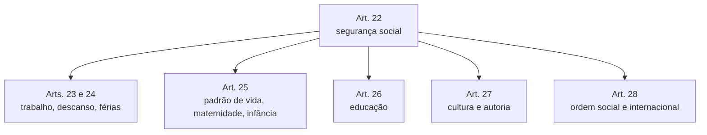

A segunda metade da Declaração muda de assunto. Depois de proteger a liberdade e a participação política, ela trata das condições materiais de uma vida digna: segurança social, trabalho, descanso, saúde, alimentação, moradia, educação e cultura. Termina com os limites do exercício dos direitos. É nesta parte que aparecem os direitos de segunda dimensão e o único dever da DUDH.

> [!objetivos]
> - Relacionar os artigos 22 a 28 aos direitos sociais, trabalhistas, educacionais e culturais.
> - Listar os direitos trabalhistas expressos na Declaração.
> - Reconhecer o artigo 29 como o dispositivo que prevê deveres e limites legais ao exercício dos direitos.
> - Explicar o alcance do artigo 30 como cláusula de proteção contra o abuso de direitos.

## Segurança social e realização dos direitos: artigo 22

O artigo 22 abre o bloco dos direitos de igualdade. Quem integra a sociedade tem direito à **segurança social**, isto é, à proteção coletiva contra os riscos da vida, e à efetivação dos direitos econômicos, sociais e culturais de que precisa para viver com dignidade e desenvolver livremente a sua personalidade. A realização depende do **esforço nacional**, da **cooperação internacional** e da organização e dos recursos de cada Estado. Em outras palavras, a efetivação é gradual e se ajusta à capacidade de cada país. É por isso que se fala em direitos de caráter prestacional: dependem de ação positiva do Estado, ao contrário dos direitos de liberdade, que pedem em geral abstenção.

> [!atencao] Recursos de cada Estado
> Uma questão pode afirmar que os direitos sociais exigem execução imediata e uniforme em todos os países. Não é o que diz o artigo 22: a realização leva em conta os recursos e a organização de cada Estado e conta com cooperação internacional.

## Direitos trabalhistas: artigos 23 e 24

A Declaração enumera, de forma objetiva, direitos dos trabalhadores. Eles aparecem em dois artigos.

| Artigo | Direitos |
| --- | --- |
| 23 | Direito ao trabalho e livre escolha de emprego; condições justas e favoráveis; proteção contra o desemprego; igual remuneração para igual trabalho; remuneração justa e satisfatória que assegure existência digna; organização de sindicatos e ingresso neles |
| 24 | Repouso e lazer; limitação razoável da jornada; férias periódicas remuneradas |

O artigo 23 fundamenta a equiparação salarial estudada no Direito do Trabalho e a liberdade sindical. O artigo 24 reúne descanso, jornada limitada e férias. A Constituição brasileira tem normas equivalentes no art. 7º, que garante, por exemplo, descanso semanal remunerado, jornada de oito horas diárias e quarenta e quatro semanais e férias com acréscimo de um terço, além dos arts. 11 e 217 sobre representação de trabalhadores e lazer.

> [!bizu] Lista de dez
> Para a prova, guarde os dez direitos: trabalho em termos gerais, escolha do emprego, condições justas, proteção contra o desemprego, igual remuneração por igual trabalho, remuneração justa, sindicatos, repouso e lazer, jornada limitada e férias.

## Padrão de vida adequado e proteção especial: artigo 25

O artigo 25 garante um padrão de vida que assegure à pessoa e à sua família saúde e bem-estar. Isso abrange **alimentação, vestuário, habitação, cuidados médicos e serviços sociais indispensáveis**, além da segurança em caso de desemprego, doença, invalidez, viuvez, velhice ou outra perda dos meios de subsistência por motivo alheio à vontade. O item 2 reserva **cuidados e assistência especiais à maternidade e à infância** e iguala a proteção social de todas as crianças, nascidas ou não do casamento. Essa última regra é uma forma de igualdade entre filhos, que a Constituição também adota. Em prova, lembre que o artigo 25 é o mais completo em direitos sociais básicos: ele junta alimentação, roupa, moradia e saúde com a proteção em caso de falta de renda por causas que a pessoa não controla.

## Educação: artigo 26

Todo ser humano tem direito à instrução. Os pontos que as bancas cobram são os seguintes.

| Aspecto | Regra |
| --- | --- |
| Gratuidade | Pelo menos nos graus elementares e fundamentais |
| Obrigatoriedade | Instrução elementar obrigatória |
| Ensino técnico-profissional | Acessível a todos |
| Ensino superior | Acesso baseado no mérito |
| Finalidade | Pleno desenvolvimento da personalidade e reforço do respeito aos direitos humanos e às liberdades fundamentais |
| Valores | Compreensão, tolerância e amizade entre nações, grupos raciais e religiosos; apoio à manutenção da paz |
| Papel dos pais | Prioridade na escolha do tipo de instrução dos filhos |

Na Constituição, a educação aparece na ordem social, entre os arts. 205 e 210. Uma alternativa que diga que a DUDH trata a educação superior como gratuita para todos erra: o texto fala em acesso por mérito, e a gratuidade é exigida ao menos nos graus elementares e fundamentais.

## Cultura, autoria e ordem social: artigos 27 e 28

### Artigo 27: vida cultural e autoria

O artigo 27 tem dois preceitos. O primeiro assegura a participação livre na **vida cultural da comunidade**, o gozo das artes e a participação no progresso científico e em seus benefícios, o que se aproxima dos arts. 23, 24, 215 e 216 da Constituição. O segundo protege os interesses **morais** (ligados à autoria) e **materiais** (de ordem econômica) decorrentes de qualquer produção científica, literária ou artística da qual a pessoa seja autora, ideia próxima ao art. 5º, IX, da Constituição, que garante a liberdade da atividade intelectual, artística, científica e de comunicação, sem censura ou licença, mas com responsabilidade se houver dano a terceiros.

### Artigo 28: ordem social e internacional

O artigo 28 afirma o direito a uma ordem social e internacional na qual os direitos e as liberdades da Declaração possam se realizar plenamente. É a ponte entre os direitos individuais e a organização da comunidade das nações: não basta o Estado reconhecer o direito no papel, é preciso que o ambiente social e internacional permita exercê-lo.

## Deveres e limites: artigos 29 e 30

O artigo 29 é peculiar. O primeiro item estabelece que cada pessoa tem **deveres perante a comunidade**, porque é nela que a personalidade pode se desenvolver por inteiro. É o único dever previsto na Declaração. Em seguida o artigo fixa limites ao exercício dos direitos.

- As limitações só podem ser estabelecidas **por lei**, o que consagra o princípio da legalidade.
- Elas têm uma finalidade: assegurar o reconhecimento e o respeito dos direitos de outras pessoas e atender às justas exigências da moral, da ordem pública e do bem-estar numa sociedade democrática.
- Direitos e liberdades não podem ser exercidos contra os propósitos e princípios das Nações Unidas.

O artigo 30 fecha o texto como cláusula de proteção: nada na Declaração pode ser interpretado como autorização a um Estado, grupo ou pessoa para praticar atos voltados à destruição dos direitos e liberdades nela previstos. Ele impede que a Declaração seja usada para negar a si mesma.

| Artigo | Função |
| --- | --- |
| 29 | Deveres para com a comunidade; limites por lei; respeito aos propósitos da ONU |
| 30 | Vedação ao abuso do direito; interpretação que não autoriza destruir direitos |

> [!pegadinha] Quem pode limitar direitos?
> A limitação do exercício de direitos exige **lei** e finalidade legítima. Uma assertiva que admita restrição por simples decisão administrativa, sem lei, ou por motivo de conveniência, contraria o artigo 29.

> [!lei] DUDH, art. 29, 2
> No exercício de seus direitos e liberdades, toda pessoa estará sujeita apenas às limitações determinadas pela lei, exclusivamente com o fim de assegurar o devido reconhecimento e respeito dos direitos e liberdades de outrem.

> [!resolvido] Questão comentada
> **Enunciado:** segundo a DUDH, o exercício dos direitos só pode sofrer limites previstos em lei, para proteger os direitos alheios e atender às exigências de moral, ordem pública e bem-estar de uma sociedade democrática. Certo ou errado?
>
> **Resolução:** certo. A alternativa descreve o artigo 29, item 2. Repare nas três palavras de apoio: *lei*, *direitos de outrem* e *sociedade democrática*.

## Mapa do capítulo

| Tema | Artigos | Palavra-chave |
| --- | --- | --- |
| Segurança social | 22 | Esforço nacional e cooperação, conforme recursos |
| Trabalho | 23 e 24 | Dez direitos trabalhistas |
| Padrão de vida | 25 | Saúde, alimentação, moradia, maternidade e infância |
| Educação | 26 | Gratuita no básico; superior por mérito |
| Cultura e autoria | 27 | Participação e proteção moral e material |
| Ordem social | 28 | Condições para realizar os direitos |
| Deveres e limites | 29 e 30 | Legalidade; vedação ao abuso |

### Para fixar

1. O artigo 22 liga a realização dos direitos sociais ao esforço nacional, à cooperação internacional e aos recursos de cada Estado.
2. O artigo 23 trata de trabalho, escolha do emprego, condições justas, proteção contra o desemprego, igual remuneração, remuneração justa e sindicatos.
3. O artigo 24 garante repouso, lazer, limitação razoável da jornada e férias periódicas remuneradas.
4. O artigo 25 assegura padrão de vida adequado, segurança em perda dos meios de subsistência e cuidados especiais à maternidade e à infância.
5. O artigo 26 prevê instrução gratuita ao menos nos graus elementares e fundamentais, instrução elementar obrigatória e superior por mérito.
6. A educação, segundo o artigo 26, deve fortalecer os direitos humanos e promover compreensão, tolerância e amizade entre os povos.
7. O artigo 27 protege a participação na vida cultural e os interesses morais e materiais do autor.
8. O artigo 29 traz o único dever da Declaração e condiciona as limitações dos direitos à lei e a finalidades legítimas.
9. O artigo 30 impede interpretar a Declaração como autorização para destruir os direitos que ela protege.
