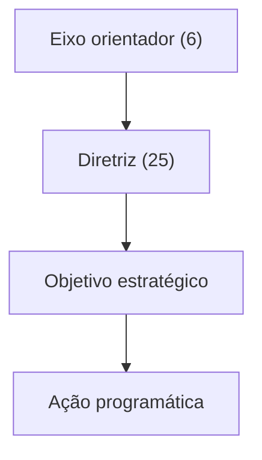

O PNDH-3 é um documento extenso, mas sua arquitetura é lógica: seis **eixos orientadores**, que se desdobram em **diretrizes**, estas em **objetivos estratégicos** e estes em **ações programáticas**. Quem domina os seis eixos consegue deduzir a maior parte das diretrizes, e esse é o conhecimento que mais cai em prova. Este capítulo percorre os eixos e as vinte e cinco diretrizes, explica o alcance jurídico do programa e trata de uma de suas políticas mais conhecidas: a Comissão Nacional da Verdade.

> [!objetivos]
> - Descrever a estrutura do PNDH-3: eixos, diretrizes, objetivos estratégicos e ações programáticas.
> - Listar os seis eixos orientadores e associar a cada um as suas diretrizes.
> - Indicar o alcance jurídico do PNDH-3 e a implementação por planos bianuais.
> - Explicar criação, composição e finalidades da Comissão Nacional da Verdade.

## Estrutura do PNDH-3

O PNDH-3 trabalha com quatro níveis, do mais amplo ao mais concreto:

| Nível | Significado |
| --- | --- |
| Eixo orientador | Grupo de temas de direitos humanos tidos como fundamentais para as políticas de governo |
| Diretriz | Linha de atuação dentro de um eixo |
| Objetivo estratégico | Pretensão específica dentro de cada diretriz |
| Ação programática | Medida concreta, com responsáveis indicados, para alcançar o objetivo |

O decreto fixa **seis eixos** e **vinte e cinco diretrizes** em seu art. 2º; os objetivos e as ações constam do anexo.

> [!bizu] Para decorar a hierarquia
> Pense em um mapa: o **eixo** é o continente, a **diretriz** é o país, o **objetivo** é a cidade e a **ação** é a rua. Em prova, a pergunta costuma ser de qual eixo é determinada diretriz, e para isso basta saber os seis eixos.

## Os seis eixos e suas diretrizes

### Eixo I: Interação democrática entre Estado e sociedade civil

Trata da participação popular e do controle social. As diretrizes de 1 a 3 pedem: fortalecer a democracia participativa pela interação entre Estado e sociedade; tornar os direitos humanos um instrumento transversal das políticas públicas; e integrar e ampliar os sistemas de informação em direitos humanos, com mecanismos de avaliação e monitoramento.

### Eixo II: Desenvolvimento e Direitos Humanos

Une direitos humanos e modelo de desenvolvimento. As diretrizes de 4 a 6 tratam de: um desenvolvimento sustentável, inclusivo, ambientalmente equilibrado, tecnologicamente responsável e participativo; a valorização da pessoa humana como sujeito central do desenvolvimento; e a defesa do meio ambiente como direito humano, de modo que as futuras gerações também sejam vistas como titulares de direitos.

### Eixo III: Universalizar direitos em um contexto de desigualdades

Lida com a desigualdade estrutural. As diretrizes de 7 a 10 pedem: direitos humanos universais, indivisíveis e interdependentes, para assegurar cidadania plena; promoção dos direitos de crianças e adolescentes, com direito de opinião e participação; combate às desigualdades estruturais; e garantia da igualdade na diversidade.

### Eixo IV: Segurança Pública, Acesso à Justiça e Combate à Violência

É o eixo de maior interesse para quem atua em corporações militares. Suas diretrizes, de 11 a 17, tratam de:

| Diretriz | Tema |
| --- | --- |
| 11 | Tornar o sistema de segurança pública mais democrático e atual |
| 12 | Abrir a segurança pública e a justiça criminal à transparência e à participação do povo |
| 13 | Prevenir a violência e o crime e dar caráter profissional à investigação |
| 14 | Enfrentar a violência praticada pelo próprio Estado, em especial a tortura e a alta letalidade nas ações policiais e nas prisões |
| 15 | Proteger as vítimas de crimes e as pessoas ameaçadas |
| 16 | Renovar a execução penal, preferindo penas e medidas alternativas ao encarceramento e melhorando as prisões |
| 17 | Construir uma justiça de acesso mais fácil, rápida e eficaz |

Alguns objetivos estratégicos desse eixo ajudam a dar concretude às diretrizes. Na diretriz 11 aparecem a modernização das normas e da gestão da segurança pública e a promoção dos direitos humanos dos próprios profissionais da área, com formação continuada. Na 13 há metas como ampliar o controle de armas de fogo em circulação, qualificar a investigação, padronizar a prova pericial e enfrentar o tráfico de pessoas. Na 14 estão o fortalecimento dos controles internos, a padronização de procedimentos e equipamentos, a política nacional de erradicação da tortura e o combate às execuções extrajudiciais cometidas por agentes do Estado. Na 15 destaca-se a proteção de testemunhas ameaçadas, de crianças e adolescentes ameaçados de morte e dos defensores de direitos humanos. Na 16 constam a reestruturação do sistema penitenciário, a limitação do uso da prisão cautelar, o tratamento adequado de pessoas com transtornos mentais e a ampliação de penas alternativas.

Para quem atua em corporações militares e na proteção civil, esse eixo é especialmente importante: ele descreve o tipo de atuação que o Estado espera de seus agentes de segurança e de proteção civil, com respeito aos direitos humanos, preparo técnico e controle.

### Eixo V: Educação e Cultura em Direitos Humanos

As diretrizes de 18 a 22 tratam de: efetivar a política nacional de educação em direitos humanos; fortalecer a democracia e os direitos humanos na educação básica, no ensino superior e nas instituições formadoras; reconhecer a educação não formal como espaço de promoção desses direitos; promover a educação em direitos humanos no serviço público; e garantir o direito à comunicação democrática e ao acesso à informação.

### Eixo VI: Direito à Memória e à Verdade

As diretrizes de 23 a 25 tratam de: reconhecer a memória e a verdade como direito humano da cidadania e dever do Estado; preservar a memória histórica e construir publicamente a verdade; e modernizar a legislação ligada à promoção desse direito, fortalecendo a democracia.

| Eixo | Tema | Diretrizes |
| --- | --- | --- |
| I | Interação democrática entre Estado e sociedade civil | 1 a 3 |
| II | Desenvolvimento e Direitos Humanos | 4 a 6 |
| III | Universalizar direitos em um contexto de desigualdades | 7 a 10 |
| IV | Segurança Pública, Acesso à Justiça e Combate à Violência | 11 a 17 |
| V | Educação e Cultura em Direitos Humanos | 18 a 22 |
| VI | Direito à Memória e à Verdade | 23 a 25 |

> [!atencao] Diretriz no eixo certo
> A banca costuma juntar, em uma só assertiva, diretrizes de eixos diferentes. Exemplo: dizer que o primeiro eixo inclui a valorização da pessoa como sujeito central do desenvolvimento (que é do eixo II) e a garantia universal e indivisível dos direitos (que é do eixo III). A assertiva fica errada porque nem toda diretriz citada pertence ao eixo indicado.

## Alcance jurídico e implementação

O PNDH-3 orienta as ações do governo, mas **não tem força vinculante** para os demais Poderes: nasce de um decreto presidencial. Por isso o art. 5º usa o verbo **convidar**: Estados, Distrito Federal, Municípios e os órgãos do Legislativo, do Judiciário e do Ministério Público são convidados a aderir. A implementação envolve, além dos responsáveis indicados no próprio programa, parcerias com outros órgãos federais ligados aos temas dos eixos.

As metas, os prazos e os recursos são definidos em **Planos de Ação de Direitos Humanos bianuais** (art. 3º). O comitê de acompanhamento e monitoramento previsto no art. 4º foi revogado por decreto de 2019.

Quando foi lançado, o PNDH-3 provocou intensa discussão pública, e algumas de suas propostas, como as relativas à mediação em conflitos agrários, foram alteradas por decreto posterior. Em prova, vale lembrar que o texto original sofreu modificações e que o decreto de 2009 não é imutável.

> [!pegadinha] Programa vinculante?
> Dizer que os programas nacionais de direitos humanos obrigam os demais Poderes e o Ministério Público é erro. Eles têm caráter de orientação das ações governamentais, e a adesão dos demais é por convite. A competência para efetivar políticas de direitos humanos, por sua vez, é **comum** a todos os entes federativos, e não exclusiva da União.

## Comissão Nacional da Verdade

O eixo VI tem como ponto marcante a **Comissão Nacional da Verdade (CNV)**, criada pela **Lei 12.528/2011**. Sua finalidade é examinar e esclarecer as **graves violações de direitos humanos** praticadas no período fixado no art. 8º do Ato das Disposições Constitucionais Transitórias, isto é, de **18 de setembro de 1946 a 5 de outubro de 1988**, a fim de efetivar o direito à memória e à verdade histórica e promover a reconciliação nacional.

### Composição

A comissão tinha **sete membros**, brasileiros, designados pelo Presidente da República, escolhidos entre pessoas de reconhecida idoneidade e conduta ética, identificadas com a defesa da democracia e da institucionalidade constitucional e com o respeito aos direitos humanos. Não podiam integrar a comissão pessoas que:

- exercessem cargos executivos em agremiação partidária;
- estivessem no exercício de cargo em comissão ou função de confiança em qualquer esfera de governo;
- não tivessem condições de atuar com imparcialidade.

### O que a comissão fazia

Entre os objetivos da comissão estavam: esclarecer os fatos e as circunstâncias dos casos de tortura, mortes, desaparecimentos forçados e ocultação de cadáveres, e sua autoria; identificar e divulgar as estruturas, locais, instituições e circunstâncias ligadas às violações; encaminhar aos órgãos competentes informações para localizar restos mortais de desaparecidos; colaborar com o Poder Público na apuração das violações; recomendar medidas e políticas públicas para prevenir novas violações e assegurar sua não repetição; e reconstruir a história dos casos, colaborando para a assistência às vítimas.

> [!atencao] CNV não pune
> Embora tenha investigado graves violações, a Comissão Nacional da Verdade **não tinha caráter jurisdicional nem persecutório**. Ela esclarecia fatos e fazia recomendações, mas não julgava nem punia ninguém. Assertivas que dizem que a CNV tinha por objetivo punir os autores estão erradas.

A comissão funcionou por prazo determinado e apresentou relatório final com suas conclusões e recomendações. Esse relatório é um dos instrumentos de concretização do eixo VI.

| Aspecto | CNV |
| --- | --- |
| Norma | Lei 12.528/2011 |
| Período investigado | 18/9/1946 a 5/10/1988 |
| Membros | Sete, designados pelo Presidente da República |
| Natureza | Esclarecimento e recomendação, sem caráter persecutório |

## Como ler o programa sem se perder

O PNDH-3 é longo, e o aluno de concurso não precisa memorizar todos os seus objetivos e ações. O caminho mais eficiente tem quatro passos. Primeiro, fixar os **seis eixos**, na ordem do decreto, porque é deles que partem as perguntas. Segundo, associar a cada eixo as suas **diretrizes mais marcantes**, como a diretriz 14 no eixo IV ou as diretrizes de memória e verdade no eixo VI. Terceiro, lembrar a **natureza** do documento: decreto, orientação ao Executivo federal, adesão por convite. Quarto, relacionar o PNDH-3 com os programas anteriores, para saber o que cada um acrescentou.

Uma forma de testar a memória é pegar uma diretriz qualquer e perguntar a si mesmo a qual eixo ela pertence. Se a diretriz trata de participação popular e informação, é eixo I. Se trata de desenvolvimento e meio ambiente, é eixo II. Se trata de igualdade, crianças e adolescentes, é eixo III. Se trata de polícia, prisões e justiça, é eixo IV. Se trata de educação e comunicação, é eixo V. E se trata de memória e verdade, é eixo VI. Esse raciocínio por tema resolve a maior parte das questões, e é bem mais confiável do que tentar decorar vinte e cinco frases.

## Como a banca cobra este assunto

Quatro padrões se repetem. O primeiro é a **estrutura**: seis eixos, vinte e cinco diretrizes, e a ordem eixo, diretriz, objetivo, ação. O segundo é a **atribuição de diretrizes a eixos**, com mistura intencional. O terceiro é o **alcance jurídico**: decreto autônomo, sem força vinculante, com adesão por convite. O quarto é a **CNV**: período de 1946 a 1988, sete membros, sem poder punitivo.

> [!resolvido] Questão comentada: diretriz de segurança pública
> Julgue: o eixo do PNDH-3 dedicado à segurança pública, ao acesso à justiça e ao combate à violência reúne diretrizes sobre a modernização do sistema de segurança, a participação popular nele e o enfrentamento da violência institucional, incluindo a tortura.
>
> **Resolução.** Certo. São as diretrizes 11, 12 e 14 do eixo IV. A erradicação da tortura e a redução da letalidade policial e carcerária marcam a diretriz 14.

## Mapa do capítulo

| Tema | Ideia central | Armadilha |
| --- | --- | --- |
| Estrutura | Eixo, diretriz, objetivo estratégico e ação programática | Inverter a ordem |
| Números | Seis eixos e vinte e cinco diretrizes | Trocar os números |
| Eixo IV | Segurança pública, acesso à justiça e violência (diretrizes 11 a 17) | Atribuir ao eixo III |
| Eixo VI | Memória e verdade (diretrizes 23 a 25) | Confundir com o eixo V |
| Alcance | Sem força vinculante; adesão por convite | Dizer que obriga o Judiciário |
| Planos | Bianuais | Dizer anuais |
| CNV | Lei 12.528/2011; 1946 a 1988; sete membros | Atribuir poder de punir |

### Para fixar

1. O PNDH-3 se estrutura em eixos orientadores, diretrizes, objetivos estratégicos e ações programáticas.
2. O decreto prevê seis eixos orientadores e vinte e cinco diretrizes.
3. O eixo IV trata de segurança pública, acesso à justiça e combate à violência, com as diretrizes de 11 a 17.
4. A diretriz 14 enfrenta a violência institucional, dando prioridade ao fim da tortura e à redução das mortes provocadas por ações policiais e dentro das prisões.
5. O eixo V trata de educação e cultura em direitos humanos; o eixo VI, do direito à memória e à verdade.
6. O PNDH-3 não vincula os demais Poderes; Estados, Distrito Federal, Municípios e órgãos dos Poderes são convidados a aderir.
7. A competência para efetivar políticas de direitos humanos é comum a todos os entes federativos.
8. As metas, prazos e recursos são definidos em planos de ação bianuais.
9. A Comissão Nacional da Verdade foi criada pela Lei 12.528/2011 para examinar graves violações ocorridas de 18/9/1946 a 5/10/1988.
10. A CNV tinha sete membros designados pelo Presidente e não tinha caráter jurisdicional nem persecutório.
