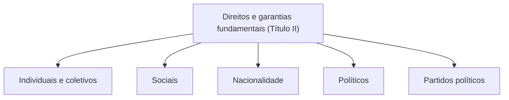

Antes de estudar cada direito previsto na Constituição, é útil entender o que os direitos fundamentais são, como se distinguem das garantias, em que se fundam, como se classificam e quais são suas características. São conceitos que organizam o estudo e que aparecem em prova tanto em Direitos Humanos quanto em Direito Constitucional. Este capítulo é uma visão geral, curta e objetiva, para orientar o restante da matéria.

> [!objetivos]
> - Relacionar direitos humanos e direitos fundamentais e indicar a origem histórica do conceito.
> - Distinguir direito fundamental e garantia fundamental, com exemplos.
> - Indicar os fundamentos e as principais classificações dos direitos fundamentais.
> - Reconhecer a titularidade e as características desses direitos.

## Do direito humano ao direito fundamental

Há sinais de direitos humanos em textos muito antigos, como os da Grécia clássica, mas eram regras primitivas e pouco sistemáticas. A doutrina costuma apontar a Magna Carta, de 1215, na Inglaterra, como um marco de origem. O momento em que se passa a falar em direitos de liberdade previstos em um texto constitucional é a Declaração de Direitos do Povo da Virgínia, de 1776. A partir daí, o termo **direitos fundamentais** ganha sentido.

Com o Iluminismo, o ser humano passa a ser o centro do pensamento: o antropocentrismo toma o lugar do teocentrismo. A cada nova etapa histórica surgem novos grupos de direitos, o que a doutrina explica pelas dimensões de direitos já estudadas.

Daí a noção prática: **direitos fundamentais são os direitos humanos positivados na Constituição de um Estado**. Eles formam o conjunto de direitos e liberdades reconhecidos e garantidos pelo direito positivo de um país, base do seu sistema jurídico. Em muitas questões, os termos "direitos humanos" e "direitos fundamentais" aparecem como equivalentes, com a diferença de plano: os primeiros no plano internacional, os segundos no plano interno.

## Direitos e garantias

O Título II da Constituição fala em "direitos e garantias fundamentais". As duas palavras não são sinônimas.

| Conceito | Ideia | Exemplo |
| --- | --- | --- |
| Direito fundamental | Interesse ou faculdade protegida por conter valores essenciais da ordem jurídica | Direito à privacidade |
| Garantia fundamental | Procedimento ou salvaguarda que dá proteção eficaz a um direito | Mandado de segurança, direito de reparação pela violação |

Não basta, portanto, assegurar o direito à privacidade: a Constituição também prevê meios para defendê-lo. As garantias podem ser classificadas em três espécies:

| Espécie | Característica | Exemplo |
| --- | --- | --- |
| Processuais | Instrumentos para exigir um direito violado, os remédios constitucionais | Habeas corpus, mandado de segurança |
| Materiais | Regras que protegem diretamente o direito | Legalidade penal, vedação de prova ilícita |
| Institucionais | Instituições que a Constituição consagra para proteger os direitos | Independência do Judiciário, separação de Poderes |

> [!bizu] Quando a prova diz só "direitos fundamentais"
> Em questões, é comum aparecer apenas a expressão "direitos fundamentais", sem a palavra garantias. Não fique técnico demais: o termo genérico abrange as garantias fundamentais, e a banca costuma usá-lo assim.

## Fundamentos dos direitos humanos

Os fundamentos são as razões que legitimam o reconhecimento dos direitos humanos. Três correntes se destacam.

| Corrente | Ideia | Crítica |
| --- | --- | --- |
| Jusnaturalismo | Direitos anteriores e superiores ao direito posto, decorrentes da natureza humana | Os direitos não são naturais nem preexistentes: resultam da evolução histórica da sociedade |
| Positivismo | Direitos humanos são os valores condizentes com a dignidade que o direito positivo reconhece | Tomado como único fundamento, enfraquece a proteção, porque diante de omissão da lei ou de norma contrária à dignidade nada se poderia opor |
| Moralismo | Direitos morais, cuja validade vem de valores morais da coletividade e não de normas positivadas | Abre caminho a divergências sobre qual moral prevalece |

Esses fundamentos, com outros de menor importância, justificam a existência dos direitos humanos.

## Classificação dos direitos fundamentais

Não é essencial conhecer todas as classificações, mas três delas aparecem com frequência.

1. **Topológica**, quanto à posição na Constituição. Os direitos fundamentais são gênero, e o Título II traz cinco espécies: direitos e deveres individuais e coletivos (Capítulo I); direitos sociais (Capítulo II); direitos da nacionalidade (Capítulo III); direitos políticos (Capítulo IV); e partidos políticos (Capítulo V).
2. **Expressos e implícitos.** Os expressos têm previsão literal no texto. Os implícitos são extraídos indiretamente da Constituição.
3. **Formais e materiais.** Formais são os previstos na Constituição, mas **fora** da parte destinada aos direitos fundamentais (fora dos arts. 5º a 17), como a anterioridade tributária, no art. 150. Materiais são os previstos dentro dessa parte.

## Titularidade

A **titularidade ativa** é de quem detém os direitos. A **titularidade passiva** é de quem tem o dever de respeitá-los, em regra o Estado.

| Titular | Alcance |
| --- | --- |
| Pessoas naturais | Todos os direitos fundamentais |
| Pessoas jurídicas | Os direitos compatíveis com sua natureza, como a propriedade |
| Poder público | Direitos compatíveis, como as garantias processuais do contraditório e da ampla defesa |
| Entes despersonalizados | Direitos de terceira dimensão, como as comunidades indígenas |

Quanto aos animais, a Constituição adota uma visão **antropocêntrica**: a fauna e a flora são objeto de proteção constitucional como bens jurídicos, e não como sujeitos de direitos.

## Características

As características dos direitos fundamentais ajudam a entender seu regime. Estas são as mais lembradas:

- **universalidade**: pertencem a todas as pessoas;
- **historicidade**: nascem e evoluem com a história;
- **inalienabilidade**: não podem ser transferidos nem vendidos;
- **imprescritibilidade**: não se perdem pelo passar do tempo;
- **irrenunciabilidade**: não se pode abrir mão deles definitivamente, embora seu exercício possa ser limitado em certos casos;
- **relatividade**: não são absolutos e podem sofrer restrições para harmonizá-los com outros direitos;
- **indivisibilidade e interdependência**: formam um conjunto, e a realização de um depende dos demais;
- **cumulatividade**: o titular pode exercer vários direitos ao mesmo tempo.

> [!pegadinha] Absoluto?
> Dizer que os direitos fundamentais são absolutos é erro. Eles têm características fortes, mas encontram limites nos direitos dos outros e no interesse coletivo, e a técnica de solução de conflitos entre direitos é a ponderação.

## Como a banca cobra este assunto

O ponto mais cobrado é a **diferença entre direito e garantia**, com exemplos que exigem identificar o que é remédio constitucional, norma protetiva ou instituição. Também aparecem a **classificação topológica** (os cinco capítulos do Título II), a ideia de que direitos fundamentais são direitos humanos positivados e a ressalva de que eles não são absolutos. Em alternativas de pegadinha, a titularidade dos animais e a possibilidade de pessoas jurídicas serem titulares costumam ser trocadas.

> [!resolvido] Questão comentada: direito ou garantia?
> O mandado de segurança é um direito fundamental ou uma garantia fundamental?
>
> **Resolução.** É garantia fundamental, de natureza processual. Ele não é o direito protegido em si, mas o instrumento que permite exigir a proteção de um direito líquido e certo violado por autoridade.

## Mapa do capítulo

| Tema | Ideia central | Armadilha |
| --- | --- | --- |
| Origem | Magna Carta (1215) e Declaração da Virgínia (1776) | Atribuir ao século XX |
| Conceito | Direitos humanos positivados na Constituição | Separar totalmente os conceitos |
| Direito x garantia | Interesse protegido x salvaguarda | Tratar como sinônimos |
| Garantias | Processuais, materiais e institucionais | Confundir com remédios apenas |
| Fundamentos | Jusnaturalismo, positivismo, moralismo | Dizer que há um fundamento único aceito |
| Classificação | Topológica, expressos e implícitos, formais e materiais | Trocar formal por material |
| Titularidade | Pessoas naturais e jurídicas (compatíveis); animais não | Dar direitos fundamentais a animais |
| Características | Universais, históricos, relativos | Chamar de absolutos |

### Para fixar

1. Direitos fundamentais são os direitos humanos positivados na Constituição de um Estado.
2. A Magna Carta (1215) é apontada como origem, e a Declaração da Virgínia (1776) como marco dos direitos de liberdade em texto constitucional.
3. Direito fundamental é o interesse protegido; garantia fundamental é a salvaguarda que o protege.
4. As garantias podem ser processuais, materiais ou institucionais.
5. Entre os fundamentos dos direitos humanos estão as correntes jusnaturalista, positivista e moralista.
6. A classificação topológica divide o Título II em cinco capítulos: direitos individuais e coletivos, sociais, nacionalidade, políticos e partidos políticos.
7. Direitos fundamentais formais estão fora dos arts. 5º a 17; os materiais, dentro dessa parte.
8. Pessoas naturais são titulares de todos os direitos; pessoas jurídicas e o poder público, dos compatíveis.
9. A Constituição adota visão antropocêntrica, e animais são tutelados como bens, e não como sujeitos de direitos.
10. Os direitos fundamentais são universais, históricos, indivisíveis e relativos, e não absolutos.
