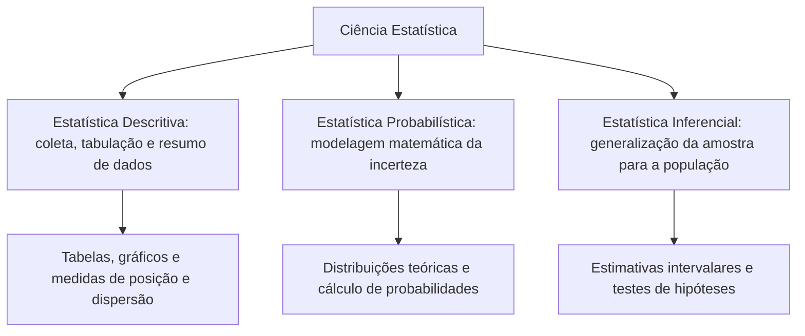
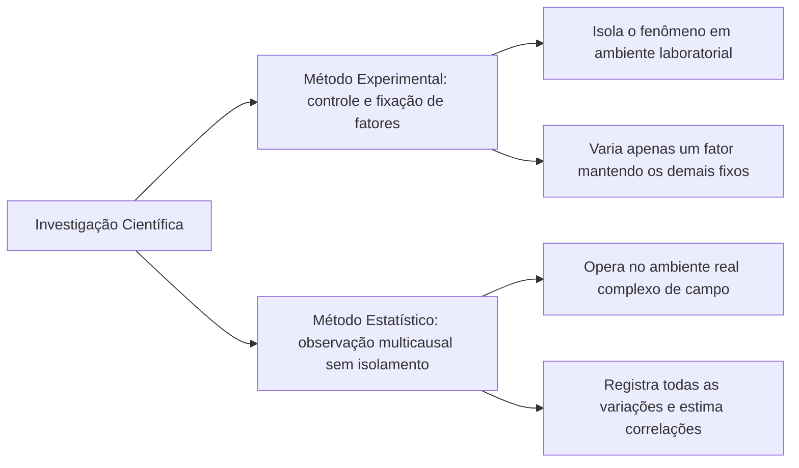
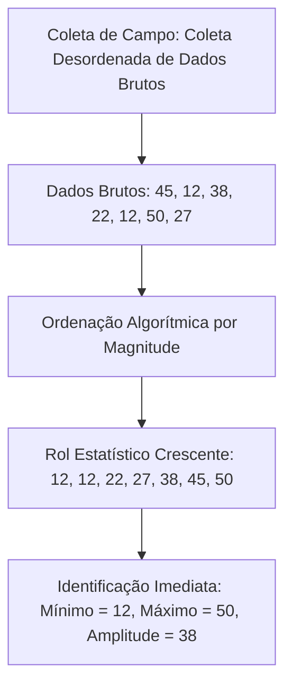
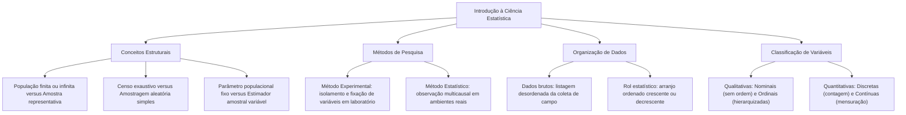

A Estatística constitui o corpo de conhecimentos científicos dedicado à coleta, organização, sintetização, análise e interpretação de dados numéricos e categóricos. No contexto contemporâneo da gestão pública, da perícia criminal e das corporações militares, a tomada de decisões fundamenta-se crescentemente em evidências quantitativas sólidas. Compreender a natureza dos dados, diferenciar levantamentos censitários de estudos amostrais e dominar a classificação técnica de variáveis estatísticas representa o alicerce indispensável para a correta resolução de provas de concurso e para o exercício profissional analítico.

> [!objetivos]
> - Compreender o objeto da Estatística e diferenciar seus ramos: descritiva, probabilística e inferencial.
> - Caracterizar e contrastar os conceitos fundamentais de população, amostra, censo e amostragem.
> - Diferenciar parâmetros populacionais de estimadores amostrais e analisar o método experimental frente ao estatístico.
> - Classificar rigorosamente os dados estatísticos e as variáveis em qualitativas e quantitativas.

## O Que É Estatística e Ramos Fundamentais

A palavra Estatística deriva etimologicamente do vocábulo latino *status*, alusivo ao Estado soberano. Historicamente, os governantes necessitavam catalogar contingentes populacionais, áreas cultiváveis, recursos bélicos e arrecadação tributária para administrar as finanças públicas e coordenar a defesa territorial. Na atualidade, a Estatística evoluiu para uma disciplina matemática aplicada de ampla abrangência, conceituada como o conjunto sistemático de métodos e técnicas concebidos para orientar a coleta, a organização, o resumo, a apresentação, a modelagem probabilística e a interpretação crítica de dados, subsidiando escolhas racionais em cenários de incerteza.

A estrutura científica da Estatística reparte-se tradicionalmente em três ramos operacionais integrados:

1. **Estatística Descritiva (ou Dedutiva):** Ramo voltado para a obtenção, tabulação, síntese e apresentação gráfica de dados empíricos observados a partir de um grupo de estudo. Ocupa-se em organizar tabelas de frequências, construir gráficos representativos e calcular medidas de tendência central e de dispersão sem extrapolar conclusões além dos elementos efetivamente analisados. Responde essencialmente à indagação: "O que os dados examinados mostram?".
2. **Estatística Probabilística:** Ramo formal que desenvolve modelos teóricos para quantificar a incerteza intrínseca aos fenômenos aleatórios. A teoria das probabilidades estabelece as leis matemáticas que governam eventos cujo desfecho não pode ser previsto antecipadamente com certeza absoluta, respondendo à pergunta: "Qual é a chance de ocorrência de determinado evento?".
3. **Estatística Inferencial (ou Indutiva):** Ramo que investiga dados colhidos em uma amostra representativa para fundamentar generalizações e inferir propriedades a respeito da população total. Utiliza técnicas de estimação pontual e intervalar e testes de hipóteses estatísticas, mensurando rigorosamente a margem de erro, o nível de confiança e a significância das previsões formuladas. Responde à pergunta: "O que é possível concluir sobre o conjunto universo a partir da parte observada?".

| Ramo da Estatística | Natureza Operacional | Ferramentas Típicas | Questão Central |
| :--- | :--- | :--- | :--- |
| **Descritiva** | Apresentação e síntese de dados | Tabelas, histogramas, médias e desvios | O que os dados observados revelam? |
| **Probabilística** | Teoria matemática de incerteza | Variáveis aleatórias e modelos teóricos | Qual a chance de o fenômeno ocorrer? |
| **Inferencial** | Generalização e predição | Intervalos de confiança e testes | O que concluir sobre a população total? |

> [!pegadinha]
> Cuidado com questões de concurso que criam termos fictícios. As bancas frequentemente inventam denominações como "estatística coletora", "estatística populacional" ou "estatística administrativa" para tentar enganar o candidato. Lembre-se: os ramos fundamentais reconhecidos são a Descritiva, a Probabilística e a Inferencial.

## População, Amostra, Censo e Estimadores

A formulação de qualquer investigação empírica exige a delimitação rigorosa do universo de elementos sob escrutínio. Em termos técnicos, estabelecem-se distinções terminológicas precisas:

- **População (ou Universo Estatístico):** Compreende o conjunto completo de indivíduos, objetos, registros operacionais ou eventos que compartilham ao menos uma característica observável comum delimitada pela pesquisa. A população classifica-se em **finita**, quando o número de elementos constituintes é limitado e passível de enumeração exaustiva (como a totalidade de bombeiros militares da ativa de um estado), ou **infinita**, quando o número de componentes é ilimitado ou inestimável (como o conjunto teórico de lançamentos sucessivos de um dado perfeito).
- **Amostra:** Corresponde a qualquer subconjunto representativo extraído da população-alvo. Para viabilizar inferências válidas, a amostra precisa reproduzir em miniatura as proporções e a diversidade interna presentes na população original. A amostragem aleatória simples é o mecanismo no qual cada elemento populacional detém rigorosamente a mesma probabilidade conhecida de ser sorteado.
- **Censo (ou Recenseamento):** Procedimento no qual todos os componentes sem exceção da população são efetivamente examinados e medidos. Embora forneça dados exaustivos, o censo apresenta custos financeiros elevados, demanda extensa equipe de campo e consome prazos dilatados. Por esses motivos práticos, recorre-se comumente à pesquisa amostral.

Outro ponto clássico de cobrança em certames é a oposição entre parâmetro e estimador (ou estatística):

Um **parâmetro** é uma medida numérica que sumariza uma propriedade da população total (como a média populacional μ ou o desvio padrão populacional σ). O parâmetro é uma constante fixa para aquela população em dado instante, porém quase sempre permanece desconhecido do pesquisador, visto que raramente se realiza um censo completo.

Em contraposição, uma **estatística** (ou estimador) é uma grandeza numérica calculada a partir dos dados observados na amostra (como a média amostral x-barra ou o desvio padrão amostral s). Como diferentes amostras aleatórias extraídas da mesma população originam estimativas distintas por força do erro amostral natural, a estatística comporta-se como uma variável aleatória, servindo para aproximar o valor do parâmetro desconhecido.

| Conceito Estrutural | Definição Metodológica | Característica Operacional |
| :--- | :--- | :--- |
| **População** | Conjunto universo total dos elementos sob análise | Pode ser finita ou conceitualmente infinita |
| **Amostra** | Fração representativa do universo investigado | Viabiliza inferências e economia de recursos |
| **Censo** | Exame exaustivo de todos os elementos populacionais | Elevado custo e tempo operacional prolongado |
| **Parâmetro** | Grandeza numérica descritiva da população total | Constante fixa, quase sempre desconhecida |
| **Estimador (Estatística)** | Valor numérico computado a partir da amostra | Variável aleatória que estima o parâmetro |

> [!atencao]
> Fixe a correspondência direta: **Parâmetro refere-se à População** (ambos iniciam com P), enquanto **Estatística refere-se à Amostra** (ambos iniciam com vogal/som consonantal distinto). Jamais aceite itens de prova que afirmem que o parâmetro é calculado na amostra.

## Método Experimental versus Método Estatístico

A produção do conhecimento científico adota caminhos metodológicos distintos conforme a possibilidade ou não de exercer controle absoluto sobre as variáveis intervenientes no ambiente de pesquisa. Distinguem-se classicamente dois métodos de investigação:

O **Método Experimental** é amplamente utilizado nas ciências de laboratório (como física, química e farmacologia). Nesse procedimento, o pesquisador isola o fenômeno do meio externo e mantém deliberadamente fixas todas as variáveis e condições ambientais (temperatura, pressão e reagentes), variando apenas um único fator de interesse. Ao manipular essa causa isolada, o cientista monitora e mede diretamente o efeito resultante, estabelecendo com precisão relações mecânicas de causa e efeito.

Entretanto, nos fenômenos socioeconômicos, biológicos de campo, operacionais e de segurança pública, é praticamente inviável manter constantes todos os fatores externos. Não é factível isolar em laboratório a criminalidade urbana, as ocorrências de incêndios florestais ou o tráfego rodoviário para testar uma única intervenção. Nesses cenários complexos aplica-se obrigatoriamente o **Método Estatístico**.

O Método Estatístico consiste em registrar e admitir todas as variações das causas presentes no ambiente real, sem tentar neutralizá-las artificialmente. O pesquisador coleta observações sob múltiplas circunstâncias e emprega ferramentas matemáticas para estimar o grau de influência de cada variável independente sobre o desfecho observado, identificando correlações, associações e tendências preponderantes.

> [!exemplo]
> Para avaliar o impacto de um novo protocolo operacional de combate a incêndios florestais em Pernambuco, não é possível manter fixos o vento, a umidade relativa do ar, o relevo e a temperatura ambiente. Utiliza-se o método estatístico: registram-se todas as variáveis meteorológicas e geográficas concomitantes e afere-se a eficiência do protocolo por meio de modelagem analítica multivariada.

## Dados Estatísticos: Tipologia e Organização em Rol

Os dados estatísticos constituem a matéria-prima de qualquer análise técnica, correspondendo aos valores brutos registrados para cada elemento pesquisado. Conforme o número de atributos mensurados simultaneamente para cada indivíduo da amostra, os dados categorizam-se em:

- **Dados Univariados:** Envolvem o registro de apenas uma característica isolada para cada elemento pesquisado (por exemplo, tabular unicamente o tempo de resposta em minutos de cada viatura de socorro).
- **Dados Bivariados:** Consistem na mensuração conjunta de duas variáveis correlacionadas em cada elemento da amostra (por exemplo, registrar simultaneamente a velocidade do vento e o tempo de contenção de focos de incêndio), permitindo investigar relações de covariância e correlação.
- **Dados Multivariados:** Abrangem a coleta de três ou mais atributos concomitantes para cada unidade investigada (por exemplo, registrar idade, tempo de serviço, pressão arterial e nível de aptidão física de militares), viabilizando estudos fatoriais e regressões múltiplas complexas.

No que concerne ao estado de organização física após a coleta de campo, distinguem-se duas fases de apresentação:

Os **dados brutos** (ou tabela primitiva) representam a listagem dos valores numéricos tal como foram registrados no momento da coleta, dispostos sem qualquer ordenação por magnitude. Os dados brutos oferecem pouca clareza interpretativa, dificultando a localização imediata de valores extremos ou padrões de repetição.

Para conferir inteligibilidade preliminar aos dados, procede-se à sua ordenação em **rol**. O rol consiste no arranjo ordenado dos dados brutos em sequência crescente (do menor para o maior valor) ou decrescente (do maior para o menor valor). Ao organizar a medição anterior do estacionamento em rol crescente (123, 126, 129, 135, 137, 161, 171), percebe-se de imediato que o tempo mínimo foi 123 minutos e o máximo atingiu 171 minutos. A estruturação do rol permite ao analista identificar prontamente o valor mínimo da série, o valor máximo, a amplitude de variação total e os pontos de aglomeração de observações.

| Modalidade de Dados | Formato de Disposição | Utilidade Técnica Principal |
| :--- | :--- | :--- |
| **Dados Brutos** | Desordenados segundo a ordem da coleta | Registro original primário do ensaio |
| **Rol Crescente** | Ordenados do menor para o maior valor | Localização ágil de extremos e medianas |
| **Rol Decrescente** | Ordenados do maior para o menor valor | Análise hierárquica e cálculo de quartis |

## Classificação Rigorosa de Variáveis Estatísticas

Uma **variável** é o objeto formal de estudo da pesquisa, consistindo na característica ou no atributo passível de assumir diferentes valores ou categorias entre os membros da população. O domínio da classificação de variáveis é um dos temas mais recorrentes em concursos públicos, visto que a natureza da variável dita obrigatoriamente quais ferramentas matemáticas e gráficos podem ser utilizados.

As variáveis dividem-se em duas grandes famílias: qualitativas e quantitativas.

### Variáveis Qualitativas (ou Categóricas)

Expressam qualidades, atributos, propriedades ou estados não numéricos. Subdividem-se em:

- **Qualitativas Nominais:** As categorias não possuem qualquer relação de hierarquia, gradação de intensidade ou ordenação intrínseca natural. Exemplos: tipo sanguíneo (A, B, AB, O), sexo biológico, estado civil, cor dos olhos, naturalidade, especialidade do bombeiro (resgate, combate a incêndio, salvamento aquático).
- **Qualitativas Ordinais:** Apresentam uma ordenação ou graduação hierárquica natural implícita entre suas classes, embora não exista uma distância numérica exata entre elas. Exemplos: nível de escolaridade (fundamental, médio, superior), estágio de uma queimadura (primeiro, segundo ou terceiro grau), postos e graduações militares (Soldado, Cabo, Sargento, Tenente, Capitão, Major, Coronel).

### Variáveis Quantitativas (ou Numéricas)

Expressam magnitudes que podem ser medidas ou contadas numericamente, fazendo pleno sentido matemático realizar operações aritméticas, somas e médias. Subdividem-se em:

- **Quantitativas Discretas:** Assumem valores pertencentes a um conjunto finito ou enumerável de números, decorrentes tipicamente de um processo de **contagem**. Expressam-se comumente por números inteiros positivos ou nulos. Exemplos: número de ocorrências atendidas no plantão, número de rodas em diferentes veículos apreendidos em um pátio, quantidade de filhos, número de viaturas disponíveis.
- **Quantitativas Contínuas:** Podem assumir conceitualmente qualquer valor numérico dentro de um intervalo contínuo da reta real, resultantes de um processo de **mensuração**. Podem apresentar casas decimais fracionárias tão detalhadas quanto a precisão do instrumento de medida permitir, a exemplo do valor cobrado em uma fatura de serviços públicos ou da massa de um lote de carga. Exemplos: tempo de resposta da viatura em minutos, temperatura da água em graus Celsius, estatura em metros, massa corporal em quilogramas.

| Categoria da Variável | Subtipo Técnico | Critério de Reconhecimento | Exemplos Práticos de Aplicação |
| :--- | :--- | :--- | :--- |
| **Qualitativa** | **Nominal** | Categorias puras sem ordenação | Grupo sanguíneo, causa do incêndio, sexo |
| **Qualitativa** | **Ordinal** | Categorias com ordenação ou hierarquia | Patente militar, grau de risco, escolaridade |
| **Quantitativa** | **Discreta** | Valores isolados oriundos de contagem | Número de vítimas, quantidade de viaturas |
| **Quantitativa** | **Contínua** | Valores em intervalo real contínuo | Pressão arterial, massa corporal, tempo |

> [!bizu]
> Guarde a distinção definitiva entre ordinal e discreta:
> - Variável qualitativa ordinal exibe hierarquia verbal ou categórica (baixa, média, alta).
> - Variável quantitativa discreta exibe contagem numérica (1, 2, 3 vítimas).
> Jamais classifique "patente militar" como quantitativa: as patentes expressam ordenação funcional, constituindo uma variável qualitativa ordinal.

> [!resolvido]
> **Questão Conceitual de Concurso:** Um relatório pericial registra os seguintes atributos de um evento de trânsito:
> 1. Código do CEP do local do acidente;
> 2. Número de ocupantes do veículo acidentado;
> 3. Grau de severidade das avarias (leve, moderada, grave);
> 4. Velocidade estimada do veículo em quilômetros por hora.
> Como se classificam tecnicamente essas quatro variáveis?
> **Resolução:**
> - 1. O **CEP** utiliza algarismos como código identificador de localização geográfica; não faz sentido calcular a média de dois CEPs: é **qualitativa nominal**.
> - 2. O **número de ocupantes** é resultado de contagem inteira de pessoas: é **quantitativa discreta**.
> - 3. O **grau de severidade** apresenta ordenação intrínseca (leve < moderada < grave): é **qualitativa ordinal**.
> - 4. A **velocidade estimada** resulta de mensuração contínua na reta real: é **quantitativa contínua**.

## Mapa do capítulo

### Para fixar

- **Definição de Estatística:** Conjunto metódico de técnicas para coletar, organizar, analisar e interpretar dados em cenários incertos.
- **Divisão em Ramos:** Descritiva resume os dados observados; Probabilística modela o acaso; Inferencial generaliza da amostra para o todo.
- **População e Amostra:** População engloba todos os elementos com características comuns; amostra é um subconjunto representativo.
- **Censo e Amostragem:** Censo é o exame exaustivo da população; amostragem é o processo criterioso de extração amostral.
- **Parâmetro versus Estatística:** Parâmetro é uma medida fixa da população; estatística é uma medida variável calculada na amostra.
- **Métodos de Investigação:** Experimental mantém fatores constantes exceto um; estatístico acolhe todas as causas no ambiente real.
- **Dados Brutos e Rol:** Dados brutos são desordenados da coleta; rol é o arranjo ordenado em magnitude crescente ou decrescente.
- **Variáveis Qualitativas:** Nominais não apresentam hierarquia intrínseca; ordinais possuem gradação ou ordem natural obrigatória.
- **Variáveis Quantitativas:** Discretas decorrem de processos de contagem; contínuas originam-se de mensuração em escala contínua.
- **Códigos Numéricos:** Algarismos que atuam unicamente como identificadores (como CEP e telefone) classificam-se como qualitativas nominais.
