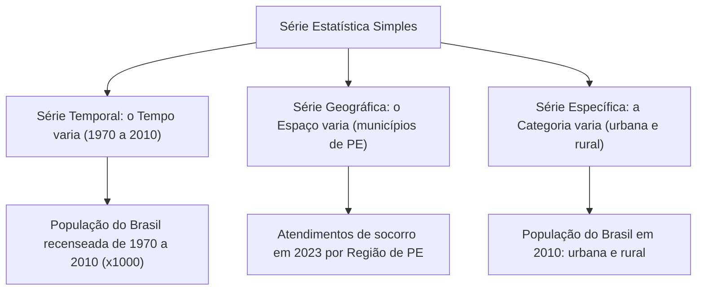
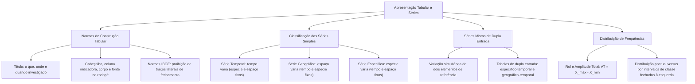

A apresentação organizada dos dados estatísticos constitui um requisito basilar para a análise técnica e a comunicação transparente na administração pública. Tabelas e séries mal concebidas geram distorções interpretativas e induzem a erros operacionais. O conhecimento das normas de apresentação tabular e o domínio da taxonomia das séries estatísticas capacitam o estudante a resolver questões de concurso com rapidez e segurança.

> [!objetivos]
> - Compreender a estrutura formal e as normas técnicas de elaboração de tabelas estatísticas.
> - Dominar os três elementos referenciais: tempo, espaço e espécie em uma série estatística.
> - Classificar as séries simples em temporais, geográficas e específicas.
> - Analisar a estrutura de séries mistas e tabelas de dupla entrada.
> - Compreender a distribuição de frequências pontual e intervalar.

## Estrutura Formal e Normas de Apresentação Tabular

Uma **tabela estatística** é uma representação compacta de dados ordenados em linhas e colunas. Sua finalidade é expor um resumo metódico de observações numéricas. A elaboração de tabelas no Brasil obedece às **Normas de Apresentação Tabular do IBGE**, que asseguram clareza e comparabilidade científica.

Segundo as normas técnicas vigentes, uma tabela completa compõe-se dos seguintes elementos constitutivos:

1. **Título:** Posicionado no topo, deve responder o que o dado representa, onde foi registrado e a época em que ocorreu.
2. **Cabeçalho:** Parte superior interna que especifica o conteúdo de cada coluna.
3. **Coluna Indicadora:** Primeira coluna à esquerda, que identifica o conteúdo descrito em cada linha.
4. **Corpo:** Conjunto central de linhas e colunas onde estão inseridos os dados numéricos.
5. **Célula:** Espaço resultante do cruzamento de uma linha com uma coluna.
6. **Rodapé:** Região inferior que engloba a **Fonte** obrigatória dos dados, notas metodológicas e eventuais chamadas.

| Componente Estrutural | Posição Técnica | Função Informativa |
| :--- | :--- | :--- |
| **Título** | Topo exterior | Responde o que, onde e quando foi investigado |
| **Cabeçalho** | Topo interior | Nomeia e descreve as colunas verticais |
| **Coluna Indicadora** | Extremo esquerdo | Nomeia e descreve o conteúdo das linhas |
| **Corpo** | Núcleo da tabela | Malha de dados numéricos em células |
| **Fonte** | Rodapé inferior | Identifica a procedência dos dados |

> [!atencao]
> As normas do IBGE vedam fechar as laterais da tabela com traços verticais. A tabela deve permanecer aberta dos lados esquerdo e direito. Utilizam-se traços horizontais apenas para delimitar o topo, separar o cabeçalho do corpo e fechar a base inferior.

## Os Três Elementos e a Classificação das Séries Simples

Uma **série estatística** define-se como toda sucessão ordenada de dados numéricos ligados a uma mesma variável. Toda série apoia-se em três elementos fundamentais: o **Tempo** (época), o **Espaço** (localidade) e a **Espécie** (o fato pesquisado).

A classificação das séries simples decorre do elemento que varia, enquanto os outros dois permanecem constantes:

1. **Série Temporal (ou Cronológica, Histórica, Evolutiva):** O elemento variável é o **tempo**, mantendo-se fixos o fato e o local. Exemplo clássico da fonte: a evolução da população brasileira recenseada pelo IBGE nos anos de 1970, 1980, 1991, 2000 e 2010 (valores em x1000 habitantes).
2. **Série Geográfica (ou Territorial, Espacial, de Localização):** O elemento variável é o **espaço**, permanecendo constantes a época e o fato. Exemplo: número de atendimentos de bombeiros em 2023 distribuídos pelos municípios de Pernambuco.
3. **Série Específica (ou Categórica):** O elemento variável é a **espécie ou categoria**, enquanto época e local são mantidos fixos. Exemplo clássico da fonte: a distribuição da população residente no Brasil em 2010 classificada em situação **urbana** e **rural**.

| Categoria da Série | Denominações Sinônimas | Elemento que Varia | Elementos Fixados |
| :--- | :--- | :--- | :--- |
| **Temporal** | Cronológica, histórica, evolutiva | Tempo (anos 1970 a 2010) | Espaço e Espécie |
| **Geográfica** | Territorial, espacial, local | Espaço (municípios) | Tempo e Espécie |
| **Específica** | Categórica, qualitativa | Categoria (urbana e rural) | Tempo e Espaço |

> [!bizu]
> Para classificar uma série com segurança, verifique o que muda nas linhas da coluna indicadora:
> - Se a coluna indicadora traz anos ou datas: a série é **temporal**.
> - Se a coluna indicadora traz cidades ou estados: a série é **geográfica**.
> - Se a coluna indicadora traz categorias (como urbana e rural): a série é **específica**.

## Séries Mistas e Tabelas de Dupla Entrada

Quando dois ou mais elementos variam simultaneamente, forma-se uma **série mista (ou composta)**. Sua apresentação exige uma **tabela de dupla entrada**. As categorias de uma variável ficam nas linhas e as da outra ocupam as colunas do cabeçalho.

A denominação da série composta decorre da fusão dos fatores que variam conjuntamente:

- **Série Específico-Temporal:** Ocorre variação da espécie e do tempo para um mesmo local. Exemplo: população urbana e rural do Brasil tabulada de 1970 a 2010 (valores em x1000).
- **Série Geográfico-Temporal:** Varia o espaço e o tempo para o mesmo fato. Exemplo: população de cada estado brasileiro registrada nos censos de 1970 a 2010.
- **Série Geográfico-Específica:** Varia o espaço e a espécie para um período de tempo constante.

| Ocorrências em Caruaru | Ano de 2022 | Ano de 2023 | Ano de 2024 | Total Trienal |
| :--- | :--- | :--- | :--- | :--- |
| **Incêndio em Edificação** | 142 | 165 | 158 | 465 |
| **Salvamento Terrestre** | 210 | 235 | 240 | 685 |
| **Resgate Pré-Hospitalar** | 480 | 512 | 530 | 1.522 |
| **Total Anual** | 832 | 912 | 928 | 2.672 |

> [!exemplo]
> A tabela acima é uma **série mista específico-temporal**. A coluna indicadora traz a espécie da ocorrência e as colunas do cabeçalho trazem os anos. O espaço territorial permanece fixado no município de Caruaru.

## Da Tabela Primitiva à Distribuição de Frequências

Ao finalizar a coleta de campo, o pesquisador dispõe de dados brutos desordenados na tabela primitiva. Para estruturar uma síntese compreensível, organiza-se o **rol** em ordem crescente.

A partir do rol calcula-se a **Amplitude Total (AT)**. Ela é a diferença entre o valor máximo e o valor mínimo da série:

AT = X_max - X_min

Em seguida, calcula-se a **frequência absoluta simples (fi)** de cada valor. Quando a variável é discreta com poucos valores, elabora-se a **distribuição de frequências pontual**. Nela, cada valor figura com sua contagem individual.

Quando a variável assume muitos valores distintos ou é contínua, adota-se a **distribuição por intervalos de classe**. Essa tabela engloba grupos de valores em intervalos uniformes. Por exemplo, na análise de 50 tempos de estudo variando entre 85 e 175 minutos, a amplitude total é 90 minutos (175 menos 85). Agrupando os dados em classes de 15 minutos, a faixa de 115 a 130 minutos engloba dados como 123, 126 e 129, enquanto a faixa de 130 a 145 engloba 135 e 137, e as faixas superiores englobam valores como 161 e 171.

A convenção matemática adotada na delimitação de classes é o intervalo fechado à esquerda e aberto à direita (`a |-- b`). O limite inferior `a` pertence à classe, enquanto o limite superior `b` é excluído e alocado na classe seguinte.

| Notação Intervalar | Convenção de Limites | Significado Estatístico | Inclusão dos Extremos |
| :--- | :--- | :--- | :--- |
| **a <= x < b** | Fechada à esquerda e aberta à direita | Limite a incluso e limite b excluso | Inclui o valor a e exclui o valor b |
| **a < x <= b** | Aberta à esquerda e fechada à direita | Limite a excluso e limite b incluso | Exclui o valor a e inclui o valor b |
| **a <= x <= b** | Fechada em ambos os lados | Ambos os limites inclusivos | Inclui simultaneamente a e b |
| **a < x < b** | Aberta em ambos os lados | Ambos os limites exclusivos | Exclui simultaneamente a e b |

> [!resolvido]
> **Questão Conceitual:** Em uma distribuição com classes `10 |-- 20` e `20 |-- 30`, onde deve ser alocado o valor 20?
> **Resolução:** O padrão `a |-- b` é fechado à esquerda e aberto à direita. O valor 20 é excluído da classe `10 |-- 20` e computado obrigatoriamente na classe `20 |-- 30`.

## Mapa do capítulo

### Para fixar

- **Componentes da Tabela:** Título explicativo, cabeçalho descritivo, coluna indicadora, corpo de dados e fonte no rodapé.
- **Normas do IBGE:** As laterais da tabela devem permanecer abertas, sem traços verticais de fechamento.
- **Três Elementos Referenciais:** Tempo (época), Espaço (local) e Espécie (fato ou categoria investigada).
- **Série Temporal:** O tempo varia ao longo das linhas, enquanto o local e o fato permanecem constantes.
- **Série Geográfica:** O espaço territorial varia entre as linhas, mantendo-se constantes a época e a espécie.
- **Série Específica:** As categorias variam nas linhas, conservando-se fixos o período temporal e a localidade.
- **Séries Mistas:** Apresentam variação simultânea de dois elementos, organizando-se em tabelas de dupla entrada.
- **Amplitude Total:** Diferença aritmética direta entre o valor máximo e o valor mínimo do rol estatístico.
- **Distribuição Pontual:** Apresenta cada valor numérico individual com sua respectiva frequência absoluta simples.
- **Intervalo de Classe Padrão:** Adota a convenção fechada à esquerda e aberta à direita (`a |-- b`), evitando contagem duplicada.
