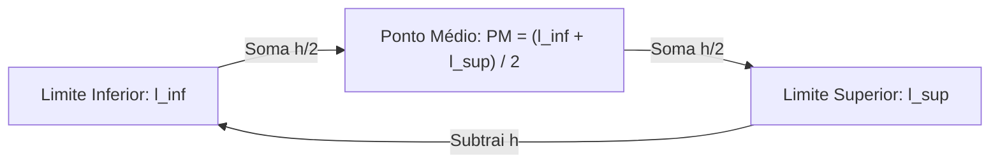
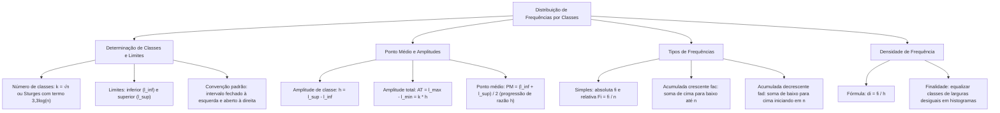

A estruturação de dados contínuos exige a condensação metódica dos valores observados em agrupamentos uniformes denominados intervalos de classe. Em levantamentos operacionais de bombeiros e perícias policiais, a tabela de distribuição de frequências por classes constitui a ferramenta central. Ela resume a variabilidade de medidas e identifica concentrações de eventos. Dominar a taxonomia de classes, os limites, os pontos médios e os quatro tipos de frequências é decisivo para gabaritar provas de alto rendimento.

> [!objetivos]
> - Definir intervalos de classe e calcular o número ideal de classes por Sturges e raiz quadrada.
> - Compreender a amplitude de classe, a amplitude total e o ponto médio como marca de classe.
> - Calcular e interpretar as frequências absolutas simples, acumuladas crescentes e decrescentes.
> - Dominar o cálculo das frequências relativas percentuais e a densidade de frequência.

## Classes, Limites e Amplitudes da Distribuição

Quando um conjunto de dados brutos abrange uma ampla faixa de valores, a apresentação individual dos números torna-se inviável. Para superar essa limitação, os dados são agrupados em **classes**. Classes são intervalos numéricos justapostos que cobrem toda a extensão da variável investigada.

A determinação do número ideal de classes (designado pela letra `k`) busca equilibrar a síntese com a precisão dos dados. Se o número de classes for muito reduzido, perdem-se detalhes da distribuição. Se for muito elevado, a tabela não atinge o objetivo de resumir os dados. Na prática estatística utilizam-se duas regras empíricas consagradas:

1. **Regra da Raiz Quadrada:** Recomendada para amostras moderadas (n <= 50). Calcula o número de classes pela raiz quadrada do tamanho amostral: k = √n.
2. **Fórmula de Sturges:** Válida para amostras de qualquer porte. Calcula o número de classes a partir da base logarítmica decimal com o termo 3,3log(n): k = 1 + 3,322 * log10(n).

O valor obtido para k funciona como estimativa orientadora e deve ser arredondado para um número inteiro. A partir de k e da amplitude dos dados, define-se a **amplitude do intervalo de classe (h)**. Ela mede o comprimento de cada classe individual:

h = l_sup - l_inf

Nessa relação, **l_inf** representa o limite inferior da classe. O termo **l_sup** representa o limite superior. A convenção padrão na estatística adota classes fechadas à esquerda e abertas à direita (`a <= x < b`). Nesse arranjo, o limite inferior pertence à classe. Já o valor que atinge o limite superior é computado na classe seguinte.

A **Amplitude Total (AT)** da distribuição corresponde à distância total entre o limite superior da última classe (l_max) e o limite inferior da primeira classe (l_min). Quando todas as k classes possuem a mesma amplitude h, estabelece-se a identidade fundamental:

AT = l_max - l_min = k * h

| Parâmetro de Classe | Expressão de Cálculo | Significado Prático |
| :--- | :--- | :--- |
| **Número de Classes (k)** | k = √n ou k = 1 + 3,3 * log(n) | Quantidade de linhas de intervalos da tabela |
| **Limite Inferior (l_inf)** | Extremo esquerdo da classe | Menor valor que ingressa no intervalo |
| **Limite Superior (l_sup)** | Extremo direito da classe | Limiar divisor que fecha a classe |
| **Amplitude de Classe (h)** | h = l_sup - l_inf | Comprimento numérico de cada classe |
| **Amplitude Total (AT)** | AT = l_max - l_min = k * h | Distância entre os extremos absolutos da tabela |

> [!pegadinha]
> Não confunda a amplitude dos dados brutos com a amplitude da tabela de classes. A amplitude dos dados brutos é a diferença entre a maior e a menor observação coletadas (X_max - X_min). Já a amplitude da tabela utiliza os limites das classes (l_max - l_min = k * h). Ela é quase sempre ligeiramente maior para assegurar folga de enquadramento.

## O Ponto Médio de Classe e suas Relações

O **ponto médio de classe** (designado por PM ou x_i) é o valor numérico que se localiza no centro geométrico do intervalo. Ele atua como o representante oficial de todos os dados daquela faixa. É utilizado para calcular médias aritméticas, desvios e variâncias em dados agrupados.

O ponto médio calcula-se pela média aritmética simples entre os limites da classe:

PM = (l_inf + l_sup) / 2

Quando a distribuição apresenta amplitude de classe constante h, os pontos médios sucessivos formam uma progressão aritmética de razão h. A distância entre os pontos médios de duas classes contíguas é igual à amplitude h.

Como o ponto médio fica no centro exato da classe, decorrem relações algébricas diretas:

- PM = l_inf + h/2
- PM = l_sup - h/2
- l_inf = PM - h/2
- l_sup = PM + h/2

> [!exemplo]
> Considere uma classe com ponto médio PM = 35 e amplitude h = 10. Para encontrar os limites do intervalo:
> - Limite inferior: l_inf = 35 - 10/2 = 35 - 5 = 30.
> - Limite superior: l_sup = 35 + 10/2 = 35 + 5 = 40.
> O intervalo procurado é 30 <= x < 40.

## Frequência Absoluta Simples e Frequências Acumuladas

A **frequência absoluta simples (f_i)** expressa a quantidade efetiva de observações pertencentes a determinada classe. A soma de todas as frequências simples é igual ao tamanho total da amostra: somatório de f_i = n.

Para analisar limiares operacionais, calculam-se as frequências acumuladas:

- **Frequência Absoluta Acumulada Crescente (f_ac ou fac_i):** Representa o número total de observações menores que o limite superior da classe. É calculada somando-se as frequências simples de cima para baixo. A frequência acumulada da última classe coincide com o tamanho amostral n.
- **Frequência Absoluta Acumulada Decrescente (f_ad ou fad_i):** Representa a contagem de observações iguais ou superiores ao limite inferior da classe. É calculada somando-se as frequências de baixo para cima. Na primeira classe, seu valor iguala-se ao total amostral n.

Existe uma relação direta entre as duas acumulações. Para qualquer classe i, a soma da frequência acumulada crescente da classe i com a frequência decrescente da classe seguinte (i+1) resulta no total de observações n: fac_i + fad_(i+1) = n.

| Classe de Idades | Frequência Simples (fi) | Acumulada Crescente (fac) | Acumulada Decrescente (fad) |
| :--- | :--- | :--- | :--- |
| **20 a 30 anos** | 6 | 6 | 60 |
| **30 a 40 anos** | 15 | 21 | 54 |
| **40 a 50 anos** | 24 | 45 | 39 |
| **50 a 60 anos** | 9 | 54 | 15 |
| **60 a 70 anos** | 6 | 60 | 6 |
| **Total Amostral** | n = 60 | Não se aplica | Não se aplica |

> [!bizu]
> Guarde a pergunta que cada frequência acumulada responde:
> - A frequência **acumulada crescente (fac)** indica quantos elementos estão **abaixo do limite superior** da classe. Na terceira classe (40 a 50 anos), fac = 45 indica que 45 servidores possuem menos de 50 anos.
> - A frequência **acumulada decrescente (fad)** indica quantos elementos estão **no limite inferior ou acima dele**. Na terceira classe, fad = 39 indica que 39 servidores possuem 40 anos ou mais.

## Frequência Relativa e Densidade de Frequência

A comparação direta entre grupos de tamanhos desiguais requer a conversão de contagens absolutas em proporções relativas. A **frequência relativa simples (F_i ou f_ri)** mede o peso proporcional da classe em relação ao total:

F_i = f_i / n

Multiplicando o resultado decimal por 100%, obtém-se a frequência relativa percentual (F_i%). A soma das frequências relativas simples de todas as classes é igual a 100%.

De maneira análoga, calculam-se as frequências relativas acumuladas:

- **Frequência Relativa Acumulada Crescente (F_ac%):** Proporção de dados situados abaixo do limite superior da classe. Ela cresce de cima para baixo até alcançar 100% na classe final.
- **Frequência Relativa Acumulada Decrescente (F_ad%):** Proporção de observações situadas a partir do limite inferior da classe. Ela inicia em 100% na primeira classe e reduz-se até a base.

Quando uma distribuição apresenta classes com larguras desiguais, a frequência simples perde a capacidade de retratar a concentração dos dados. Para corrigir a distorção introduzida por intervalos largos ou estreitos, calcula-se a **densidade de frequência (d_i)**:

d_i = f_i / h

A densidade de frequência expressa o número de observações concentradas por unidade de amplitude da variável. Essa grandeza é a medida utilizada para definir a altura dos retângulos em histogramas com classes desiguais. Ela assegura que a área de cada barra permaneça proporcional à frequência da classe.

| Classe de Idades | Frequência Simples (fi) | Frequência Relativa (Fi%) | Relativa Crescente (Fac%) | Densidade (di = fi/h) |
| :--- | :--- | :--- | :--- | :--- |
| **20 a 30 anos** | 6 | 10% | 10% | 0,60 |
| **30 a 40 anos** | 15 | 25% | 35% | 1,50 |
| **40 a 50 anos** | 24 | 40% | 75% | 2,40 |
| **50 a 60 anos** | 9 | 15% | 90% | 0,90 |
| **60 a 70 anos** | 6 | 10% | 100% | 0,60 |

## Exemplo Completo de Síntese e Aplicação em Questões

Para consolidar os conceitos, considere uma pesquisa pericial sobre o tempo em minutos que equipes de segurança pública estudam e registram ocorrências, investigando ocorrências de apreensão de drogas ou resgates. Foram coletados 50 tempos de atendimento operacional. A amplitude de classe fixada é h = 15 minutos, cobrindo a faixa de 85 a 190 minutos em sete classes consecutivas:

| Faixa de Tempo | fi | fac | fad | Fi% | Fac% | Fad% | Densidade |
| :--- | :--- | :--- | :--- | :--- | :--- | :--- | :--- |
| **85 a 100 min (85100)** | 5 | 5 | 50 | 10% | 10% | 100% | 0,33 |
| **100 a 115 min (100115)** | 5 | 10 | 45 | 10% | 20% | 90% | 0,33 |
| **115 a 130 min (115130)** | 12 | 22 | 40 | 24% | 44% | 80% | 0,80 |
| **130 a 145 min (130145)** | 10 | 32 | 28 | 20% | 64% | 56% | 0,67 |
| **145 a 160 min (145160)** | 7 | 39 | 18 | 14% | 78% | 36% | 0,47 |
| **160 a 175 min (160175)** | 9 | 48 | 11 | 18% | 96% | 22% | 0,60 |
| **175 a 190 min (175190)** | 2 | 50 | 2 | 4% | 100% | 4% | 0,13 |

Repetimos as propriedades fundamentais dessa síntese tabular:
- A Amplitude Total é AT = 190 - 85 = 105 minutos, igual a k * h = 7 * 15 = 105.
- Os pontos médios das classes são 92,5; 107,5; 122,5; 137,5; 152,5; 167,5 e 182,5 minutos, compondo progressão aritmética de razão 15.
- A frequência acumulada crescente da quarta classe (130 a 145 min) é fac = 32. Ela comprova que 32 atendimentos duraram menos de 145 minutos (Fac = 64%).
- A frequência acumulada decrescente da quarta classe é fad = 28. Ela demonstra que 28 atendimentos demandaram 130 minutos ou mais (Fad = 56%).

> [!resolvido]
> **Questão Conceitual de Concurso:** Em uma pesquisa amostral com 200 servidores públicos sobre faixas salariais, a quarta classe apresenta limite inferior de 4000 reais, limite superior de 6000 reais e frequência simples de 50 servidores.
> 1. Qual é o ponto médio dessa classe?
> 2. Qual é a frequência relativa percentual dessa classe?
> 3. Qual é a densidade de frequência dessa classe por milhar de reais?
> **Resolução:**
> - 1. Ponto Médio: PM = (4000 + 6000) / 2 = 5000 reais.
> - 2. Frequência Relativa: Fi% = (50 / 200) * 100% = 25%.
> - 3. Amplitude da classe: h = 6000 - 4000 = 2000 reais (ou h = 2 milhares de reais). Densidade de frequência: di = 50 / 2 = 25 servidores por milhar de reais (ou di = 50 / 2000 = 0,025 servidores por real).

## Mapa do capítulo

### Para fixar

- **Número de Classes:** Estimado pela fórmula de Sturges k = 1 + 3,322 * log10(n) ou pela raiz quadrada para amostras reduzidas.
- **Limites de Classe:** O limite inferior pertence ao intervalo; o limite superior define a fronteira exclusiva de transição.
- **Amplitude de Classe:** Distância constante entre os extremos da classe, calculada por h = l_sup - l_inf.
- **Amplitude Total:** Diferença entre o extremo superior final e o extremo inferior inicial, expressa por AT = k * h com classes iguais.
- **Ponto Médio da Classe:** Média aritmética dos limites do intervalo (PM = (l_inf + l_sup)/2), distanciando-se por h entre classes vizinhas.
- **Frequência Simples:** Quantidade direta de observações na classe; a soma de todas as frequências fi resulta no tamanho n da amostra.
- **Frequência Acumulada Crescente:** Mede as observações abaixo do limite superior da classe, progredindo de cima para baixo até atingir n.
- **Frequência Acumulada Decrescente:** Mede as observações a partir do limite inferior da classe, iniciando em n e reduzindo-se até a base.
- **Frequência Relativa:** Proporção ou percentual dado por Fi = fi / n; o somatório de todas as frequências relativas resulta em 100%.
- **Densidade de Frequência:** Razão di = fi / h que mede a concentração de observações por unidade de amplitude da classe.
