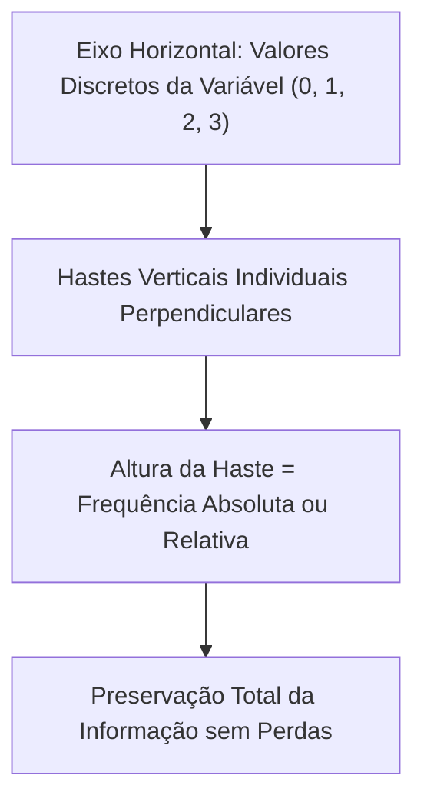
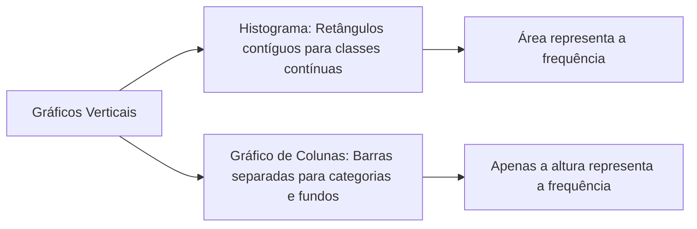
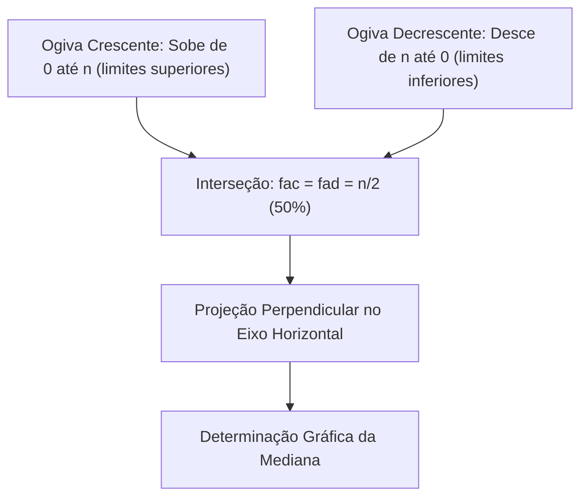
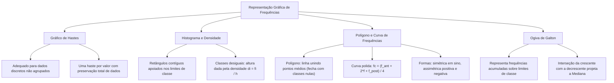

A representação gráfica de uma distribuição de frequências traduz tabelas numéricas complexas em imagens visuais de apreensão imediata. Nos relatórios periciais de criminalística e nos boletins de ocorrência de bombeiros, os diagramas estatísticos permitem aos analistas identificar padrões de concentração e assimetrias. Compreender a distinção metodológica entre gráficos de hastes, histogramas, polígonos de frequências, curvas suavizadas e ogivas acumuladas é indispensável para resolver questões de concurso com rigor conceitual.

> [!objetivos]
> - Diferenciar a representação por gráfico de hastes da representação contínua por histograma.
> - Compreender a construção geométrica do histograma e o papel da densidade de frequência.
> - Analisar a obtenção do polígono de frequências e a transição para a curva polida.
> - Interpretar a ogiva de frequências acumuladas e correlacionar sua interseção com a mediana.

## Gráfico de Hastes para Dados Não Agrupados

O **gráfico de hastes** (ou bastões) é o modelo adequado para séries estatísticas com dados pontuais não agrupados em classes. Aplica-se a variáveis quantitativas discretas que assumem poucos valores inteiros na amostra.

Na construção do diagrama, os valores observados são alocados no eixo horizontal. Sobre cada valor ergue-se uma haste vertical perpendicular. A altura de cada haste é igual à frequência daquela observação.

A vantagem principal do gráfico de hastes reside na **ausência de perda de informação**. Cada ponto amostral mantém sua identidade singular com sua frequência exata. É perfeitamente viável reconstruir a tabela original completa a partir do gráfico.

> [!exemplo]
> Em uma inspeção militar registra-se o número de faltas de 50 servidores: 0 faltas (30 homens), 1 falta (12 homens), 2 faltas (6 homens) e 3 faltas (2 homens). O gráfico de hastes exibe quatro bastões sobre os pontos 0, 1, 2 e 3, com alturas 30, 12, 6 e 2.

## O Histograma e a Densidade de Frequência

O **histograma** é o gráfico padrão para distribuições com dados agrupados em intervalos de classe. É formado por uma sucessão de retângulos contíguos (barras coladas sem espaçamento vazio), apoiados no eixo horizontal.

A geometria do histograma obedece a regras consolidadas:

1. As bases dos retângulos assentam-se sobre o eixo horizontal, coincidindo com os limites da classe (largura h).
2. O ponto médio da base coincide com o ponto médio PM da classe.
3. Com amplitude h constante, a altura de cada retângulo é proporcional à frequência da classe.
4. A área total dos retângulos é proporcional ao tamanho total da amostra n.

> [!pegadinha]
> A distinção entre histograma e gráfico de colunas é muito cobrada em certames. Um gráfico com barras separadas por espaços representando categorias ou fundos de investimento não é histograma. No histograma, os retângulos são colados porque as bases dos retângulos cobrem intervalos contínuos de classe.

Quando as classes têm larguras desiguais, a altura representa a **densidade de frequência (d = fi / h)**. A área de cada retângulo expressa a frequência real: Área = Base * Altura = h * (fi / h) = fi. Se uma classe de largura 1000 tem densidade 2x10⁻⁴ com 30 elementos, a frequência relativa é 0,2 (30/150). A linha que contorna o topo dos retângulos chama-se poligonal característica.

| Elemento do Histograma | Significado Geométrico | Relação Matemática |
| :--- | :--- | :--- |
| **Base do Retângulo** | Limites do intervalo de classe | Comprimento igual à amplitude h |
| **Centro da Base** | Ponto médio da classe | Posição x = (l_inf + l_sup) / 2 |
| **Altura (Classes Iguais)** | Proporcional à contagem | Altura igual a fi ou Fi |
| **Altura (Classes Desiguais)** | Densidade de frequência | Altura igual a d = fi / h |
| **Área do Retângulo** | Proporcional à frequência | Área = h * d = fi |

## Polígono de Frequências e Curva Suavizada

O **polígono de frequências** é um gráfico em linha que evidencia o desenho morfológico da distribuição. Ele é construído marcando-se um ponto cartesiano sobre o topo de cada retângulo do histograma, no par (ponto médio, frequência). Em seguida, unem-se esses pontos por segmentos de reta.

Para que a figura se feche como um polígono, acrescentam-se duas classes fictícias nos extremos com frequência zero. Ao ligar as pontas aos pontos médios dessas classes nulas, a figura fecha-se no eixo. A área sob o polígono é igual à área dos retângulos do histograma.

Quando a amostra cresce, os vértices angulosos atenuam-se. A **curva de frequências** é obtida por **polimento**, que calcula a média ponderada entre três classes vizinhas com peso dois na central:

fc = (f_anterior + 2 * f_classe + f_posterior) / 4

Considere a série de 50 tempos com classes 85 ≤ x < 100, 100 ≤ x < 115 (100x), 115 ≤ x < 130 (115x), 130 ≤ x < 145 (130x e 145), 145 ≤ x < 160 (145x e 160), 160 ≤ x < 175 (160x) e 175 ≤ x < 190 (175x). Os pontos médios são 92,5; 107,5; 122,5; 137,5; 152,5; 167,5 e 182,5 (182).

As curvas de frequências classificam-se em:

- **Simétrica (em Sino):** Caudas laterais equilibradas. Média, mediana e moda coincidem no centro.
- **Assimétrica à Direita (Positiva):** Concentração nos valores baixos e cauda alongada à direita (Moda < Mediana < Média).
- **Assimétrica à Esquerda (Negativa):** Concentração nos valores altos e cauda alongada à esquerda (Média < Mediana < Moda).
- **Curvas em J, J Invertido e em U:** Máximos em um ou em ambos os extremos.

| Morfologia da Curva | Disposição das Caudas | Relação entre Medidas |
| :--- | :--- | :--- |
| **Simétrica (Sino)** | Caudas equilibradas em ambos os lados | Média = Mediana = Moda |
| **Assimétrica Positiva** | Cauda alongada para a direita | Moda < Mediana < Média |
| **Assimétrica Negativa** | Cauda alongada para a esquerda | Média < Mediana < Moda |
| **Forma em U** | Concentrações nos dois extremos | Mínimo na região central |

> [!bizu]
> O nome da assimetria acompanha a **cauda longa** e não o lado da aglomeração. Se a cauda se estica para a direita, a assimetria é positiva (à direita).

## A Ogiva de Galton (Polígono de Frequências Acumuladas)

A **ogiva** é o gráfico em linha projetado para representar frequências acumuladas. No eixo horizontal utilizam-se os **limites exatos das classes**, e não os pontos médios.

A ogiva apresenta duas vertentes:

1. **Ogiva Crescente:** Plota as frequências acumuladas crescentes. Inicia no limite inferior da primeira classe com valor zero e sobe até atingir n (ou 100%) no limite superior da última classe.
2. **Ogiva Decrescente:** Plota as frequências acumuladas decrescentes. Parte do limite inferior da primeira classe com o valor n (ou 100%) e desce até zero no limite superior da última classe.

O **ponto de interseção entre a ogiva crescente e a decrescente** ocorre exatamente na ordenada n/2 (50% dos dados). Projetando-se esse ponto sobre o eixo horizontal, obtém-se diretamente a **Mediana (Md)** da distribuição.

> [!resolvido]
> **Questão Conceitual:** Em um teste físico com 120 candidatos, o cruzamento das ogivas crescente e decrescente ocorreu no ponto com abscissa de 12 minutos e ordenada de 60 candidatos. O que indica esse ponto?
> **Resolução:** O cruzamento das ogivas indica a frequência de 50% (ordenada n/2 = 60). Sua projeção horizontal define a **Mediana**. Logo, 12 minutos é a mediana da corrida, indicando que metade dos candidatos correu em até 12 minutos.

## Mapa do capítulo

### Para fixar

- **Gráfico de Hastes:** Empregado em dados discretos não agrupados; cada haste reflete a frequência sem perda de informação.
- **Histograma:** Formado por retângulos contíguos sem espaçamento; a base representa a classe e a área reflete a frequência.
- **Distinção Essencial:** Gráfico de colunas possui barras separadas; o histograma apresenta barras coladas de dados contínuos.
- **Classes Desiguais:** Exigem que a altura do retângulo seja calculada pela densidade de frequência di = fi / h.
- **Polígono de Frequências:** Linha que une os pontos médios superiores dos retângulos, fechando no eixo em classes fictícias nulas.
- **Curva de Frequências:** Linha suavizada por polimento ponderado que revela a tendência contínua da população subjacente.
- **Assimetria das Curvas:** A assimetria positiva estica a cauda para a direita; a assimetria negativa estica a cauda para a esquerda.
- **Ogiva Crescente:** Linha de frequências acumuladas crescentes que parte do zero na base e alcança 100% no topo.
- **Eixo da Ogiva:** Utiliza os limites dos intervalos de classe na linha horizontal, diferenciando-se dos pontos médios do polígono.
- **Interseção das Ogivas:** O cruzamento das ogivas crescente e decrescente ocorre em 50% e projeta a mediana da distribuição.
