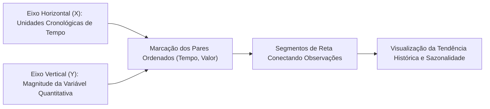
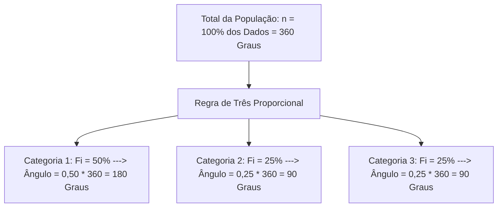
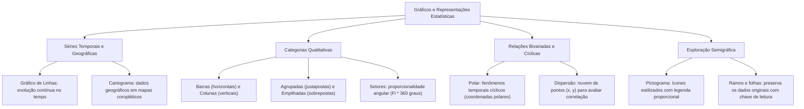

A comunicação estatística apoia-se na representação gráfica para sintetizar dados. Esse formato auxilia na tomada rápida de decisões de gestão. Na segurança pública, a escolha do diagrama evidencia tendências criminais. Ela também permite mapear a distribuição espacial de sinistros e correlacionar variáveis de campo. O domínio dos princípios geométricos de gráficos de colunas, setores, polares e ramos e folhas é decisivo. Esse conhecimento garante rapidez e segurança na resolução de provas.

> [!objetivos]
> - Compreender os critérios técnicos de escolha e os princípios de simplicidade e clareza dos gráficos.
> - Diferenciar gráficos em barras e em colunas em suas variações simples, agrupadas e empilhadas.
> - Dominar o cálculo dos ângulos em gráficos de setores e sua aplicação em equações de concurso.
> - Caracterizar gráficos polares, cartogramas, pictogramas, gráficos de dispersão e o diagrama de ramos e folhas.

## Princípios da Representação Gráfica e Gráficos de Linhas

O propósito de um gráfico estatístico é proporcionar visualização rápida e intuitiva. O formato geométrico facilita a compreensão dos dados numéricos. A Estatística Descritiva estabelece que qualquer gráfico deve atender a três requisitos fundamentais:

- **Simplicidade:** O traçado deve ser desprovido de adornos visuais supérfluos, efeitos tridimensionais desnecessários ou detalhes irrelevantes que desviem a atenção do analista;
- **Clareza:** A disposição dos eixos, legendas, títulos e escalas deve permitir uma decodificação imediata e inequívoca dos valores representados;
- **Verossimilhança:** O desenho geométrico deve traduzir com fidelidade a verdade dos fatos. Devem-se evitar distorções visuais ou supressão de origens de eixos que induzam a conclusões falsas.

Os **gráficos de linhas** constituem a ferramenta padrão por excelência para a representação visual de **séries temporais**. No plano cartesiano ortogonal, o eixo horizontal das abscissas destina-se invariavelmente à marcação das unidades cronológicas de tempo (anos, meses, dias ou horas de plantão). O eixo vertical das ordenadas registra os valores quantitativos assumidos pela variável.

Os pares ordenados (tempo, valor) são assinalados como pontos e posteriormente conectados por segmentos de reta contínuos. Quando se deseja contrastar o comportamento histórico de diferentes unidades operacionais (por exemplo, comparar a evolução dos chamados de resgate em três batalhões de bombeiros ao longo de uma década), traçam-se múltiplas linhas simultâneas diferenciadas por cores, espessuras ou estilos de traço, acompanhadas por legenda técnica explicativa.

## Gráficos em Barras e Gráficos em Colunas

Os gráficos constituídos por retângulos isolados destinam-se precipuamente à representação de **variáveis qualitativas (categóricas)** ou variáveis quantitativas discretas que apresentem poucas classes de contagem. A nomenclatura técnica distingue a orientação espacial dos retângulos:

- **Gráficos em Barras (Horizontais):** Os retângulos são orientados horizontalmente, apoiando-se no eixo vertical esquerdo. Todos os retângulos possuem rigorosamente a mesma largura ou espessura. O **comprimento horizontal** de cada barra é diretamente proporcional à frequência absoluta ou relativa da categoria. Esse formato é fortemente recomendado quando as categorias possuem nomes ou rótulos textuais longos (como nomes extensos de municípios ou qualificações penais), pois viabiliza a leitura horizontal do texto sem inclinações desconfortáveis.
- **Gráficos em Colunas (Verticais):** Os retângulos erguem-se verticalmente a partir do eixo horizontal inferior. Todos os retângulos mantêm a mesma base. A **altura vertical** é proporcional à intensidade numérica do dado. É o formato ideal para séries geográficas ou específicas com rótulos curtos.

Os gráficos em barras ou colunas desdobram-se em três modalidades estruturais conforme a complexidade dos dados:

1. **Simples:** Exibem uma única barra ou coluna individual para cada categoria da variável.
2. **Agrupados (ou Justapostos):** Posicionam duas ou mais barras contíguas lado a lado para cada categoria da coluna indicadora. Permitem comparar subgrupos em um único diagrama (por exemplo, comparar o número de chamados diurnos e noturnos lado a lado em cinco municípios distintos).
3. **Sobrepostos (ou Empilhados):** Cada barra é subdividida em segmentos proporcionais empilhados uns sobre os outros, totalizando a altura integral da categoria. Permitem analisar simultaneamente o total absoluto acumulado e a participação relativa de cada componente interno.

| Tipo de Gráfico | Orientação Espacial | Proporcionalidade Numérica | Indicação Técnica Principal |
| :--- | :--- | :--- | :--- |
| **Barras Simples** | Retângulos horizontais | Comprimento proporcional | Categorias com legendas ou nomes extensos |
| **Colunas Simples** | Retângulos verticais | Altura proporcional | Séries categóricas com legendas curtas |
| **Agrupadas** | Barras lado a lado | Altura individual comparada | Confronto de subgrupos em períodos fixos |
| **Empilhadas** | Segmentos sobrepostos | Altura acumulada total | Decomposição de partes de um total |

> [!pegadinha]
> Fique atento à terminologia rigorosa do IBGE: barras referem-se estritamente aos retângulos dispostos na horizontal, enquanto colunas designam os retângulos na vertical. Jamais confunda um gráfico de colunas com um histograma: o gráfico de colunas possui espaçamentos vazios obrigatórios entre as barras e representa dados qualitativos ou discretos, enquanto o histograma é formado por retângulos colados para classes de dados contínuos.

## Gráfico em Setores (Pizza) e Cálculos Angulares

O **gráfico em setores** (popularmente denominado gráfico de pizza) consiste em um círculo subdividido em fatias ou setores circulares. Sua aplicação é voltada para evidenciar a **composição proporcional e a frequência relativa** de uma variável categórica ou qualitativa em relação ao conjunto universo total de observações.

O círculo completo compreende uma circunferência total de 360 graus angulares, correspondendo à totalidade de 100% da amostra ou população (somatório de frequências igual a n). Cada setor circular individual possui vértice ancorado no centro geométrico do círculo. A área do setor e a abertura de seu **ângulo central** são diretamente proporcionais à frequência relativa simples da respectiva categoria pesquisada.

O cálculo do ângulo central do setor decorre de uma regra de três direta fundamental:

Ângulo Central = (frequência da categoria / total amostral) * 360 graus = F_i * 360 graus

Recomenda-se tecnicamente limitar o gráfico de setores a um número reduzido de divisões (geralmente não mais do que cinco ou seis classes). A dispersão em dezenas de fatias diminutas torna o diagrama confuso, dificultando a discriminação visual dos percentuais.

> [!bizu]
> Em questões de concurso com gráficos de setores, a banca comumente fornece as porcentagens no gráfico e estabelece relações em valores absolutos no enunciado. Para resolver com rapidez: defina o total da amostra como a incógnita T, monte uma equação de primeiro grau com as porcentagens expressas em função de T e encontre o valor numérico global.

> [!resolvido]
> **Questão Típica de Concurso:** Um boletim setorial do Corpo de Bombeiros apresenta um gráfico de setores com as receitas operacionais de três batalhões: Batalhão Alfa (50%), Batalhão Beta (30%) e Batalhão Gama (20%). O texto informa que o Batalhão Alfa recebeu 40 milhões de reais a mais do que o Batalhão Beta. Qual foi a receita destinada ao Batalhão Gama?
> **Resolução:**
> - Seja T o total geral de recursos.
> - A receita de Alfa é 0,50 * T e a de Beta é 0,30 * T.
> - A diferença fornecida é: 0,50 * T - 0,30 * T = 40 milhões de reais.
> - 0,20 * T = 40 milhões de reais, logo T = 40 / 0,20 = 200 milhões de reais.
> - A receita de Gama corresponde a 20% do total: 0,20 * 200 = 40 milhões de reais.

## Gráficos Polares, Cartogramas, Pictogramas e Dispersão

A estatística dispõe de diagramas especializados para acomodar variáveis com restrições geométricas ou territoriais específicas:

- **Gráfico Polar:** Modelo desenhado em um sistema de coordenadas polares, composto por eixos radiais que partem de um polo central com ângulos de separação perfeitamente iguais. É o gráfico preconizado para retratar **séries temporais cíclicas ou periódicas**, que se repetem em ciclos regulares (como os doze meses do ano, os dias da semana ou as 24 horas do dia). Conectando-se os pontos marcados em cada raio obtém-se uma figura poligonal que evidencia de pronto picos sazonais (como volume mensal de chuvas ou índice horário de acidentes de trânsito).
- **Cartograma:** Representação estatística expressa diretamente sobre uma base cartográfica ou mapa geográfico. Destina-se à ilustração de **séries geográficas**. As unidades espaciais (estados, municípios ou distritos policiais) são preenchidas com cores de intensidade gradual (mapas coropléticos), símbolos pontuais ou hachuras, acompanhadas de escala técnica que traduz a densidade de ocorrências em cada território.
- **Pictograma (ou Gráfico Figurativo):** Representação visual concebida para atrair a atenção do grande público e facilitar a apreensão popular dos dados. Os valores numéricos são substituídos por ícones estilizados ou ilustrações padronizadas de dimensões idênticas (como desenhos de viaturas, bombeiros ou árvores), acompanhados por legenda que explicita o valor fixo de cada ícone. Quando uma contagem não atinge a unidade inteira, o ícone é desenhado de forma fracionada (cortado pela metade para expressar fração de valor).
- **Gráfico de Dispersão (ou Diagrama de Dispersão):** Representação cartesiana bivariada utilizada para investigar o comportamento conjunto de duas variáveis quantitativas contínuas. Cada elemento da amostra é marcado como um ponto isolado de coordenadas (x, y). A nuvem de pontos gerada no plano cartesiano permite diagnosticar visualmente se existe correlação linear positiva, negativa ou ausência de relacionamento funcional entre as variáveis.

| Modelo Gráfico | Base de Construção | Variável Adequada | Aplicação Prática Típica |
| :--- | :--- | :--- | :--- |
| **Polar** | Eixos radiais divergentes | Séries temporais cíclicas | Chuvas por mês e sinistros por hora |
| **Cartograma** | Mapa territorial com cor | Séries geográficas | Ocorrências por município em PE |
| **Pictograma** | Ícones gráficos repetidos | Comunicação institucional | Apresentação visual a leigos |
| **Dispersão** | Nuvem de pares ordenados | Duas variáveis numéricas | Correlação de velocidade e tempo |

## Diagrama de Ramos e Folhas (Stem-and-Leaf)

O **diagrama de ramos e folhas** é uma técnica semigráfica clássica da análise exploratória de dados que combina as virtudes de uma tabela de frequências ordenada com a percepção visual direta da forma da distribuição, com a vantagem notável de **não descartar os dados numéricos originais**.

Na montagem padrão do diagrama de ramos e folhas, cada valor numérico individual da série ordenada (rol) é repartido estruturalmente em duas frações:

- O **Ramo (à esquerda):** Formado pelo dígito ou grupo de dígitos principais de maior valor posicional (comumente as centenas e dezenas, isto é, tudo aquilo que antecede o último algarismo da direita);
- A **Folha (à direita):** Composta exclusivamente pelo algarismo terminal da unidade de cada observação.

Os ramos distintos são dispostos verticalmente em ordem crescente em uma coluna à esquerda, separados das folhas por um traço vertical. Na linha horizontal correspondente a cada ramo anotam-se sucessivamente todas as folhas individuais que pertencem àquele ramo. Uma exigência metodológica indeclinável do diagrama é a inclusão de uma **chave de leitura**, que esclarece a interpretação numérica precisa da notação (por exemplo, a chave "4 | 2 = 42 anos" ou "3 | 5 = 3,5 kg").

> **Chave de Leitura:** 4 \| 2 = 42 anos
> - **Ramo 3:** folhas 1, 4, 8 (valores: 31, 34, 38)
> - **Ramo 4:** folhas 2, 2, 7 (valores: 42, 42, 47)
> - **Ramo 5:** folha 5 (valor: 55)

O diagrama acima traduz com fidelidade o rol composto pelas observações: 31, 34, 38, 42, 42, 47 e 55. A inspeção visual imediata do diagrama de ramos e folhas revela onde reside a maior concentração de dados (no ramo 4), a amplitude da série e permite localizar a mediana sem necessidade de realizar cálculos adicionais.

## Mapa do capítulo

### Para fixar

- **Critérios Gráficos:** Todo gráfico deve ostentar simplicidade no desenho, clareza interpretativa e verossimilhança numérica.
- **Gráficos de Linhas:** Ferramenta padrão para séries temporais, posicionando o tempo no eixo das abscissas.
- **Barras e Colunas:** Barras são retângulos horizontais para rótulos longos; colunas são verticais para rótulos curtos.
- **Empilhadas e Agrupadas:** Empilhadas decompõem frações de uma soma total; agrupadas comparam subgrupos lado a lado.
- **Gráfico em Setores:** Retrata frequências relativas percentuais; o ângulo central é calculado pela fórmula Fi * 360 graus.
- **Gráfico Polar:** Utiliza eixos radiais divergentes para séries periódicas cíclicas (como meses do ano ou horas do dia).
- **Cartograma:** Expressa dados estatísticos diretamente sobre bases cartográficas mediante hachuras ou escalas de cor.
- **Pictograma:** Utiliza figuras ou ícones padronizados proporcionais com legenda para comunicação de apelo popular.
- **Gráfico de Dispersão:** Plota pares ordenados (x, y) no plano cartesiano para investigar correlações bivariadas.
- **Ramos e Folhas:** Separa ramos à esquerda e folhas à direita, preservando a identidade dos números com chave de leitura.
