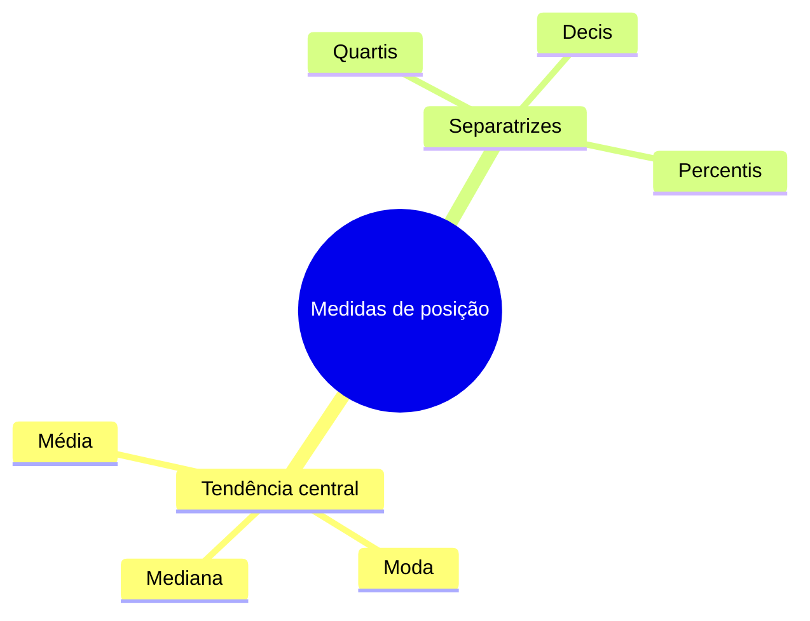

Toda análise estatística começa por uma pergunta simples: qual valor representa bem um conjunto de dados? As medidas de posição respondem a essa pergunta. Antes de estudar cada média, este capítulo apresenta as medidas de posição, mostra como elas se dividem e ensina a linguagem em que as fórmulas são escritas: o somatório. Quem domina a notação resolve as demonstrações e as questões de propriedades com muito mais segurança.

> [!objetivos]
> - Diferenciar medidas de tendência central e separatrizes.
> - Ler e escrever expressões com o símbolo de somatório.
> - Aplicar as propriedades do somatório em cálculos.
> - Evitar os erros clássicos com somas de quadrados e produtos.

## O que são medidas de posição

Os dados de uma pesquisa costumam ser muitos. Em vez de listá-los, a Estatística resume o conjunto em poucos números. As **medidas de posição** indicam onde os valores se concentram ou como se distribuem ao longo da escala. Elas se dividem em dois grupos.

- **Medidas de tendência central** (ou de centralidade): indicam o valor em torno do qual os dados se agrupam. São a **média**, a **moda** e a **mediana**.
- **Separatrizes**: dividem o conjunto ordenado em partes iguais. São os **quartis** (4 partes), os **decis** (10 partes) e os **percentis** (100 partes).

A tabela mostra a função de cada medida.

| Medida | O que indica | Exemplo de uso |
| --- | --- | --- |
| Média | Valor que "equilibra" o conjunto | Tempo médio de resposta de uma guarnição |
| Moda | Valor mais frequente | Tipo de ocorrência mais comum |
| Mediana | Valor central dos dados ordenados | Salário típico, sem influência de extremos |
| Quartil | Valor que separa 25%, 50% ou 75% dos dados | Faixas de desempenho em um curso |
| Percentil | Valor que deixa certa porcentagem abaixo dele | Posição em um concurso |

### Os tipos de média

A palavra "média" aparece em vários sentidos. Neste volume, estudaremos as mais cobradas, e cada uma tem um uso específico.

| Média | Ideia | Quando usar |
| --- | --- | --- |
| Aritmética | Soma dividida pela quantidade | Valores de mesma natureza, como notas e idades |
| Ponderada | Cada valor tem um peso | Notas com pesos diferentes |
| Geométrica | Raiz do produto dos valores | Taxas de crescimento acumulado |
| Harmônica | Inverso da média dos inversos | Velocidades e razões com mesmo numerador |

A moda é estudada nos últimos capítulos do volume.

## Médias no noticiário

As medidas de posição aparecem todos os dias nos jornais. Uma notícia diz que a expectativa de vida do Japão é muito maior que a de Angola; outra informa o salário médio de uma categoria; outra, o tempo médio de espera por atendimento. Em todos os casos, uma única medida substitui uma série inteira de números.

Esse resumo tem um custo: a média esconde a **distribuição**. Imagine uma pequena empresa com um patrão que ganha 20 mil reais por mês e quatro empregados que ganham 2 mil cada. A média é (20 000 + 4 · 2 000)/5 = **5 600 reais**, valor que nenhum empregado recebe. O patrão eleva a média, e ela passa a descrever mal o grupo. Por isso, o profissional que lê dados deve perguntar sempre se a média representa bem a sequência de valores ou se um extremo a distorce. A mediana, nesse caso, seria 2 mil reais, mais próxima da realidade dos empregados.

> [!exemplo]
> Um quartel registra, em seis plantões seguidos, estes tempos de espera por uma viatura, em minutos: 10, 12, 11, 13, 12 e 70. O 70 foi uma pane isolada. A média dos seis valores é 128/6 ≈ 21,3 minutos, número maior que cinco dos seis plantões. A mediana é 12 minutos e descreve melhor o plantão típico. A escolha da medida depende da pergunta que se quer responder.

## Notação de somatório

O **somatório** é uma forma curta de escrever uma soma de muitas parcelas. O símbolo é a letra grega maiúscula σ (Σ). Considere os tempos de resposta, em minutos, de cinco ocorrências: 6, 8, 5, 9 e 12. Chamamos esses valores de x₁, x₂, x₃, x₄ e x₅. A soma deles se escreve:

    Σ xᵢ = x₁ + x₂ + x₃ + x₄ + x₅ = 6 + 8 + 5 + 9 + 12 = 40   (i variando de 1 a 5)

A letra **i** é o **índice**: ela percorre as posições. Embaixo do σ está o valor inicial do índice, e em cima, o valor final. Na leitura dos concursos, o índice quase sempre vai de 1 até **n**, que é o número de observações.

O somatório também pode começar em outra posição. Se a soma vai do segundo ao quarto termo, escreve-se com i = 2 embaixo e 4 em cima, e o resultado é x₂ + x₃ + x₄ = 8 + 5 + 9 = **22**. Quando a questão informa os limites, só entram na soma os termos desse intervalo.

| Parte do símbolo | Significado |
| --- | --- |
| Σ | Some as parcelas |
| i = 1 (embaixo) | O índice começa em 1 |
| n (em cima) | O índice termina em n |
| xᵢ | Valor da observação de posição i |

Duas leituras diferentes pedem atenção. A expressão **Σ xᵢ²** significa elevar cada valor ao quadrado e depois somar. Com os dados acima, 6² + 8² + 5² + 9² + 12² = 36 + 64 + 25 + 81 + 144 = **350**. Já a expressão **(Σ xᵢ)²** significa somar primeiro e elevar depois: 40² = **1600**. São números muito diferentes.

> [!pegadinha]
> Confundir Σ xᵢ² com (Σ xᵢ)². No primeiro, eleva-se cada parcela e depois soma-se. No segundo, soma-se e depois eleva-se o total. A banca coloca as duas expressões lado a lado para testar atenção.

## Propriedades do somatório

Cinco propriedades resolvem a maior parte das questões, e todas decorrem das regras da adição.

| Propriedade | Escrita | Exemplo com n = 5 |
| --- | --- | --- |
| Soma de constante | Σ c = n · c | Σ 3 = 5 · 3 = 15 |
| Constante multiplicando | Σ c·xᵢ = c · Σ xᵢ | Σ 2xᵢ = 2 · 40 = 80 |
| Soma de variáveis | Σ (xᵢ + yᵢ) = Σ xᵢ + Σ yᵢ | Soma separada de cada lista |
| Diferença | Σ (xᵢ − yᵢ) = Σ xᵢ − Σ yᵢ | Subtração separada |
| Mudança de origem | Σ (xᵢ + c) = Σ xᵢ + n · c | Σ (xᵢ + 3) = 40 + 15 = 55 |

Com elas, calcula-se qualquer soma de funções lineares sem listar os termos. Por exemplo, Σ (2xᵢ + 3) com os dados acima é igual a 2 · 40 + 5 · 3 = **95**. Conferindo termo a termo: 15, 19, 13, 21 e 27, que somam 95.

Duas armadilhas fecham o assunto:

- Σ xᵢ·yᵢ **não** é igual a (Σ xᵢ)·(Σ yᵢ). Somar os produtos termo a termo dá um resultado diferente de multiplicar as duas somas totais.
- Σ xᵢ² **não** é igual a (Σ xᵢ)². O quadrado de uma soma tem termos cruzados.

> [!resolvido] Somatório de uma expressão linear
> **Enunciado.** Os valores de x são 6, 8, 5, 9 e 12. Calcule Σ (3xᵢ − 2).
>
> **Raciocínio.** Usa-se a propriedade da diferença e da constante: Σ (3xᵢ − 2) = 3 · Σ xᵢ − Σ 2 = 3 · 40 − 5 · 2.
>
> **Conta.** 3 · 40 = 120, e 5 · 2 = 10, logo 120 − 10 = 110.
>
> **Resposta.** 110. Conferência: os termos são 16, 22, 13, 25 e 34, e a soma é 110.

> [!resolvido] Soma dos produtos e produto das somas
> **Enunciado.** Sejam x = (2, 4, 6) e y = (1, 3, 5). Calcule Σ xᵢ·yᵢ e (Σ xᵢ)·(Σ yᵢ) e compare.
>
> **Raciocínio.** Não há propriedade que iguale os dois. Calcula-se cada expressão separadamente.
>
> **Conta.** Σ xᵢ·yᵢ = 2·1 + 4·3 + 6·5 = 2 + 12 + 30 = 44. Já Σ xᵢ = 12 e Σ yᵢ = 9, de modo que o produto das somas é 12 · 9 = 108.
>
> **Resposta.** 44 e 108, números diferentes. A soma dos produtos não é o produto das somas, e esse erro de simplificação reprova muita gente.

### Desvios em relação a um valor

Chama-se **desvio** de um valor a diferença entre ele e uma referência. Com os dados do exemplo, a referência natural é a média, x̄ = 40/5 = 8. Os desvios são 6 − 8 = −2, 8 − 8 = 0, 5 − 8 = −3, 9 − 8 = 1 e 12 − 8 = 4. A soma desses desvios é −2 + 0 − 3 + 1 + 4 = **0**. Esse resultado não é coincidência: a soma dos desvios em relação à média aritmética é sempre zero, propriedade que o próximo capítulo explora.

> [!bizu]
> Para lembrar a diferença entre as duas somas de quadrados, pense em "quadrado primeiro" para Σ xᵢ² e "soma primeiro" para (Σ xᵢ)². Quem se confunde costuma esquecer que o parêntese manda fazer a soma antes.

### Soma de quadrados dos desvios

Uma expressão que reaparece em toda a Estatística é a soma dos quadrados dos desvios, Σ (xᵢ − x̄)². Com os dados do exemplo, os desvios são −2, 0, −3, 1 e 4, e seus quadrados são 4, 0, 9, 1 e 16, que somam **30**. Ela é a base da variância, assunto de outro volume. Aqui, basta saber que ela nunca é negativa e só vale zero quando todos os valores são iguais.

## Como a banca cobra este assunto

As questões sobre medidas de posição em geral pedem três habilidades:

1. **Reconhecer o grupo da medida:** média e moda são de centralidade; quartil e percentil são separatrizes.
2. **Aplicar as propriedades do somatório** a uma situação nova, como somar uma constante a todos os dados.
3. **Distinguir somas parecidas,** como Σ xᵢ², (Σ xᵢ)² e Σ xᵢ·yᵢ.

Quase sempre a resposta sai de uma única propriedade. Identifique qual é, aplique e confira com um exemplo numérico pequeno. Outra forma comum de cobrança é a pergunta conceitual: qual medida é mais adequada a um conjunto com valores extremos? A resposta é a mediana, e não a média. Também é frequente pedir o que acontece com a soma quando se multiplica cada dado por uma constante: a soma fica multiplicada pela mesma constante, porque a constante sai do somatório.

## Mapa do capítulo

A tabela reúne os pontos centrais.

| Tema | Ponto central | Cuidado |
| --- | --- | --- |
| Medidas de posição | Centralidade e separatrizes | Quartil e percentil não são de centralidade |
| Notação Σ | Soma de parcelas com índice | Σ xᵢ² difere de (Σ xᵢ)² |
| Soma de constante | Σ c = n · c | A constante vezes o número de termos |
| Constante no somatório | Σ c·xᵢ = c · Σ xᵢ | A constante sai do somatório |
| Mudança de origem | Σ (xᵢ + c) = Σ xᵢ + n·c | Soma n vezes a constante |
| Desvios | Σ (xᵢ − x̄) = 0 | Vale só para a média aritmética |

### Para fixar

- As medidas de posição se dividem em tendência central (média, moda, mediana) e separatrizes (quartis, decis, percentis).
- A média pode ser aritmética, ponderada, geométrica ou harmônica.
- Σ c = n · c: somar uma constante n vezes dá n vezes a constante.
- A constante que multiplica cada termo sai do somatório.
- O somatório da soma é a soma dos somatórios.
- Σ xᵢ² e (Σ xᵢ)² são expressões diferentes.
- Σ xᵢ·yᵢ não é o produto das somas.
- A média resume bem dados homogêneos, mas um extremo a distorce; nesse caso, a mediana é mais representativa.
- A soma dos desvios em relação à média aritmética é zero.
