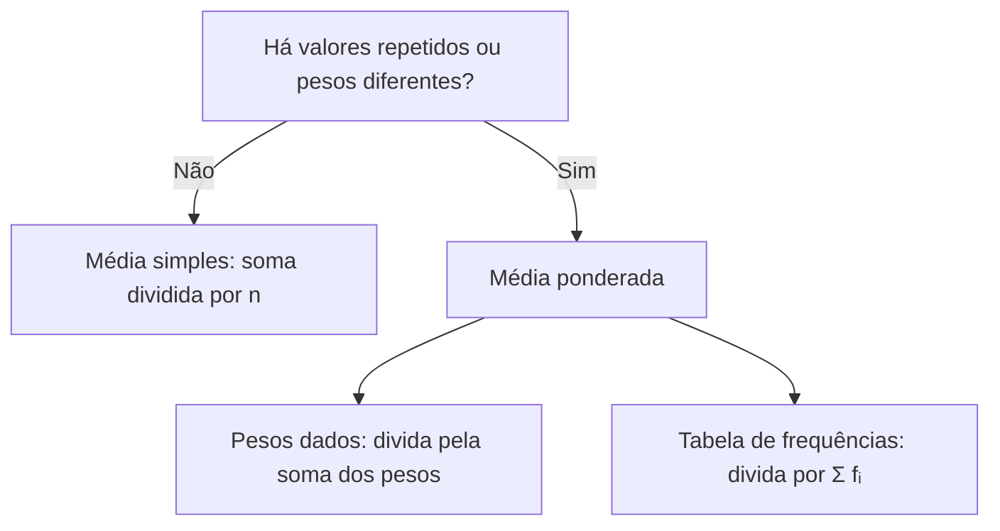

Nem todos os valores de um conjunto têm a mesma importância. Em um concurso, a prova de Português pode valer mais que a de Informática. Em uma tabela, um valor pode se repetir dezenas de vezes. Nesses casos, a média simples não serve, e o instrumento correto é a média ponderada. Este capítulo mostra como calcular a média quando os dados têm pesos e quando estão organizados em uma tabela de frequências, dois cenários muito comuns na prova.

> [!objetivos]
> - Calcular a média ponderada com pesos dados.
> - Reconhecer que a média para dados agrupados é uma média ponderada pelas frequências.
> - Usar frequências absolutas e relativas no cálculo.
> - Aplicar as propriedades da média ponderada a mudanças de pesos.

## Média ponderada

A **média aritmética ponderada** atribui a cada valor um **peso**, que mede sua importância. Se os valores são x₁, x₂, …, xₙ e os pesos são p₁, p₂, …, pₙ, a média ponderada é:

    x̄ = (p₁·x₁ + p₂·x₂ + … + pₙ·xₙ) / (p₁ + p₂ + … + pₙ) = Σ (pᵢ·xᵢ) / Σ pᵢ

Os símbolos significam: xᵢ é cada valor, pᵢ é o seu peso, Σ (pᵢ·xᵢ) é a soma dos produtos e Σ pᵢ é a soma dos pesos. O denominador é a soma dos pesos, e não a quantidade de valores.

> [!resolvido] Nota final de um curso
> **Enunciado.** Um curso tem três provas: P1 com peso 2 e nota 7, P2 com peso 3 e nota 8, P3 com peso 5 e nota 6. Qual é a média final ponderada?
>
> **Raciocínio.** Multiplica-se cada nota pelo respectivo peso, somam-se os produtos e divide-se pela soma dos pesos.
>
> **Conta.** Produtos: 2 · 7 = 14, 3 · 8 = 24 e 5 · 6 = 30. Soma dos produtos: 68. Soma dos pesos: 2 + 3 + 5 = 10. Média: 68/10 = 6,8.
>
> **Resposta.** 6,8. A média simples seria (7 + 8 + 6)/3 = 7, valor mais alto, porque dá a mesma importância às três provas.

A média ponderada fica mais próxima do valor de **maior peso**. Aqui, a P3, de peso 5, puxou a média para perto de 6. Quando todos os pesos são iguais, a média ponderada se reduz à média simples.

### Propriedades da média ponderada

A tabela resume as propriedades mais usadas, com os dados do exemplo.

| Propriedade | Efeito | Exemplo |
| --- | --- | --- |
| Pesos iguais | Média ponderada = média simples | Pesos 1, 1, 1 dão 7 |
| Pesos proporcionais | Multiplicar todos os pesos pelo mesmo número não muda a média | Pesos 4, 6, 10 também dão 6,8 |
| Limites | A média fica entre o menor e o maior valor | 6 ≤ 6,8 ≤ 8 |
| Soma de constante | Somar c a todos os valores soma c à média | Somando 1 a cada nota, 7,8 |
| Produto por constante | Multiplicar os valores por k multiplica a média por k | Dobrando as notas, 13,6 |

A segunda linha merece atenção. Os pesos importam apenas em **proporção**. Pesos 2, 3 e 5 equivalem a 20%, 30% e 50%, e dão o mesmo resultado. Por isso, uma questão pode dar os pesos em porcentagem, e a soma dos pesos será 100.

> [!pegadinha]
> Dividir a soma dos produtos pela quantidade de valores, em vez de pela soma dos pesos. No exemplo, dividir 68 por 3 daria 22,7, número impossível para uma nota de até 10. O denominador é sempre a soma dos pesos.

### Pesos como carga horária e como quantidade

Em muitos problemas, o peso não é dado como "peso", mas como uma quantidade que o enunciado descreve: a carga horária de uma disciplina, o número de itens vendidos, o tamanho de uma turma. A regra é a mesma: multiplicar cada valor por sua quantidade.

A tabela mostra o desempenho de um aluno em três disciplinas de um curso, com a carga horária de cada uma como peso.

| Disciplina | Carga horária (peso) | Nota |
| --- | --- | --- |
| Direito Constitucional | 60 | 8 |
| Legislação | 30 | 9 |
| Contabilidade | 30 | 6 |

A média ponderada é (60 · 8 + 30 · 9 + 30 · 6)/(60 + 30 + 30) = (480 + 270 + 180)/120 = 930/120 = **7,75**. A média simples das notas seria 7,67, valor um pouco menor, pois a disciplina de maior carga teve a melhor nota.

> [!resolvido] Preço médio de combustível
> **Enunciado.** Um posto vendeu 1 200 litros de um combustível a 5 reais o litro e, em outro período, 800 litros a 6 reais. Qual foi o preço médio por litro vendido?
>
> **Raciocínio.** A média simples dos preços (5,50) ignoraria que se vendeu mais litros ao preço menor. Os litros vendidos são os pesos.
>
> **Conta.** Receita: 1 200 · 5 + 800 · 6 = 6 000 + 4 800 = 10 800. Litros: 2 000. Preço médio: 10 800/2 000 = 5,40.
>
> **Resposta.** 5,40 reais por litro. O resultado fica mais perto de 5, porque os litros mais baratos foram a maioria.

> [!resolvido] Junção de duas frotas
> **Enunciado.** Circulam em certo bairro 300 veículos de passeio, com idade média de 6 anos, e 100 veículos utilitários, com idade média de 10 anos. Qual é a idade média de todos?
>
> **Raciocínio.** Cada média de grupo é ponderada pelo número de veículos do grupo.
>
> **Conta.** Soma das idades: 300 · 6 + 100 · 10 = 1 800 + 1 000 = 2 800. Veículos: 400. Média: 2 800/400 = 7.
>
> **Resposta.** 7 anos.

### Média ponderada com porcentagens

Os pesos em porcentagem facilitam a leitura. Se uma prova tem peso 40% na parte objetiva e 60% na parte discursiva, e o candidato tirou 5 e 8, a nota final é 0,4 · 5 + 0,6 · 8 = 2 + 4,8 = **6,8**. Como a soma dos pesos já é 1, não há divisão.

> [!bizu]
> Na dúvida, imagine que cada peso é o número de vezes que o valor se repete. Um valor de peso 3 equivale a três observações iguais. Assim, a média ponderada é só a média simples de uma lista com repetições.

## Média para dados agrupados sem classes

Quando muitos valores se repetem, usa-se a **distribuição de frequências**: uma tabela que mostra cada valor e quantas vezes ele aparece. A **frequência absoluta** (fᵢ) é a contagem. A **frequência relativa** (frᵢ = fᵢ / n) é a proporção do total.

A tabela mostra o número de ocorrências atendidas por dia em 20 dias de um posto.

| Ocorrências por dia (xᵢ) | Dias (fᵢ) | xᵢ · fᵢ |
| --- | --- | --- |
| 0 | 2 | 0 |
| 1 | 5 | 5 |
| 2 | 8 | 16 |
| 3 | 3 | 9 |
| 4 | 2 | 8 |
| Total | 20 | 38 |

A média é a soma dos produtos xᵢ · fᵢ dividida pelo total de dias:

    x̄ = (Σ xᵢ·fᵢ) / (Σ fᵢ) = 38 / 20 = 1,9 ocorrência por dia

Trata-se de uma média ponderada em que o **peso de cada valor é a sua frequência**. Também é possível usar as frequências relativas: x̄ = Σ xᵢ · frᵢ. Com os dados da tabela, as frequências relativas são 0,10, 0,25, 0,40, 0,15 e 0,10, e a soma de xᵢ · frᵢ é 0 + 0,25 + 0,80 + 0,45 + 0,40 = **1,90**.

> [!resolvido] Média de uma tabela de frequências
> **Enunciado.** Em 20 dias, o posto atendeu 0 ocorrência em 2 dias, 1 em 5 dias, 2 em 8 dias, 3 em 3 dias e 4 em 2 dias. Qual é a média diária?
>
> **Raciocínio.** Multiplica-se cada valor pela frequência, soma-se e divide-se pelo número de dias.
>
> **Conta.** Σ xᵢ · fᵢ = 0 + 5 + 16 + 9 + 8 = 38. Σ fᵢ = 20. Média = 38/20.
>
> **Resposta.** 1,9 ocorrência por dia.

Um segundo exemplo de tabela usa uma variável de contagem: o número de filhos por casal em uma turma de 50 casais entrevistados.

| Filhos por casal (xᵢ) | Casais (fᵢ) | Frequência relativa |
| --- | --- | --- |
| 0 | 10 | 0,20 |
| 1 | 15 | 0,30 |
| 2 | 20 | 0,40 |
| 3 | 5 | 0,10 |

A soma de xᵢ · fᵢ é 0 + 15 + 40 + 15 = 70, e a média é 70/50 = **1,4 filho por casal**. Pelas frequências relativas, 0 · 0,20 + 1 · 0,30 + 2 · 0,40 + 3 · 0,10 = 1,4. O número médio não precisa ser inteiro, mesmo quando a variável só assume valores inteiros.

### Erros comuns na tabela

Três enganos reaparecem nas provas:

1. **Somar só os valores distintos.** A média de 0, 1, 2, 3 e 4 seria 2, mas esse cálculo ignora as frequências.
2. **Dividir pela quantidade de linhas.** O divisor é Σ fᵢ, o total de observações, e não o número de valores diferentes.
3. **Esquecer uma linha.** A conferência é comparar Σ fᵢ com o total de observações do enunciado.

> [!atencao] Tabela e lista dão a mesma média
> Se a tabela fosse "desmontada" em uma lista de 20 números (dois zeros, cinco uns e assim por diante), a média simples seria idêntica. A tabela é só uma forma compacta de escrever a lista.

### Efeito de mudar frequências

Se as frequências de todos os valores são multiplicadas pelo mesmo número, a média não muda, pois o peso é proporcional. Se as frequências dos valores maiores aumentam, a média sobe. Por exemplo, se os 2 dias de 4 ocorrências viram 6 dias, a soma passa a 38 + 16 = 54, e o total passa a 24 dias, e a nova média é 54/24 = 2,25.

## Que média usar

Diante de uma questão, a primeira decisão é qual média aplicar. O diagrama resume a escolha entre as duas médias estudadas até aqui.

## Como a banca cobra este assunto

Os padrões mais frequentes:

- **Cálculo direto:** pesos dados, notas dadas, pede-se a média. Atenção ao denominador.
- **Valor que falta:** a média ponderada é dada, e se pede a nota de uma prova. Monta-se a equação e isola-se a incógnita.
- **Tabela de frequências:** a questão traz a tabela e pede a média; a armadilha é dividir pelo número de linhas.
- **Alternativa de média simples:** a opção errada traz a média simples, que é plausível mas incorreta.
- **Mudança de pesos:** pergunta-se o que ocorre com a média quando se aumenta o peso de um valor alto ou baixo.

> [!exemplo]
> Para ser aprovado, um candidato precisa de média ponderada 7 em três provas de pesos 1, 2 e 3. Tirou 8 e 5 nas duas primeiras. Quanto precisa tirar na terceira? Soma de pesos: 6, e a soma necessária é 7 · 6 = 42. Já acumulou 1 · 8 + 2 · 5 = 18. Faltam 24, que divididos pelo peso 3 dão **8**. A conta fecha: (8 + 10 + 24)/6 = 7.

## Mapa do capítulo

A tabela reúne os pontos centrais.

| Tema | Fórmula | Cuidado |
| --- | --- | --- |
| Média ponderada | Σ (pᵢ·xᵢ) / Σ pᵢ | Divide-se pela soma dos pesos |
| Pesos iguais | Equivale à média simples | Todos os pesos idênticos |
| Pesos proporcionais | Mesma média | Só a proporção importa |
| Dados agrupados | Σ (xᵢ·fᵢ) / Σ fᵢ | Peso é a frequência |
| Frequência relativa | Σ (xᵢ·frᵢ) | A soma das frequências relativas é 1 |
| Valor que falta | Soma exigida menos a soma já obtida | Divide-se pelo peso da prova que falta |

### Para fixar

- A média ponderada é a soma dos produtos valor × peso dividida pela soma dos pesos.
- Com pesos iguais, a média ponderada é a média simples.
- Multiplicar todos os pesos por um mesmo número não altera a média.
- A média ponderada fica entre o menor e o maior valor e se aproxima do de maior peso.
- Em dados agrupados, o peso de cada valor é a sua frequência.
- A média de uma tabela é Σ xᵢ·fᵢ dividida por Σ fᵢ.
- Pode-se usar a frequência relativa: a média é Σ xᵢ·frᵢ.
- Nunca divida pelo número de linhas da tabela.
