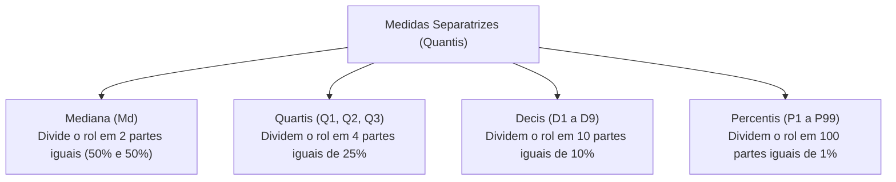
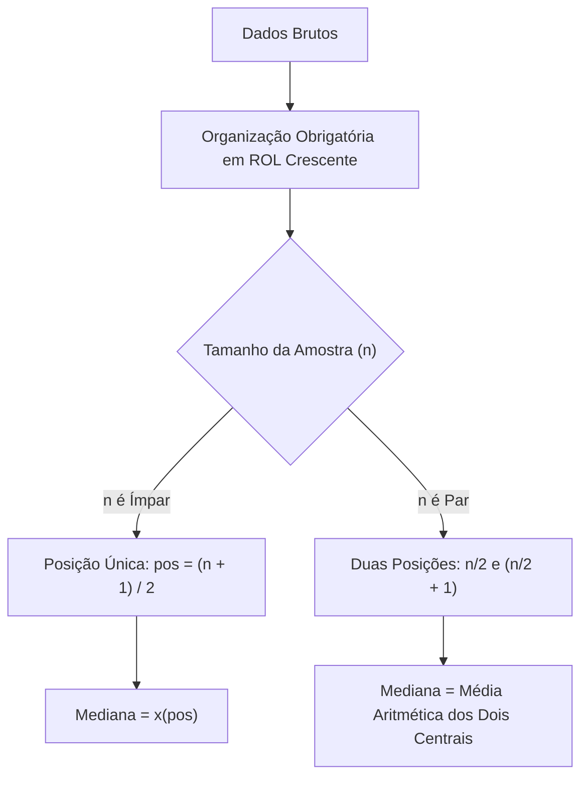
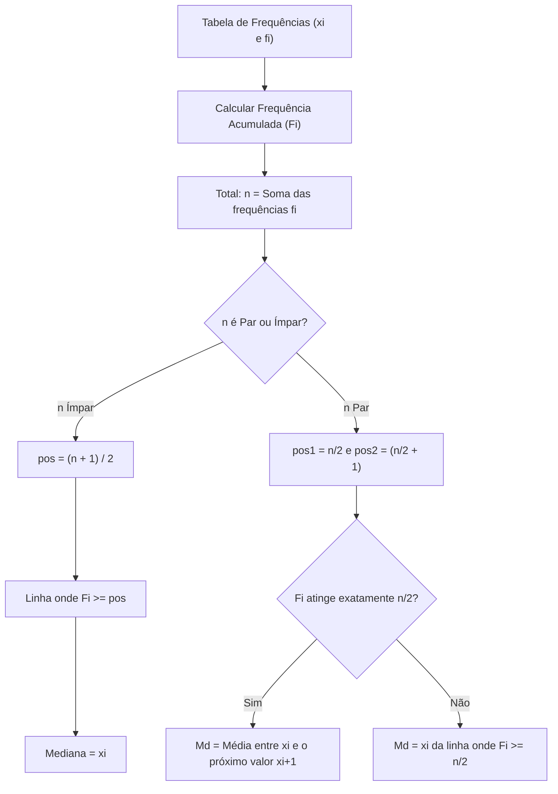
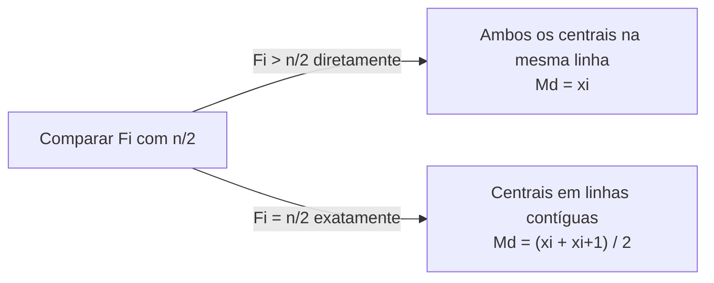
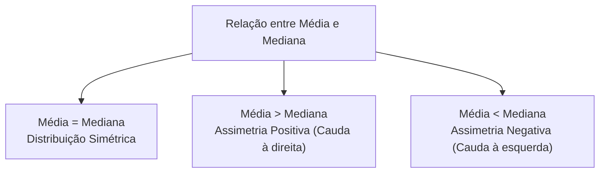
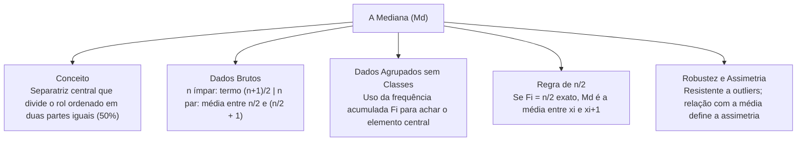

As medidas de tendência central e as medidas separatrizes constituem a base da Estatística Descritiva. Entre essas medidas, a mediana ganha destaque pela estabilidade diante de valores discrepantes. Compreender as etapas de localização e cálculo da mediana em dados brutos e em tabelas pontuais é essencial para provas de concursos e para analisar dados operacionais na segurança pública.

> [!objetivos]
> - Compreender a definição de medidas separatrizes e a função da mediana.
> - Dominar a construção do rol e a busca da posição mediana para n ímpar e par.
> - Calcular a mediana em dados agrupados sem classes por frequências acumuladas.
> - Evitar o erro comum quando a frequência acumulada atinge cinquenta por cento.

## Introdução às Medidas Separatrizes

Na estatística descritiva, as medidas de tendência central resumem os dados em um valor representativo. A média aritmética sofre forte distorção quando existem valores extremos atípicos (outliers). Por essa razão, a estatística utiliza a família das **medidas separatrizes**, também chamadas de **quantis**.

As medidas separatrizes dividem uma série de dados ordenados em partes com igual número de observações. Elas informam a posição de cada dado no conjunto e ajudam a avaliar dispersão e assimetria.

A principal medida dessa família é a **mediana**. Ela reparte os dados em duas partes iguais. Cinquenta por cento dos dados ficam abaixo ou no mesmo valor da mediana, e cinquenta por cento ficam acima. Além dos quartis, decis e percentis, a literatura cita os **quintis**, que particionam a série ordenada em cinco partes iguais de vinte por cento cada. As outras separatrizes derivam dessa mesma lógica de partição em rol. A teoria clássica consolidada desde 1985 trata os quantis como ferramentas ideais para descrever distribuições com frequências desiguais e caudas pesadas.

## Conceito e Definição da Mediana

A mediana (Md) é o valor que ocupa o centro de uma série ordenada de dados. Ela não usa a magnitude de todos os elementos em seu cálculo. Ela depende exclusivamente da ordem das observações.

O primeiro passo para achar a mediana é dispor os dados em ordem crescente ou decrescente. Essa organização gera o **rol**:
x(1) ≤ x(2) ≤ x(3) ≤ ... ≤ x(n).

Sem organizar os dados em rol, qualquer busca pelo elemento central estará errada.

A identificação da mediana em dados não agrupados segue duas situações, conforme o total de observações n:
- **Amostra com número ímpar de termos (n é ímpar):** há um termo central único que divide o rol. Sua posição é obtida pela relação:
pos = (n + 1) / 2.
O valor da mediana é o elemento localizado nessa posição:
Md = x(pos).

- **Amostra com número par de termos (n é par):** existem dois elementos centrais no meio da série. O primeiro ocupa a ordem:
pos1 = n / 2.
O segundo ocupa a posição imediatamente posterior:
pos2 = (n / 2) + 1.
A mediana é a média aritmética simples desses dois valores centrais:
Md = (x(pos1) + x(pos2)) / 2.

> [!bizu] Posição versus Valor da Mediana
> Não confunda a posição com o valor da mediana. A fórmula posicional indica apenas o índice do termo no rol ordenado. Após calcular a posição, consulte o rol e anote o número presente naquele ponto.

Considere uma série composta por 49 semanas de registro de denuncias atendidas por um órgão correicional. Como n = 49 é ímpar, a posição central é calculada por pos = (49 + 1) / 2 = 25. O elemento de ordem 25 no rol define a mediana exata da série. Em contrapartida, em uma pesquisa contendo n = 500 clientes e cidadãos entrevistados, o total é par. A metade exata da amostra é 250. Os elementos centrais do rol são x250 e x251, que antecedem os termos x252 e x253. A mediana dessa pesquisa de opinião será a média simples entre x250 e x251.

## Cálculo da Mediana para Dados Brutos: Exemplos Resolvidos

O cálculo prático em dados não agrupados pode ser acompanhado em registros rotineiros de emergência e resgate.

> [!exemplo] Exemplo Prático com Amostra de Tamanho Ímpar
> Uma equipe de bombeiros registrou o tempo de resposta em minutos para sete chamados em um plantão:
> Dados desordenados: 14, 8, 22, 11, 9, 18, 15.
> Passo 1: Construção do rol crescente:
> Rol: 8, 9, 11, 14, 15, 18, 22.
> Passo 2: O total de observações é ímpar (n = 7). A posição central é:
> pos = (7 + 1) / 2 = 8 / 2 = 4.
> Passo 3: O quarto termo do rol é quatorze.
> Md = x(4) = 14 minutos.
> Três tempos ficam abaixo de 14 (8, 9, 11) e três tempos ficam acima (15, 18, 22).

> [!exemplo] Exemplo Prático com Amostra de Tamanho Par
> Se um oitavo chamado for atendido em 25 minutos, a série terá oito termos:
> Rol com n = 8: 8, 9, 11, 14, 15, 18, 22, 25.
> Como n = 8 é par, temos duas posições centrais:
> pos1 = 8 / 2 = 4.
> pos2 = 4 + 1 = 5.
> No rol, o quarto termo é x(4) = 14 e o quinto termo é x(5) = 15.
> A mediana é a média simples dos dois termos centrais:
> Md = (14 + 15) / 2 = 29 / 2 = 14,5 minutos.
> O valor 14,5 divide o conjunto em duas metades com quatro dados cada.

Em um posto de atendimento em São Luís, registrou-se o total de itens emprestados em dois turnos consecutivos. Obtiveram-se 780 e 870 itens. A mediana dessa pequena série de dois valores é a média simples: (780 + 870) / 2 = 825 itens emprestados. Esse mesmo procedimento aplica-se a qualquer conjunto par de observações.

| Situação | Tamanho Amostral (n) | Fórmula da Posição | Determinação da Mediana |
|---|---|---|---|
| **Série Ímpar** | n é ímpar | pos = (n + 1) / 2 | Md = x(pos) (termo físico central) |
| **Série Par** | n é par | pos1 = n / 2, pos2 = (n / 2) + 1 | Md = (x(pos1) + x(pos2)) / 2 |

## Mediana para Dados Agrupados sem Classes

Quando a quantidade de dados é grande e a variável é discreta, os valores são reunidos em tabelas de distribuição de frequências sem intervalos de classe. Cada valor xi surge acompanhado de sua frequência simples fi.

Para achar a mediana sem abrir a lista completa dos termos, utiliza-se a **frequência acumulada** (Fi ou fac). A frequência acumulada indica quantos dados têm valor menor ou igual ao valor xi da linha correspondente.

O cálculo da mediana em dados agrupados sem classes compreende quatro passos:
1. Construir a coluna das frequências acumuladas (Fi), somando as frequências simples fi.
2. Calcular o total de dados pela soma das frequências: n = Σ fi.
3. Obter as posições de ordem centrais conforme a paridade de n.
4. Procurar na coluna Fi a linha que abriga a posição desejada. O valor xi dessa linha é a mediana.

> [!resolvido] Aplicação em Dados Agrupados com n Ímpar
> Considere uma pesquisa de satisfação em que trinta e cinco usuários e clientes entrevistados atribuíram uma nota de 1 a 5 para a qualidade de um serviço público:
> 
> | Nota atribuída (xi) | Frequência simples (fi) | Frequência acumulada (Fi) |
> |---|---|---|
> | 1 | 6 | 6 |
> | 2 | 11 | 17 |
> | 3 | 10 | 27 |
> | 4 | 5 | 32 |
> | 5 | 3 | 35 |
> | **Total** | **n = 35** | — |
> 
> Como n = 35 é ímpar, calculamos a posição central:
> pos = (35 + 1) / 2 = 36 / 2 = 18.
> Procuramos na coluna Fi a primeira linha onde o valor atinge ou passa de 18.
> Na linha 1, F1 = 6. Na linha 2, F2 = 17. Na linha 3, F3 = 27.
> Como 17 é menor que 18 e 27 é maior que 18, o 18º dado está na linha 3.
> Logo, a nota mediana de satisfação é:
> Md = 3 pontos.

## A Regra da Frequência Acumulada Igual a n/2

Em provas de concursos, uma situação clássica envolve amostras pares em que a frequência acumulada de uma linha coincide exatamente com n / 2.

Se a frequência acumulada Fi atinge com precisão n / 2 (cinquenta por cento dos dados), o elemento de ordem n / 2 é o valor xi daquela linha. Mas o elemento seguinte, de ordem (n / 2) + 1, cai imediatamente na linha seguinte (xi+1). A vigesima observação pertence a uma linha e a vigésima primeira cai na próxima linha.

Nesse caso, a mediana é a **média aritmética** entre o valor da linha que atingiu cinquenta por cento e o valor da linha imediatamente posterior:
Md = (xi + xi+1) / 2.

Se Fi ultrapassar n / 2 diretamente sem igualá-lo, ambos os termos centrais estarão na mesma linha. Nesse caso, o valor xi da linha é a mediana.

> [!pegadinha] A Frequência Acumulada Exatamente Igual a n/2
> Um erro frequente em concursos é adotar o valor xi da linha onde Fi = n/2 e esquecer que o segundo termo central saltou para a linha seguinte. Sempre confira se n é par e se a frequência acumulada cravou em cinquenta por cento. Havendo essa coincidência exata, faça a média entre esse valor e o próximo.

> [!resolvido] Exemplo Prático de n/2 Exato
> A tabela apresenta as faltas cometidas por quarenta policiais em um ano:
> 
> | Faltas (xi) | Frequência simples (fi) | Frequência acumulada (Fi) |
> |---|---|---|
> | 0 | 12 | 12 |
> | 1 | 8 | 20 |
> | 2 | 14 | 34 |
> | 3 | 6 | 40 |
> | **Total** | **n = 40** | — |
> 
> O tamanho da amostra é par (n = 40). Os termos centrais estão nas posições:
> pos1 = 40 / 2 = 20.
> pos2 = 20 + 1 = 21.
> Na segunda linha, F2 = 20. Logo, a vigesima observação é x2 = 1 falta.
> A vigésima primeira observação cai imediatamente na terceira linha, cujo valor é x3 = 2 faltas. Essa terceira linha vai do 21º ao 34º dado.
> A mediana é a média entre os dois termos centrais:
> Md = (1 + 2) / 2 = 3 / 2 = 1,5 falta.
> Indicar apenas 1 falta como resposta seria o erro comum.

| Frequência Acumulada | Posição dos Termos Centrais | Cálculo da Mediana |
|---|---|---|
| **Fi passa de n/2 sem igualá-lo** | Ambos os termos na mesma linha i | Md = xi |
| **Fi atinge com precisão n/2** | pos1 na linha i e pos2 na linha i+1 | Md = (xi + xi+1) / 2 |

## Propriedades e Vantagens da Mediana

O uso da mediana em análises estatísticas traz vantagens relevantes sobre a média aritmética:

1. **Robustez contra valores extremos (outliers):** a mediana não se altera com valores aberrantes nas extremidades. Em uma equipe onde cinco membros ganham três mil reais e um ganha trinta mil reais, a média sobe bastante. A mediana permanece estável em três mil reais, retratando o perfil típico do grupo.
2. **Existência e unicidade:** para qualquer conjunto numérico finito ordenado, a mediana sempre existe e tem valor único.
3. **Aplicação em dados ordinais:** a mediana pode ser obtida em variáveis qualitativas ordinais, como patentes e graus de escolaridade, que admitem rol mas não admitem somas aritméticas.
4. **Leitura de assimetria:** a comparação entre média e mediana indica a forma da distribuição:
   - Se Média = Md: distribuição **simétrica**.
   - Se Média > Md: **assimetria positiva** (cauda longa à direita).
   - Se Média < Md: **assimetria negativa** (cauda longa à esquerda).

> [!esquema] Média versus Mediana
> - **Média aritmética:** sensível a todos os valores, recomendada para dados simétricos sem outliers.
> - **Mediana:** resistente a extremos, recomendada para rendimentos, tempos de espera e dados com assimetria.

## Comparação Detalhada de Casos Operacionais

Para fixar a compreensão, analise uma distribuição de atendimentos diários em cinco postos de salvamento. Os postos atenderam: 3, 4, 4, 5 e 14 ocorrências.
O número de postos é ímpar (n = 5).
O rol ordenado já está formado: 3, 4, 4, 5, 14.
A posição central é: pos = (5 + 1) / 2 = 3.
O terceiro termo é 4. Logo, a mediana é Md = 4 ocorrências.
A média aritmética dessa série é: (3 + 4 + 4 + 5 + 14) / 5 = 30 / 5 = 6 ocorrências.
O valor 14 é um valor discrepante que puxou a média para 6. Quatro dos cinco postos tiveram atendimentos estritamente inferiores à média (3, 4, 4, 5). A mediana igual a 4 representa muito melhor o volume rotineiro de trabalho da maioria das unidades operacionais.

Considere agora que o quinto posto tenha atendido 40 ocorrências em vez de 14 devido a uma grande enchente.
A nova série é: 3, 4, 4, 5, 40.
A média dispara para (3 + 4 + 4 + 5 + 40) / 5 = 56 / 5 = 11,2 ocorrências.
A mediana, no entanto, continua rigorosamente igual a 4 ocorrências.
Essa propriedade confere à mediana papel de destaque em relatórios oficiais de auditoria e estatística policial.

| Conjunto de Dados | Média Aritmética | Mediana (Md) | Conclusão Analítica |
|---|---|---|---|
| **Série A: 3, 4, 4, 5, 14** | 6,0 | 4,0 | Média puxada pelo extremo 14 |
| **Série B: 3, 4, 4, 5, 40** | 11,2 | 4,0 | Mediana permanece estável em 4 |
| **Série C: 2, 4, 6, 8, 10** | 6,0 | 6,0 | Simetria perfeita: Média = Md |

## Mapa do capítulo

### Para fixar

- A mediana divide uma série ordenada em duas partes com igual quantidade de dados (cinquenta por cento).
- A organização dos dados em rol é indispensável antes de qualquer cálculo de mediana.
- Se o número de termos for ímpar, a mediana é o elemento localizado na ordem (n + 1) / 2.
- Se o número de termos for par, a mediana é a média simples dos dados nas ordens n / 2 e (n / 2) + 1.
- Em tabelas sem classes, localiza-se a mediana pela primeira linha cuja frequência acumulada atinge a ordem central.
- Se a frequência acumulada coincidir com n / 2, a mediana é a média entre o valor atual e o valor seguinte.
- A mediana não é distorcida por valores atípicos extremos situados nas extremidades da distribuição.
- Em distribuições simétricas a média coincide com a mediana, enquanto na assimetria à direita a média supera a mediana.
