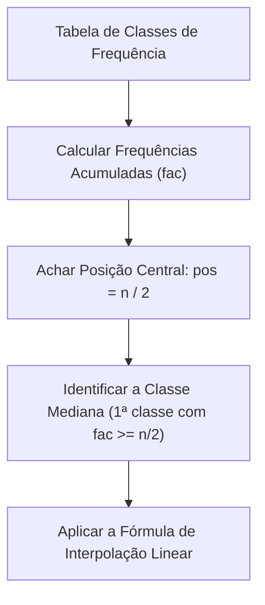
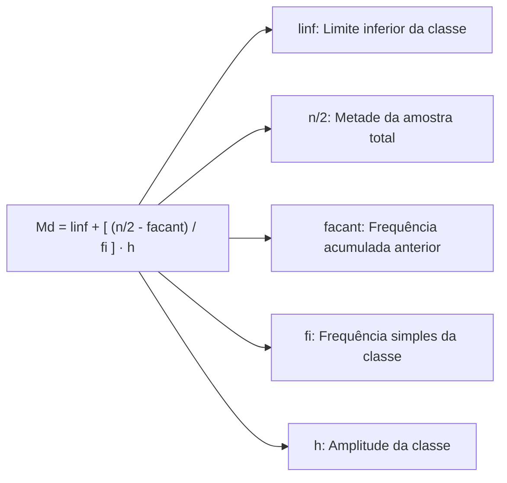
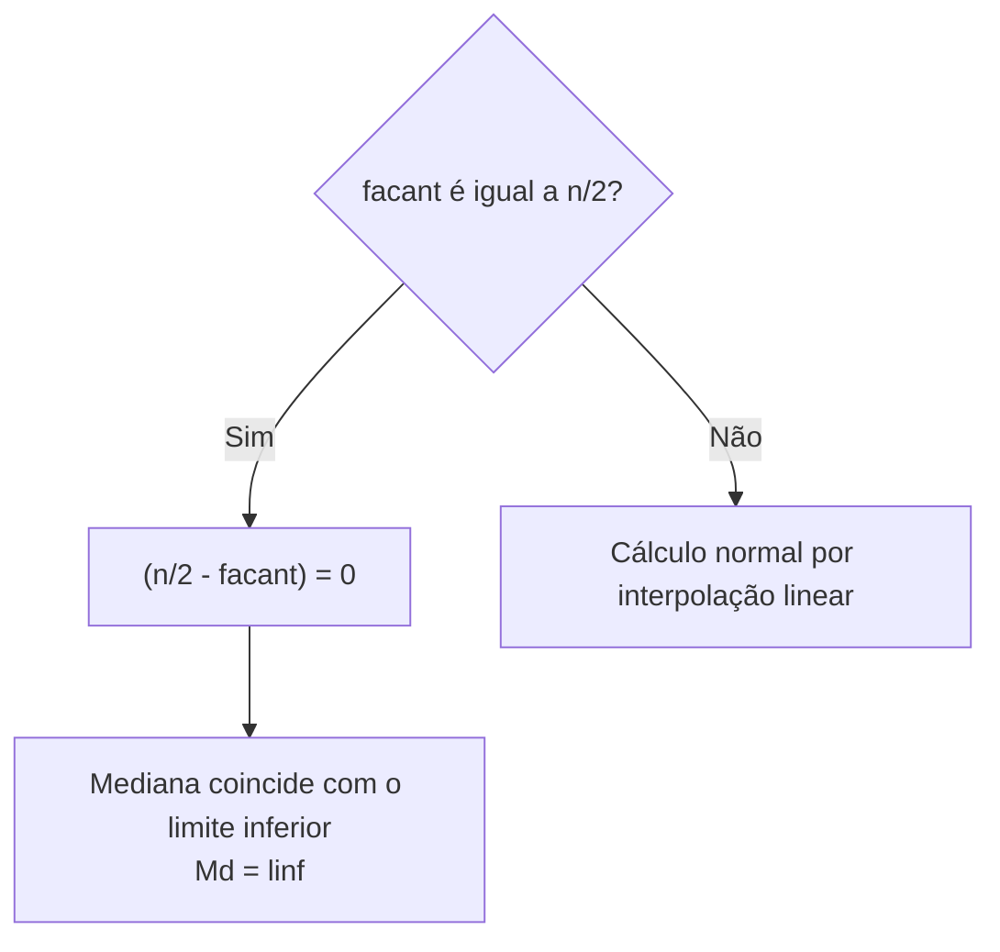
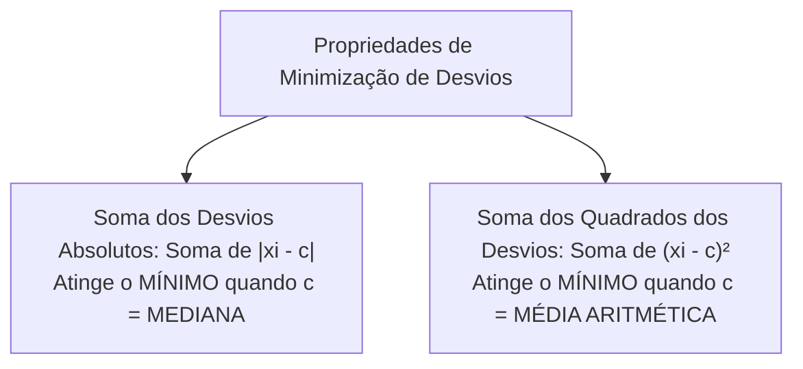
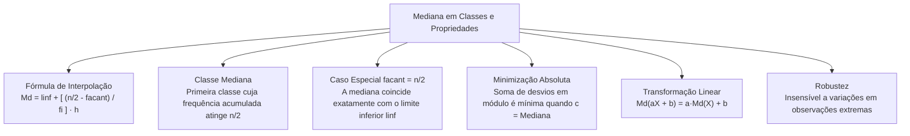

O cálculo da mediana para dados contínuos agrupados em intervalos de classe exige técnicas de interpolação linear geométrica. Quando os dados são tabelados em faixas, os valores individuais das observações deixam de ser visíveis, exigindo a aplicação de modelos proporcionais. Além do procedimento de cálculo, as propriedades matemáticas da mediana representam um dos conteúdos prediletos das bancas.

> [!objetivos]
> - Compreender a lógica da interpolação linear na estimativa da mediana em classes.
> - Aplicar a fórmula clássica identificando limites, frequências acumuladas e amplitude.
> - Dominar a regra especial quando a frequência acumulada anterior atinge exatamente n / 2.
> - Conhecer as três propriedades centrais da mediana, com destaque para a minimização dos desvios absolutos.

## A Mediana para Dados Agrupados em Intervalos de Classe

Em muitas pesquisas operacionais, as variáveis contínuas são organizadas em intervalos de classe, como salários, pesos ou distâncias. Ao tabular os dados em classes, perde-se a informação do valor exato de cada observação original. Sabemos apenas quantos dados recaíram dentro de cada faixa de valores.

Para calcular a mediana nessa condição, a estatística adota uma premissa teórica: assume-se que as observações da classe mediana distribuem-se de maneira uniforme e contínua ao longo de todo o intervalo. Com essa hipótese de proporcionalidade uniforme, a mediana é estimada por **interpolação linear**.

O roteiro sistemático de resolução estrutura-se em quatro passos:
1. Construir a coluna de frequências acumuladas (fac), somando as frequências simples fi de cada classe de cima para baixo.
2. Calcular a posição central da distribuição dividindo o total de dados por dois: pos = n / 2 (ou Σ fi / 2). Em classes de frequência contínua, adota-se sempre n / 2 como termo de partição central, seja n par ou ímpar.
3. Identificar a classe mediana: percorremos as frequências acumuladas e paramos na primeira classe em que a contagem acumulada atinge ou ultrapassa a metade da amostra total.
4. Aplicar a fórmula de interpolação linear para encontrar o valor numérico da mediana.

## A Fórmula da Interpolação Linear

A fórmula clássica da mediana para dados agrupados em classes é expressa por:
Md = linf + [((n / 2) - facant) / fi] · h.

Na literatura estatística, o limite inferior também é grafado como liminf ou li, e a fórmula pode ser escrita como:
Md = liminf + [((n / 2) - facant) / fi] · h.

Cada termo dessa relação possui significado geométrico e aritmético bem definido:
- **linf** (ou **liminf**): limite inferior da classe mediana.
- **n**: número total de observações na amostra (n = Σ fi).
- **n / 2**: metade do tamanho amostral, correspondente à ordem central acumulada.
- **facant**: frequência acumulada da classe imediatamente anterior à classe mediana.
- **fi**: frequência simples da própria classe mediana.
- **h**: amplitude do intervalo da classe mediana, calculada pela diferença entre seu limite superior e inferior (h = lsup - linf).

A fração [((n / 2) - facant) / fi] representa a fração proporcional do intervalo de classe que precisamos percorrer para alcançar exatamente o elemento central da distribuição. Multiplicando essa fração pela largura do intervalo h e somando o resultado ao limite inicial linf, obtemos o ponto exato da mediana.

> [!bizu] Dedução Gráfica pela Ogiva de Frequências
> Graficamente, a mediana corresponde à abscissa do ponto de interseção entre a curva ogiva de frequências acumuladas crescentes e a linha horizontal na altura de cinquenta por cento do total de dados. Essa relação direta por triângulos semelhantes assegura a exatidão geométrica da fórmula.

## Exemplo Numérico: Estudo Biométrico de Estaturas

Para consolidar a aplicação da fórmula, examine um levantamento biométrico das estaturas em centímetros de 500 indivíduos de uma população prisional masculina. A distribuição agrupa as estaturas em classes de amplitude h = 4 cm:

| Classes de Estaturas (cm) | Frequência simples (fi) | Frequência acumulada (fac) |
|---|---|---|
| 150 a 154 | 25 | 25 |
| 154 a 158 | 60 | 85 |
| 158 a 162 | 110 | 195 |
| 162 a 166 | 125 | 320 |
| 166 a 170 | 100 | 420 |
| 170 a 174 | 80 | 500 |
| **Total** | **n = 500** | — |

Executando o passo a passo com o método de interpolação:
Passo 1: O total de observações é n = 500 indivíduos da população prisional.
Passo 2: A posição da mediana é:
pos = n / 2 = 500 / 2 = 250.
Passo 3: Localizamos na coluna fac a classe mediana.
Na classe de 150 a 154, fac = 25.
Na classe de 154 a 158, fac = 85.
Na classe de 158 a 162, fac = 195.
Na classe de 162 a 166, fac = 320.
Como 195 é menor que 250 e 320 é maior ou igual a 250, paramos nessa faixa. A classe mediana é a quarta classe: 162 a 166 cm.

Passo 4: Identificamos os parâmetros da classe:
- Limite inferior: linf = 162 cm.
- Frequência acumulada anterior: facant = 195.
- Frequência simples da classe: fi = 125.
- Amplitude da classe: h = 166 - 162 = 4 cm.

Passo 5: Aplicamos os dados na fórmula:
Md = linf + [((n / 2) - facant) / fi] · h.
Md = 162 + [((250 - 195) / 125)] · 4.
Md = 162 + [(55 / 125)] · 4.
Md = 162 + [220 / 125].
Md = 162 + 1,76 = 163,76 cm.

A estatura mediana calculada é 163,76 cm. Esse valor está contido no intervalo de 162 a 166 cm, comprovando o acerto da interpolação.

| Parâmetro | Valor Identificado | Papel no Cálculo |
|---|---|---|
| **Classe Mediana** | 162 a 166 cm | Faixa que abriga o 250º indivíduo |
| **Limite inferior (linf)** | 162 cm | Ponto inicial da faixa |
| **Ponto central (n/2)** | 250 | Metade da população prisional |
| **Frequência anterior (facant)** | 195 | Acumulado antes de 162 cm |
| **Frequência da classe (fi)** | 125 | Frequência simples da faixa |
| **Amplitude (h)** | 4 cm | Largura da classe de estaturas |
| **Mediana Calculada** | **163,76 cm** | Ponto mediano da distribuição |

## A Situação Especial em que facant Coincide com n/2

Uma situação peculiar examinada em bancas de concursos ocorre quando a frequência acumulada da classe anterior coincide exatamente com a metade do tamanho da amostra (facant = n / 2).

Nesse caso específico, temos:
(n / 2) - facant = (n / 2) - (n / 2) = 0.

Ao substituir essa diferença nula na fórmula da mediana, a fração inteira anula-se:
Md = linf + [0 / fi] · h = linf + 0 = linf.

A mediana coincide rigorosamente com o limite inferior da classe mediana (linf). Como o limite inferior da classe atual é idêntico ao limite superior da classe anterior, a mediana localiza-se exatamente na fronteira divisória entre as duas classes. Como haviamos previsto, na sequencia de termos mostrada na tabela biométrica do cidadão brasileiro, a mediana Md = linf coincide com o valor limite, indicando que a regra especial funciona para qualquer série contendo 29, 38, 49 ou 74 observações.

> [!pegadinha] A Mediana no Limite da Classe
> Se a frequência acumulada da classe anterior fechar exatamente em n / 2, não perca tempo com contas longas de frações. A mediana é de forma imediata o próprio limite inferior da classe mediana (ou o limite superior da classe anterior). Candidatos desatentos costumam se assustar com o zero no numerador e desconfiam erroneamente de suas contas.

> [!resolvido] Exemplo do Caso Especial de Limite
> Considere a tabela com quarenta medições de peso:
> 
> | Classes de Peso (kg) | fi | fac |
> |---|---|---|
> | 50 a 60 | 8 | 8 |
> | 60 a 70 | 12 | 20 |
> | 70 a 80 | 15 | 35 |
> | 80 a 90 | 5 | 40 |
> | **Total** | **40** | — |
> 
> O tamanho total é n = 40. A metade é n / 2 = 20.
> A segunda classe (60 a 70) acumulou exatamente 20 dados (fac = 20).
> A classe que atinge a posição central é a terceira classe (70 a 80), pois nela fac = 35 ≥ 20.
> O limite inferior da terceira classe é linf = 70.
> A frequência acumulada da classe anterior é facant = 20.
> Aplicando a fórmula:
> Md = 70 + [(20 - 20) / 15] · 10 = 70 + 0 = 70 kg.
> A mediana é exatamente 70 kg, fronteira entre a segunda e a terceira classe.

## As Três Propriedades Fundamentais da Mediana

A teoria estatística estabelece três propriedades notáveis da mediana. Elas são exploradas com grande frequência em itens conceituais de provas de concurso.

### Minimização da Soma dos Desvios Absolutos

Esta é uma das propriedades matemáticas mais elegantes e cobradas da mediana.
Seja um conjunto de dados x1, x2, ..., xn e uma constante real qualquer c. Se calcularmos a soma dos desvios absolutos de todos os dados em relação a essa constante c, temos a função:
S(c) = Σ |xi - c|.

O valor da constante c que torna essa soma de desvios absolutos a menor possível (mínima) é a mediana:
c = Md implica que a soma Σ |xi - c| é mínima.

Em contraste direto, a soma dos quadrados dos desvios Σ (xi - c)² atinge seu valor mínimo quando c é igual à média aritmética (c = x̄). As bancas trocam frequentemente essas duas propriedades para induzir o candidato ao erro.

> [!atencao] Comparação Crucial entre Média e Mediana
> Guarde com clareza estas distinções fundamentais:
> - Soma dos desvios em módulo (absolutos) mínima: constante é a **MEDIANA**.
> - Soma dos quadrados dos desvios mínima: constante é a **MÉDIA ARITMÉTICA**.
> - Soma algébrica simples dos desvios (sem módulo) nula: constante é a **MÉDIA ARITMÉTICA** (Σ (xi - x̄) = 0).

### Invariância sob Transformação Linear

Se todos os valores xi de uma variável X sofrerem uma transformação linear da forma:
yi = a · xi + b,
onde a e b são números reais constantes, a nova mediana da variável Y será obtida aplicando-se exatamente a mesma transformação sobre a mediana original de X:
Md(Y) = a · Md(X) + b.

Essa propriedade garante que:
- Se somarmos ou subtrairmos uma constante b a todos os elementos, a mediana aumentará ou diminuirá em b.
- Se multiplicarmos ou dividirmos todos os elementos por uma constante a, a mediana ficará multiplicada ou dividida por a.

> [!exemplo] Aplicação da Transformação Linear
> Em um pelotão de bombeiros, a mediana dos tempos de deslocamento foi de 12 minutos.
> Devido a obras viárias, o comando estimou que cada tempo aumentou em 3 minutos e sofreu acréscimo de 10% (multiplicação por 1,10).
> A nova variável de tempo é: Y = 1,10 · X + 3.
> A nova mediana será:
> Md(Y) = 1,10 · Md(X) + 3.
> Md(Y) = 1,10 · 12 + 3 = 13,2 + 3 = 16,2 minutos.
> Não é necessário recalcular o rol de todos os tempos.

### Robustez a Valores Extremos

A mediana é uma medida de posição robusta (resistente). Ela depende apenas da contagem de dados e das ordens centrais. Modificar o valor do menor elemento ou do maior elemento da distribuição não altera a mediana, desde que esses valores continuem abaixo ou acima do ponto mediano. Em distribuições muito assimétricas, a mediana representa o centro típico com muito mais fidelidade do que a média.

| Propriedade Estatística | Formulação Matemática | Comparação com a Média |
|---|---|---|
| **Minimização de Desvios** | Soma de desvios absolutos mínima para c = Md | Soma de desvios quadráticos mínima para c = x̄ |
| **Transformação Linear** | Y = aX + b resulta em Md(Y) = a·Md(X) + b | Y = aX + b resulta em x̄(Y) = a·x̄(X) + b |
| **Sensibilidade a Outliers**| Resistente (invariante a extremos) | Muito sensível a valores atípicos |

## Mapa do capítulo

### Para fixar

- A mediana em classes é calculada pela hipótese de distribuição uniforme por interpolação linear.
- A fórmula da mediana é Md = linf + [((n / 2) - facant) / fi] · h.
- Paramos na primeira classe cuja frequência acumulada atinge ou supera a metade da amostra.
- Se a frequência acumulada anterior for igual a n / 2, a mediana é o limite inferior da classe.
- A soma dos desvios absolutos atinge valor mínimo quando a constante c é a mediana.
- A soma dos quadrados dos desvios atinge valor mínimo quando a constante c é a média.
- Sob transformação linear Y = aX + b, a nova mediana obedece à equação Md(Y) = a · Md(X) + b.
- A mediana é uma medida robusta que preserva seu valor diante de variações nos extremos do rol.
