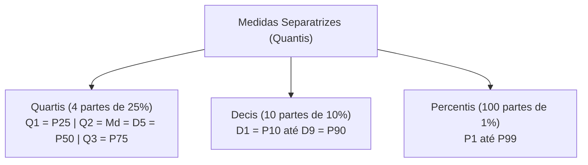
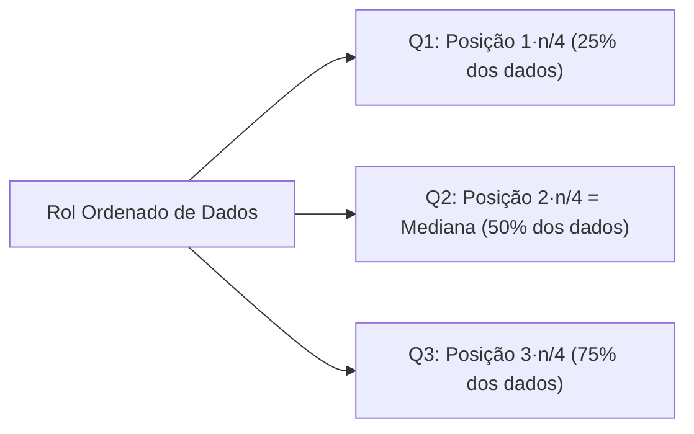
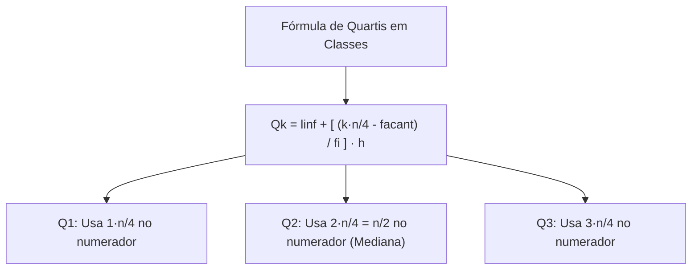
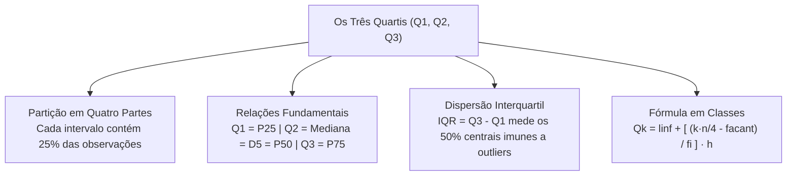

As medidas separatrizes ampliam o conceito da mediana para partições mais detalhadas da distribuição de frequências. Ao dividir um rol ordenado em quatro, dez ou cem partes com igual número de elementos, essas medidas oferecem visão precisa da concentração e da dispersão dos dados. Dentre todas as famílias de quantis, os quartis assumem papel central na análise exploratória moderna e no desenho do diagrama de caixa.

> [!objetivos]
> - Compreender a divisão em quartis e suas relações com a mediana.
> - Calcular os três quartis em séries brutas não agrupadas.
> - Determinar os quartis em distribuições de frequências pontuais.
> - Aplicar a fórmula de interpolação linear para quartis em classes contínuas.

## A Família das Medidas Separatrizes

As medidas separatrizes (quantis) dividem um conjunto previamente ordenado em frações que contêm o mesmo número de observações. O nome de cada medida decorre diretamente da quantidade de partes criadas:

| Medida Separatriz | Quantidade de Partes | Percentual por Parte | Número de Cortes | Símbolos Usuais |
|---|---|---|---|---|
| **Mediana** | 2 partes iguais | 50% cada | 1 corte | Md |
| **Quartis** | 4 partes iguais | 25% cada | 3 cortes | Q1, Q2, Q3 |
| **Quintis** | 5 partes iguais | 20% cada | 4 cortes | Qt1 a Qt4 |
| **Decis** | 10 partes iguais | 10% cada | 9 cortes | D1 a D9 |
| **Percentis** | 100 partes iguais | 1% cada | 99 cortes | P1 a P99 |

Observe que para repartir um conjunto em K partes iguais são necessários sempre K - 1 pontos de corte. Assim, temos três quartis, quatro quintis, nove decis e noventa e nove percentis.

Existe equivalência direta entre as medidas:
- O segundo quartil separa cinquenta por cento dos dados e coincide com a mediana: Q2 = Md = D5 = P50.
- O primeiro quartil separa os vinte e cinco por cento menores: Q1 = P25.
- O terceiro quartil separa os setenta e cinco por cento menores (ou vinte e cinco por cento maiores): Q3 = P75.

A distância entre o terceiro e o primeiro quartil define o **intervalo interquartil** (IQR):
IQR = Q3 - Q1.
O IQR mede a dispersão dos cinquenta por cento centrais da distribuição, sendo imune a valores extremos.

## Quartis para Dados Não Agrupados (Dados Brutos)

Para calcular os quartis em uma série bruta, a ordenação dos dados em rol crescente é obrigatória.
A posição de ordem do quartil Qk (onde k pode ser 1, 2 ou 3) em uma amostra de tamanho n é obtida por:
pos = k · n / 4.

Se a posição calculada for um número inteiro, o quartil corresponde ao elemento nessa posição ou à média com o termo seguinte, conforme a convenção. Se a posição for fracionária, adota-se a posição inteira mais próxima no rol ou interpolação linear entre os vizinhos imediatos. Para o segundo quartil Q2, adota-se sempre o procedimento da mediana: termo (n + 1) / 2 para n ímpar, ou a média entre n / 2 e (n / 2) + 1 para n par.

> [!resolvido] Exemplo em Rol com Dezesseis Valores
> Considere as idades de 16 recrutas ordenadas em rol crescente:
> Rol: 18, 18, 19, 19, 20, 20, 21, 21, 22, 22, 23, 24, 25, 25, 26, 27.
> Temos n = 16 observações.
> 1. Posição de Q1:
> pos(Q1) = 1 · 16 / 4 = 4.
> O quarto termo é 19 e o quinto é 20. Adotando a média entre os termos centrais da primeira metade:
> Q1 = (19 + 20) / 2 = 19,5 anos.
> 2. Posição de Q2 (Mediana):
> Como n = 16 é par, os termos centrais são o 8º (21) e o 9º (22).
> Q2 = (21 + 22) / 2 = 21,5 anos.
> 3. Posição de Q3:
> pos(Q3) = 3 · 16 / 4 = 12.
> O 12º termo é 24 e o 13º é 25. A média da segunda metade fornece:
> Q3 = (24 + 25) / 2 = 24,5 anos.
> O intervalo interquartil é IQR = Q3 - Q1 = 24,5 - 19,5 = 5 anos.

## Quartis para Dados Agrupados sem Classes

Em tabelas pontuais de valores isolados com frequências simples fi, a localização dos quartis recorre à coluna de frequências acumuladas (Fi ou fac).

Para achar o quartil Qk, calculamos o corte posicional:
corte = k · n / 4.
Percorremos a coluna Fi de cima para baixo até identificar a linha onde Fi atinge ou supera esse corte.

Se a frequência acumulada Fi for estritamente maior que o corte, o quartil Qk é o próprio valor xi daquela linha. Se Fi coincidir exatamente com o corte k · n / 4, o quartil será a média aritmética simples entre o valor xi dessa linha e o valor xi+1 da linha seguinte:
Qk = (xi + xi+1) / 2.

> [!exemplo] Levantamento de Filhos de Servidores
> Uma pesquisa coletou o número de filhos de quarenta servidores públicos:
> 
> | Número de Filhos (xi) | Frequência simples (fi) | Frequência acumulada (Fi) |
> |---|---|---|
> | 0 | 10 | 10 |
> | 1 | 14 | 24 |
> | 2 | 11 | 35 |
> | 3 | 5 | 40 |
> | **Total** | **n = 40** | — |
> 
> Calculando os quartis:
> - Para Q1: corte = 1 · 40 / 4 = 10. A primeira linha tem F1 = 10 (coincidência exata com o corte).
> Logo, Q1 é a média entre a linha atual (0) e a seguinte (1):
> Q1 = (0 + 1) / 2 = 0,5 filho.
> - Para Q2 (Mediana): corte = 2 · 40 / 4 = 20. Na linha 2 temos F2 = 24 > 20.
> Q2 = 1 filho.
> - Para Q3: corte = 3 · 40 / 4 = 30. Na linha 3 temos F3 = 35 > 30.
> Q3 = 2 filhos.

## Quartis para Dados Agrupados em Classes

Quando os dados estão distribuídos em faixas intervalares contínuas, os quartis são calculados pela mesma fórmula de interpolação linear da mediana, ajustando apenas a fração de corte.

A fórmula geral para o quartil Qk em classes é:
Qk = linf + [((k · n / 4) - facant) / fi] · h.

Onde:
- **k:** ordem do quartil desejado (k = 1, 2 ou 3).
- **linf:** limite inferior da classe do quartil.
- **k · n / 4:** ponto de corte acumulado correspondente ao quartil.
- **facant:** frequência acumulada da classe imediatamente anterior.
- **fi:** frequência simples da classe do quartil.
- **h:** amplitude da classe do quartil (h = lsup - linf).

> [!resolvido] Exemplo Completo com Pesos de 180 Alunos
> Uma escola registrou a distribuição de pesos em quilogramas de 180 alunos em classes com amplitude h = 20 kg:
> 
> | Classes de Peso (kg) | fi | fac |
> |---|---|---|
> | 40 a 60 | 60 | 60 |
> | 60 a 80 | 70 | 130 |
> | 80 a 100 | 50 | 180 |
> | **Total** | **n = 180** | — |
> 
> Vamos calcular os três quartis:
> 
> 1. **Cálculo de Q1:**
> Posição: 1 · 180 / 4 = 45.
> A primeira classe (40 a 60) tem fac = 60 ≥ 45. Essa é a classe de Q1.
> Parâmetros: linf = 40, facant = 0, fi = 60, h = 20.
> Q1 = 40 + [((45 - 0) / 60)] · 20 = 40 + [45 / 3] = 40 + 15 = 55 kg.
> 
> 2. **Cálculo de Q2 (Mediana):**
> Posição: 2 · 180 / 4 = 90.
> A segunda classe (60 a 80) tem fac = 130 ≥ 90. Essa é a classe de Q2.
> Parâmetros: linf = 60, facant = 60, fi = 70, h = 20.
> Q2 = 60 + [((90 - 60) / 70)] · 20 = 60 + [(30 / 70)] · 20 = 60 + 8,57 = 68,57 kg.
> 
> 3. **Cálculo de Q3:**
> Posição: 3 · 180 / 4 = 135.
> A terceira classe (80 a 100) tem fac = 180 ≥ 135. Essa é a classe de Q3.
> Parâmetros: linf = 80, facant = 130, fi = 50, h = 20.
> Q3 = 80 + [((135 - 130) / 50)] · 20 = 80 + [(5 / 50)] · 20 = 80 + 2 = 82 kg.

> [!atencao] Coerência do Resultado
> O valor calculado de qualquer quartil deve sempre recair dentro dos limites da classe identificada. Se Q1 resultou em 55 kg, ele precisa estar contido no intervalo de 40 a 60 kg. Essa conferência rápida evita erros em operações aritméticas.

| Quartil | Posição Teórica | Percentual Abaixo | Percentual Acima | Equivalência |
|---|---|---|---|---|
| **Q1** | 1 · n / 4 | 25% | 75% | P25 |
| **Q2** | 2 · n / 4 = n / 2 | 50% | 50% | Md, D5, P50 |
| **Q3** | 3 · n / 4 | 75% | 25% | P75 |

## Mapa do capítulo

### Para fixar

- A família dos três quartis segmenta o conjunto ordenado em quatro blocos homogêneos, acumulando vinte e cinco por cento em cada intervalo.
- São três os quartis: Q1 (25% menores), Q2 (50%, mediana) e Q3 (75% menores).
- O intervalo interquartil é a diferença IQR = Q3 - Q1, medindo a dispersão central resistente.
- Em dados brutos, organiza-se o rol e busca-se a posição k · n / 4.
- Em tabelas sem classes, se a frequência acumulada coincidir com k · n / 4, faz-se a média com o valor seguinte.
- Em tabelas com classes, emprega-se a fórmula de interpolação linear com o termo k · n / 4 no numerador.
- O segundo quartil é rigorosamente idêntico à mediana e ao quinto decil e quinquagésimo percentil.
- O valor numérico de cada quartil deve obrigatoriamente situar-se dentro dos limites da classe do quartil.
