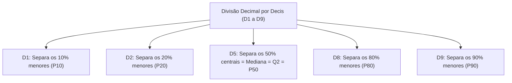
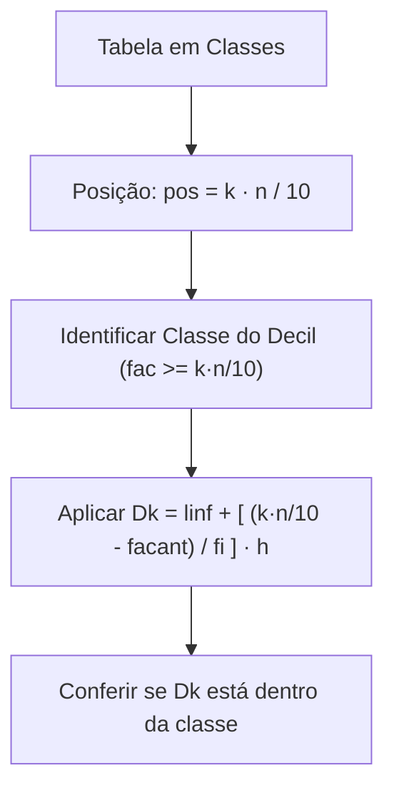
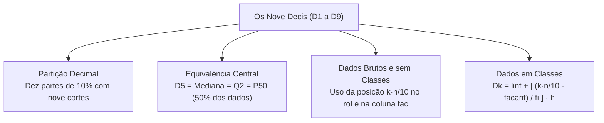

Os decis integram o núcleo da estatística descritiva e análise exploratória de dados. Ao organizar gráficos, diagramas, tabelas e medidas descritivas de posição, a partição decimal divide a série ordenada em dez faixas com igual quantidade de observações. O cálculo dos decis adapta a estrutura da mediana, substituindo a metade pelo corte decimal por dez.

> [!objetivos]
> - Compreender a definição dos nove decis e suas equivalências com outras separatrizes.
> - Calcular decis em séries brutas não agrupadas no rol ordenado.
> - Localizar decis em tabelas de frequências simples sem classes.
> - Aplicar a interpolação linear para obter decis em classes contínuas.

## O Conceito de Decil e a Partição Decimal

Os decis são medidas descritivas de posição que dividem o rol em dez partes com igual número de observações. Cada fração delimitada por dois decis consecutivos reúne exatamente dez por cento dos dados.

Para repartir a distribuição em dez partes iguais, utilizam-se **nove pontos de corte**, denominados D1 a D9:
- **D1 (Primeiro decil):** deixa 10% dos dados abaixo e 90% acima.
- **D2 (Segundo decil):** deixa 20% dos dados abaixo e 80% acima.
- **D5 (Quinto decil):** deixa 50% dos dados abaixo, coincidindo com a mediana e o segundo quartil: D5 = Md = Q2 = P50.
- **D9 (Nono decil):** deixa 90% dos dados abaixo e apenas os 10% maiores acima.

Na estatística descritiva e análise exploratória de dados, o cálculo dos decis reproduz o roteiro da mediana, empregando a posição:
pos = k · n / 10.

| Decil | Percentual Abaixo | Percentual Acima | Equivalência |
|---|---|---|---|
| **D1** | 10% | 90% | P10 |
| **D2** | 20% | 80% | P20 |
| **D5** | 50% | 50% | Md, Q2, P50 |
| **D8** | 80% | 20% | P80 |
| **D9** | 90% | 10% | P90 |

## Decis para Dados Não Agrupados e sem Classes

Em dados brutos, a ordenação prévia em rol crescente é mandatória. A ordem posicional de Dk é calculada por:
pos = k · n / 10.

Se k · n / 10 for número inteiro, o decil Dk é a média aritmética entre o termo dessa posição e o termo seguinte no rol. Se a posição for fracionária, adota-se o termo correspondente à posição inteira imediatamente superior.

> [!resolvido] Exemplo em Rol com Dez Observações
> Considere as notas de dez candidatos em teste físico:
> Rol: 42, 48, 55, 60, 64, 70, 75, 82, 88, 95.
> Temos n = 10 observações.
> 1. Para D3:
> pos = 3 · 10 / 10 = 3.
> O terceiro termo é 55 e o quarto é 60.
> D3 = (55 + 60) / 2 = 57,5 pontos.
> 2. Para D8:
> pos = 8 · 10 / 10 = 8.
> O oitavo termo é 82 e o nono é 88.
> D8 = (82 + 88) / 2 = 85 pontos.

Em tabelas pontuais sem classes (valores isolados com frequências fi), localiza-se o decil pela frequência acumulada (fac).
Calcula-se o corte k · n / 10 e busca-se a primeira linha onde fac ≥ k · n / 10. Se fac coincidir com o corte, faz-se a média simples entre o valor xi e o seguinte xi+1:
Dk = (xi + xi+1) / 2.

> [!exemplo] Filhos de Servidores
> Amostra sobre o número de filhos de 170 servidores públicos:
> 
> | Filhos (xi) | fi | fac |
> |---|---|---|
> | 0 | 40 | 40 |
> | 1 | 65 | 105 |
> | 2 | 45 | 150 |
> | 3 | 20 | 170 |
> | **Total** | **n = 170** | — |
> 
> Para o quarto decil D4, comecamos determinando o corte:
> corte = 4 · 170 / 10 = 68.
> Como F1 = 40 < 68 e F2 = 105 ≥ 68, determinamos D4 = 1 filho. Se houver necessidade de analisar outra variável contínua entre 162 e 167 cm, encontramos na proxima etapa o limite linfdk = 162 cm.

## Decis para Dados Agrupados em Classes

Em classes contínuas, o decil Dk é obtido por interpolação linear, admitindo distribuição homogênea dos dados na classe.

A fórmula do decil Dk em classes é:
Dk = linf + [((k · n / 10) - facant) / fi] · h.

Onde:
- **k:** ordem do decil (1 a 9).
- **linf:** limite inferior da classe do decil.
- **k · n / 10:** corte acumulado decimal.
- **facant:** frequência acumulada da classe anterior.
- **fi:** frequência simples da classe do decil.
- **h:** amplitude da classe (lsup - linf).

> [!resolvido] Estaturas de 54 Alunos
> Medições de estatura de 54 alunos em classes com amplitude h = 8 cm:
> 
> | Classes de Estatura (cm) | fi | fac |
> |---|---|---|
> | 120 a 128 | 6 | 6 |
> | 128 a 136 | 12 | 18 |
> | 136 a 144 | 20 | 38 |
> | 144 a 152 | 10 | 48 |
> | 152 a 160 | 6 | 54 |
> | **Total** | **n = 54** | — |
> 
> 1. **Cálculo de D1:**
> Posição: 1 · 54 / 10 = 5,4.
> Classe de D1: 120 a 128 cm (fac = 6 ≥ 5,4).
> Parâmetros: linf = 120, facant = 0, fi = 6, h = 8.
> D1 = 120 + [((5,4 - 0) / 6)] · 8 = 120 + 7,2 = 127,2 cm.
> 
> 2. **Cálculo de D7:**
> Posição: 7 · 54 / 10 = 37,8.
> Classe de D7: 136 a 144 cm (fac = 38 ≥ 37,8).
> Parâmetros: linf = 136, facant = 18, fi = 20, h = 8.
> D7 = 136 + [((37,8 - 18) / 20)] · 8 = 136 + 7,92 = 143,92 cm.

> [!atencao] Notação e Rigor nos Cálculos
> Não confunda a letra D de decil com o termo quartil em provas. Verifique com atenção as operações com decimais para evitar desvios de arredondamento.

## Mapa do capítulo

### Para fixar

- Os decis dividem a série ordenada em dez partes com igual número de observações (dez por cento cada).
- Existem nove decis (D1 a D9), sendo D5 idêntico à mediana e ao segundo quartil.
- Em dados brutos ordenados em rol, calcula-se a posição através da relação k · n / 10.
- Em tabelas pontuais sem classes, se fac coincidir com k · n / 10, faz-se a média com o valor seguinte.
- Em tabelas com classes, aplica-se interpolação linear com o corte k · n / 10 no numerador.
- O resultado numérico de cada decil deve obrigatoriamente estar contido nos limites da classe identificada.
