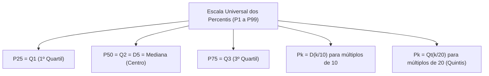
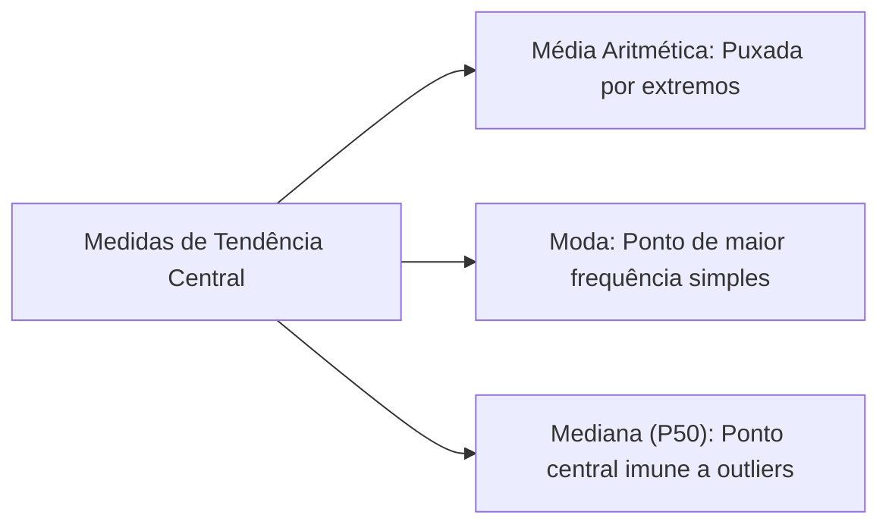
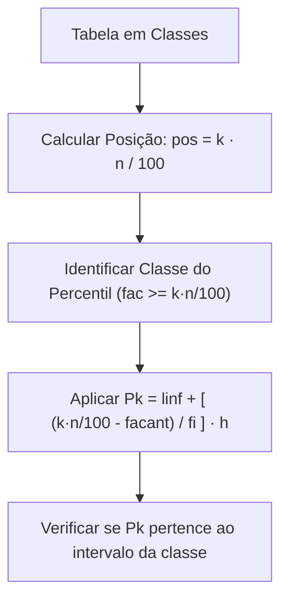
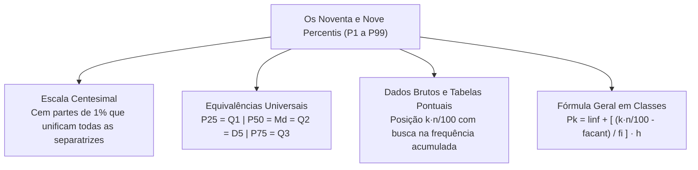

Os percentis representam a forma mais refinada de mensuração posicional na estatística descritiva e análise exploratória de dados. Ao integrar as medidas de tendência central (médias, moda e mediana) com a família das separatrizes, os percentis permitem localizar qualquer observação em uma escala percentual contínua de um a noventa e nove por cento. Compreender a fórmula geral unificada dos percentis possibilita resolver qualquer questão de quartis, decis e mediana com uma única estrutura matemática.

> [!objetivos]
> - Compreender a definição dos noventa e nove percentis e suas equivalências universais.
> - Dominar a localização de percentis em dados brutos e em tabelas sem classes.
> - Aplicar a fórmula geral unificada de interpolação linear para percentis em classes.
> - Reconhecer as convenções de arredondamento e divergências de cálculo em concursos.

## A Família dos Percentis e a Escala Centesimal

Os percentis (ou centis) são valores separatrizes que particionam uma série ordenada de dados em cem frações com igual quantidade de elementos. Cada faixa delimitada por dois percentis sucessivos reúne exatamente um por cento das observações da amostra.

Para repartir uma distribuição em cem partes iguais, são necessários **noventa e nove pontos de corte**, representados por P1, P2, P3, ..., P99. O índice k varia de 1 a 99 e expressa a porcentagem acumulada de dados que se posiciona abaixo daquele ponto:
- **P1:** separa o primeiro 1% dos dados, deixando 99% acima.
- **P10:** separa os 10% menores, equivalendo ao primeiro decil: P10 = D1.
- **P25:** separa os 25% menores, equivalendo ao primeiro quartil: P25 = Q1.
- **P50:** separa os 50% menores, coincidindo com a mediana, com o segundo quartil e com o quinto decil: P50 = Md = Q2 = D5.
- **P75:** separa os 75% menores (ou 25% maiores), equivalendo ao terceiro quartil: P75 = Q3.
- **P90:** separa os 90% menores, equivalendo ao nono decil: P90 = D9.
- **P99:** separa os 99% menores, deixando apenas o 1% mais elevado acima.

Na estatística descritiva e análise exploratória de dados, a grande vantagem dos percentis reside no fato de que todas as demais medidas separatrizes são casos particulares de percentis. Conhecendo a lógica dos percentis, domina-se simultaneamente a mediana, os quartis, os quintis e os decis.

| Medida Tradicional | Percentil Equivalente | Percentual Abaixo | Percentual Acima |
|---|---|---|---|
| **Primeiro Quartil (Q1)** | P25 | 25% | 75% |
| **Mediana (Md / Q2 / D5)** | P50 | 50% | 50% |
| **Terceiro Quartil (Q3)** | P75 | 75% | 25% |
| **Primeiro Decil (D1)** | P10 | 10% | 90% |
| **Primeiro Quintil (Qt1)**| P20 | 20% | 80% |

## Relação com as Medidas de Tendência Central

O estudo das medidas de tendência central (médias, moda e mediana) ganha amplitude quando articulado com os percentis. Enquanto a média aritmética utiliza a totalidade dos valores e a moda aponta o dado de maior frequência simples, a mediana ancora-se como o percentil cinquenta (P50).

Em distribuições simétricas unimodais, a média aritmética, a moda e o percentil cinquenta coincidem exatamente no ápice central da distribuição. Contudo, na presença de forte assimetria, a média aritmética é puxada na direção dos valores extremos. A mediana (P50) preserva a estabilidade posicional, separando metade dos indivíduos. Por essa razão, percentis como P10 e P90 são adotados em avaliações de desempenho de cidades brasileiras e em levantamentos de bens culturais catalogados por órgãos como o Iphan para isolar extremos atípicos.

## Percentis para Dados Não Agrupados e Tabelas sem Classes

Para encontrar o percentil Pk em dados não agrupados, a primeira exigência é a organização das observações em rol crescente.
Em seguida, calcula-se a posição de ordem centesimal por meio da relação:
pos = k · n / 100.

O valor de k representa a ordem do percentil desejado (de 1 a 99) e n é o tamanho total da amostra.
Se a posição calculada for um número inteiro, adota-se o elemento daquela posição ou a média aritmética entre ele e o termo seguinte. Se a posição for fracionária, a regra mais frequente em concursos consiste em arredondar o resultado para o número inteiro imediatamente superior no rol ordenado.

> [!resolvido] Exemplo em Amostra de Funcionários de um Órgão
> Em um estudo sobre idades de funcionários em um órgão público, obteve-se um rol com trinta servidores. Deseja-se determinar o décimo quinto percentil P15 e o octogésimo terceiro percentil P83:
> 1. Posição de P15:
> pos = 15 · 30 / 100 = 450 / 100 = 4,5.
> Como a posição 4,5 é fracionária, adota-se o quinto elemento do rol ordenado como P15.
> 2. Posição de P83:
> pos = 83 · 30 / 100 = 2490 / 100 = 24,9.
> Por arredondamento para o número inteiro mais próximo, adota-se o vigésimo quinto elemento do rol como o valor de P83. Em cadernos de questões, é comum encontrar pequenos erros tipográficos de digitação, como grafar P27 em vez de P83 ou pp27 e pp45 na resolução, mas o procedimento aritmético de busca segue inalterado.

Em tabelas de dados agrupados sem intervalos de classe (valores discretos com frequências simples fi), utiliza-se a coluna de frequências acumuladas (fac). Nessa etapa, comecamos calculando o ponto de corte centesimal k · n / 100 e vamos procurar a primeira linha da tabela em que fac atinge ou supera esse corte. Se fac for igual ao corte com exatidão, faz-se a média aritmética simples entre o valor xi da linha e o valor xi+1 da linha imediatamente seguinte:
Pk = (xi + xi+1) / 2.

> [!exemplo] Avaliação de Distâncias Percorridas até a Defensoria
> Em uma pesquisa com cidadãos atendidos pela Defensoria Pública, registrou-se a distância em quilometros percorrida até a unidade por duzentos entrevistados. Também foi levantado o número de filhos de cada usuário ocupando diferentes faixas de frequência.
> 
> | Faixas de Distância em quilometros (xi) | fi | fac |
> |---|---|---|
> | 1 | 50 | 50 |
> | 2 | 80 | 130 |
> | 3 | 50 | 180 |
> | 4 | 20 | 200 |
> | **Total** | **n = 200** | — |
> 
> Para o sexagésimo percentil P60:
> corte = 60 · 200 / 100 = 120.
> Na linha 1, fac = 50 < 120. Na linha 2, fac = 130 ≥ 120.
> Logo, o sexagésimo percentil é P60 = 2 quilometros.

## Percentis para Dados Agrupados em Classes

Quando os dados contínuos estão distribuídos em classes de frequência, o percentil Pk é calculado pela fórmula geral unificada de interpolação linear:
Pk = linf + [((k · n / 100) - facant) / fi] · h.

Na prática de resolução, jogando os valores identificados na fórmula e utilizando linfpk para designar o limite inferior da classe do percentil, temos:
- **k:** ordem do percentil desejado (1 a 99).
- **linf** (ou **linfpk**): limite inferior da classe que contém o percentil.
- **k · n / 100:** posição de corte centesimal da distribuição.
- **facant:** frequência acumulada da classe imediatamente anterior.
- **fi:** frequência simples da própria classe do percentil.
- **h:** amplitude da classe (lsup - linf).

> [!resolvido] Estudo Biométrico Completo com P77
> Considere a tabela com medições de estatura de 54 alunos, com classes de amplitude h = 8 cm:
> 
> | Classes de Estatura (cm) | fi | fac |
> |---|---|---|
> | 120 a 128 | 6 | 6 |
> | 128 a 136 | 12 | 18 |
> | 136 a 144 | 20 | 38 |
> | 144 a 152 | 10 | 48 |
> | 152 a 160 | 6 | 54 |
> | **Total** | **n = 54** | — |
> 
> Deseja-se calcular o septuagésimo sétimo percentil P77:
> Passo 1: Cálculo rigoroso da posição:
> pos = 77 · 54 / 100 = 4158 / 100 = 41,58.
> Algumas apostilas antigas registravam equivocadamente 41,04 por engano de digitação, mas o produto aritmético exato é 41,58.
> Passo 2: A quarta classe (144 a 152 cm) possui fac = 48 ≥ 41,58. Essa é a classe do percentil.
> Passo 3: Parâmetros: linfpk = 144, facant = 38, fi = 10, h = 8.
> Passo 4: Aplicando a fórmula:
> P77 = 144 + [((41,58 - 38) / 10)] · 8.
> P77 = 144 + [(3,58 / 10)] · 8.
> P77 = 144 + 0,358 · 8.
> P77 = 144 + 2,864 = 146,864 cm.
> Se a banca utilizar a posição digitada como 41,04, a conta resulta em 144 + ((41,04 - 38) / 10) · 8 = 144 + 2,432 = 146,43 cm. Quando os valores de frequência são ligeiramente diferentes, como em salas de espetáculos e teatros de capitais brasileiras, o cálculo de P77 pode atingir 148,66 cm. O candidato deve manter atenção aos números fornecidos no enunciado.

> [!pegadinha] Atenção às Convenções de Arredondamento
> Bancas examinadoras costumam apresentar pequenas variações nas regras de arredondamento de posições fracionárias em dados brutos. Algumas arredondam para o inteiro mais próximo (por exemplo, 2,97 vira 3, e 9,13 vira 9), enquanto outras interpolam linearmente entre os dois termos vizinhos. Ao resolver a questão, confira as alternativas para identificar qual convenção matemática a banca adotou.

| Separatriz | Razão de Partição | Posição em Amostra n | Exemplo de Equivalência |
|---|---|---|---|
| **Mediana** | Divide por 2 | pos = n / 2 | Md = P50 |
| **Quartis** | Divide por 4 | pos = k · n / 4 | Q1 = P25, Q3 = P75 |
| **Decis** | Divide por 10 | pos = k · n / 10 | D1 = P10, D5 = P50 |
| **Percentis** | Divide por 100 | pos = k · n / 100 | Pk genérico |

## Interpretação Prática e Aplicações no Serviço Público

No contexto da gestão pública, perícias e corporações de segurança, os percentis desempenham papel crucial na análise de indicadores operacionais e critérios de seleção. Diferente da média aritmética, que pode ser distorcida por um pequeno número de eventos extremos, as separatrizes centesimais revelam com exatidão a distribuição real do desempenho e dos recursos disponíveis.

Em avaliações de desempenho físico e operacional, como nos testes de aptidão física de órgãos estaduais, notas de corte costumam ser fixadas com base em percentis específicos. Por exemplo, quando uma corporação estabelece que apenas os candidatos posicionados no percentil oitenta e cinco (P85) ou superior em corrida de resistência serão considerados aptos para forças especiais, isso significa que o candidato precisa superar oitenta e cinco por cento de todos os participantes do certame. Da mesma forma, na gestão de chamados de emergência de bombeiros e policiamento, o tempo de resposta medido no percentil noventa (P90) indica o limite temporal no qual noventa por cento dos atendimentos à população são efetivamente concluídos. Se o P90 de tempo de resposta é de doze minutos, sabe-se que apenas dez por cento dos chamados mais complexos exigiram tempo superior a essa marca de corte.

## Mapa do capítulo

### Para fixar

- Os percentis dividem a distribuição ordenada em cem partes iguais de um por cento cada.
- São noventa e nove os percentis, variando de P1 a P99 na escala percentual acumulada.
- O quinquagésimo percentil (P50) coincide com a mediana, com o segundo quartil e com o quinto decil.
- O primeiro quartil é igual a P25 e o terceiro quartil é igual a P75.
- Em dados agrupados em classes, a fórmula unificada é Pk = linf + [((k · n / 100) - facant) / fi] · h.
- A posição centesimal de corte é calculada pela relação pos = k · n / 100.
- A hipótese fundamental da interpolação linear é a distribuição uniforme das observações na classe.
- O valor resultante do percentil deve obrigatoriamente estar compreendido no intervalo da classe identificada.
