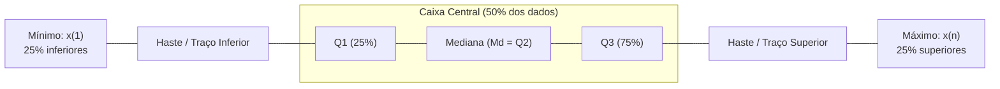
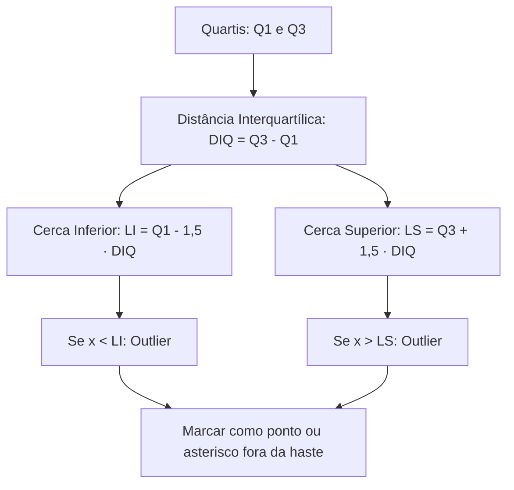
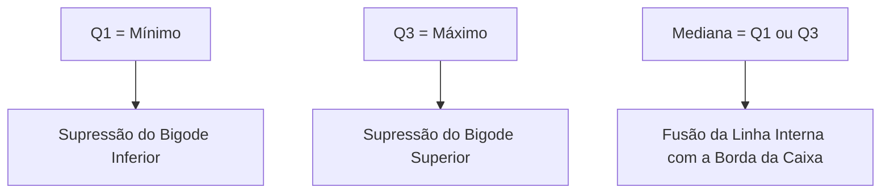
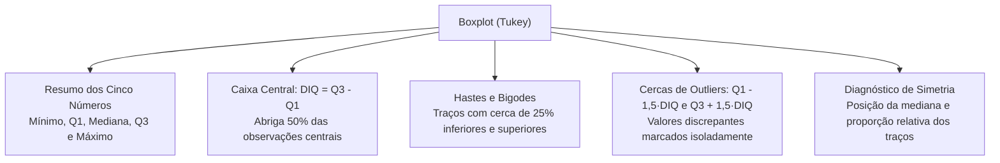

O gráfico de caixa e bigodes, amplamente denominado boxplot (ou box-and-whisker plot), é uma das ferramentas visuais mais eficazes da análise exploratória de dados. Desenvolvido por John Tukey na década de 1970, esse diagrama resume um conjunto volumoso de dados quantitativos em apenas cinco medidas posicionais fundamentais. Por meio dessa representação sintética, o analista apreende de imediato a tendência central, a dispersão, a simetria da distribuição e a existência de observações discrepantes denominadas outliers.

> [!objetivos]
> - Compreender a estrutura anatômica do box plot baseada nos cinco números de resumo.
> - Interpretar a partição percentual dos dados entre caixa, mediana e bigodes.
> - Dominar o cálculo da distância interquartílica e das cercas de identificação de outliers.
> - Reconhecer as deformações do desenho quando ocorrem medidas coincidentes.
> - Comparar grupos de dados distintos dispostos paralelamente no mesmo eixo gráfico.

## Estrutura Fundamental do Boxplot e os Cinco Números

A construção do boxplot fundamenta-se no resumo dos cinco números da estatística descritiva:
1. O valor mínimo da série amostral (x(1));
2. O primeiro quartil (Q1 ou P25);
3. A mediana da distribuição (Md, Q2 ou P50);
4. O terceiro quartil (Q3 ou P75);
5. O valor máximo da série amostral (x(n)).

O diagrama pode ser orientado horizontalmente ou verticalmente. Na disposição horizontal, o eixo das abscissas expressa a escala da variável em estudo. A haste central serve como linha de apoio, sobre a qual repousam os componentes gráficos do modelo:

A **caixa central (box)** é um retângulo cujos limites coincidem precisamente com o primeiro quartil Q1 e o terceiro quartil Q3. O comprimento do retângulo delimita a distância interquartílica da distribuição. Consequentemente, a caixa abriga em seu interior exatamente cinquenta por cento das observações centrais.

A **linha da mediana** corta o retângulo na posição exata de Q2. Essa divisória não precisa situar-se no ponto médio geométrico da caixa: se a distribuição for assimétrica, a linha ficará deslocada para mais perto de Q1 ou de Q3.

Os **bigodes (whiskers)** são traços que partem das bordas da caixa e projetam-se em direção aos extremos. Em séries sem outliers, o traço inferior conecta Q1 ao valor mínimo, abrigando vinte e cinco por cento das observações. O traço superior conecta Q3 ao valor máximo, servindo para reunir os vinte e cinco por cento mais elevados da amostra.

| Componente Anatômico | Delimitação Matemática | Proporção Contida de Dados | O que Revela |
|---|---|---|---|
| **Bigode Inferior** | Do mínimo (ou cerca) até Q1 | Cerca de 25% | Dispersão dos menores valores |
| **Borda Inferior da Caixa** | Ponto de corte Q1 (P25) | Ponto divisor | Separa os 25% inferiores |
| **Interior da Caixa** | Intervalo entre Q1 e Q3 | Exatamente 50% | Dispersão e amplitude central |
| **Linha Interna** | Posição da mediana Q2 (P50) | Ponto divisor | Tendência central e assimetria |
| **Borda Superior da Caixa** | Ponto de corte Q3 (P75) | Ponto divisor | Separa os 75% inferiores |
| **Bigode Superior** | De Q3 até o máximo (ou cerca) | Cerca de 25% | Dispersão dos maiores valores |

O boxplot é um gráfico estritamente posicional e não informa a média aritmética, salvo se um marcador específico for adotado. Afirmações em provas que atribuam à caixa os limites da média aritmética estão incorretas.

## A Distância Interquartílica e a Detecção de Outliers

Para quantificar a dispersão central e parametrizar a busca por valores discrepantes, calcula-se a distância interquartílica (amplitude interquartílica):
DIQ = Q3 - Q1.

A DIQ expressa a largura da caixa. É importante distingui-la do desvio quartílico (amplitude semi-interquartílica), que equivale à metade da DIQ:
Dq = (Q3 - Q1) / 2.

Na metodologia de Tukey, dados que se afastam substancialmente do corpo central são classificados como outliers. Para detectá-los, utilizam-se as seguintes cercas de corte:
- **Limite Inferior (LI):**
LI = Q1 - 1,5 · DIQ.
- **Limite Superior (LS):**
LS = Q3 + 1,5 · DIQ.

Qualquer observação estritamente menor que o limite inferior (x < LI) ou estritamente maior que o limite superior (x > LS) é rotulada como outlier. Caso ultrapasse três vezes a DIQ além dos quartis, recebe o nome de outlier extremo.

Quando há valores discrepantes na série, os traços dos bigodes não alcançam o mínimo ou máximo absolutos:
- A ponta do bigode inferior encerra-se no menor valor amostral que seja maior ou igual ao limite inferior (x ≥ LI).
- A ponta do bigode superior encerra-se no maior valor amostral que seja menor ou igual ao limite superior (x ≤ LS).
- Os outliers são plotados individualmente por pequenos pontos ou asteriscos além das hastes.

> [!pegadinha] Valores Exatamente Iguais às Cercas e Proporções Amostrais
> Um valor que coincida exatamente com LI ou LS **não é outlier**. Ele é considerado termo regular da série e representará a própria ponta do bigode.
> Vale ressaltar que o boxplot expressa proporções percentuais acumuladas (quartis) e não o total absoluto de elementos. Dois diagramas idênticos podem representar amostras com quantidades de dados totalmente diferentes.

## Passo a Passo de Construção e Exemplos Numéricos Práticos

O roteiro sistemático de construção do boxplot segue etapas bem definidas:
1. Ordenar as n observações em ordem crescente (rol).
2. Determinar o mínimo, Q1, mediana e Q3.
3. Calcular a distância interquartílica DIQ = Q3 - Q1.
4. Fixar os limites de corte: LI = Q1 - 1,5 · DIQ e LS = Q3 + 1,5 · DIQ.
5. Identificar eventuais outliers e delimitar os extremos dos bigodes.
6. Desenhar a escala, a caixa central e as hastes com os traços correspondentes.

> [!resolvido] Exemplo Prático com Identificação de Outlier
> Um grupo de servidores analisou as pontuações obtidas por quinze candidatos em um teste técnico:
> 55, 58, 60, 62, 64, 65, 66, 67, 68, 69, 70, 72, 75, 78, 98.
> 
> Com n = 15 observações em ordem crescente:
> - O valor mínimo é 55 e o máximo absoluto é 98.
> - O primeiro quartil Q1 é 62 (posição 4), delimitando os 25% inferiores.
> - O valor mediano está localizado em 67 (posição 8), ocupando o centro da distribuição.
> - O terceiro quartil Q3 é 70 (posição 12). Se considerarmos outra partição com Q3 = 69, o procedimento segue análogo. Adotando Q1 = 62 e Q3 = 69:
> DIQ = 69 - 62 = 7.
> Limites de corte:
> LI = 62 - (1,5 · 7) = 62 - 10,5 = 51,5.
> LS = 69 + (1,5 · 7) = 69 + 10,5 = 79,5.
> 
> Análise dos dados:
> - O menor valor (55) é maior que 51,5. Logo, o bigode inferior inicia-se em 55.
> - O valor 98 supera o limite de 79,5, sendo classificado como **outlier**.
> - O maior valor que não ultrapassa 79,5 é 78, que forma a ponta do bigode superior.
> - Os valores 62, 65, 66, 67, 68 e 69 permanecem confortavelmente no corpo central do gráfico.

Em problemas frequentes de concurso, a banca fornece apenas os quartis. Se um enunciado indicar Q1 = 40 e Q3 = 52, temos DIQ = 12. As cercas serão LI = 40 - 18 = 22 e LS = 52 + 18 = 70. Nesse caso, registros de 30 e 66 são comuns, ao passo que 71 é categorizado como outlier por superar a cerca de 70.

## Coincidência de Medidas e Comparação Entre Grupos

Quando os dados apresentam muitas repetições ou forte assimetria, medidas separatrizes podem assumir valores idênticos, alterando o desenho:
- Se **Q1 coincidir com o mínimo**, não haverá haste inferior à esquerda da caixa.
- Se **Q3 coincidir com o máximo**, não haverá haste superior à direita da caixa.
- Se a **mediana coincidir com Q1 ou com Q3**, a linha interna funde-se à borda da caixa, reduzindo o número visível de divisórias.

> [!exemplo] Dados com Medidas Coincidentes
> Considere o conjunto ordenado de oito observações: {4, 4, 4, 6, 8, 8, 8, 12}.
> Aqui, o mínimo vale 4 e o primeiro quartil também vale 4. O bigode inferior desaparece.
> A mediana vale 7 e o terceiro quartil vale 8. A amplitude interquartílica é DIQ = 8 - 4 = 4.
> O limite superior é LS = 8 + (1,5 · 4) = 14.
> Como o valor máximo 12 é inferior a 14, não ocorrem outliers.
> O boxplot resultante apresenta caixa de 4 a 8 com linha interna em 7, ausência total de bigode à esquerda e bigode à direita estendendo-se até 12.

A comparação visual de múltiplos diagramas traçados sobre a mesma escala permite contrastar grupos amostrais distintos:
- **Posição:** A comparação das linhas de mediana indica qual grupo apresenta valores tipicamente superiores.
- **Variabilidade:** Caixas de maior comprimento revelam maior dispersão dos 50% centrais dos dados. Duas caixas com mesmo comprimento possuem a mesma distância interquartílica.
- **Assimetria:** Se a mediana estiver no meio da caixa e os traços tiverem extensões semelhantes, a distribuição é simétrica. Se a mediana estiver próxima de Q1 e o bigode superior for alongado, a assimetria é positiva. Se a mediana estiver junto a Q3 e o bigode inferior for mais longo, a assimetria é negativa.

## Mapa do capítulo

### Para fixar

- O boxplot resume cinco medidas de posição: mínimo, primeiro quartil, mediana, terceiro quartil e máximo.
- O gráfico expressa proporções percentuais acumuladas e não exibe a média aritmética nem o total absoluto de dados.
- A caixa central é delimitada por Q1 e Q3, contendo cinquenta por cento das observações amostrais.
- A distância interquartílica é dada por DIQ = Q3 - Q1 e expressa a largura da caixa.
- O desvio quartílico equivale à metade da DIQ: Dq = (Q3 - Q1) / 2.
- Valores além das cercas LI = Q1 - 1,5 · DIQ e LS = Q3 + 1,5 · DIQ são considerados outliers.
- Um elemento exatamente igual a uma das cercas não é classificado como outlier.
- Quando separatrizes coincidem entre si, partes do desenho são suprimidas.
- Caixas de mesma extensão em grupos distintos possuem rigorosamente a mesma distância interquartílica.
- A posição relativa da mediana na caixa e a extensão das hastes revelam a simetria da distribuição.
