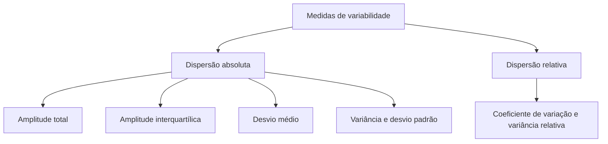

Duas turmas podem ter a mesma média e comportamentos opostos: numa, todos os alunos tiram 7; na outra, uns tiram 1 e outros 10. A média não revela isso. Para descrever o quanto os dados se espalham, a Estatística usa as **medidas de dispersão**, ou de variabilidade. Este capítulo apresenta as duas mais simples, a **amplitude total** e a **amplitude interquartílica**, e as propriedades de cada uma. Elas abrem o estudo que continua nos capítulos seguintes com desvio médio, variância, desvio padrão e coeficiente de variação, assuntos muito presentes em provas de nível médio e superior.

> [!objetivos]
> - Diferenciar medidas de posição, de tendência central, separatrizes e de dispersão.
> - Calcular a amplitude total para dados não agrupados, agrupados sem classes e agrupados em classes.
> - Calcular os quartis e a amplitude interquartílica.
> - Aplicar as propriedades das duas amplitudes quando se soma ou se multiplica uma constante.

## Por que medir a dispersão

Considere três grupos de cinco tempos de resposta, em minutos: A = 12, 12, 12, 12, 12; B = 10, 11, 12, 13, 14; e C = 2, 8, 14, 18, 18. Os três têm média 12, e no entanto são muito diferentes. O grupo A é perfeitamente homogêneo, o B é pouco disperso e o C é heterogêneo. A média é uma boa medida **representativa**, mas não diz o grau de homogeneidade do conjunto. É a medida de dispersão que mostra isso, e ela cresce à medida que os dados ficam mais espalhados.

As medidas estatísticas se dividem em famílias que as bancas gostam de misturar:

| Família | O que mede | Exemplos |
| --- | --- | --- |
| Medidas de posição (tendência central) | Onde os dados se concentram | Média aritmética, mediana e moda |
| Separatrizes | Divide os dados em partes de mesmo tamanho | Quartis, decis e percentis |
| Dispersão absoluta | O quanto os dados variam, na unidade original | Amplitude total, amplitude interquartílica, desvio médio, variância e desvio padrão |
| Dispersão relativa | A variação em relação à média, sem unidade | Coeficiente de variação e variância relativa |

> [!pegadinha]
> Dizer que a moda, a média ou a mediana são medidas de dispersão, ou que o desvio padrão é medida de posição. As medidas de posição indicam **onde** os dados estão; as de dispersão indicam o **quanto** eles se espalham. Variância, desvio padrão, amplitude e coeficiente de variação são dispersão; média, mediana e moda não são.

## Amplitude total

A **amplitude total** é a diferença entre o maior e o menor valor do conjunto:

    AT = x_máx − x_mín

É a mais simples das medidas de dispersão e, por isso, muito instável: depende só dos dois valores extremos e ignora tudo o que está entre eles. Um único valor discrepante, como um 55 no conjunto 5, 7, 8, 9, 10, 11, 55, faz a amplitude chegar a 50, embora seis dos sete valores estejam entre 5 e 11. Ela também cresce, em geral, com o tamanho da amostra e varia muito de uma amostra para outra. Mesmo assim, é útil quando se quer uma ideia rápida, como a variação de temperatura de um dia.

### Dados não agrupados

Basta subtrair o menor do maior valor. Nos conjuntos A = 50, 50, 50, 50, 50, B = 47, 49, 50, 51, 53 e C = 20, 35, 50, 65, 80, todos de média 50, as amplitudes são 0, 6 e 60. O conjunto A tem dispersão nula, e o C é o mais heterogêneo.

> [!resolvido] Amplitude total de um conjunto
> **Enunciado.** Os tempos de atendimento de oito chamados foram 12, 14, 15, 17, 20, 24, 30 e 44 minutos. Calcule a amplitude total.
>
> **Raciocínio.** A amplitude é a diferença entre o maior e o menor valor.
>
> **Conta.** AT = 44 − 12 = 32 minutos.
>
> **Resposta.** A amplitude total é de 32 minutos.

### Dados agrupados sem classes

Quando os dados vêm numa tabela de frequências, a regra é a mesma, e a única diferença está em encontrar o mínimo e o máximo na tabela. A frequência não importa: na tabela com x = 1, 2, 3, 4, 5 e frequências 2, 4, 8, 4, 2, os valores extremos são 1 e 5, e AT = 5 − 1 = 4, mesmo que o 1 tenha aparecido só duas vezes.

### Dados agrupados em classes

Há dois métodos, e a banca costuma indicar qual usar:

1. **Pelos limites:** AT = L_sup − l_inf, isto é, o limite superior da última classe menos o limite inferior da primeira.
2. **Pelos pontos médios:** AT = PM_últ − PM_pri, isto é, o ponto médio da última classe menos o da primeira.

Para classes de 0 ⊢ 10 a 40 ⊢ 50, com pontos médios 5, 15, 25, 35 e 45, o primeiro método dá 50 − 0 = 50, e o segundo, 45 − 5 = 40. O segundo valor é menor porque os pontos médios ficam mais para dentro do que os limites.

```grafico Distribuição em cinco classes (50 observações)
{"tipo": "histograma", "titulo": "Distribuição em cinco classes", "eixoX": "valor", "eixoY": "frequência",
 "classes": [[0, 10], [10, 20], [20, 30], [30, 40], [40, 50]], "frequencias": [5, 10, 20, 10, 5]}
```

### Propriedades da amplitude total

| Operação sobre todos os valores | Efeito na amplitude |
| --- | --- |
| Somar ou subtrair uma constante c | Não muda |
| Multiplicar ou dividir por uma constante c | É multiplicada ou dividida pelo módulo de c |

Por exemplo, a sequência 3, 6, 8, 9, 10 tem amplitude 7. Somando 5 a todos, a amplitude continua 7. Multiplicando a sequência original por 5, os valores viram 15, 30, 40, 45 e 50, e a amplitude passa a 35, ou seja, 5 vezes maior.

> [!bizu]
> Para lembrar o efeito das operações em qualquer medida de dispersão: **somar não altera, multiplicar escala**. Deslocar todos os dados para o lado não muda o espalhamento; esticar os dados muda. A amplitude, o desvio médio e o desvio padrão são multiplicados por |c|, e a variância, como veremos, por c².

## Amplitude interquartílica

A amplitude total sofre com valores extremos. Para escapar disso, usa-se a parte central dos dados. Os **quartis** dividem a série ordenada em quatro partes com o mesmo número de elementos, 25% em cada uma, e são três: **Q1**, que separa os 25% menores, **Q2**, que é a mediana, e **Q3**, que separa os 75% menores. A **amplitude interquartílica** (ou intervalo interquartil) é a distância entre o primeiro e o terceiro quartil:

    AIQ = Q3 − Q1

Ela mede a dispersão dos 50% centrais dos dados e **não é afetada por valores extremos**. A **semiamplitude interquartílica** é a metade dela, (Q3 − Q1)/2.

### Quartis de dados não agrupados

Ordene os dados, ache a mediana e calcule a mediana de cada metade. Para os oito tempos 12, 14, 15, 17, 20, 24, 30 e 44: a mediana é (17 + 20)/2 = 18,5; a metade inferior, 12, 14, 15 e 17, tem mediana 14,5, que é Q1; a metade superior, 20, 24, 30 e 44, tem mediana 27, que é Q3. Logo, AIQ = 27 − 14,5 = 12,5 minutos, enquanto a amplitude total é 32. O valor 44, discrepante, pesa muito na amplitude total e nada na interquartílica.

> [!resolvido] Amplitude interquartílica em classes
> **Enunciado.** Em uma distribuição de 50 observações nas classes 0 ⊢ 10, 10 ⊢ 20, 20 ⊢ 30, 30 ⊢ 40 e 40 ⊢ 50, as frequências são 5, 10, 20, 10 e 5. Calcule Q1, Q3 e a amplitude interquartílica.
>
> **Raciocínio.** Em classes, o quartil k fica na posição k·n/4 e é interpolado dentro da classe: Q = l_inf + h · (posição − F_anterior)/f.
>
> **Conta.** As frequências acumuladas são 5, 15, 35, 45 e 50. Para Q1, a posição é 50/4 = 12,5, na classe 10 ⊢ 20, com F anterior 5: Q1 = 10 + 10 · (12,5 − 5)/10 = 17,5. Para Q3, a posição é 3 · 50/4 = 37,5, na classe 30 ⊢ 40, com F anterior 35: Q3 = 30 + 10 · (37,5 − 35)/10 = 32,5. A amplitude é AIQ = 32,5 − 17,5 = 15.
>
> **Resposta.** Q1 = 17,5, Q3 = 32,5 e AIQ = 15.

### Propriedades da amplitude interquartílica

São as mesmas da amplitude total. Somar ou subtrair uma constante não altera Q3 − Q1, porque os dois quartis se deslocam juntos. Multiplicar todos os valores por c multiplica a amplitude interquartílica por |c|.

A AIQ ainda é a base de uma regra prática para detectar valores atípicos: são considerados discrepantes os valores menores que Q1 − 1,5 · AIQ ou maiores que Q3 + 1,5 · AIQ. No exemplo dos tempos de atendimento, o limite superior seria 27 + 1,5 · 12,5 = 45,75, e o 44 ficaria dentro.



## Amplitude com estaturas em classes

Uma pesquisa registrou as estaturas, em centímetros, de 40 alunos de um curso de formação, e agrupou os dados em classes de 4 cm: 152 ⊢ 156, 156 ⊢ 160, 160 ⊢ 164, 164 ⊢ 168, 168 ⊢ 172 e 172 ⊢ 176. As frequências são 1, 1, 15, 9, 8 e 6, e os pontos médios são 154, 158, 162, 166, 170 e 174.

> [!exemplo] Dois métodos, dois resultados
> Pelos limites, a amplitude é 176 − 152 = 24 cm. Pelos pontos médios, é 174 − 154 = 20 cm. A diferença de 4 cm é a soma de meia classe em cada ponta. Se a questão não disser qual método usar, escolha o dos limites, que é o mais frequente, e confira se alguma alternativa traz o outro valor.

Perceba também o que a amplitude não mostra: 24 dos 40 alunos estão em duas classes vizinhas, e só dois ficam abaixo de 160 cm. A amplitude de 24 cm ignora essa concentração, que a amplitude interquartílica revelaria. É uma ilustração do porquê de usarmos as duas medidas em conjunto: uma mostra a abertura total, e a outra mostra a largura da faixa central.

## Como a banca cobra este assunto

Os padrões mais frequentes são:

- **Classificação:** pedir quais das medidas listadas são de dispersão e quais são de posição.
- **Definição:** dar uma lista pequena de dados e pedir "8 − 3 = 5", isto é, reconhecer a amplitude total.
- **Cálculo:** amplitude total em dados agrupados em classes, com atenção ao método (limites ou pontos médios).
- **Propriedades:** qual é a nova amplitude depois de somar uma constante, multiplicar por um fator ou trocar o sinal.
- **Comparação:** dois grupos de mesma média, com perguntas sobre qual é mais homogêneo.

## Mapa do capítulo

| Medida | Fórmula | Característica |
| --- | --- | --- |
| Amplitude total | x_máx − x_mín | Simples e instável; sensível a discrepantes |
| AT em classes | L_sup − l_inf, ou PM_últ − PM_pri | Os dois métodos dão valores diferentes |
| Amplitude interquartílica | Q3 − Q1 | Mede os 50% centrais; resistente a discrepantes |
| Semiamplitude interquartílica | (Q3 − Q1)/2 | Metade da AIQ |
| Propriedade da soma | Não altera | Vale para as duas |
| Propriedade do produto | Multiplica pelo módulo de c | Vale para as duas |

### Para fixar

- Medidas de dispersão indicam o quanto os dados se espalham; média, mediana e moda são medidas de posição.
- A amplitude total é a diferença entre o maior e o menor valor.
- A amplitude total é instável porque depende só dos extremos.
- Em classes, a amplitude pode ser calculada pelos limites ou pelos pontos médios.
- Somar uma constante não altera a amplitude; multiplicar escala a amplitude por |c|.
- Quartis dividem os dados em quatro partes iguais; Q2 é a mediana.
- A amplitude interquartílica é Q3 − Q1 e mede a dispersão dos 50% centrais.
- A AIQ não é afetada por valores extremos, ao contrário da amplitude total.
