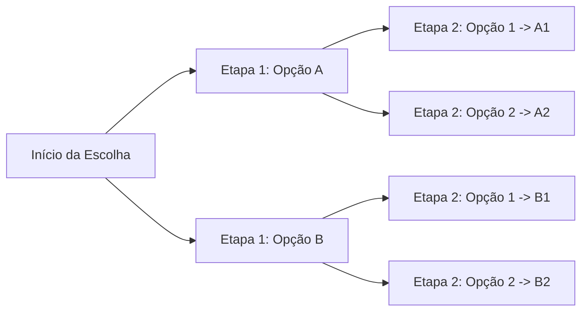
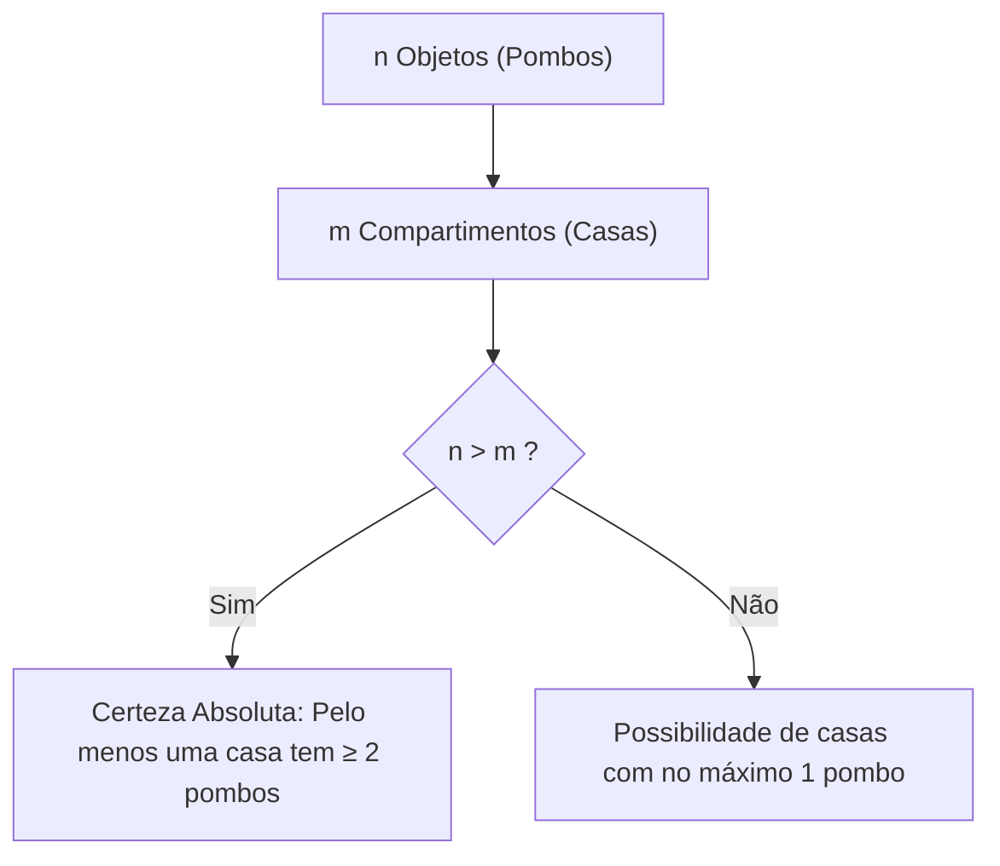
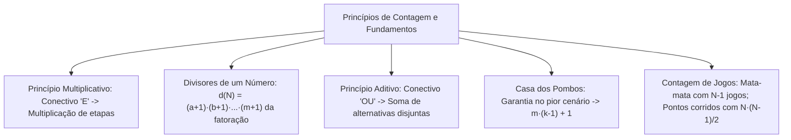

A Análise Combinatória é o ramo da Matemática que desenvolve métodos de contagem indireta. Ela permite quantificar as possibilidades de um conjunto finito sem enumerar cada elemento. Em concursos, essa contagem estrutura o cálculo de probabilidades. Ela viabiliza a análise de riscos, o dimensionamento de escalas e a alocação de equipes. O candidato aprende a resolver problemas complexos com raciocínio lógico e direto.

> [!objetivos]
> - Compreender a lógica do Princípio Fundamental da Contagem (Princípio Multiplicativo) em etapas sucessivas.
> - Aplicar o produto de possibilidades na contagem de divisores positivos de um número natural.
> - Dominar o Princípio Aditivo para alternativas mutuamente excludentes e sua integração prática.
> - Resolver problemas de certezas e garantias mínimas com o Princípio da Casa dos Pombos.
> - Calcular o total de confrontos entre jogadores em torneios eliminatórios e de pontos corridos.

## Introdução à Análise Combinatória e o Princípio Multiplicativo

A contagem combinatorial visa determinar agrupamentos viáveis sob regras específicas. Quando a quantidade de opções é muito pequena, podemos listar cada possibilidade. Por exemplo, com os dígitos 2, 5 e 7, formamos 6 números de três algarismos distintos: 257, 275, 527, 572, 725 e 752. Porém, se tivermos nove dígitos e várias restrições, a listagem manual torna-se impraticável.

Para resolver esse desafio, utilizamos o **Princípio Fundamental da Contagem (PFC)**, também chamado de **Princípio Multiplicativo**:

Se uma ação divide-se em duas etapas sucessivas, onde a primeira etapa tem m possibilidades e a segunda tem n possibilidades, o total de maneiras de realizar a ação completa é dado por:

Total = m · n

Essa relação estende-se a qualquer número finito de etapas. Se uma decisão global envolve k etapas sucessivas com n1, n2, ..., nk opções, multiplicamos todos os valores:

Total de Possibilidades = n1 · n2 · ... · nk

Considere um exemplo clássico do cotidiano. Marta precisa escolher uma vestimenta para trabalhar. Ela possui 3 blusas diferentes e 4 modelos de calça, além de 2 pares de sapatos para calçar. 
- Para a escolha da blusa, Marta dispõe de 3 opções.
- Para a escolha da calça, ela conta com 4 opções.
- Para calçar os pés, dispõe de 2 opções de calçados.

Pelo Princípio Multiplicativo, como Marta deve vestir blusa, calça e calçar sapatos, o total de composições de trajes é:
Total = 3 · 4 · 2 = 24 maneiras distintas.

O conectivo lógico desse princípio é a conjunção **"e"**. Quando dizemos que devemos escolher a primeira etapa **e** a segunda etapa, multiplicamos as possibilidades.

> [!bizu] Conectivo E versus Conectivo OU
> Guarde esta regra essencial:
> - O conectivo **"E"** indica ações sucessivas ou simultâneas obrigatórias: **MULTIPLICAM-SE** as opções.
> - O conectivo **"OU"** indica opções alternativas e mutuamente exclusivas: **SOMAM-SE** as opções.

### Problemas com Restrições Posicionais e Geométricas

Em provas de concurso, as questões impõem condições restritivas. A diretriz fundamental consiste em: **sempre definir primeiro as posições que contêm restrições obrigatórias**.

Vejamos dois contextos frequentes em certames:

1. **Formação de Senhas Numéricas Pares:**
Deseja-se formar senhas de 4 algarismos distintos com os dígitos de 0 a 9, exigindo que a senha seja par.
- Analisamos primeiro a última posição: ela deve conter 0, 2, 4, 6 ou 8 (5 opções).
- A terceira posição recebe qualquer um dos 9 dígitos restantes.
- A segunda posição recebe qualquer um dos 8 dígitos restantes.
- A primeira posição recebe qualquer um dos 7 dígitos restantes.
Total = 7 · 8 · 9 · 5 = 2.520 senhas pares distintas.

2. **Contagem em Figuras Geométricas:**
Considere um polígono regular com n vértices. Cada par de vértices não adjacentes define uma diagonal. Para escolher o primeiro vértice de um segmento, temos n opções. Para escolher o segundo vértice, temos n - 1 opções. Como o segmento unindo o vértice A ao vértice B é idêntico ao unindo B a A, dividimos por 2. Retirando os n lados do polígono, obtemos a fórmula clássica das diagonais: D = n · (n - 3) / 2.

## Aplicações do Princípio Multiplicativo: Contagem de Divisores

Uma aplicação relevante do Princípio Multiplicativo consiste em calcular os divisores inteiros positivos de um número natural N.

Pelo Teorema Fundamental da Aritmética, todo número natural maior que 1 decompõe-se de forma única em fatores primos:

N = (p1^a) · (p2^b) · ... · (pk^m)

Em que p1, p2, ..., pk são primos distintos e a, b, ..., m são expoentes inteiros positivos.

Cada divisor positivo d de N é formado pelos mesmos fatores primos, com expoentes entre zero e o limite de N:
- Para o primo p1, o expoente no divisor pode ser 0, 1, ..., a (a + 1 opções).
- Para o primo p2, o expoente pode ser 0, 1, ..., b (b + 1 opções).
- Para o primo pk, o expoente pode ser 0, 1, ..., m (m + 1 opções).

Pelo Princípio Multiplicativo, o número de divisores positivos d(N) é:

d(N) = (a + 1) · (b + 1) · ... · (m + 1)

| Número Natural | Fatoração em Primos | Cálculo dos Divisores Positivos | Quantidade de Divisores |
|---|---|---|---|
| **72** | 2³ · 3² | (3 + 1) · (2 + 1) = 4 · 3 | **12 divisores** |
| **360** | 2³ · 3² · 5¹ | (3 + 1) · (2 + 1) · (1 + 1) = 4 · 3 · 2 | **24 divisores** |
| **600** | 2³ · 3¹ · 5² | (3 + 1) · (1 + 1) · (2 + 1) = 4 · 2 · 3 | **24 divisores** |
| **1.800** | 2³ · 3² · 5² | (3 + 1) · (2 + 1) · (2 + 1) = 4 · 3 · 3 | **36 divisores** |

> [!resolvido] Cálculo de Divisores Pares e Divisores Múltiplos
> **Problema:** Quantos divisores positivos de 360 são números pares? E quantos são múltiplos de 15?
> 
> **Resolução:**
> Fatorando 360 em primos: 360 = 2³ · 3² · 5¹.
> 1. **Divisores pares:** Para ser par, o fator 2 não pode ter expoente 0. Restam os expoentes 1, 2 ou 3 (3 opções). O primo 3 tem 3 opções (0, 1 ou 2). O primo 5 tem 2 opções (0 ou 1). Total de divisores pares = 3 · 3 · 2 = **18 divisores**.
> 2. **Divisores múltiplos de 15:** Como 15 = 3 · 5, o divisor deve conter pelo menos um 3 e pelo menos um 5. Assim, o fator 3 tem 2 opções (1 ou 2) e o fator 5 tem 1 opção (expoente 1). O fator 2 pode ter qualquer expoente de 0 a 3 (4 opções). Total = 4 · 2 · 1 = **8 divisores múltiplos de 15**.

Essa técnica resolve perguntas indiretas. Por exemplo: "De quantas formas podemos escrever 360 como produto de dois inteiros positivos?". Cada divisor d define o par (d, 360 / d). Há 24 pares ordenados. Se a ordem não importar, dividimos por 2, obtendo 12 maneiras.

## O Princípio Aditivo e a Integração dos Princípios

O **Princípio Aditivo** rege escolhas entre alternativas disjuntas. Elas não podem ocorrer de forma simultânea.

Se o evento A ocorre de m maneiras e o evento B ocorre de n maneiras, e ambos são **mutuamente excludentes**, a ocorrência de A **ou** B dá-se de:

Total = m + n maneiras distintas.

Para k eventos disjuntos com cardinalidades c1, c2, ..., ck, o total é a soma simples:

Total = c1 + c2 + ... + ck

| Conectivo | Relação Lógica | Operação | Exemplo Real |
|---|---|---|---|
| **E** | Etapas sucessivas e concomitantes | **Multiplicação** | Escolher 1 viatura entre 4 **e** 1 rádio entre 5 (4 · 5 = 20) |
| **OU** | Opções disjuntas e alternativas | **Soma** | Estudar idioma: francês (3 turmas) **ou** espanhol (4 turmas) (3 + 4 = 7) |
| **Misto (E com OU)** | Estruturas encadeadas | **Soma de Produtos** | Comida e bebida na lanchonete em opções distintas |

### Integração dos Princípios em Problemas Mistos

Problemas avançados combinam decisões sucessivas e escolhas alternativas. A conduta resolutiva consiste em **dividir o problema em casos disjuntos (somar)**, calculando internamente as etapas de cada caso pelo **princípio multiplicativo**.

Considere dois exemplos práticos:

1. **Escolha de Refeição e Bebida:**
Em uma lanchonete, um militar escolhe um lanche e uma bebida. O cardápio oferece 5 salgados ou 3 doces como opção de comida. Para beber, há 4 sucos naturais ou 2 refrigerantes.
- Opções de comida: 5 + 3 = 8 opções (salgado **ou** doce).
- Opções de bebida: 4 + 2 = 6 opções (suco **ou** refrigerante).
- Escolha combinada (comida **e** bebida): 8 · 6 = 48 combinações de refeição.

2. **Cursos de Idiomas no Batalhão:**
Um soldado deseja matricular-se em cursos de capacitação linguística. O centro de estudos oferece turmas matutinas e vespertinas de francês e espanhol. Há 3 turmas de francês de manhã e 2 à tarde. Para espanhol, há 4 turmas de manhã e 3 à tarde.
- Se o soldado pode cursar apenas um idioma: o total de turmas de francês é 3 + 2 = 5, e de espanhol é 4 + 3 = 7. O total de escolhas é 5 + 7 = 12 turmas alternativas.
- Se ele puder escolher uma turma de francês **e** uma turma de espanhol em turnos opostos: dividimos em dois casos. Caso 1: francês de manhã (3) e espanhol à tarde (3), totalizando 3 · 3 = 9. Caso 2: francês à tarde (2) e espanhol de manhã (4), totalizando 2 · 4 = 8. Somando os casos: 9 + 8 = 17 possibilidades.

## O Princípio da Casa dos Pombos (Teorema de Dirichlet)

O **Princípio da Casa dos Pombos**, formulado por Dirichlet em 1834, expressa uma verdade lógica elementar:

Se n objetos ("pombos") forem distribuídos em m compartimentos ("casas") e n > m, então **pelo menos um compartimento conterá dois ou mais objetos**.

A versão generalizada afirma que, se distribuirmos n objetos em m casas, pelo menos uma casa abrigará no mínimo:

k = teto(n / m) objetos.

Em certames públicos, esse princípio aparece em questões de **garantias mínimas**: "Quantos elementos devemos retirar para ter a certeza absoluta de que determinada repetição ocorra?".

### O Raciocínio do Pior Cenário Possível

Para obter certeza matemática sem depender da sorte, analisamos a situação sob o **pior cenário viável**:
1. Identifique os compartimentos (as características que se deseja repetir).
2. Suponha que a distribuição espalhe os elementos uniformemente, sem fechar a meta pedida.
3. Se queremos garantir k elementos no mesmo compartimento, o pior caso aloca k - 1 elementos em cada uma das m casas.
4. Adicionamos **1 elemento a mais**. Esse elemento extra cairá obrigatoriamente em uma casa já com k - 1 elementos, totalizando k e confirmando a garantia.

A fórmula para garantia mínima é expressa por:

Número Mínimo para Garantir = m · (k - 1) + 1

> [!atencao] Aplicações do Pior Cenário
> Exemplos típicos de concursos:
> - **Dias da semana (m = 7):** Para garantir pelo menos 2 pessoas nascidas no mesmo dia da semana, o pior caso reúne 7 pessoas em dias distintos. A 8ª pessoa garante a repetição: 7 · (2 - 1) + 1 = **8 pessoas**.
> - **Meses do ano (m = 12):** Para garantir pelo menos 3 bombeiros nascidos no mesmo mês, o pior caso aloca 2 em cada mês (24 pessoas). O 25º bombeiro fecha a trinca: 12 · (3 - 1) + 1 = **25 bombeiros**.

> [!pegadinha] Urnas com Bolas e Compartimentos Reais
> Atente para o tipo exato de garantia solicitada no problema.
> Considere uma urna com 10 bolas vermelhas, 7 bolas azuis e 4 bolas verdes:
> - **Garantir duas bolas de mesma cor (qualquer cor):** Temos 3 cores (compartimentos). O pior caso retira uma bola de cada cor (3 bolas). A 4ª bola garante um par da mesma cor: 3 + 1 = **4 bolas**.
> - **Garantir pelo menos uma bola azul:** O pior caso retira todas as bolas de outras cores primeiro (10 vermelhas + 4 verdes = 14 bolas). Somente a 15ª bola será com certeza azul: 14 + 1 = **15 bolas**.
> - **Garantir duas bolas verdes:** O pior caso retira todas as bolas não verdes (10 vermelhas + 7 azuis = 17 bolas). As 2 bolas seguintes serão verdes: 17 + 2 = **19 bolas**.

## Contagem de Jogos em Torneios e Campeonatos

A contagem de confrontos em eventos desportivos organiza-se em dois formatos clássicos:

### Torneios de Eliminação Simples (Mata-Mata)

Em torneios eliminatórios com N jogadores ou equipes, cada partida opõe dois competidores. O perdedor sai e o vencedor avança, até restar o campeão.

Podemos somar as partidas de cada fase sucessiva:
- Na 1ª fase, N participantes realizam N / 2 partidas.
- Na 2ª fase, ocorrem N / 4 partidas, seguindo até a finalíssima.

Entretanto, há um raciocínio dedutivo direto e elegante:
- Para consagrar **1 único campeão**, exatamente **N - 1 jogadores precisam ser eliminados**.
- Como **cada jogo elimina exatamente 1 jogador**, o número total de partidas é igual a N - 1:

Total de Jogos no Mata-Mata = N - 1

Essa regra independe de chaves simétricas. Mesmo com jogadores que aguardam fases adiantadas, o total permanece N - 1.

| Número de Jogadores (N) | Jogos Fase por Fase | Método Direto (N - 1) | Total de Jogos |
|---|---|---|---|
| **4 jogadores** | 2 semifinais + 1 final | 4 - 1 | **3 jogos** |
| **8 jogadores** | 4 quartas + 2 semis + 1 final | 8 - 1 | **7 jogos** |
| **16 jogadores** | 8 oitavas + 4 quartas + 2 semis + 1 final | 16 - 1 | **15 jogos** |
| **32 jogadores** | 16 + 8 + 4 + 2 + 1 | 32 - 1 | **31 jogos** |
| **64 jogadores** | 32 + 16 + 8 + 4 + 2 + 1 | 64 - 1 | **63 jogos** |
| **128 jogadores** | 64 + 32 + 16 + 8 + 4 + 2 + 1 | 128 - 1 | **127 jogos** |

### Torneios de Todos contra Todos (Pontos Corridos)

Em certames de pontos corridos, cada participante enfrenta todos os adversários:
- **Turno Único:** Cada dupla joga apenas uma vez. A ordem dos adversários não cria um novo confronto:

Total de Jogos (Turno Único) = N · (N - 1) / 2

- **Turno e Returno:** Cada equipe joga em casa e fora contra cada adversário. A ordem define o mando:

Total de Jogos (Turno e Returno) = N · (N - 1)

| Formato do Torneio | Fórmula Matemática | Exemplo com 10 Equipes | Propriedade Central |
|---|---|---|---|
| **Eliminação Simples (Mata-Mata)** | N - 1 | 10 - 1 = **9 jogos** | Cada confronto elimina 1 competidor |
| **Pontos Corridos (Turno Único)** | N · (N - 1) / 2 | 10 · 9 / 2 = **45 jogos** | Confronto direto sem repetição |
| **Pontos Corridos (Turno e Returno)** | N · (N - 1) | 10 · 9 = **90 jogos** | Mandos de campo invertidos |

> [!esquema] Síntese de Fórmulas Fundamentais
> Memorização rápida:
> - **Princípio Multiplicativo ("E"):** n1 · n2 · ... · nk em etapas sucessivas.
> - **Princípio Aditivo ("OU"):** c1 + c2 + ... + ck para eventos disjuntos.
> - **Divisores de N = p1^a · p2^b · ...:** d(N) = (a + 1) · (b + 1) · ...
> - **Casa dos Pombos (Pior Cenário):** m · (k - 1) + 1 para garantir k em m casas.
> - **Torneio Eliminatório:** N - 1 confrontos para N jogadores.

## Mapa do capítulo

### Para fixar

- O Princípio Multiplicativo calcula escolhas sucessivas ligadas pelo conectivo "E".
- O Princípio Aditivo soma as opções de eventos mutuamente excludentes ligados pelo conectivo "OU".
- Em problemas com restrições, defina prioritariamente as posições que possuem exigências rígidas.
- A contagem de divisores positivos resulta do produto dos expoentes da fatoração prima acrescidos de 1.
- Para divisores pares ou múltiplos, restrinja os expoentes mínimos dos primos antes de multiplicar.
- O Princípio da Casa dos Pombos garante repetição quando a quantidade de objetos supera a de compartimentos.
- Questões de certezas mínimas resolvem-se estruturando o pior cenário possível e somando uma unidade.
- Para garantir k elementos num mesmo compartimento entre m opções, necessita-se de m · (k - 1) + 1 objetos.
- Em torneios eliminatórios com N jogadores ocorrem exatamente N - 1 partidas para definir o campeão.
- Em campeonatos de turno único entre N participantes realizam-se N · (N - 1) / 2 jogos.
