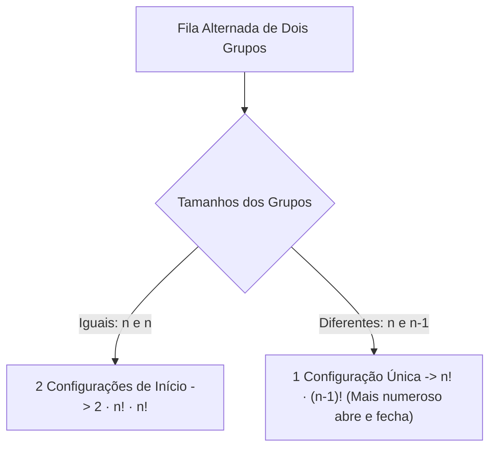
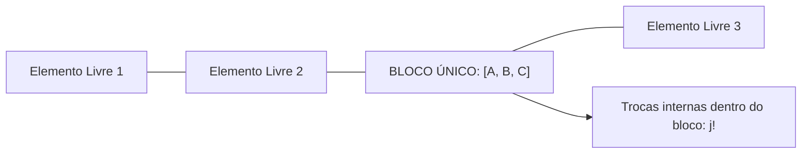
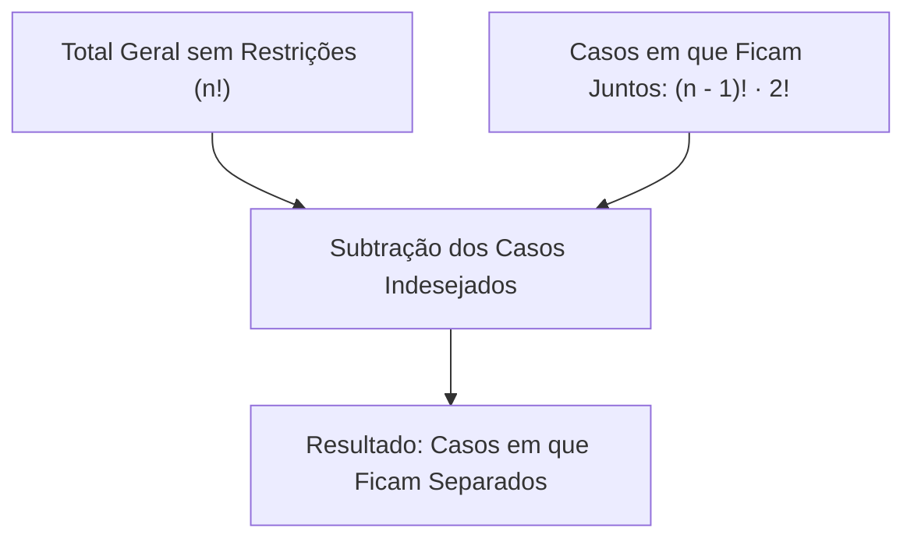
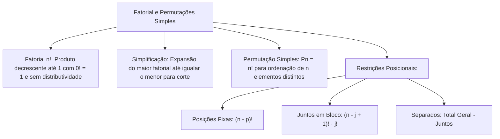

O estudo do fatorial e das permutações simples constitui o núcleo operacional da Análise Combinatória. O fatorial é o operador algébrico que quantifica o produto de inteiros positivos decrescentes, viabilizando a simplificação de fórmulas extensas. Por sua vez, a permutação simples analisa as diferentes maneiras de ordenar elementos distintos em filas, rankings ou anagramas. Em concursos, dominar técnicas de restrição posicional permite calcular escalas de serviço e disposições táticas com precisão analítica.

> [!objetivos]
> - Definir o conceito de fatorial de um número natural e simplificar frações fatoriais.
> - Compreender por que o operador fatorial não é distributivo e aplicar a convenção 0! = 1.
> - Calcular o número de permutações simples de n elementos distintos como Pn = n!.
> - Resolver problemas com elementos fixados ou restritos a determinadas posições.
> - Dominar a técnica do bloco para elementos que devem permanecer juntos e o método indireto para elementos separados.

## Fatorial de um Número Natural

O **fatorial** de um número natural n, indicado pelo símbolo **n!**, é o produto de n por todos os seus antecessores inteiros positivos até o número 1:

n! = n · (n - 1) · (n - 2) · ... · 3 · 2 · 1

Para valores pequenos, a memorização dos resultados acelera a resolução de questões de concurso:
- 0! = 1 (por convenção matemática fundamentada)
- 1! = 1
- 2! = 2 · 1 = 2
- 3! = 3 · 2 · 1 = 6
- 4! = 4 · 3 · 2 · 1 = 24
- 5! = 5 · 4 · 3 · 2 · 1 = 120
- 6! = 6 · 5 · 4 · 3 · 2 · 1 = 720
- 7! = 7 · 6 · 5 · 4 · 3 · 2 · 1 = 5.040
- 8! = 8 · 7 · 6 · 5 · 4 · 3 · 2 · 1 = 40.320

| Número Natural (n) | Expressão Expandida | Valor Numérico de n! |
|---|---|---|
| **0** | Convenção formal | **1** |
| **1** | 1 | **1** |
| **2** | 2 · 1 | **2** |
| **3** | 3 · 2 · 1 | **6** |
| **4** | 4 · 3 · 2 · 1 | **24** |
| **5** | 5 · 4 · 3 · 2 · 1 | **120** |
| **6** | 6 · 5 · 4 · 3 · 2 · 1 | **720** |
| **7** | 7 · 6 · 5 · 4 · 3 · 2 · 1 | **5.040** |
| **8** | 8 · 7 · 6 · 5 · 4 · 3 · 2 · 1 | **40.320** |

### Abertura Recursiva e Simplificação de Frações Fatoriais

O fatorial cresce de forma exponencial. Contudo, podemos reescrever qualquer fatorial interrompendo a multiplicação no termo desejado:
- 7! = 7 · 6! = 7 · 6 · 5!
- 10! = 10 · 9 · 8 · 7!
- n! = n · (n - 1)! = n · (n - 1) · (n - 2)!

Essa propriedade é o recurso central para **simplificar divisões de fatoriais**. Expandimos o fatorial de maior valor até alcançar o fatorial menor do denominador, cancelando os termos equivalentes:

Exemplo 1: 12! / 10! = (12 · 11 · 10!) / 10! = 12 · 11 = 132.

Exemplo 2: (8! · 5!) / (6! · 7!)
Expandimos 8! em função de 7! (8! = 8 · 7!) e 6! em função de 5! (6! = 6 · 5!):
(8 · 7! · 5!) / (6 · 5! · 7!) = 8 / 6 = 4 / 3.

| Expressão Fatorial | Método de Expansão | Cancelamento | Resultado Final |
|---|---|---|---|
| **9! / 7!** | (9 · 8 · 7!) / 7! | Cancela 7! | 9 · 8 = **72** |
| **15! / 13!** | (15 · 14 · 13!) / 13! | Cancela 13! | 15 · 14 = **210** |
| **(10! · 4!) / (8! · 5!)** | (10 · 9 · 8! · 4!) / (8! · 5 · 4!) | Cancela 8! e 4! | (10 · 9) / 5 = **18** |
| **n! / (n - 2)!** | n · (n - 1) · (n - 2)! / (n - 2)! | Cancela (n - 2)! | n · (n - 1) = **n² - n** |

> [!bizu] Simplificação Rápida de Frações com Fatoriais
> Em expressões com produtos de fatoriais no numerador e denominador:
> 1. Localize os pares de números mais próximos entre a parte superior e a inferior.
> 2. Abra o maior fatorial de cada par até igualar o menor.
> 3. Cancele os termos idênticos. O restante reduz-se a uma multiplicação aritmética simples.

### A Não Distributividade do Fatorial e o Caso Especial 0!

O ponto de exclamação afeta exclusivamente o número ou a expressão imediatamente anterior a ele. A presença ou ausência de parênteses altera completamente o resultado numérico. O operador fatorial **não possui propriedade distributiva** em relação a nenhuma das quatro operações fundamentais:

| Expressão | Ordem de Resolução | Cálculo Numérico | Resultado |
|---|---|---|---|
| **6! / 3!** | Calcula fatoriais, depois divide | 720 / 6 | **120** |
| **(6 / 3)!** | Divide primeiro, depois aplica o fatorial | (2)! = 2 · 1 | **2** |
| **2 · 4!** | Calcula o fatorial de 4, depois multiplica por 2 | 2 · 24 | **48** |
| **(2 · 4)!** | Multiplica 2 por 4, depois aplica o fatorial | (8)! | **40.320** |
| **2 + 4!** | Calcula o fatorial de 4, depois soma 2 | 2 + 24 | **26** |
| **(2 + 4)!** | Soma 2 com 4, depois aplica o fatorial | (6)! | **720** |
| **8 - 3!** | Calcula o fatorial de 3, depois subtrai de 8 | 8 - 6 | **2** |
| **(8 - 3)!** | Subtrai 3 de 8, depois aplica o fatorial | (5)! | **120** |

> [!atencao] A Não Distributividade do Sinal de Fatorial
> Guarde com rigor:
> - (a + b)! é diferente de a! + b!
> - (a - b)! é diferente de a! - b!
> - (a · b)! é diferente de a! · b!
> - (a / b)! é diferente de a! / b!

A convenção **0! = 1** decorre da relação de recorrência fundamental n! = (n + 1)! / (n + 1). Fazendo n = 0, obtemos 0! = 1! / 1 = 1. Essa definição mantém a consistência da fórmula geral das combinações e arranjos quando escolhemos todos os elementos de um conjunto.

## Permutação Simples

Permutar significa trocar a ordem ou a posição dos elementos. A **permutação simples** consiste na ordenação linear de n elementos todos **distintos** entre si.

Podemos deduzir o total de permutações através do Princípio Fundamental da Contagem:
- Para a 1ª posição da fila, podemos alocar qualquer um dos n elementos disponíveis.
- Para a 2ª posição, restam n - 1 elementos.
- Para a 3ª posição, restam n - 2 elementos.
- Seguindo sucessivamente até a última posição, resta apenas 1 elemento.

Como a escolha das posições é sequencial e obrigatória, multiplicamos as possibilidades:

Pn = n · (n - 1) · (n - 2) · ... · 2 · 1 = n!

Portanto, o número de permutações simples de n objetos distintos é dado por:

Pn = n!

As permutações simples resolvem problemas clássicos de contagem:
- Disposição de crianças em fila indiana escolar. Uma fila com 8 crianças admite P8 = 8! = 40.320 modos de organização. Se tivermos 9 crianças, o total eleva-se para 9! = 362.880 ordenações.
- Classificação de candidatos em concurso. Em uma seleção para 5 vagas em cidades diferentes, se Beto for o primeiro colocado, sua lotação define a prioridade de escolha.
- Sinais de comunicação marítima. Um navio da capitania utiliza bandeiras coloridas hasteadas em um mastro vertical. A cada nova ordem das bandeiras corresponde uma mensagem cifrada diferente para a frota. Se o mastro dispõe de 8 posições e na oitava posição for hasteada uma bandeira sinalizadora específica, os demais sinais ordenam-se nas vagas restantes.
- Anagramas de palavras formadas por letras todas distintas. A palavra BRASIL possui 6 letras distintas, gerando P6 = 6! = 720 anagramas.

## Permutação Simples com Restrições

Na maior parte das questões de concurso, os elementos não circulam de forma totalmente livre. O examinador impõe exigências que restringem as posições relativas. Essas restrições dividem-se em duas categorias:
1. Elementos destinados a posições específicas.
2. Elementos que devem permanecer juntos ou separados.

### Elementos Destinados a Posições Determinadas

Analisemos os dois desdobramentos dessa restrição:

### Elementos Fixados em Lugares Determinados

Se p dos n elementos já possuem posições predeterminadas no enunciado, esses elementos saem do cálculo ativo. Basta permutar os n - p elementos restantes nos n - p lugares que sobraram:

Pn-p = (n - p)!

Considere a formação de números de 7 algarismos distintos com os dígitos de 1 a 7, exigindo que o número comece pelo algarismo 1 e termine pelo algarismo 7.
- A primeira posição está travada no algarismo 1.
- A última posição está travada no algarismo 7.
- Restam 5 algarismos para ordenar nas 5 posições centrais: P5 = 5! = 120 números.

Outro caso prático: considere 5 candidatos aprovados que serão alocados em 5 postos de atendimento. Se Beto foi o primeiro colocado e sua lotação já foi fixada no posto da capital, restam 4 candidatos para 4 postos: P4 = 4! = 24 maneiras. Em um navio de resgate com 8 mastros, se a bandeira de emergência já foi içada na oitava posição, as 7 bandeiras restantes permutam em 7! = 5.040 ordens visuais.

### Elementos Reservados a um Conjunto de Posições

Se p elementos devem ocupar um grupo de p posições reservadas, mas podem trocar de lugar livremente entre si, calculamos duas permutações e multiplicamos os resultados:

Total = (n - p)! · p!

Considere 8 militares em fila (6 soldados e 2 oficiais). Os 2 oficiais devem obrigatoriamente ocupar as extremidades da fila (a primeira e a última posição), em qualquer ordem.
- Os 2 oficiais permutam entre si nas 2 pontas: P2 = 2! = 2 maneiras.
- Os 6 soldados permutam nas 6 posições intermediárias: P6 = 6! = 720 maneiras.
- Pelo princípio multiplicativo: Total = 2! · 6! = 2 · 720 = 1.440 filas.

### Grupos em Posições Alternadas

Quando dois grupos de elementos devem alternar posições na fila (como meninos e meninas, ou números pares e ímpares), a quantidade de elementos de cada grupo determina a estrutura da fila:

1. **Quantidades Diferentes (n e n - 1):**
Há apenas uma configuração espacial viável. O grupo mais numeroso deve obrigatoriamente ocupar o início e o fim da fila. Considere uma turma escolar com 5 meninas e 4 meninos enfileirados de modo estritamente alternado: Menina, Menino, Menina, Menino, Menina, Menino, Menina, Menino, Menina.
- As meninas permutam em suas 5 posições: P5 = 5! = 120.
- Os meninos permutam em suas 4 posições: P4 = 4! = 24.
- Total = 120 · 24 = 2.880 filas.

2. **Quantidades Iguais (n e n):**
Há duas configurações espaciais possíveis. A fila pode começar com um menino ou com uma menina. Portanto, multiplicamos por 2:
Total = 2 · n! · n!.
Com 4 meninos e 4 meninas alternados, temos 2 · 4! · 4! = 2 · 24 · 24 = 1.152 filas.

### Elementos que Devem Ficar Juntos (Técnica do Bloco)

Quando o enunciado exige que determinados elementos fiquem juntos (lado a lado), aplicamos a clássica **técnica do bloco** (ou método da amarração):
1. Reunimos os j elementos que devem ficar juntos em um único bloco fechado.
2. Tratamos esse bloco como se fosse um único elemento individual.
3. Se o conjunto original possuía n elementos, agora temos (n - j) elementos livres mais 1 bloco, totalizando (n - j + 1) elementos a permutar.
4. Calculamos a permutação desses (n - j + 1) elementos: (n - j + 1)!.
5. Verificamos se a ordem dos elementos dentro do bloco pode variar.

Distinguem-se dois casos fundamentais:

1. **Elementos Juntos em Ordem Determinada:**
Se a sequência dos elementos dentro do bloco for rígida e fixa (por exemplo, "os animais leão, camelo e elefante devem caminhar juntos nessa exata sequência"), não há trocas internas.
Considere uma fila de 10 animais em um zoológico. Se o leão, o camelo e o elefante devem ficar juntos nessa ordem exata:
- O trio [leão, camelo, elefante] vira 1 bloco de ordem fixa.
- Sobram 7 animais livres mais 1 bloco, totalizando 8 objetos a ordenar.
- Total = 8! = 40.320 modos. Note que 8! equivale a 8 · 7!, e não a 7 · 7!.

2. **Elementos Juntos em Qualquer Ordem:**
Se os animais puderem trocar de posição livremente entre si dentro do bloco:
- Calculamos a permutação dos 8 objetos: 8! = 40.320.
- Multiplicamos pelas permutações internas do trio (leão, camelo, elefante): P3 = 3! = 6.
- Total = 8! · 3! = 40.320 · 6 = 241.920 ordenações.

> [!resolvido] Anagramas com Letras Juntas em Bloco
> **Problema:** Quantos são os anagramas da palavra **MISTRO** (6 letras distintas M, I, S, T, R, O) em que as letras M, I e S aparecem sempre juntas?
> 
> **Resolução:**
> Analisando as letras M, I, S, T, R, O:
> 1. Formamos o bloco com as letras [M, I, S].
> 2. Temos as letras livres T, R, O (3 letras) mais 1 bloco, totalizando 4 elementos a ordenar.
> 3. Permutação dos 4 elementos: P4 = 4! = 24.
> 4. As 3 letras dentro do bloco permutam livremente entre si: P3 = 3! = 6.
> 5. Total de anagramas = 4! · 3! = 24 · 6 = **144 anagramas**.

> [!pegadinha] Trocas Internas no Bloco: Ordem Fixa versus Ordem Livre
> Uma falha recorrente em provas consiste em esquecer de multiplicar pelo fatorial das trocas internas do bloco.
> - Se o enunciado diz "as letras A e B juntas": permuta o bloco com os demais elementos **e multiplica por 2!**.
> - Se o enunciado diz "as letras A e B juntas nessa ordem": permuta o bloco com os demais elementos **sem multiplicar por 2!** (a ordem interna já está congelada).

### Elementos que Não Podem Ficar Juntos (Método Indireto)

Quando a exigência for que determinados elementos **não fiquem juntos**, o método direto pode tornar-se trabalhoso. A abordagem analítica mais elegante consiste no **método indireto (ou complementar)**:

Total com Elementos Separados = Total Geral Sem Restrições - Total com Elementos Juntos

Essa identidade aplica-se perfeitamente quando a restrição envolve dois elementos (por exemplo, "Beto e Carlos não podem ficar juntos na fila"):
1. Calculamos o total irrestrito de permutações: Pn = n!.
2. Calculamos o total de casos em que os dois elementos ficam juntos pelo método do bloco: (n - 1)! · 2!.
3. Subtraímos os casos indesejados do total global: n! - [ (n - 1)! · 2! ].

Exemplo prático: Em uma solenidade de formatura do CFO-BM, 6 cadetes serão posicionados em fila. Dois cadetes que tiveram desentendimento não podem ficar lado a lado.
- Total geral de filas sem restrições: P6 = 6! = 720 filas.
- Filas em que os dois cadetes ficam juntos: tratamos a dupla como 1 bloco. Temos 5 elementos (4 cadetes + 1 bloco) que permutam entre si (5! = 120), com 2! trocas internas na dupla. Total juntos = 120 · 2 = 240 filas.
- Filas com os cadetes separados: 720 - 240 = **480 filas**.

| Situação Combinatorial | Expressão Matemática | Exemplo com n = 6 |
|---|---|---|
| **Sem restrições (Permutação Livre)** | n! | 6! = **720** |
| **p elementos em posições fixas** | (n - p)! | Se p = 2: 4! = **24** |
| **p elementos reservados trocando entre si** | (n - p)! · p! | Se p = 2: 4! · 2! = **48** |
| **j elementos juntos em ordem fixa** | (n - j + 1)! | Se j = 2: 5! = **120** |
| **j elementos juntos em qualquer ordem** | (n - j + 1)! · j! | Se j = 2: 5! · 2! = **240** |
| **Dois elementos separados (Método Indireto)** | n! - [ (n - 1)! · 2! ] | 720 - 240 = **480** |

> [!esquema] Síntese dos Casos de Restrição Posicional
> Memorize para a prova:
> - **Elementos juntos:** Amarre no bloco e trate como 1 objeto. Lembre-se de multiplicar pelas trocas internas do bloco.
> - **Elementos separados:** Calcule o total geral e subtraia os casos em que eles ficam juntos.
> - **Posições fixas:** Retire os elementos fixados do cálculo e permute apenas as posições e elementos que restaram.

## Mapa do capítulo

### Para fixar

- O fatorial n! representa o produto dos inteiros positivos consecutivos de n até 1.
- Por convenção matemática formal, 0! = 1 e 1! = 1.
- Para simplificar frações com fatoriais, abra o maior termo até igualar o menor e cancele os fatores comuns.
- O fatorial não é distributivo em relação à adição, subtração, multiplicação ou divisão.
- A permutação simples de n objetos distintos calcula-se por Pn = n!.
- Em anagramas de palavras sem letras repetidas, o número de arranjos é a permutação do total de letras.
- Se p elementos têm lugares pré-fixados, eles saem do cálculo e permutam-se apenas os n - p restantes.
- Para elementos que devem ficar juntos, amarre-os em um bloco único e permute o bloco com os outros elementos.
- Ao usar o método do bloco com ordem livre, multiplique sempre pelo fatorial dos elementos internos.
- Para calcular permutações com dois elementos separados, subtraia os casos em que ficam juntos do total geral.
