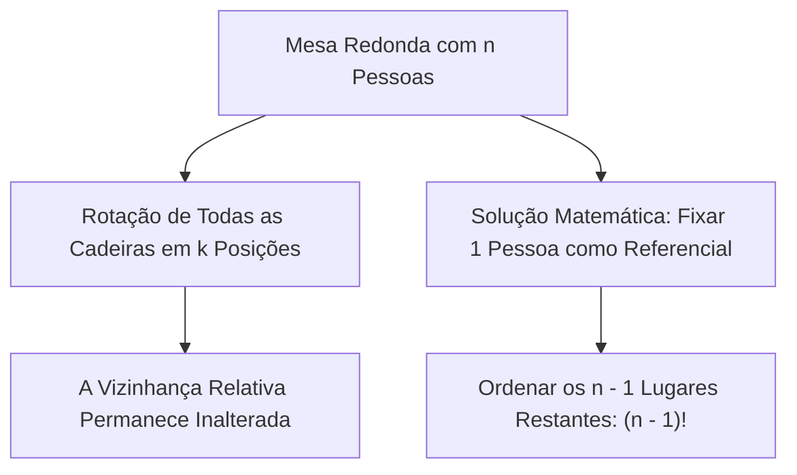
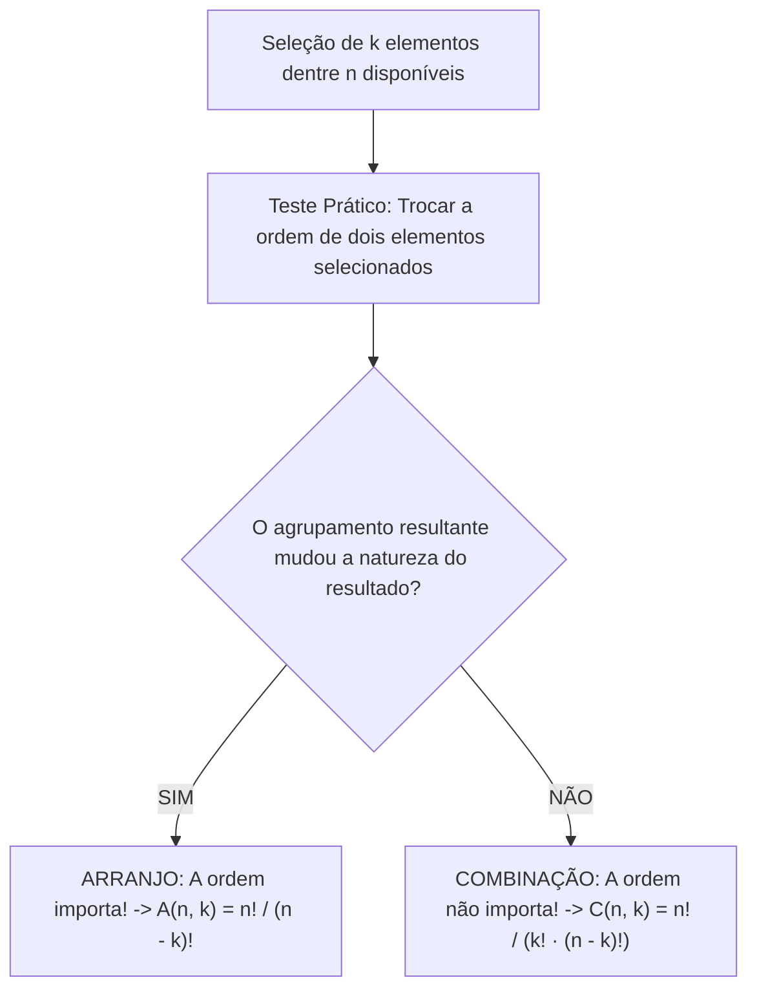
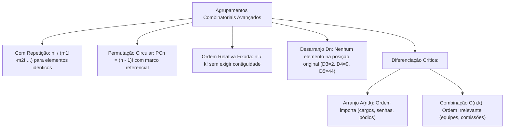

A teoria das permutações expande-se quando os elementos apresentam repetições, restrições geométricas em círculo ou exigências de deslocamento total sem pontos fixos. Além disso, a tomada de decisão combinatorial exige distinguir com precisão se a ordem dos elementos selecionados gera um novo agrupamento ou se representa o mesmo conjunto. Em concursos públicos militares e policiais, o domínio de permutações com repetição, desarranjos, arranjos e combinações viabiliza a solução ágil de problemas de inteligência, criptografia e alocação de postos operacionais.

> [!objetivos]
> - Calcular o número de permutações com elementos repetidos eliminando supercontagens.
> - Aplicar a fórmula da permutação circular fixando referenciais relativos.
> - Resolver problemas de ordenação relativa prefixada sem exigir contiguidade física.
> - Dominar o cálculo de permutações caóticas (desarranjos) pela fórmula de inclusão-exclusão.
> - Diferenciar arranjos de combinações através do teste prático da inversão de posições.

## Permutação com Repetição

Na permutação simples, todos os n elementos ordenados são rigorosamente distintos. Quando um ou mais elementos repetem-se no conjunto, a troca de posição entre dois termos idênticos não produz uma nova configuração perceptível.

Se calculássemos a permutação como se todos os elementos fossem diferentes (n!), estaríamos cometendo uma **supercontagem**. Para corrigir esse excesso, dividimos n! pelo número de permutações internas de cada bloco de elementos iguais.

Se em um conjunto de n elementos temos elementos repetidos com frequências m1, m2, ..., mk, o número de permutações distintas é dado por:

Pn(m1, m2, ..., mk) = n! / (m1! · m2! · ... · mk!)

Elementos que aparecem uma única vez possuem m = 1, e como 1! = 1, eles não alteram o denominador da fração.

| Palavra ou Código | Total de Letras (n) | Frequência de Repetições | Cálculo Combinatorial | Total de Anagramas |
|---|---|---|---|---|
| **BANANA** | 6 | A (3 vezes), N (2 vezes), B (1 vez) | 6! / (3! · 2!) = 720 / (6 · 2) | **60 anagramas** |
| **ARARA** | 5 | A (3 vezes), R (2 vezes) | 5! / (3! · 2!) = 120 / (6 · 2) | **10 anagramas** |
| **BOMBEIRO** | 8 | B (2 vezes), O (2 vezes) | 8! / (2! · 2!) = 40.320 / 4 | **10.080 anagramas** |
| **MILITAR** | 7 | I (2 vezes) | 7! / 2! = 5.040 / 2 | **2.520 anagramas** |
| **BATALHAO** | 8 | A (3 vezes) | 8! / 3! = 40.320 / 6 | **6.720 anagramas** |

> [!bizu] Como Evitar a Supercontagem em Permutações com Repetição
> Ao calcular anagramas de palavras:
> 1. Conte o número total de caracteres (n).
> 2. Liste as letras que se repetem e conte suas respectivas frequências (m1, m2, etc.).
> 3. Monte a fração com n! no numerador e o produto dos fatoriais m1! · m2! no denominador.
> 4. Expanda o maior fatorial até o maior termo do denominador para simplificar o cálculo.

### Aplicações de Trajetórias em Malhas Quadriculadas

Uma aplicação clássica de permutações com repetição envolve percursos em redes urbanas e coordenadas cartesianas. Considere uma viatura de resgate que precisa deslocar-se do ponto (0, 0) até o ponto (5, 3) sobre uma malha viária quadriculada. A viatura só pode movimentar-se para a direita (D) ou para cima (C):
- Para atingir o destino, são necessários exatamente 5 passos para a direita e 3 passos para cima.
- Qualquer trajeto viável é uma sequência de 8 movimentos contendo 5 letras D e 3 letras C (por exemplo, D-D-D-D-D-C-C-C ou D-C-D-C-D-C-D-D).
- O número de trajetos distintos é a permutação de 8 elementos com repetição de 5 e 3:
Total = P8(5, 3) = 8! / (5! · 3!) = (8 · 7 · 6 · 5!) / (5! · 6) = 56 trajetos distintos.

## Permutação Circular

A **permutação circular** estuda as disposições de n elementos distintos ao redor de um círculo fechado (como convidados ao redor de uma mesa redonda, crianças em roda de ciranda ou contas em um colar).

Em uma linha reta, existem posições absolutas bem definidas (primeiro, segundo, extremidade esquerda, extremidade direita). Em um círculo, não existem posições absolutas. Girar todos os ocupantes da mesa no mesmo sentido e pelo mesmo número de cadeiras não altera as posições relativas entre eles. Cada arranjo circular pode ser rotacionado n vezes sem gerar uma ordem inédita.

Para eliminar as repetições rotacionais, **fixamos um dos elementos em qualquer cadeira** para que sirva de marco referencial. Uma vez travado esse elemento guia, as n - 1 posições restantes tornam-se distinguíveis e podem ser ordenadas como uma permutação linear simples:

PCn = (n - 1)!

Exemplo direto: De quantas maneiras 6 oficiais de bombeiros podem sentar-se ao redor de uma mesa de conferência circular?
Aplicamos a fórmula da permutação circular: PC6 = (6 - 1)! = 5! = 120 maneiras distintas.

### Permutação Circular com Restrições e Posições Relativas

Quando há condições adicionais em torno de uma mesa redonda, o problema deve ser resolvido em **etapas sucessivas**:

1. **Grupos Alternados em Mesa Redonda:**
Considere 3 meninos e 3 meninas que devem sentar-se em uma mesa redonda de 6 lugares de forma estritamente alternada.
- Sentamos primeiro o grupo dos 3 meninos em disposição circular: PC3 = (3 - 1)! = 2! = 2 maneiras.
- Os 3 meninos assentados definem 3 vãos intermediários entre si. Como cada vão agora fica entre dois meninos específicos, essas posições tornam-se perfeitamente distinguíveis.
- As 3 meninas são ordenadas nesses 3 vãos por uma permutação linear simples: P3 = 3! = 6 maneiras.
- Pelo Princípio Multiplicativo: Total = PC3 · P3 = 2 · 6 = 12 possibilidades distintas.

2. **Serviço de Carnes e Pratos nos Vãos entre Cadeiras:**
Considere 5 amigos (Beto, Caio, Cleber, Benedito e Álvaro) sentados ao redor de uma mesa redonda e 5 porções distintas de carnes servidas nos vãos entre os convidados.
- Os 5 amigos organizam-se na mesa: PC5 = (5 - 1)! = 4! = 24 modos.
- Uma vez posicionados os amigos Beto, Caio, Cleber, Benedito e Álvaro, cada vão entre dois amigos ganha identidade única. As 5 opções de carnes permutam linearmente nos 5 vãos: P5 = 5! = 120 modos.
- Total = 24 · 120 = 2.880 possibilidades completas.

| Configuração Circular | Procedimento de Cálculo | Expressão Algébrica | Exemplo Numérico |
|---|---|---|---|
| **n elementos livres** | Fixa 1 elemento e permuta o restante | (n - 1)! | n = 6: 5! = **120** |
| **Dois grupos de n alternados** | Fixa o grupo 1 em círculo; grupo 2 linear | (n - 1)! · n! | n = 3: 2! · 3! = **12** |
| **Dois elementos juntos em círculo** | Trata a dupla como 1 bloco em círculo | (n - 2)! · 2! | n = 6: 4! · 2! = **48** |
| **Dois elementos separados em círculo** | Subtrai os casos juntos do total circular | (n - 1)! - [ (n - 2)! · 2! ] | n = 6: 120 - 48 = **72** |

> [!atencao] Fixação de Referencial na Permutação Circular
> Nunca aplique (n - 1)! mais de uma vez no mesmo problema. O marco referencial é fixado apenas na primeira etapa da acomodação circular. Uma vez colocado o primeiro grupo, o círculo já possui referências geográficas internas, e os elementos seguintes devem ser acomodados por permutação simples.

## Outros Tipos de Permutação: Ordem Prefixada e Condições Especiais

Em certas questões de concurso, determinados elementos devem aparecer em uma **ordem relativa pré-fixada**, embora não precisem estar contíguos (juntos) na fila. Outros tipos de permutação envolvem elementos com precedência hierárquica ou restrições direcionais.

Considere n elementos distintos onde um subconjunto de k elementos deve figurar em uma ordem predeterminada (por exemplo, "o elemento A deve aparecer antes do elemento B, que deve aparecer antes do elemento C").

O raciocínio matemático baseia-se na eliminação de simetrias:
- Na permutação simples de n elementos, existem k! maneiras de ordenar os k elementos escolhidos entre si.
- Dentre todas essas k! ordenações relativas possíveis, **apenas 1 única ordenação atende à exigência do enunciado**.
- Como todas as ordens relativas são equiprováveis por simetria combinatorial, dividimos o total irrestrito por k!:

Total = n! / k!

Exemplo: De quantas maneiras podemos formar uma fila com 6 pessoas (A, B, C, D, E, F) de modo que a pessoa A fique sempre à frente da pessoa B?
O total irrestrito de filas é 6! = 720. Em exatamente metade dessas filas A aparece antes de B, e na outra metade B aparece antes de A. Portanto:
Total = 6! / 2! = 720 / 2 = 360 possibilidades de filas.

Se a condição exigisse que A ficasse antes de B e B antes de C (ordem A-B-C fixada entre os três):
Total = 6! / 3! = 720 / 6 = 120 possibilidades.

Se houver **dois grupos independentes com ordens relativas fixadas** (k1 elementos em uma ordem e k2 elementos em outra), dividimos pelo produto dos dois fatoriais:

Total = n! / (k1! · k2!)

Exemplo com anagramas: Quantos são os anagramas da palavra **LIVROS** (6 letras distintas) em que as letras L, I, V aparecem nessa ordem (não necessariamente juntas) e as letras O, S aparecem nessa ordem?
Total = 6! / (3! · 2!) = 720 / (6 · 2) = 60 anagramas.

> [!pegadinha] Ordem Relativa versus Proximidade Física Imediata
> Não confunda as seguintes formulações textuais:
> - **"A aparece antes de B":** Ordem relativa. Eles podem ter vários elementos intermediários entre si. Divide-se o total por 2! (n! / 2!).
> - **"A e B aparecem juntos nessa ordem":** Bloco rígido contíguo [A, B]. Eles formam uma unidade inseparável. O cálculo é feito por (n - 1)!.

## Permutação Caótica ou Desarranjo

Uma **permutação caótica** (também denominada **desarranjo** ou desordem estrita) é uma permutação de elementos na qual **nenhum elemento ocupa a sua posição original de partida**. A quantidade de desarranjos de n elementos é representada pelo símbolo **Dn** (ou !n).

Esse modelo aplica-se a problemas típicos de concursos onde cada pessoa deve receber um objeto que não seja o seu, ou quando em uma auditoria cada servidor analisa o processo de outro colega sem que nenhum funcionário analise o processo de um parente ou o próprio relatório. O objetivo é que ninguém permaneça no seu lugar de origem.

Para deduzir a fórmula de Dn, utiliza-se o Princípio da Inclusão-Exclusão. Subtraem-se as permutações que deixam pelo menos um elemento fixo, somam-se as que fixam dois, e assim sucessivamente:

Dn = n! · [ 1/2! - 1/3! + 1/4! - 1/5! + ... + (-1)^n / n! ]

Os termos 1/0! e -1/1! anulam-se mutuamente (1 - 1 = 0), restando a série alternada a partir de 1/2!. Para cada valor de n, o último termo tem sinal positivo se n for par, e negativo se n for ímpar.

| Número de Elementos (n) | Expressão Expandida de Cálculo | Valor Numérico de Dn | Fração Decimal em Relação a n! |
|---|---|---|---|
| **n = 1** | Conjunto com 1 elemento não admite desarranjo | **D1 = 0** | 0% |
| **n = 2** | 2! · (1/2) | **D2 = 1** | 50% |
| **n = 3** | 3! · (1/2 - 1/6) = 3 - 1 | **D3 = 2** | 33,3% |
| **n = 4** | 4! · (1/2 - 1/6 + 1/24) = 12 - 4 + 1 | **D4 = 9** | 37,5% |
| **n = 5** | 5! · (1/2 - 1/6 + 1/24 - 1/120) = 60 - 20 + 5 - 1 | **D5 = 44** | 36,7% |
| **n = 6** | 6! · (1/2 - 1/6 + 1/24 - 1/120 + 1/720) = 360 - 120 + 30 - 6 + 1 | **D6 = 265** | 36,8% |

Para fins práticos em provas, a memorização da sequência **D2 = 1, D3 = 2, D4 = 9 e D5 = 44** garante resolução imediata sem necessidade de calcular a soma de frações.

> [!resolvido] Desarranjo em Troca de Presentes de Amigo Secreto
> **Problema:** Quatro bombeiros militares (Alves, Bruno, Costa e Dias) participam de uma confraternização de fim de ano com brincadeira de amigo secreto. De quantas maneiras os bilhetes com os nomes podem ser sorteados de modo que **nenhum participante tire a si mesmo**?
> 
> **Resolução:**
> O enunciado exige que nenhum participante fique com o seu próprio nome. Trata-se exatamente da definição de permutação caótica de 4 elementos (D4).
> Aplicando os valores notáveis:
> D4 = 9 maneiras distintas.
> 
> Se fossem 5 participantes, a resposta seria D5 = 44 maneiras.

## Arranjo e Combinação: A Decisão Fundamental da Ordem

Ao selecionar um subconjunto de k elementos a partir de um conjunto maior de n elementos disponíveis, deparamo-nos com o dilema clássico da combinatória: **a ordem da escolha importa ou não importa?**

### O Teste Prático da Ordem

Para classificar com segurança qualquer enunciado:
1. Monte mentalmente um exemplo concreto de seleção (por exemplo, selecionar os elementos A e B).
2. Inverta a ordem da seleção (selecionar B e A).
3. Avalie se essa inversão gerou uma nova situação prática:
   - Se a situação mudou (como em pódios de 1º e 2º lugares, senhas alfanuméricas ou cargos de presidente e vice-presidente), temos um **ARRANJO**.
   - Se a situação permanece rigorosamente idêntica (como em uma comissão parlamentar, equipe de ronda, sorteio de prêmios iguais ou escolha de ingredientes para uma pizza), temos uma **COMBINAÇÃO**.

### Arranjo Simples (Sem Repetição)

No **arranjo simples**, escolhemos k elementos ordenados entre n elementos distintos, sem reposição. Pelo Princípio Multiplicativo, temos n opções para o primeiro termo, n - 1 para o segundo, descendo até k fatores:

A(n, k) = n · (n - 1) · (n - 2) · ... · (n - k + 1)

Multiplicando e dividindo pelo fatorial dos termos faltantes (n - k)!, formalizamos a expressão algébrica fechada:

A(n, k) = n! / (n - k)! com k ≤ n

Exemplo: Em uma repartição pública com 10 servidores qualificados, deseja-se designar 1 supervisor, 1 coordenador e 1 técnico. Como os cargos são distintos, a mesma trinca de pessoas alocada em funções diferentes gera resultados e atribuições práticas totalmente diferentes. Trata-se de um arranjo simples:
A(10, 3) = 10! / (10 - 3)! = 10! / 7! = 10 · 9 · 8 = 720 possibilidades de equipes diretivas. Se fossem 8 atletas disputando os três primeiros lugares de um pódio (ouro, prata e bronze), teríamos A(8, 3) = 8 · 7 · 6 = 336 possibilidades.

### Arranjo com Repetição

No **arranjo com repetição** (ou produto cartesiano irrestrito), o mesmo elemento pode ser selecionado múltiplas vezes ao longo das k escolhas. Como o número de opções permanece constante em todas as etapas, aplicamos a exponenciação direta:

AR(n, k) = n^k

Exemplo: Quantas senhas de 4 dígitos podem ser formadas com os algarismos de 0 a 9, permitindo repetições de dígitos?
Temos 10 opções para cada uma das 4 posições: 10 · 10 · 10 · 10 = 10⁴ = 10.000 senhas.

Se a senha exigir 2 letras minúsculas distintas (entre 26) seguidas de 3 dígitos quaisquer (0 a 9 permitindo repetição), multiplicamos os arranjos de cada bloco:
Total = (26 · 25) · (10³) = 650 · 1.000 = 650.000 senhas.

### Combinação Simples

Na **combinação simples**, a ordem dos k elementos escolhidos é irrelevante. Como cada grupo de k elementos admite k! permutações internas que correspondem ao mesmo conjunto, eliminamos a supercontagem dividindo o arranjo por k!:

C(n, k) = A(n, k) / k! = n! / [ k! · (n - k)! ]

Exemplo: De quantas formas um pelotão de 10 bombeiros pode escolher uma equipe de 3 militares para realizar um resgate em altura?
Como os 3 militares desempenharão o resgate sem distinção hierárquica de função, a ordem não importa:
C(10, 3) = 10! / [ 3! · 7! ] = (10 · 9 · 8) / (3 · 2 · 1) = 720 / 6 = 120 equipes.

| Tipo de Agrupamento | A Ordem Importa? | Admite Repetição? | Fórmula Algébrica | Exemplo Clássico |
|---|---|---|---|---|
| **Permutação Simples** | Sim (todos os elementos) | Não | Pn = n! | Filas e anagramas sem repetição |
| **Permutação com Repetição** | Sim (todos os elementos) | Sim | n! / (m1! · m2! · ...) | Anagramas de BANANA ou ARARA |
| **Permutação Circular** | Sim (posições relativas) | Não | PCn = (n - 1)! | Mesas redondas e rodas de ciranda |
| **Desarranjo (Caótica)** | Sim (nenhum na origem) | Não | Dn = n! · ∑ (-1)^i / i! | Amigo secreto sem tirar a si mesmo |
| **Arranjo Simples** | Sim (parte dos elementos) | Não | A(n, k) = n! / (n - k)! | Pódio (1º, 2º e 3º) ou cargos distintos |
| **Arranjo com Repetição** | Sim (parte dos elementos) | Sim | AR(n, k) = n^k | Senhas e placas com repetição livre |
| **Combinação Simples** | **Não (subconjuntos)** | Não | C(n, k) = n! / [k! · (n - k)!] | Comissões, equipes e jogos de loteria |

> [!esquema] Síntese Operacional: Arranjo ou Combinação?
> Ao ler uma questão de seleção de grupos:
> - Pergunte: "Se eu trocar quem veio primeiro por quem veio depois, formei um resultado novo?".
> - Se a resposta for **SIM**, resolva por **ARRANJO**: multiplique as opções decrescentes sem dividir.
> - Se a resposta for **NÃO**, resolva por **COMBINAÇÃO**: calcule o produto decrescente e **divida pelo fatorial do tamanho do grupo**.

## Mapa do capítulo

### Para fixar

- Na permutação com repetição, divide-se o fatorial total pelo fatorial de cada quantidade de elementos repetidos.
- A permutação circular PCn = (n - 1)! decorre da fixação de um elemento referencial para eliminar simetrias de rotação.
- Em problemas circulares com grupos alternados, posicione o primeiro grupo em círculo e os demais por permutação simples.
- Quando k elementos devem aparecer em uma ordem prefixada sem necessidade de estarem contíguos, calcula-se n! / k!.
- Em uma permutação caótica (desarranjo), nenhum elemento pode ocupar sua posição original de partida.
- Os valores fundamentais de desarranjos para memorizar em provas são D2 = 1, D3 = 2, D4 = 9 e D5 = 44.
- No arranjo simples a ordem dos elementos selecionados importa, gerando agrupamentos distintos com os mesmos itens.
- Na combinação simples a ordem dos elementos é irrelevante, correspondendo ao arranjo dividido pelo fatorial da quantidade escolhida.
- O teste decisivo consiste em inverter a ordem de dois elementos: se o resultado prático mudar, é arranjo; se permanecer o mesmo, é combinação.
- Arranjos com reposição admitem repetição de elementos e calculam-se por n^k pelo Princípio Multiplicativo.
