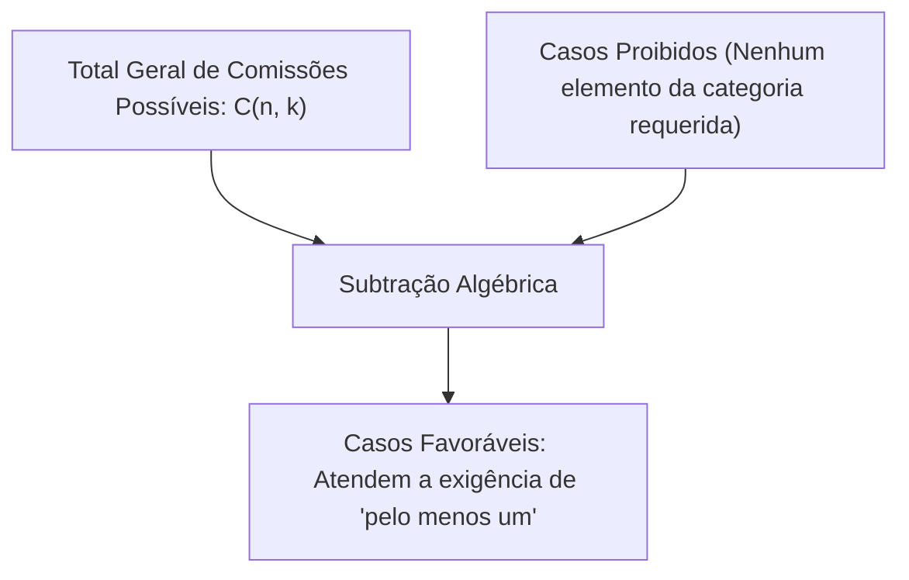
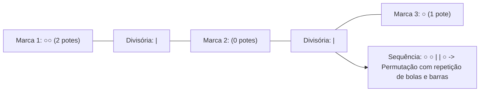
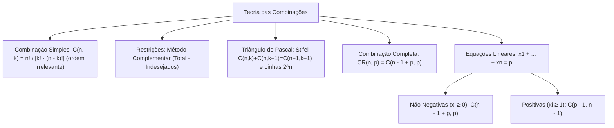

A teoria das combinações constitui a ferramenta matemática para quantificar escolhas nas quais a ordem dos elementos selecionados é totalmente irrelevante. Seja na montagem de comissões, na formação de equipes de socorro ou na seleção de amostras estatísticas, o agrupamento depende unicamente de quais elementos foram escolhidos, e não da sequência temporal de sua retirada. Neste capítulo, abordamos a combinação simples sem repetição, suas propriedades simétricas no Triângulo de Pascal, as combinações completas com repetição e o método dos traços e bolas para o cálculo de soluções inteiras de equações lineares.

> [!objetivos]
> - Definir combinação simples e deduzir sua fórmula dividindo o arranjo pelas permutações internas.
> - Resolver problemas de comissões com restrições do tipo "pelo menos um" através do método complementar.
> - Aplicar as propriedades do Triângulo de Pascal e a Relação de Stifel na simplificação de somas binomiais.
> - Compreender a lógica das divisórias na combinação completa com repetição de elementos.
> - Calcular o número de soluções inteiras não negativas e estritamente positivas de equações lineares.

## Combinação Simples

Na combinação simples, selecionamos um subconjunto de k elementos a partir de um conjunto de n elementos distintos, onde k ≤ n, sem que a ordem de escolha distinga novos agrupamentos.

Se calculássemos a seleção pelo Princípio Multiplicativo de arranjo simples A(n, k), teríamos:
A(n, k) = n · (n - 1) · (n - 2) · ... · (n - k + 1)

Contudo, para cada grupo de k elementos selecionados, existem k! permutações internas que correspondem rigorosamente ao mesmo subconjunto prático. Por exemplo, escolher os policiais Alfa e Bravo para uma ronda é idêntico a escolher Bravo e Alfa. Assim, o arranjo gera uma supercontagem de fator k!. Dividindo o arranjo pelas k! permutações equivalentes, obtemos a fórmula canônica da **combinação simples**:

C(n, k) = A(n, k) / k! = n! / [ k! · (n - k)! ]

Outras notações habituais incluem Cn,k ou o número binomial (n sobre k).

Exemplo 1: De um grupo de 6 policiais militares, quantos pares distintos de patrulhamento podem ser formados para uma viatura?
Como a ordem dos dois policiais não cria uma nova dupla de serviço:
C(6, 2) = 6! / [ 2! · (6 - 2)! ] = 6! / [ 2! · 4! ] = (6 · 5) / 2 = 15 duplas.

Exemplo 2: De quantas maneiras podemos escolher uma equipe de 3 alunos entre 7 candidatos?
C(7, 3) = 7! / [ 3! · 4! ] = (7 · 6 · 5) / (3 · 2 · 1) = 35 equipes distintas.

Exemplo 3: Em um batalhão esportivo, o treinador deseja selecionar trios de jogadores entre 15 jogadores relacionados para uma partida comemorativa. Como a ordem interna dos atletas no trio não altera a equipe, a escalação de cada jogador dá-se por combinação simples:
C(15, 3) = (15 · 14 · 13) / (3 · 2 · 1) = 455 trios de jogadores possíveis. Se um amigo for convidar um grupo de colegas com convites para o evento, a escolha segue a mesma regra.

> [!bizu] O Uso da Simetria Binomial para Cálculos Rápidos
> Para calcular C(n, k) manualmente em provas, aplique o método do produto decrescente direto:
> 1. Escreva no numerador o produto de k fatores inteiros decrescentes a partir de n.
> 2. Escreva no denominador o fatorial k! (k · (k - 1) · ... · 1).
> 3. Simplifique antes de multiplicar.
> Exemplo: C(10, 3) = (10 · 9 · 8) / (3 · 2 · 1) = 10 · 3 · 4 = 120.

### Restrições Combinadas e Seleções Multicategoriais

Frequentemente, o problema exige a composição de equipes formadas por integrantes de categorias profissionais diferentes. Nesses casos, aplicamos a combinação simples em cada categoria de forma independente e multiplicamos os resultados parciais pelo Princípio Fundamental da Contagem:

1. **Equipe com Médicos e Engenheiros:**
Considere um hospital de campanha com 5 engenheiros civis e 4 médicos socorristas. Deseja-se formar uma comissão multidisciplinar composta por 2 engenheiros e 1 médico.
- Escolha dos 2 engenheiros entre 5: C(5, 2) = (5 · 4) / 2 = 10 maneiras.
- Escolha do médico entre 4: C(4, 1) = 4 maneiras.
- Pelo princípio multiplicativo: Total = 10 · 4 = 40 comissões possíveis.

2. **Formação de Banda Musical da Corporação:**
A banda de música do Corpo de Bombeiros precisa escalar uma formação instrumental contendo: 2 guitarristas (entre 6 disponíveis), 1 baixista (entre 2 disponíveis), 1 baterista (entre 4 disponíveis) e 1 tecladista (entre 3 disponíveis).
- Guitarristas: C(6, 2) = (6 · 5) / 2 = 15 maneiras.
- Baixista: C(2, 1) = 2 maneiras.
- Baterista: C(4, 1) = 4 maneiras.
- Tecladista: C(3, 1) = 3 maneiras.
- Total de conjuntos musicais = 15 · 2 · 4 · 3 = 360 formações distintas.

### Restrições do Tipo "Pelo Menos Um" (Método Complementar)

Quando o enunciado exige que um grupo contenha "pelo menos um" integrante de determinado perfil (por exemplo, "pelo menos uma mulher" ou "pelo menos um oficial"), a análise direta de todos os casos favoráveis pode tornar-se extensa. A via mais rápida e segura consiste em aplicar o **método complementar (ou indireto)**:

Casos Favoráveis = Total Geral Sem Restrições - Casos que Violam a Regra (Casos Indesejados)

> [!resolvido] Comissão com Exigência de 'Pelo Menos Um'
> **Problema:** Um destacamento de resgate dispõe de 6 homens e 4 mulheres. De quantas maneiras podemos formar uma equipe de intervenção com 4 militares contendo **pelo menos uma mulher**?
> 
> **Resolução pelo método complementar:**
> 1. **Total geral de equipes de 4 pessoas sem restrições:** Temos 10 militares ao todo (6 homens + 4 mulheres).
> C(10, 4) = (10 · 9 · 8 · 7) / (4 · 3 · 2 · 1) = 210 equipes.
> 2. **Casos indesejados (equipes sem nenhuma mulher, ou seja, formadas exclusivamente por homens):** Escolhemos 4 militares entre os 6 homens disponíveis.
> C(6, 4) = C(6, 2) = (6 · 5) / 2 = 15 equipes masculinas.
> 3. **Casos favoráveis com pelo menos uma mulher:** Subtraímos os casos indesejados do total geral:
> Total = 210 - 15 = **195 equipes**.

## Casos Particulares e o Triângulo de Pascal

O operador binomial C(n, k) exibe propriedades analíticas fundamentais que aceleram o trabalho algébrico em provas:

| Caso Particular | Expressão Numérica | Justificativa Combinatorial |
|---|---|---|
| **C(n, 0)** | **1** | Só há 1 forma de escolher zero elementos (o conjunto vazio) |
| **C(n, n)** | **1** | Só há 1 forma de escolher todos os n elementos |
| **C(n, 1)** | **n** | Escolher 1 elemento entre n oferece n opções individuais |
| **C(n, n - 1)** | **n** | Escolher n - 1 elementos equivale a escolher o único elemento que fica de fora |
| **C(n, k) = C(n, n - k)** | **Simetria Binomial** | Selecionar k elementos equivale a rejeitar n - k elementos restantes |

A propriedade de simetria C(n, k) = C(n, n - k) permite substituir cálculos volumosos por contas simples. Por exemplo, calcular C(10, 8) equivale a calcular C(10, 2) = (10 · 9) / 2 = 45. Da mesma forma, C(100, 98) = C(100, 2) = (100 · 99) / 2 = 4.950.

### O Triângulo de Pascal e suas Propriedades

O **Triângulo de Pascal** é uma tabela triangular infinita formada pelos números binomiais C(n, k), onde n indica o índice da linha (começando em n = 0) e k indica o índice da coluna (começando em k = 0):

- Linha 0: 1
- Linha 1: 1, 1
- Linha 2: 1, 2, 1
- Linha 3: 1, 3, 3, 1
- Linha 4: 1, 4, 6, 4, 1
- Linha 5: 1, 5, 10, 10, 5, 1
- Linha 6: 1, 6, 15, 20, 15, 6, 1

| Linha (n) | Coluna 0 | Coluna 1 | Coluna 2 | Coluna 3 | Coluna 4 | Coluna 5 | Soma da Linha |
|---|---|---|---|---|---|---|---|
| **n = 0** | 1 | | | | | | **1 = 2⁰** |
| **n = 1** | 1 | 1 | | | | | **2 = 2¹** |
| **n = 2** | 1 | 2 | 1 | | | | **4 = 2²** |
| **n = 3** | 1 | 3 | 3 | 1 | | | **8 = 2³** |
| **n = 4** | 1 | 4 | 6 | 4 | 1 | | **16 = 2⁴** |
| **n = 5** | 1 | 5 | 10 | 10 | 5 | 1 | **32 = 2⁵** |

O Triângulo de Pascal é regido por três teoremas cardinais:

1. **Relação de Stifel:** A soma de dois termos adjacentes na mesma linha resulta no termo imediatamente abaixo do segundo:
C(n, k) + C(n, k + 1) = C(n + 1, k + 1)
Exemplo: C(5, 2) + C(5, 3) = 10 + 10 = 20 = C(6, 3).

2. **Teorema das Linhas:** A soma de todos os números binomiais de uma mesma linha n é igual a 2 elevado a n:
C(n, 0) + C(n, 1) + C(n, 2) + ... + C(n, n) = 2^n
Essa identidade reflete a quantidade total de subconjuntos de um conjunto de n elementos (o conjunto das partes). Por exemplo, um batalhão com 6 oficiais pode formar delegações de qualquer tamanho (de 0 a 6 pessoas) de 2⁶ = 64 maneiras.

> [!exemplo] Distribuição de Pastas e Documentos em Caixas
> Um arquivista precisa guardar 6 pastas distintas contendo relatórios operacionais em 2 caixas distintas, com a condição de que nenhuma caixa fique vazia (cada caixa deve receber pelo menos 1 pasta).
> - Para cada uma das 6 pastas, dispomos de 2 opções de caixas: 2 · 2 · 2 · 2 · 2 · 2 = 2⁶ = 64 distribuições possíveis.
> - Dentre essas 64 distribuições, exatamente 2 casos deixam uma caixa vazia (quando todas as 6 pastas vão para a primeira caixa ou todas vão para a segunda caixa).
> - Portanto, o total de maneiras válidas é 64 - 2 = **62 maneiras**.
> Esse resultado equivale à soma binomial C(6, 1) + C(6, 2) + C(6, 3) + C(6, 4) + C(6, 5) = 6 + 15 + 20 + 15 + 6 = 62.

3. **Teorema das Colunas:** A soma dos elementos de uma mesma coluna k, partindo do topo da coluna (linha k) até uma linha n qualquer, é igual ao elemento situado na linha seguinte (n + 1) e na coluna seguinte (k + 1):
C(k, k) + C(k + 1, k) + C(k + 2, k) + ... + C(n, k) = C(n + 1, k + 1)
Exemplo na coluna k = 2: C(2, 2) + C(3, 2) + C(4, 2) = 1 + 3 + 6 = 10 = C(5, 3).

## Combinação Completa (Combinação com Repetição)

A **combinação completa** surge quando dispomos de n tipos distintos de objetos e devemos escolher uma quantidade p de unidades, sendo permitido escolher mais de uma unidade do mesmo tipo. A ordem da escolha não importa, apenas a quantidade final colhida de cada tipo.

Considere, por exemplo, uma sorveteria que disponibiliza 5 marcas distintas de sorvete. Um cliente deseja adquirir 3 potes que serão adquiridos para viagem. Os potes adquiridos podem ser de marcas diferentes, ou dois potes da mesma marca e um de outra marca, ou até os 3 potes da mesma marca. Se fosse uma combinação simples de marcas distintas, teríamos C(5, 3) = 10 opções. Na combinação completa, como os potes adquiridos podem repetir a marca, o número de opções é substancialmente maior.

O mesmo raciocínio aplica-se à distribuição de maçãs idênticas para crianças, ou à partilha de convites idênticos de formatura entre amigos da turma. Quando os convites ou maçãs são indistinguíveis, o que interessa é apenas quantos convites ou quantas maçãs cada amigo recebe.

### O Método das Bolas e Traços (Divisórias)

A técnica analítica universal para resolver combinações completas é o **método das bolas e divisórias (traços)**:
- Representamos cada uma das p unidades a serem compradas por uma bola: ○.
- Representamos os n tipos disponíveis separando-os por divisórias verticais: |.
- Para separar n tipos distintos, são necessárias exatamente **n - 1 divisórias**.
- Qualquer escolha de compra equivale a uma sequência contendo p bolas e n - 1 divisórias.

Como todas as bolas são idênticas entre si e todas as divisórias são idênticas entre si, o problema reduz-se a uma **permutação com repetição** de um total de p + (n - 1) símbolos:

CR(n, p) = P(n - 1 + p; n - 1, p) = (n - 1 + p)! / [ (n - 1)! · p! ] = C(n - 1 + p, p)

Exemplo prático do sorvete: Com 5 marcas (n = 5 tipos -> 4 divisórias) e 3 potes adquiridos (p = 3 bolas):
CR(5, 3) = C(5 - 1 + 3, 3) = C(7, 3) = (7 · 6 · 5) / (3 · 2 · 1) = 35 maneiras distintas de compor a compra.

Outro exemplo: Em uma doceria com 3 tipos de doces, um cliente adquire 4 unidades.
Temos n = 3 tipos (2 divisórias) e p = 4 unidades (4 bolas):
CR(3, 4) = C(3 - 1 + 4, 4) = C(6, 4) = C(6, 2) = (6 · 5) / 2 = 15 maneiras.

> [!atencao] Objetos Distintos versus Objetos Idênticos na Distribuição
> Ao distribuir objetos entre pessoas ou gavetas:
> - Se os objetos forem **distintos** (por exemplo, 3 viaturas operacionais com placas diferentes para 5 postos), cada objeto escolhe seu destino: 5 · 5 · 5 = 5³ = 125 maneiras (Princípio Multiplicativo).
> - Se os objetos forem **idênticos** (por exemplo, convites idênticos ou maçãs iguais distribuídas entre amigos), temos combinação completa: CR(5, 3) = C(7, 3) = 35 maneiras.

## Número de Soluções Inteiras de Equações Lineares

A combinação completa é estruturalmente idêntica ao cálculo do número de soluções inteiras de uma equação linear com coeficientes unitários da forma:

x1 + x2 + x3 + ... + xn = p

Onde cada variável xi representa a quantidade de unidades atribuídas ao tipo i, e p representa o total acumulado.

Distinguem-se dois regimes de soluções fundamentais:

### Soluções Inteiras Não Negativas (xi ≥ 0)

Quando as variáveis podem assumir qualquer valor inteiro maior ou igual a zero (admitindo xi = 0, o que significa que determinado tipo pode não receber nenhuma unidade), o número de soluções é dado exatamente pela combinação completa:

Número de Soluções (xi ≥ 0) = CR(n, p) = C(n - 1 + p, p) = (n - 1 + p)! / [ (n - 1)! · p! ]

Exemplo: Determine o número de soluções inteiras não negativas da equação x + y + z = 4.
Temos n = 3 variáveis (2 divisórias) e soma p = 4 (4 bolas):
CR(3, 4) = C(3 - 1 + 4, 4) = C(6, 4) = C(6, 2) = (6 · 5) / 2 = 15 soluções.

Algumas dessas soluções incluem: (4, 0, 0), (0, 2, 2), (1, 1, 2), etc.

### Soluções Inteiras Estritamente Positivas (xi ≥ 1)

Se a exigência for de soluções inteiras estritamente positivas (cada variável deve ser estritamente maior que zero, ou seja, xi ≥ 1), nenhuma variável pode ser nula.

Para solucionar essa condição sem refazer a teoria, efetuamos uma **mudança de variável prévia**:
- Atribuímos preventivamente 1 unidade a cada uma das n variáveis.
- O total consumido é de n unidades.
- O saldo restante a distribuir livremente em valores não negativos passa a ser p - n.

Substituindo p por p - n na fórmula da combinação completa:
CR(n, p - n) = C(n - 1 + p - n, p - n) = C(p - 1, p - n) = C(p - 1, n - 1)

Número de Soluções Positivas (xi ≥ 1) = C(p - 1, n - 1)

Exemplo: Quantas soluções inteiras positivas possui a equação x + y + z = 8?
Temos n = 3 variáveis e soma p = 8.
Entregamos 1 para cada variável, restando 8 - 3 = 5 unidades a distribuir:
CR(3, 5) = C(3 - 1 + 5, 5) = C(7, 5) = C(7, 2) = (7 · 6) / 2 = 21 soluções.

| Tipo de Solução Exigida | Condição das Variáveis | Fórmula Operacional | Exemplo: x + y + z = 6 (n = 3, p = 6) |
|---|---|---|---|
| **Inteiras Não Negativas** | xi ≥ 0 (admite zero) | C(n - 1 + p, p) | C(2 + 6, 6) = C(8, 6) = C(8, 2) = **28 soluções** |
| **Inteiras Positivas** | xi ≥ 1 (não admite zero) | C(p - 1, n - 1) | C(6 - 1, 3 - 1) = C(5, 2) = **10 soluções** |
| **Com Cotas Mínimas (xi ≥ ci)** | xi ≥ ci | Reserva-se ∑ ci antes | Deduz a soma inicial e aplica CR no resíduo |

> [!pegadinha] Soluções Não Negativas versus Soluções Estritamente Positivas
> Muita atenção ao vocabulário do enunciado da banca examinadora:
> - **"Soluções inteiras e não negativas":** Permite o número zero (0, 1, 2, ...). Use C(n - 1 + p, p).
> - **"Soluções inteiras positivas":** Exclui o número zero (1, 2, 3, ...). Subtraia primeiro 1 de cada variável antes de aplicar a fórmula: C(p - 1, n - 1).

### Problemas com Cotas Mínimas Diferenciadas

A técnica de reserva prévia estende-se a quaisquer exigências de quantidades mínimas desiguais.

Considere a seguinte situação:
Um oficial de logística deve distribuir 11 pacotes idênticos de ração operacional entre 3 viaturas de patrulhamento (A, B e C), de modo que a viatura A receba pelo menos 2 pacotes, a viatura B receba pelo menos 3 pacotes e a viatura C receba pelo menos 1 pacote.

Resolução passo a passo:
1. Alocamos preventivamente as cotas mínimas exigidas: 2 pacotes para A, 3 para B e 1 para C.
2. O total previamente entregue é 2 + 3 + 1 = 6 pacotes de ração.
3. O saldo restante para distribuição irrestrita é de 11 - 6 = 5 pacotes idênticos.
4. Agora distribuímos esses 5 pacotes entre as 3 viaturas sem nenhuma restrição adicional (soluções inteiras não negativas):
Total = CR(3, 5) = C(3 - 1 + 5, 5) = C(7, 5) = C(7, 2) = (7 · 6) / 2 = 21 maneiras distintas de concluir a distribuição.

| Conceito Comparado | Combinação Simples | Combinação Completa (com Repetição) |
|---|---|---|
| **Natureza da Escolha** | Subconjunto de elementos distintos | Seleção de tipos onde unidades podem se repetir |
| **Condição de Seleção** | Cada elemento é escolhido no máximo 1 vez (k ≤ n) | Cada tipo pode ser escolhido várias vezes (p pode ser > n) |
| **Fórmula Algébrica** | C(n, k) = n! / [ k! · (n - k)! ] | CR(n, p) = C(n - 1 + p, p) |
| **Aplicação Típica** | Comissões, equipes e loterias | Bolas e traços, potes de sorvete e equações lineares |

> [!esquema] O Método das Bolas e Traços em Equações Lineares
> Resumo prático:
> - Para equações lineares x1 + x2 + ... + xn = p com n incógnitas e soma p:
> - O número de sinais de adição "+" é sempre n - 1 (divisórias).
> - O resultado da soma p é a quantidade de unidades (bolas).
> - O total de configurações é a combinação simples C(n - 1 + p, p).

## Mapa do capítulo

### Para fixar

- A combinação simples calcula agrupamentos onde a ordem de escolha dos elementos não altera o resultado.
- A fórmula C(n, k) = n! / [k! · (n - k)!] divide o arranjo correspondente pelas k! permutações internas.
- Em problemas com restrição de "pelo menos um", subtraia as comissões que violam a regra do total geral.
- A simetria binomial C(n, k) = C(n, n - k) permite trocar cálculos volumosos pelo seu complemento menor.
- Pela Relação de Stifel, a soma de dois números binomiais vizinhos na mesma linha resulta no termo abaixo do segundo.
- A soma de todos os números binomiais da linha n do Triângulo de Pascal é igual a 2^n.
- A combinação completa CR(n, p) = C(n - 1 + p, p) modela escolhas de p itens entre n tipos com repetição.
- O método das divisórias associa n tipos a n - 1 traços e p unidades a p bolas idênticas.
- O número de soluções inteiras não negativas de x1 + ... + xn = p calcula-se por C(n - 1 + p, p).
- Para soluções inteiras positivas (xi ≥ 1), desconta-se 1 unidade de cada incógnita, resultando em C(p - 1, n - 1).
