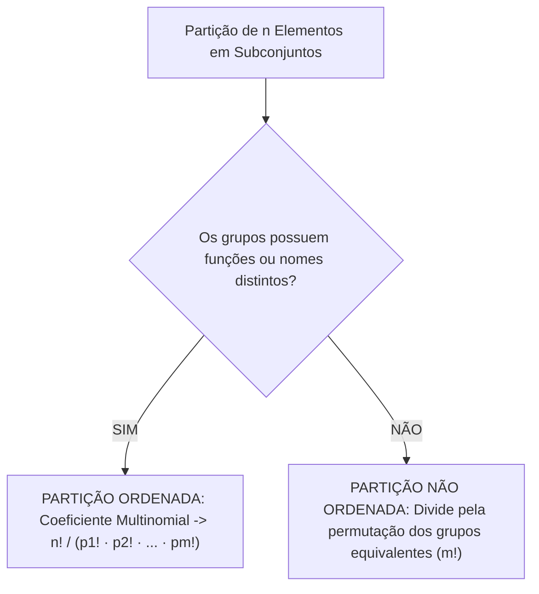
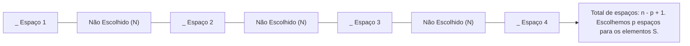
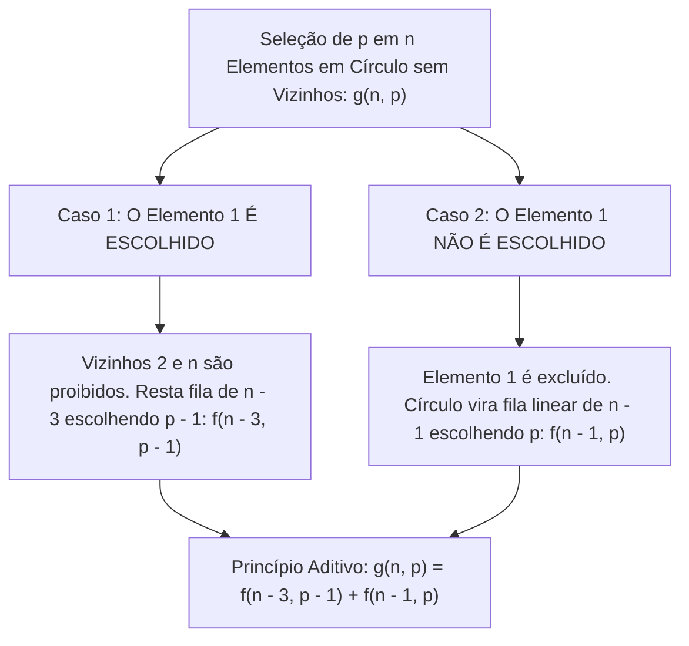
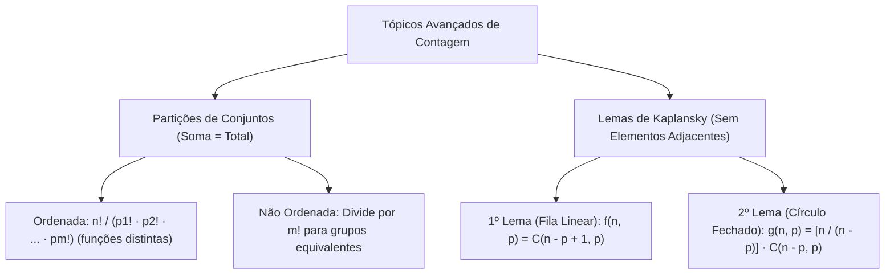

Neste capítulo final de Análise Combinatória, exploramos duas técnicas avançadas de contagem: as partições de conjuntos finitos e os Lemas de Kaplansky. Enquanto as combinações clássicas selecionam apenas uma amostra de elementos, as partições subdividem a totalidade do conjunto em blocos específicos. Por sua vez, os Lemas de Kaplansky resolvem com elegância o problema de escolher subconjuntos sem elementos adjacentes ou consecutivos, tanto em disposições lineares quanto em arranjos circulares. Em concursos, essas ferramentas resolvem problemas sofisticados de patrulhamento, escalas de vigilância e alocação de efetivo.

> [!objetivos]
> - Compreender o conceito de partição e diferenciar partições ordenadas de partições não ordenadas.
> - Aplicar o coeficiente multinomial no cálculo de partições ordenadas com grupos distinguíveis.
> - Utilizar fatores de correção de simetria (m!) em partições não ordenadas com grupos equivalentes.
> - Dominar o Primeiro Lema de Kaplansky para seleção de elementos não consecutivos em fila.
> - Aplicar o Segundo Lema de Kaplansky para contagem de elementos não adjacentes em círculo.

## O Conceito de Partição de um Conjunto

Particionar um conjunto finito de n elementos consiste em dividi-lo em m subconjuntos não vazios e disjuntos dois a dois, de modo que a união de todas as partes recomponha exatamente o conjunto original.

Considere uma equipe de 9 bombeiros militares que deve ser dividida em grupos menores de 5, 2 e 2 integrantes. A propriedade definidora da partição é que **a soma dos tamanhos de todos os subconjuntos deve ser igual ao total de elementos**:

p1 + p2 + p3 + ... + pm = n

Essa característica distingue a partição da combinação simples comum:
- Na combinação simples, escolhemos apenas um grupo de tamanho k a partir de n elementos, e os n - k elementos restantes são descartados.
- Na partição, todos os n elementos do conjunto são obrigatoriamente alocados em algum dos subconjuntos. Nenhum elemento sobra.

Conforme a natureza prática dos grupos formados, as partições classificam-se em duas categorias fundamentais:

| Critério de Comparação | Partição Ordenada | Partição Não Ordenada |
|---|---|---|
| **Identidade dos Grupos** | Grupos **distintos** com nomes, funções ou destinos diferentes | Grupos **equivalentes** que desempenham rigorosamente a mesma tarefa |
| **A Ordem Entre os Grupos** | **Importa:** Trocar os grupos de função altera o resultado prático | **Não importa:** Trocar grupos idênticos de lugar gera a mesma repartição |
| **A Ordem Dentro de Cada Grupo** | Não importa (são comissões internas) | Não importa (são comissões internas) |
| **Fórmula Algébrica** | n! / (p1! · p2! · ... · pm!) | [ n! / (p1! · ... · pm!) ] / [ m! ] (para m grupos iguais) |

> [!bizu] Como Identificar Imediatamente se a Partição é Ordenada ou Não-Ordenada
> Faça a seguinte pergunta diante do enunciado:
> "Se o Grupo 1 e o Grupo 2 trocarem de tarefas ou de nomes, a situação operacional da corporação mudou?".
> - Se a resposta for **SIM** (por exemplo, Grupo 1 vai para Salvamento e Grupo 2 vai para Combate a Incêndio), a partição é **ORDENADA**.
> - Se a resposta for **NÃO** (por exemplo, formar 3 duplas de patrulha para fazer a mesma ronda sem distinção de setor), a partição é **NÃO ORDENADA**.

## Partição Ordenada

Na **partição ordenada**, cada subconjunto possui uma destinação específica, uma tarefa própria ou uma identificação nominal exclusiva.

Podemos calcular essa partição por meio de combinações sucessivas:
1. Escolhemos p1 elementos entre os n disponíveis: C(n, p1).
2. Do saldo restante (n - p1), escolhemos p2 elementos: C(n - p1, p2).
3. Do novo saldo (n - p1 - p2), escolhemos p3 elementos: C(n - p1 - p2, p3).
4. Prosseguimos até o último grupo de tamanho pm, que esgota os elementos: C(pm, pm) = 1.

Pelo Princípio Multiplicativo, multiplicamos essas combinações:
Total = C(n, p1) · C(n - p1, p2) · ... · C(pm, pm)

Ao expandir os fatoriais das combinações, ocorre um cancelamento telescópico em cadeia. O termo (n - p1)! do denominador da primeira fração simplifica-se com o numerador da segunda, e assim sucessivamente. Ao final, resta uma expressão compacta e direta denominada **coeficiente multinomial**:

Partição Ordenada = n! / (p1! · p2! · p3! · ... · pm!)

Onde n = p1 + p2 + ... + pm.

### Exemplos Práticos de Partição Ordenada

1. **Alocação Funcional em Batalhão:**
Deseja-se alocar 10 servidores em três funções administrativas distintas: 1 gerente de operações, 2 coordenadores de setor e 7 operadores de rádio.
Como as funções são perfeitamente diferenciadas, a partição é ordenada:
Total = 10! / (1! · 2! · 7!) = (10 · 9 · 8 · 7!) / (1 · 2 · 7!) = 720 / 2 = 360 maneiras distintas.

2. **Distribuição de Alunos em Laboratórios:**
Considere 12 cadetes que serão distribuídos em 3 laboratórios de instrução técnica (Química, Física e Telecomunicações), contendo respectivamente 5, 4 e 3 vagas.
Como os laboratórios são locais físicos distintos, aplicamos o coeficiente multinomial:
Total = 12! / (5! · 4! · 3!) = (12 · 11 · 10 · 9 · 8 · 7 · 6 · 5!) / [ 5! · 24 · 6 ] = 27.720 maneiras.

3. **Distribuição de Projetos e Estações entre Departamentos:**
Uma secretaria precisa alocar 7 projetos de melhoria estrutural entre 3 departamentos independentes (Engenharia, Logística e Telecomunicações), de modo que o primeiro departamento receba 3 projetos, e os outros dois departamentos recebam 2 projetos cada.
Como os departamentos são distintos, calculamos pelo coeficiente multinomial:
Total = 7! / (3! · 2! · 2!) = 5.040 / (6 · 2 · 2) = 5.040 / 24 = 210 maneiras.
Se tivéssemos 10 estações de monitoramento de rádio distribuídas entre 3 companhias em proporção às suas notas de pontuação 500, 300 e 200, as quantidades de estações alocadas seriam respectivamente 5, 3 e 2 estações. O total de distribuições de estações seria: 10! / (5! · 3! · 2!) = 3.628.800 / (120 · 6 · 2) = 2.520 maneiras.

## Partição Não-Ordenada

Na **partição não-ordenada**, os subconjuntos formados são funcionalmente equivalentes e não possuem nomes, funções ou rótulos que os diferenciem. Todos os grupos executam exatamente o mesmo papel no mesmo ambiente.

Se calculássemos essa divisão pela fórmula da partição ordenada, estaríamos gerando uma supercontagem. Para subconjuntos de **mesmo tamanho p**, qualquer reordenação da lista de grupos gera a mesma partição prática.

Portanto, para m grupos equivalentes de mesmo tamanho p (onde n = m · p), partimos do cálculo ordenado e **dividimos pela permutação dos m grupos (m!)**:

Partição Não Ordenada = [ (m · p)! / ( (p!)^m ) ] / m! = (m · p)! / [ m! · (p!)^m ]

Exemplo fundamental: Considere 6 cadetes da corporação (Álvaro, Beto, Caio, Dédé, Eduardo e Fátima) que serão divididos em 3 duplas de patrulhamento idênticas para cumprir a mesma ronda de vigilância.
- Se as duplas tivessem setores diferentes (A, B e C), a partição seria ordenada:
6! / (2! · 2! · 2!) = 720 / 8 = 90 maneiras.
- Como as 3 duplas fazem o mesmo trabalho e não têm rótulos, as mesmas 3 duplas com Álvaro, Beto, Caio, Dédé, Eduardo e Fátima podem ser listadas em 3! = 6 ordens diferentes. Cada agrupamento real foi contado 6 vezes.
- Dividindo pelo fator de correção m! = 3! = 6:
Total = 90 / 6 = 15 maneiras distintas de formar as duplas.

Outro caso clássico: Dividir 8 atletas em duas equipes de 4 participantes para disputar um jogo-treino sem mandante ou visitante.
Temos m = 2 grupos de tamanho p = 4 (total n = 8):
Total = 8! / [ 2! · (4!)² ] = 40.320 / [ 2 · (24)² ] = 40.320 / [ 2 · 576 ] = 40.320 / 1.152 = 35 divisões possíveis.

Se fôssemos dividir 10 cadetes em dois grupos de 5 integrantes indistintos:
Total = 10! / [ 2! · (5!)² ] = 3.628.800 / [ 2 · 14.400 ] = 3.628.800 / 28.800 = 126 divisões.

| Cenário de Partição | Total (n) | Subgrupos e Tamanhos | Distinção entre Grupos | Fator de Correção | Total de Maneiras |
|---|---|---|---|---|---|
| **10 pessoas em 3 funções (1, 2, 7)** | 10 | 1 gerente, 2 coord., 7 oper. | Distintos (Ordenada) | Sem divisão adicional | 10! / (1! · 2! · 7!) = **360** |
| **12 alunos em 3 laboratórios (5, 4, 3)** | 12 | Labs A (5), B (4), C (3) | Distintos (Ordenada) | Sem divisão adicional | 12! / (5! · 4! · 3!) = **27.720** |
| **6 pessoas em 3 duplas idênticas** | 6 | 3 duplas de 2 pessoas | Indistintos (Não ordenada) | Divide por 3! | 90 / 6 = **15** |
| **8 pessoas em 2 quartetos idênticos** | 8 | 2 equipes de 4 pessoas | Indistintos (Não ordenada) | Divide por 2! | 70 / 2 = **35** |
| **10 pessoas em 2 quintetos idênticos** | 10 | 2 equipes de 5 pessoas | Indistintos (Não ordenada) | Divide por 2! | 252 / 2 = **126** |
| **7 pessoas em grupos de 3, 2 e 2** | 7 | 1 trio e 2 duplas indistintas | Duplas iguais entre si | Divide por 2! | 210 / 2 = **105** |

> [!resolvido] Divisão de Equipes de Perícia em Grupos de Tamanhos Iguais e Desiguais
> **Problema:** Um setor de perícia forense com 7 peritos deve ser dividido em 3 equipes operacionais: uma equipe com 3 peritos e duas equipes com 2 peritos cada. As duas equipes de 2 peritos desempenharão tarefas idênticas de perícia externa, sem distinção de área. De quantas formas essa partição pode ser realizada?
> 
> **Resolução analítica:**
> 1. Analisamos os tamanhos dos grupos: temos um grupo de 3 e dois grupos de 2.
> 2. O grupo de 3 elementos já é intrinsecamente distinguível dos demais pelo seu próprio tamanho (não há perigo de confundi-lo com uma dupla).
> 3. As duas equipes de 2 peritos são de mesmo tamanho e desempenham a mesma função, sendo, portanto, intercambiáveis entre si.
> 4. Calculamos primeiro a partição multinomial como se todos os grupos fossem distintos:
> 7! / (3! · 2! · 2!) = 5.040 / (6 · 2 · 2) = 5.040 / 24 = 210.
> 5. Aplicamos o fator de correção apenas para os 2 grupos de mesmo tamanho que são equivalentes, dividindo por 2! = 2:
> Total = 210 / 2 = **105 partições distintas**.

## Lemas de Kaplansky

Os **Lemas de Kaplansky**, estabelecidos pelo matemático Irving Kaplansky em 1943, fornecem fórmulas fechadas para responder à seguinte pergunta:

"De quantas maneiras podemos escolher p elementos a partir de um conjunto de n elementos ordenados, de modo que **nunca sejam escolhidos dois elementos consecutivos (adjacentes ou vizinhos)**?".

A ordem da escolha não importa (trata-se de uma seleção de subconjunto). A distinção estrutural entre os dois lemas reside na geometria da disposição dos n elementos:

| Lema Combinatorial | Topologia da Disposição | Relação dos Extremos (1º e n-ésimo) | Fórmula Fechada |
|---|---|---|---|
| **Primeiro Lema de Kaplansky** | **Linear (Fila ou Reta)** | O 1º e o n-ésimo **não são vizinhos** | f(n, p) = C(n - p + 1, p) |
| **Segundo Lema de Kaplansky** | **Cíclica (Círculo ou Roda)** | O 1º e o n-ésimo **são vizinhos** | g(n, p) = [ n / (n - p) ] · C(n - p, p) |

### Primeiro Lema de Kaplansky (Disposição Linear)

Considere n elementos dispostos em uma fileira numerada de 1 a n. Desejamos selecionar p elementos sem escolher dois números consecutivos.

A dedução genial de Kaplansky baseia-se no **método dos espaços (lacunas)**:
1. Denotamos por **S** (sim) cada elemento selecionado, e por **N** (não) cada elemento não selecionado.
2. Como selecionamos p elementos, temos p símbolos S e exatamente (n - p) símbolos N.
3. Posicionamos primeiro os (n - p) símbolos N em linha reta.
4. Para garantir que nunca haja dois símbolos S adjacentes, cada S deve ser alocado em um espaço vazio diferente criado pelos símbolos N.
5. Em uma fileira de (n - p) elementos, existem espaços disponíveis antes do primeiro, entre cada par de vizinhos e após o último, totalizando exatamente **n - p + 1 espaços**.
6. Portanto, a contagem reduz-se a escolher em quais desses (n - p + 1) espaços colocaremos os p símbolos S:

f(n, p) = C(n - p + 1, p) = (n - p + 1)! / [ p! · (n - 2p + 1)! ]

> [!atencao] O Método dos Espaços na Dedução do Primeiro Lema de Kaplansky
> Exemplos de aplicação do Primeiro Lema de Kaplansky:
> - **Cadeiras em fila:** Em uma fileira de 10 cadeiras, de quantas formas 4 pessoas podem sentar-se sem que duas fiquem em cadeiras adjacentes?
> Temos n = 10 e p = 4. Aplicando a fórmula:
> f(10, 4) = C(10 - 4 + 1, 4) = C(7, 4) = C(7, 3) = (7 · 6 · 5) / (3 · 2 · 1) = **35 maneiras**.
> - **Escala de plantão semanal:** Um bombeiro deve escolher 3 dias de serviço entre segunda-feira e sábado (6 dias no total), sem trabalhar em dias consecutivos.
> Temos n = 6 e p = 3:
> f(6, 3) = C(6 - 3 + 1, 3) = C(4, 3) = **4 escalas possíveis**.
> Essas 4 escalas são: (seg, qua, sex), (seg, qua, sab), (seg, qui, sab) e (ter, qui, sab).

Se o número de elementos requeridos p for superior a (n + 1) / 2, é matematicamente impossível evitar a adjacência (pelo Princípio da Casa dos Pombos), e o valor de f(n, p) é automaticamente igual a zero.

### O Problema do Acendimento de Lâmpadas sem Lâmpadas Vizinhas Acesas

Considere um painel de controle de emergência com 5 lâmpadas alinhadas em fila. De quantas maneiras distintas podemos deixar lâmpadas acesas nesse painel de modo que nunca haja duas lâmpadas acesas simultaneamente em soquetes adjacentes?
Pelo Princípio Aditivo, somamos os casos conforme a quantidade p de lâmpadas acesas:
- Nenhuma lâmpada acesa (p = 0): 1 possibilidade.
- Exatamente uma lâmpada acesa (p = 1): C(5, 1) = 5 possibilidades.
- Duas lâmpadas acesas (p = 2): f(5, 2) = C(5 - 2 + 1, 2) = C(4, 2) = 6 possibilidades.
- Três lâmpadas acesas (p = 3): f(5, 3) = C(5 - 3 + 1, 3) = C(3, 3) = 1 possibilidade.
- Quatro ou cinco lâmpadas acesas: impossível sem gerar vizinhas acesas (f = 0).

Somando todas as configurações possíveis: 1 + 5 + 6 + 1 = 13 possibilidades distintas. Essa família de problemas conecta-se às sequências de Fibonacci e à contagem de bits em códigos digitais com 10 a 12 elementos.

### Segundo Lema de Kaplansky (Disposição Circular)

Quando os n elementos estão organizados ao redor de uma circunferência (como convidados em mesa redonda, dias de uma semana cíclica contínua de domingo a domingo ou fatias de uma pizza redonda), o primeiro elemento (1) e o último elemento (n) passam a ser vizinhos diretos.

Essa vizinhança circular restringe ainda mais as escolhas viáveis. A fórmula do **Segundo Lema de Kaplansky** é dada por:

g(n, p) = [ n / (n - p) ] · C(n - p, p)

A dedução analítica pelo Princípio Aditivo ilustra a harmonia da combinatória:
- **Caso 1 (O elemento 1 é escolhido):** Se o elemento 1 é selecionado, seus vizinhos imediatos (o elemento 2 e o elemento n) não podem ser escolhidos. Restam n - 3 elementos intermediários (de 3 a n - 1), que agora formam uma fileira linear simples (pois as pontas não se conectam mais). Devemos escolher p - 1 elementos nessa fila: f(n - 3, p - 1).
- **Caso 2 (O elemento 1 não é escolhido):** Se o elemento 1 é rejeitado, abrimos o círculo naquele ponto. Os n - 1 elementos restantes formam uma fileira linear simples de 2 a n. Devemos escolher p elementos nessa fila: f(n - 1, p).

Somando os dois casos disjuntos pelo Princípio Aditivo:
g(n, p) = f(n - 3, p - 1) + f(n - 1, p)

Desenvolvendo essa soma binomial por propriedades algébricas, alcança-se exatamente a fórmula fechada [ n / (n - p) ] · C(n - p, p).

Exemplo prático: Uma pizza redonda dividida em 8 fatias circulares. De quantas maneiras podemos selecionar 3 fatias sem escolher duas fatias adjacentes?
Como a pizza é circular, a fatia 1 é vizinha da fatia 8. Aplicamos o Segundo Lema com n = 8 e p = 3:
g(8, 3) = [ 8 / (8 - 3) ] · C(8 - 3, 3) = (8 / 5) · C(5, 3) = (8 / 5) · 10 = 16 maneiras distintas.

Conferindo pela soma dos dois casos lineares:
f(8 - 3, 3 - 1) + f(8 - 1, 3) = f(5, 2) + f(7, 3)
f(5, 2) = C(5 - 2 + 1, 2) = C(4, 2) = 6.
f(7, 3) = C(7 - 3 + 1, 3) = C(5, 3) = 10.
Total = 6 + 10 = 16 maneiras. A correspondência é exata.

> [!pegadinha] Fila versus Círculo: A Vizinhança dos Extremos nos Lemas de Kaplansky
> Antes de aplicar a fórmula de Kaplansky, avalie criticamente o fechamento dos extremos:
> - Se o conjunto for uma **fila** (dias úteis de segunda a sexta, bancos de um corredor, casas em uma rua reta): use o **Primeiro Lema f(n, p) = C(n - p + 1, p)**.
> - Se o conjunto for um **círculo** (dias da semana em ciclo perpétuo, mesas redondas, catracas de rotação): use o **Segundo Lema g(n, p) = [ n / (n - p) ] · C(n - p, p)**.
> Observe a discrepância numérica para n = 8 e p = 3: na fila temos f(8, 3) = C(6, 3) = 20 modos, enquanto no círculo temos g(8, 3) = 16 modos. A vizinhança entre os extremos elimina 4 configurações.

> [!esquema] Síntese Operacional das Fórmulas de Partições e Kaplansky
> Resumo executivo para memorização:
> - **Partição Ordenada:** n! / (p1! · p2! · ... · pm!).
> - **Partição Não-Ordenada (m grupos de tamanho p):** (m · p)! / [ m! · (p!)^m ].
> - **1º Lema de Kaplansky (Linear, sem extremos vizinhos):** f(n, p) = C(n - p + 1, p).
> - **2º Lema de Kaplansky (Circular, extremos vizinhos):** g(n, p) = [ n / (n - p) ] · C(n - p, p).

## Mapa do capítulo

### Para fixar

- Na partição de um conjunto, todos os n elementos são divididos em subgrupos, sem sobras.
- Em partições ordenadas, os grupos possuem funções ou nomes distintos e calculam-se por n! / (p1! · ... · pm!).
- Em partições não ordenadas com m grupos de mesmo tamanho p, divide-se a expressão ordenada por m!.
- Se houver grupos de tamanhos desiguais, divide-se apenas pelo fatorial da quantidade de grupos equivalentes de mesmo tamanho.
- O Primeiro Lema de Kaplansky calcula seleções de p elementos não consecutivos em fila por C(n - p + 1, p).
- O raciocínio do Primeiro Lema baseia-se na alocação de p elementos nos n - p + 1 espaços criados pelos elementos não escolhidos.
- O Segundo Lema de Kaplansky aplica-se a estruturas circulares onde o primeiro e o último elemento são adjacentes.
- A fórmula do Segundo Lema g(n, p) = [ n / (n - p) ] · C(n - p, p) decompõe-se na soma de dois casos lineares disjuntos.
- A condição circular sempre reduz a quantidade de seleções viáveis em comparação com a disposição linear.
- Se a quantidade p de elementos desejada for superior a metade dos elementos disponíveis em fila, a contagem de Kaplansky é nula.
