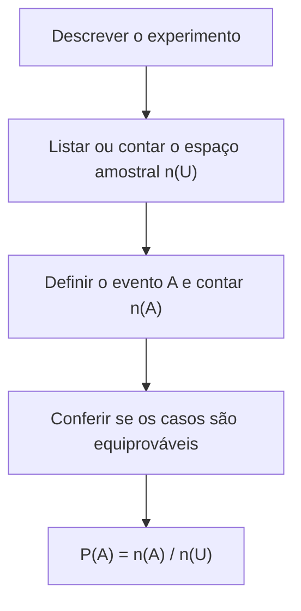

A probabilidade mede a chance de um acontecimento incerto ocorrer. A prova a cobra de forma muito direta: sorteios, lançamentos de moedas e dados, retiradas de cartas e de bolas de uma urna, escolhas de pessoas para uma comissão. Este capítulo apresenta a linguagem do assunto, que é a de conjuntos: experimento aleatório, espaço amostral e evento, e a **definição clássica de probabilidade**, que calcula a chance como a razão entre os casos favoráveis e os casos possíveis, quando todos os resultados têm a mesma chance.

> [!objetivos]
> - Distinguir experimento aleatório, espaço amostral, ponto amostral e evento.
> - Reconhecer os tipos de evento: certo, impossível, elementar, complementar e mutuamente excludentes.
> - Calcular a probabilidade pela definição clássica.
> - Usar a contagem (arranjos e combinações) para obter casos favoráveis e possíveis.

## Experimento aleatório e espaço amostral

Um **experimento aleatório** é um experimento que pode ser repetido em condições semelhantes e cujo resultado não se sabe com certeza antes de ele ocorrer, mas cujos resultados possíveis são conhecidos. O lançamento de uma moeda é o exemplo clássico: a moeda pode cair com cara ou coroa, mas ninguém sabe qual antes do lançamento. A repetição precisa ser possível: se a moeda cair em um bueiro, o experimento não pode ser repetido.

O conjunto de todos os resultados possíveis é o **espaço amostral**, indicado por Ω ou U, e cada elemento é um **ponto amostral**. Por exemplo:

| Experimento | Espaço amostral | Número de pontos |
| --- | --- | --- |
| Uma moeda | {cara, coroa} | 2 |
| Dois lançamentos de moeda | {CC, CK, KC, KK} | 4 |
| Um dado | {1, 2, 3, 4, 5, 6} | 6 |
| Dois dados | Todos os pares (a, b), com a e b de 1 a 6 | 36 |
| Uma carta de um baralho comum | As 52 cartas | 52 |

Em dois lançamentos de moeda, C representa cara e K representa coroa. A ordem importa: CK e KC são resultados diferentes.

## Evento

Um **evento** é qualquer subconjunto do espaço amostral. É um conjunto de resultados que têm uma característica comum. Por exemplo, no lançamento de dois dados, o evento A, "a soma das faces é 12", tem um só elemento, (6, 6). O evento B, "a soma é 7", tem seis elementos: (1,6), (2,5), (3,4), (4,3), (5,2) e (6,1).

Alguns tipos de evento têm nomes próprios:

| Tipo | Definição | Exemplo no lançamento de um dado |
| --- | --- | --- |
| Evento certo | Coincide com o espaço amostral; sempre ocorre | Sair um número de 1 a 6 |
| Evento impossível | Conjunto vazio; nunca ocorre | Sair o número 7 |
| Evento elementar | Tem um só ponto amostral | Sair o número 4 |
| Evento complementar | Todos os pontos que não estão em A | O complementar de "número par" é "número ímpar" |
| Eventos mutuamente excludentes | Não podem ocorrer ao mesmo tempo (interseção vazia) | "Sair par" e "sair 5" |

No lançamento de dois dados, o evento "soma igual a 13" é impossível, pois nenhum par de faces atinge esse valor. E o evento "soma menor que 13" é certo.

> [!pegadinha]
> Confundir eventos **mutuamente excludentes** com eventos **independentes**. Excludentes não podem ocorrer juntos; independentes são aqueles em que a ocorrência de um não altera a chance do outro. Dois eventos de probabilidade não nula que sejam excludentes **nunca** são independentes, porque se um ocorre, o outro deixa de ser possível.

## Definição clássica de probabilidade

Quando o espaço amostral é finito e todos os seus pontos têm **a mesma chance** (são equiprováveis), a probabilidade de um evento A é:

    P(A) = n(A) / n(U)

em que n(A) é o número de casos **favoráveis** (elementos de A) e n(U) é o número de casos **possíveis** (elementos do espaço amostral). Dessa definição seguem três consequências:

1. 0 ≤ P(A) ≤ 1, pois n(A) varia de zero a n(U).
2. P(evento certo) = 1 e P(evento impossível) = 0.
3. A probabilidade pode ser dada em fração, decimal ou porcentagem: 1/4 = 0,25 = 25%.

A hipótese de **equiprobabilidade** é essencial. Em uma moeda viciada, em que a chance de cair cara é maior, não se pode contar casos e dividir: seria preciso conhecer as probabilidades de cada resultado. Por isso o enunciado costuma dizer "moeda honesta" ou "dado não viciado", ou "sorteados ao acaso".

> [!resolvido] Dois lançamentos de moeda
> **Enunciado.** Uma moeda honesta é lançada duas vezes. Qual é a probabilidade de que as duas faces sejam iguais?
>
> **Raciocínio.** O espaço amostral tem 4 resultados equiprováveis. O evento tem os resultados em que as faces coincidem.
>
> **Conta.** U = {CC, CK, KC, KK}, n(U) = 4. O evento A = {CC, KK}, n(A) = 2. Então P(A) = 2/4 = 1/2.
>
> **Resposta.** A probabilidade é de 1/2, ou 50%.

> [!resolvido] Soma das faces de dois dados
> **Enunciado.** Dois dados honestos são lançados. Qual é a probabilidade de a soma das faces ser 7? E de ser 12?
>
> **Raciocínio.** Há 6 · 6 = 36 pares equiprováveis. Contam-se os pares favoráveis.
>
> **Conta.** Soma 7: (1,6), (2,5), (3,4), (4,3), (5,2), (6,1), isto é, 6 pares, e P = 6/36 = 1/6. Soma 12: apenas (6,6), e P = 1/36.
>
> **Resposta.** A probabilidade de a soma ser 7 é de 1/6, e a de ser 12 é de 1/36. A soma 7 é a mais provável.

## Contagem para calcular probabilidades

Quando o espaço amostral é grande, não se listam os casos: usa-se a análise combinatória. Dois instrumentos bastam:

- **Arranjo:** escolher e **ordenar** k elementos entre n, com A(n, k) = n!/(n − k)!. A ordem importa, como em uma fila ou em cargos distintos.
- **Combinação:** escolher k elementos entre n, **sem ordem**, com C(n, k) = n!/(k! · (n − k)!). Vale para comissões, grupos e mãos de baralho.

> [!resolvido] Sorteio de uma comissão
> **Enunciado.** Entre 6 deputados, 3 do Partido A e 3 do Partido B, serão sorteados 2 para uma comissão. Qual é a probabilidade de os dois sorteados serem do Partido A?
>
> **Raciocínio.** A ordem não importa, e então se usam combinações.
>
> **Conta.** Casos possíveis: C(6, 2) = 15. Casos favoráveis: C(3, 2) = 3. Então P = 3/15 = 1/5.
>
> **Resposta.** A probabilidade é de 1/5, ou 20%.

> [!resolvido] Escolha de soldados
> **Enunciado.** Um capitão deve escolher 6 entre 12 soldados, entre eles Enzo. Qual é a probabilidade de Enzo estar entre os escolhidos?
>
> **Raciocínio.** Se Enzo está no grupo, faltam 5 vagas entre os 11 soldados restantes.
>
> **Conta.** Favoráveis: C(11, 5) = 462. Possíveis: C(12, 6) = 924. P = 462/924 = 1/2.
>
> **Resposta.** A probabilidade é de 1/2. O resultado também decorre de uma observação simples: cada soldado tem a mesma chance de entrar, e 6 de 12 é metade.

## Exemplos de aplicação em contextos de prova

**Balas e urnas.** Uma caixa tem 12 balas: 5 amarelas, todas com recheio de chocolate, 4 verdes de café e 3 vermelhas de morango. Sorteando uma bala ao acaso, a probabilidade de ser amarela é 5/12, e a de ter recheio de chocolate é a mesma, 5/12, porque os dois eventos coincidem. A probabilidade de ser verde ou vermelha é 7/12, o complementar de amarela. Na urna, o raciocínio é idêntico: bolas numeradas de 1 a 20 e o evento "múltiplo de 5" tem 4 elementos (5, 10, 15 e 20), logo P = 4/20 = 1/5.

**Pesquisas.** Em um levantamento com 200 moradores de um bairro, 30 tiveram dengue no último ano. Sorteando um morador, a chance de ele ter tido dengue é 30/200 = 3/20 = 15%. Em uma sala com 40 pessoas, das quais 12 torcem pelo Vasco, a probabilidade de o sorteado ser torcedor do clube é 12/40 = 3/10. Nos dois casos, a pesquisa vira um espaço amostral, e o evento é um subconjunto das respostas.

**Cargos e cadeiras.** Um coordenador e um assistente serão sorteados entre 8 agentes. Como os cargos são distintos, a ordem importa: há 8 · 7 = 56 maneiras de ocupar os dois cargos. Se André é um dos agentes, a probabilidade de ele ser o coordenador é 7/56 = 1/8. Já se quatro pessoas, entre elas André e Bruno, serão sentadas em quatro cadeiras numeradas por sorteio, há 4! = 24 arranjos. André e Bruno ocupam as cadeiras 1 e 2, em qualquer ordem, em 2 · 2 = 4 arranjos (2 para os dois e 2 para os outros), e a probabilidade é 4/24 = 1/6. Uma pessoa sentada em uma cadeira específica tem probabilidade 1/4.

**Peças e controle de qualidade.** De um lote de 20 peças, 3 são defeituosas. Sorteando 2 peças sem reposição, a probabilidade de ambas serem defeituosas é C(3, 2)/C(20, 2) = 3/190, cerca de 1,6%. A probabilidade de nenhuma ser defeituosa é C(17, 2)/C(20, 2) = 136/190 = 68/95.

| Situação | Casos possíveis | Casos favoráveis | Probabilidade |
| --- | --- | --- | --- |
| Bala amarela em 12 balas | 12 | 5 | 5/12 |
| Múltiplo de 5 entre 1 e 20 | 20 | 4 | 1/5 |
| Morador com dengue em 200 | 200 | 30 | 3/20 |
| Duas peças defeituosas em 20 | C(20, 2) = 190 | C(3, 2) = 3 | 3/190 |

### Erros comuns de contagem

O erro mais frequente é tratar como diferentes resultados que são iguais, ou como iguais resultados que são diferentes. No lançamento de dois dados, o par (2, 5) e o par (5, 2) são resultados distintos, e por isso a soma 7 tem 6 pares, e não 3. Já ao sortear 2 pessoas para uma comissão, o par {André, Bruno} e o par {Bruno, André} são o mesmo grupo, e a combinação trata disso. Outro erro é esquecer que, em retiradas **sem reposição**, o espaço amostral muda a cada retirada: depois de tirar uma peça, restam 19, e não 20. Em retiradas **com reposição**, o espaço se mantém, e as retiradas sucessivas têm sempre as mesmas chances. Por fim, convém converter o resultado ao formato pedido: se a alternativa traz porcentagem e o cálculo deu fração, basta dividir e multiplicar por 100, como em 3/190, que é cerca de 1,6%.

> [!bizu]
> Antes de qualquer conta, responda a duas perguntas: **a ordem importa?** (arranjo ou combinação) e **os casos têm a mesma chance?** (se não, a definição clássica não se aplica). A maior parte dos erros em prova vem de contar pares ordenados quando a ordem não importa, ou o contrário.

## Probabilidade, frequência e linguagem do dia a dia

No dia a dia, a probabilidade aparece em frases como "há 30% de chance de chuva". Essa afirmação não depende de contar casos equiprováveis, mas ela segue as mesmas regras: o número está entre 0% e 100%, e a chance de não chover é o complemento, 70%. Em prova, a conversão entre fração, decimal e porcentagem é frequente, e vale ter os valores comuns de cor: 1/2 é 50%, 1/4 é 25%, 1/5 é 20%, 1/8 é 12,5% e 1/10 é 10%. Também é útil lembrar que a probabilidade de um evento e a do seu complementar somam 1, o que permite calcular "pelo menos um" como 1 menos "nenhum", atalho que será explorado nos próximos capítulos.

## Como a banca cobra este assunto

As questões de prova costumam vir com enunciados curtos, em que a dificuldade está em identificar o espaço amostral. Os padrões mais frequentes são:

- **Vocabulário:** identificar espaço amostral, evento certo, impossível e complementar.
- **Cálculo direto:** moedas, dados, cartas, urnas e sorteios, com casos favoráveis sobre casos possíveis.
- **Combinatória:** probabilidade de comissões, grupos e filas, em que se usa C(n, k).
- **Limites:** reconhecer que probabilidade negativa ou maior que 1 é impossível.
- **Equiprobabilidade:** perceber quando o enunciado não permite contar casos.

## Mapa do capítulo

| Tema | Regra | Cuidado |
| --- | --- | --- |
| Espaço amostral | Conjunto de todos os resultados | Cada resultado é um ponto amostral |
| Evento | Subconjunto do espaço amostral | Certo, impossível, elementar e complementar |
| Definição clássica | P(A) = n(A) / n(U) | Só com casos equiprováveis |
| Limites | 0 ≤ P(A) ≤ 1 | Certo vale 1; impossível vale 0 |
| Combinação | C(n, k), sem ordem | Usar em comissões e grupos |
| Arranjo | A(n, k), com ordem | Usar em filas e cargos distintos |

### Para fixar

- Experimento aleatório é aquele cujo resultado é incerto, mas cujos resultados possíveis são conhecidos.
- O espaço amostral é o conjunto de todos os resultados possíveis; evento é um subconjunto dele.
- O evento certo tem probabilidade 1 e o impossível, probabilidade 0.
- A definição clássica divide os casos favoráveis pelos casos possíveis, quando são equiprováveis.
- A probabilidade está sempre entre 0 e 1.
- Em dois dados, há 36 resultados, e a soma 7 é a mais provável (6/36).
- Combinação é usada quando a ordem não importa; arranjo, quando importa.
- Eventos mutuamente excludentes não podem ocorrer juntos e não se confundem com independentes.
