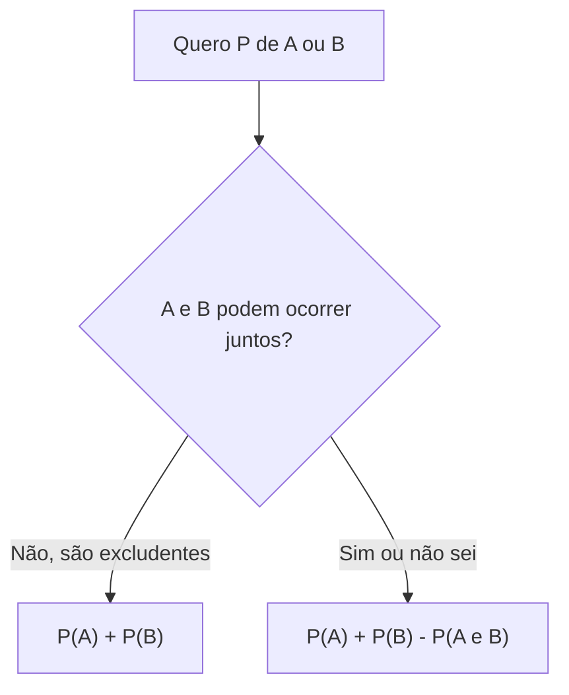

Nem sempre os resultados de um experimento são equiprováveis, e nem sempre se pode contar os casos. Neste capítulo, a probabilidade é obtida de outra forma, a **frequência relativa**, observada nas repetições de um experimento. Depois estudamos como combinar eventos: a **união** (um ou outro), a **interseção** (um e outro) e a regra da probabilidade da união, para dois e para três eventos. É um dos assuntos mais cobrados do bloco, porque exige organizar conjuntos e evitar contar duas vezes o que é comum.

> [!objetivos]
> - Calcular a probabilidade como frequência relativa observada.
> - Aplicar a regra da união para dois eventos, excludentes ou não.
> - Aplicar a regra da união de três eventos.
> - Relacionar união, interseção e complementar com conjuntos.

## Probabilidade como frequência relativa

Quando o experimento pode ser repetido muitas vezes, a probabilidade de um evento pode ser estimada pela **frequência relativa** com que ele ocorreu: se um evento ocorreu n vezes em N repetições, sua frequência relativa é

    f = n / N

Pela **lei dos grandes números**, quanto maior o número de repetições, mais a frequência relativa se aproxima da probabilidade verdadeira. É a abordagem **empírica** (ou frequentista), a única possível para uma moeda não equilibrada ou para fenômenos como o defeito de uma peça. Por exemplo, ao lançar uma moeda 1.000 vezes e obter 620 caras, a probabilidade estimada de cara é 620/1.000 = 0,62, e a de coroa, 0,38.

> [!resolvido] Frequência relativa de um evento
> **Enunciado.** Uma fábrica inspecionou 500 peças e encontrou 35 defeituosas. Usando a frequência relativa, estime a probabilidade de uma peça sorteada ser defeituosa e a de ser perfeita.
>
> **Raciocínio.** A frequência relativa dos defeitos estima a probabilidade. A probabilidade da peça perfeita é o complemento.
>
> **Conta.** P(defeituosa) = 35/500 = 0,07 = 7%. P(perfeita) = 1 − 0,07 = 0,93 = 93%.
>
> **Resposta.** A estimativa é de 7% de peças defeituosas e 93% de peças perfeitas.

## Operações com eventos

Como eventos são conjuntos, as operações de conjuntos se aplicam:

| Operação | Símbolo | Significado | Em palavras |
| --- | --- | --- | --- |
| União | A ∪ B | Ocorre A, ou B, ou ambos | "A ou B" |
| Interseção | A ∩ B | Ocorrem A e B ao mesmo tempo | "A e B" |
| Complementar | A' (ou Ā) | Não ocorre A | "não A" |
| Diferença | A − B | Ocorre A, mas não B | "A e não B" |

Dois eventos são **mutuamente excludentes** (ou disjuntos) se A ∩ B = ∅, isto é, não ocorrem juntos.

## Probabilidade da união de dois eventos

Para dois eventos quaisquer, a probabilidade de ocorrer A ou B é:

    P(A ∪ B) = P(A) + P(B) − P(A ∩ B)

Subtrai-se a interseção porque ela foi contada duas vezes, uma em P(A) e outra em P(B). Se os eventos são **mutuamente excludentes**, a interseção é vazia e a probabilidade é zero, de modo que:

    P(A ∪ B) = P(A) + P(B)

> [!resolvido] União de eventos no lançamento de um dado
> **Enunciado.** Em um dado honesto, A é o evento "número menor que 3" e B é "número par". Calcule P(A ∪ B).
>
> **Raciocínio.** Listam-se os eventos e verifica-se a interseção.
>
> **Conta.** A = {1, 2}, B = {2, 4, 6}, A ∩ B = {2}. P(A) = 2/6, P(B) = 3/6, P(A ∩ B) = 1/6. P(A ∪ B) = 2/6 + 3/6 − 1/6 = 4/6 = 2/3. Conferência direta: A ∪ B = {1, 2, 4, 6}, com 4 elementos em 6.
>
> **Resposta.** A probabilidade é de 2/3.

> [!resolvido] Probabilidade da interseção a partir da união
> **Enunciado.** Sabe-se que P(A) = 0,5, P(B) = 0,4 e P(A ∪ B) = 0,7. Calcule P(A ∩ B).
>
> **Raciocínio.** Isola-se a interseção na fórmula da união.
>
> **Conta.** 0,7 = 0,5 + 0,4 − P(A ∩ B), logo P(A ∩ B) = 0,9 − 0,7 = 0,2.
>
> **Resposta.** A probabilidade da interseção é de 0,2, ou 20%.

Em pesquisas, a regra aparece como "leitores". Em uma pesquisa com 100 pessoas, 60 leem jornal (J), 45 leem revista (R) e 20 leem ambos. A probabilidade de uma pessoa sorteada ler jornal ou revista é 0,60 + 0,45 − 0,20 = 0,85. E a de não ler nenhum dos dois é 1 − 0,85 = 0,15.

### Eventos exaustivos e partição

Dois ou mais eventos são **exaustivos** quando, juntos, cobrem todo o espaço amostral: pelo menos um deles sempre ocorre. Quando, além disso, são mutuamente excludentes, formam uma **partição** do espaço amostral, e a soma de suas probabilidades é 1. Em um dado, "par" e "ímpar" formam uma partição. Já "menor que 4" e "maior que 3" também formam. Mas "menor que 4" e "maior que 4" não são exaustivos, porque o 4 fica fora de ambos. Quando um enunciado diz que os eventos são exaustivos e excludentes, ele permite obter uma probabilidade desconhecida pelo complemento: se três grupos formam uma partição e dois têm 30% e 45%, o terceiro tem 25%.

### Exemplos de pesquisa e de seleção

**Consumo de marcas.** Em uma pesquisa com 505 consumidores de sabonete, 220 consomem a marca A, 180 consomem a marca B e 60 consomem as duas. Se um consumidor é sorteado, a probabilidade de que consuma A ou B é (220 + 180 − 60)/505 = 340/505 = 68/101, cerca de 67,3%. A probabilidade de que consuma apenas A é (220 − 60)/505 = 160/505, e a de que não consuma nenhuma das duas marcas é 1 − 340/505 = 165/505. Quando o enunciado diz que o consumidor consome "pelo menos uma" das marcas, é a união que se calcula.

**Seleção de soldados.** Na escolha de 6 entre 12 soldados, a probabilidade de cada soldado ser selecionado é 6/12 = 1/2. Para dois soldados específicos, Enzo e Lucas, a probabilidade de os dois serem escolhidos é C(10, 4)/C(12, 6) = 210/924 = 5/22. Pela fórmula da união, P(Enzo ou Lucas) = 1/2 + 1/2 − 5/22 = 17/22. Conferindo pelo complementar, a probabilidade de nenhum dos dois ser escolhido é C(10, 6)/C(12, 6) = 210/924 = 5/22, e 1 − 5/22 = 17/22. As duas formas dão o mesmo valor, o que mostra a vantagem do complementar em problemas de "pelo menos um".

**Controle de qualidade.** Um lote de tijolos tem 400 unidades, e a inspeção indica que 24 têm trinca e 16 têm falha de cor, sendo que 6 têm os dois defeitos. A probabilidade de um tijolo sorteado ter algum defeito é (24 + 16 − 6)/400 = 34/400 = 8,5%. Quem somasse 24 e 16 sem subtrair os 6 chegaria a 10%, valor maior que o correto. Como se vê, o erro de não subtrair a interseção infla a estimativa.

> [!pegadinha]
> Somar as probabilidades e esquecer de subtrair a interseção, quando os eventos podem ocorrer juntos. No exemplo do dado, 2/6 + 3/6 daria 5/6, valor errado, porque o número 2 pertence aos dois eventos. A soma simples só vale para eventos mutuamente excludentes, como "menor que 3" e "maior que 4" (1/3 + 1/3 = 2/3).

## Probabilidade da união de três eventos

Para três eventos, usa-se o princípio da **inclusão e exclusão**:

    P(A ∪ B ∪ C) = P(A) + P(B) + P(C) − P(A ∩ B) − P(A ∩ C) − P(B ∩ C) + P(A ∩ B ∩ C)

Somam-se os três eventos, subtraem-se as interseções duas a duas, que foram contadas duas vezes, e soma-se de volta a interseção tripla, que foi somada três vezes e subtraída três vezes, ficando sem contar.

> [!resolvido] Múltiplos de 2, 3 e 5
> **Enunciado.** Um número é sorteado entre 1 e 100. Qual é a probabilidade de que seja múltiplo de 2, de 3 ou de 5?
>
> **Raciocínio.** Define-se A = múltiplo de 2, B = múltiplo de 3 e C = múltiplo de 5, e aplica-se a inclusão e exclusão sobre as contagens.
>
> **Conta.** n(A) = 50, n(B) = 33, n(C) = 20. As interseções são: múltiplos de 6, que são 16; de 10, que são 10; de 15, que são 6. A interseção tripla, múltiplos de 30, tem 3. Então n(A ∪ B ∪ C) = 50 + 33 + 20 − 16 − 10 − 6 + 3 = 74. A probabilidade é 74/100 = 0,74.
>
> **Resposta.** A probabilidade é de 74%.

Se os eventos são **mutuamente excludentes dois a dois**, todas as interseções são vazias e a probabilidade é só a soma P(A) + P(B) + P(C). E se o enunciado dá a união e as interseções, a mesma fórmula serve para achar uma probabilidade desconhecida, como P(C).

| Quantidade de eventos | Fórmula da união |
| --- | --- |
| Dois, excludentes | P(A) + P(B) |
| Dois, quaisquer | P(A) + P(B) − P(A ∩ B) |
| Três, excludentes | P(A) + P(B) + P(C) |
| Três, quaisquer | Soma − interseções duas a duas + interseção tripla |

> [!bizu]
> Use o **diagrama de Venn** sempre que houver pesquisas com grupos que se sobrepõem. Comece sempre pela região mais interna (a interseção de todos), vá para fora subtraindo o que já foi contado e some as regiões. Assim a fórmula de inclusão e exclusão se torna uma simples soma de regiões, e o risco de contar duas vezes cai.

## Resumo das propriedades

Reunidas, as propriedades da probabilidade permitem resolver a maior parte dos problemas de combinação de eventos. A probabilidade do complementar é P(A') = 1 − P(A). A probabilidade da diferença, "A e não B", é P(A − B) = P(A) − P(A ∩ B). A probabilidade de "nenhum dos dois" é 1 − P(A ∪ B). A probabilidade de "exatamente um" dos dois eventos é P(A) + P(B) − 2 · P(A ∩ B). Se A está contido em B, então P(A) ≤ P(B). Cada uma delas decorre das regras já vistas e pode ser conferida em um diagrama de conjuntos.

## Revisando com um quadro de exemplos

Para consolidar, veja o mesmo dado de seis faces com três eventos: A = "número par" ({2, 4, 6}), B = "número maior que 3" ({4, 5, 6}) e C = "número primo" ({2, 3, 5}). As probabilidades individuais são todas 3/6. As interseções são A ∩ B = {4, 6} (2/6), A ∩ C = {2} (1/6), B ∩ C = {5} (1/6) e A ∩ B ∩ C = ∅ (0). A união é {2, 3, 4, 5, 6}, com 5 elementos, logo 5/6. Pela fórmula, 3/6 + 3/6 + 3/6 − 2/6 − 1/6 − 1/6 + 0 = 9/6 − 4/6 = 5/6. O exemplo mostra que a fórmula e a contagem direta devem coincidir, e que esse é o melhor teste de um resultado. Quando a prova der várias alternativas próximas, escolha a que satisfaz as propriedades: probabilidade entre 0 e 1 e união maior ou igual à maior das probabilidades individuais.

## Como a banca cobra este assunto

Os padrões mais frequentes são:

- **Frequência relativa:** estimar a probabilidade a partir de uma tabela de ocorrências.
- **União de dois eventos:** pesquisas com dois grupos e a sobreposição entre eles.
- **Interseção desconhecida:** obtê-la a partir das demais probabilidades.
- **União de três eventos:** múltiplos, grupos de leitores e conjuntos de pessoas.
- **Excludentes:** reconhecer quando a soma simples vale.

## Mapa do capítulo

| Tema | Regra | Cuidado |
| --- | --- | --- |
| Frequência relativa | f = n / N | Aproxima a probabilidade com muitas repetições |
| União | P(A) + P(B) − P(A ∩ B) | Subtrair a interseção |
| Excludentes | P(A) + P(B) | Interseção vazia |
| União de três | Inclusão e exclusão | Somar de volta a interseção tripla |
| Complementar | 1 − P(A) | Útil em "pelo menos um" |

### Para fixar

- A frequência relativa é o número de ocorrências dividido pelo número de repetições.
- Com muitas repetições, a frequência relativa se aproxima da probabilidade verdadeira.
- A união corresponde a "A ou B", e a interseção, a "A e B".
- P(A ∪ B) = P(A) + P(B) − P(A ∩ B).
- Se os eventos são excludentes, a interseção é vazia e basta somar.
- Para três eventos, soma-se, subtraem-se as interseções duas a duas e soma-se a tripla.
- O complementar vale 1 − P(A) e simplifica as contas de "nenhum" e "pelo menos um".
