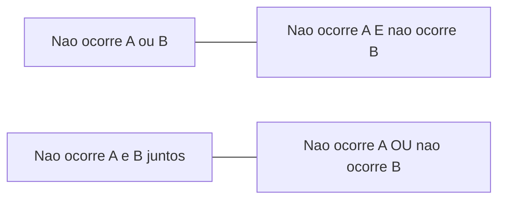

Há um atalho que resolve muitas questões de probabilidade: em vez de calcular a chance de um evento, calcular a de seu **complementar** e subtrair de 1. É o que se faz em todo problema de "pelo menos um". Este capítulo apresenta o teorema do evento complementar, as **leis de De Morgan**, que ligam o complementar da união e o da interseção, e os **axiomas** que sustentam toda a teoria. Os axiomas são a base da definição axiomática de probabilidade, cobrada no edital em geral por meio das propriedades que deles decorrem.

> [!objetivos]
> - Aplicar o teorema do evento complementar a problemas de "pelo menos um".
> - Usar as leis de De Morgan com probabilidades.
> - Enunciar os três axiomas da probabilidade.
> - Deduzir propriedades dos axiomas e verificar se uma distribuição é válida.

## Teorema do evento complementar

O **complementar** de um evento A, indicado por A' (ou Ā), reúne todos os pontos do espaço amostral que não pertencem a A. Como A e A' são excludentes e juntos formam todo o espaço, suas probabilidades somam 1:

    P(A') = 1 − P(A)

Esse resultado é útil quando o evento de interesse é "complicado" e seu complementar é simples. O caso clássico é o de **pelo menos um**: o complementar de "pelo menos um" é "nenhum", que costuma ter uma única forma de ocorrer.

| Enunciado | Evento complementar | Cálculo |
| --- | --- | --- |
| Pelo menos uma cara em 3 lançamentos | Nenhuma cara (todas coroas) | 1 − (1/2)³ = 7/8 |
| Soma de dois dados maior ou igual a 3 | Soma menor que 3 (só o par 1-1) | 1 − 1/36 = 35/36 |
| Pelo menos um 6 em 3 lançamentos de um dado | Nenhum 6 | 1 − (5/6)³ = 91/216 |
| Pelo menos um defeituoso em 2 peças de 20, sendo 3 defeituosas | Nenhum defeituoso | 1 − C(17, 2)/C(20, 2) = 1 − 68/95 = 27/95 |

> [!resolvido] Pelo menos um menino
> **Enunciado.** Um casal tem 3 filhos. Supondo que a chance de menino ou de menina seja a mesma, qual é a probabilidade de haver pelo menos um menino?
>
> **Raciocínio.** O evento "pelo menos um menino" tem muitas formas (1, 2 ou 3 meninos). O complementar é "nenhum menino", isto é, três meninas, que tem uma só forma.
>
> **Conta.** O espaço amostral tem 2³ = 8 resultados equiprováveis. O complementar tem 1 resultado, P = 1/8. Então P(pelo menos um menino) = 1 − 1/8 = 7/8.
>
> **Resposta.** A probabilidade é de 7/8, ou 87,5%.

> [!bizu]
> Sempre que o enunciado trouxer a expressão **"pelo menos um"**, **"ao menos um"** ou **"no mínimo um"**, pense primeiro em 1 menos a probabilidade de "nenhum". Funciona também para "no máximo" quando o evento contrário é simples, como "mais de dois" ser o complementar de "no máximo dois".

## Complementar da união e da interseção

As **leis de De Morgan** relacionam o complementar de uma união ou interseção com os complementares dos eventos:

    (A ∪ B)' = A' ∩ B'        e        (A ∩ B)' = A' ∪ B'

Em palavras: não ocorrer "A ou B" é o mesmo que não ocorrer A **e** não ocorrer B; e não ocorrer "A e B" é o mesmo que não ocorrer A **ou** não ocorrer B. Traduzidas em probabilidade:

    P((A ∪ B)') = 1 − P(A ∪ B)        P((A ∩ B)') = 1 − P(A ∩ B)

> [!resolvido] Aplicando De Morgan
> **Enunciado.** Sabe-se que P(A) = 0,3, P(B) = 0,5 e P(A ∩ B) = 0,1. Calcule P(A ∪ B), P((A ∪ B)') e P((A ∩ B)').
>
> **Raciocínio.** Calcula-se a união pela regra já vista e depois os complementares.
>
> **Conta.** P(A ∪ B) = 0,3 + 0,5 − 0,1 = 0,7. P((A ∪ B)') = 1 − 0,7 = 0,3, que é também P(A' ∩ B'), a chance de nenhum dos dois ocorrer. P((A ∩ B)') = 1 − 0,1 = 0,9, que é P(A' ∪ B'), a chance de pelo menos um deles não ocorrer.
>
> **Resposta.** A união vale 0,7, "nenhum dos dois" vale 0,3 e "não ocorrerem os dois juntos" vale 0,9.

> [!pegadinha]
> Trocar o conectivo ao negar. A negação de "A ou B" é "não A **e** não B", e não "não A ou não B". O mesmo vale para a negação de "A e B", que é "não A **ou** não B". Em questões de probabilidade, isso aparece quando se pede "nenhum dos dois" (interseção dos complementares) ou "pelo menos um deixou de ocorrer" (união dos complementares).

## Aplicações em pesquisas, cartões e tabuleiro

**Pasta de dente.** Em uma pesquisa com 300 pessoas, 120 usam a pasta de dente da marca A, 100 usam a da marca B e 40 usam as duas. Quantas pessoas usam A ou B? 120 + 100 − 40 = 180, e P(A ∪ B) = 180/300 = 0,6. Quem não usa nenhuma das duas é o complementar: 1 − 0,6 = 0,4, ou 120 pessoas. Pela lei de De Morgan, esse grupo é a interseção A' ∩ B'.

**Telefone celular e telefone fixo.** Suponha que 80% das famílias de uma cidade tenham telefone celular, 30% tenham telefone fixo e 25% tenham os dois. A probabilidade de ter pelo menos um dos dois é 0,80 + 0,30 − 0,25 = 0,85, e a de não ter nenhum é 0,15. A probabilidade de ter celular mas não fixo é 0,80 − 0,25 = 0,55.

**Torcedores.** Em um estádio, 60% dos presentes são torcedores do time A e 30% do time B. Como é impossível torcer pelos dois ao mesmo tempo, os eventos são mutuamente excludentes, e a probabilidade de um torcedor sorteado ser de A ou de B é 0,60 + 0,30 = 0,90. Os 10% restantes torcem por outro time, ou por nenhum.

**Cartões numerados.** Dez cartões numerados de 1 a 10 são colocados em uma caixa, e um é sorteado. O evento "número par ou múltiplo de 3" tem os elementos 2, 3, 4, 6, 8, 9 e 10, ou seja, 7 elementos, e P = 7/10. Pelo método da união, 5/10 + 3/10 − 1/10 = 7/10, pois os pares são 5, os múltiplos de 3 são 3 (3, 6 e 9) e o 6 pertence aos dois. O complementar, "ímpar e não múltiplo de 3", tem {1, 5, 7}, e P = 3/10.

**Tabuleiro.** Uma peça é colocada ao acaso em uma das 64 casas de um tabuleiro de 8 por 8. As casas da borda são 28 (32 casas das quatro bordas menos as 4 contadas duas vezes nos cantos, isto é, 8 + 8 + 6 + 6). Então a probabilidade de a peça cair na borda é 28/64 = 7/16, e a de cair no interior é 36/64 = 9/16, o complementar.

**Pessoas comendo ou bebendo.** Em um refeitório com 50 pessoas, 25 estão comendo, 18 estão bebendo e 10 estão fazendo as duas coisas. Estão comendo ou bebendo 25 + 18 − 10 = 33, e a probabilidade é 33/50 = 0,66. A de nem uma nem outra coisa é 17/50 = 0,34.

**Bolas marrons.** Uma urna tem 5 bolas marrons e 7 azuis. Duas bolas são retiradas sem reposição. A probabilidade de nenhuma ser marrom é C(7, 2)/C(12, 2) = 21/66 = 7/22, e a de pelo menos uma ser marrom é 1 − 7/22 = 15/22. O complementar poupa o trabalho de somar os casos "uma marrom" e "duas marrons".

| Situação | Evento | Complementar | Resultado |
| --- | --- | --- | --- |
| Pasta de dente | A ou B | Nenhuma das duas marcas | 0,6 e 0,4 |
| Telefone celular e fixo | Pelo menos um | Nenhum dos dois | 0,85 e 0,15 |
| Cartões de 1 a 10 | Par ou múltiplo de 3 | Ímpar e não múltiplo de 3 | 7/10 e 3/10 |
| Tabuleiro 8 por 8 | Casa na borda | Casa no interior | 7/16 e 9/16 |
| Urna com bolas marrons | Pelo menos uma marrom | Nenhuma marrom | 15/22 e 7/22 |

Em todos esses casos, vale um teste de sanidade: o complementar e o evento somam 1, e o resultado final fica entre 0 e 1. Se uma conta deu um número fixo fora desse intervalo, há erro de contagem, em geral de uma interseção esquecida.

## Axiomas da probabilidade

Os axiomas de Kolmogorov definem o que é uma probabilidade. Dado um espaço amostral U, uma função P que atribui a cada evento um número é uma probabilidade se obedece a três condições:

| Axioma | Enunciado | Significado |
| --- | --- | --- |
| 1. Não negatividade | P(A) ≥ 0, para todo evento A | Não existe probabilidade negativa |
| 2. Normalização | P(U) = 1 | O evento certo tem probabilidade 1 |
| 3. Aditividade | Se A e B são mutuamente excludentes, P(A ∪ B) = P(A) + P(B) | As probabilidades de eventos disjuntos se somam |

O terceiro axioma se estende a qualquer número finito (ou enumerável) de eventos mutuamente excludentes. Dos três axiomas decorrem as propriedades:

| Propriedade | Dedução |
| --- | --- |
| P(A') = 1 − P(A) | A e A' são excludentes, e A ∪ A' = U |
| P(∅) = 0 | ∅ é o complementar de U, e P(U) = 1 |
| 0 ≤ P(A) ≤ 1 | P(A) ≥ 0 e P(A) = 1 − P(A') ≤ 1 |
| Se A ⊂ B, então P(A) ≤ P(B) | B = A ∪ (B − A), eventos disjuntos |
| P(A ∪ B) = P(A) + P(B) − P(A ∩ B) | Decomposição em partes disjuntas |

> [!resolvido] Verificando uma distribuição de probabilidade
> **Enunciado.** Um experimento tem espaço amostral {a, b, c}, com P(a) = 0,2, P(b) = 0,5 e P(c) = 0,4. Essa atribuição é uma probabilidade?
>
> **Raciocínio.** Verificam-se os axiomas. Todos os valores são não negativos. Falta conferir se a soma é 1, pois P(U) = P(a) + P(b) + P(c) (eventos disjuntos).
>
> **Conta.** 0,2 + 0,5 + 0,4 = 1,1, que é maior que 1.
>
> **Resposta.** Não é uma probabilidade, pois viola o axioma da normalização. Para ser válida, a soma deveria ser 1; por exemplo, trocando P(c) por 0,3.

### Dado viciado

Os axiomas permitem trabalhar com resultados que não são equiprováveis. Suponha um dado em que a probabilidade de cada face seja proporcional ao número da face: P(k) = c · k. Pelo axioma da normalização, c · (1 + 2 + 3 + 4 + 5 + 6) = 1, então c = 1/21. A probabilidade de sair um número par é (2 + 4 + 6)/21 = 12/21 = 4/7. A de sair 6 é 6/21 = 2/7. Aqui não vale a definição clássica, mas valem os axiomas.

> [!atencao] Axiomas e definição clássica
> A definição clássica (casos favoráveis sobre possíveis) é um **caso particular** de probabilidade que obedece aos axiomas, quando os resultados são equiprováveis. A definição axiomática é mais geral: aceita qualquer atribuição de valores que satisfaça as três condições. Por isso uma questão que afirme que "toda probabilidade é favoráveis sobre possíveis" está errada.

## Demonstrações curtas que ajudam a lembrar

Duas deduções aparecem com frequência e valem ser memorizadas, porque mostram como os axiomas trabalham. A primeira é a do complementar: como A e A' são excludentes e A ∪ A' = U, o terceiro axioma dá P(A) + P(A') = P(U), e o segundo axioma, P(U) = 1, leva a P(A') = 1 − P(A). A segunda é a da probabilidade do conjunto vazio: o vazio é o complementar do espaço amostral, então P(∅) = 1 − P(U) = 0. Daí vem também que nenhuma probabilidade pode passar de 1, pois, se P(A) fosse maior que 1, P(A') seria negativa, o que viola o primeiro axioma.

A terceira dedução é a da monotonicidade. Se A está contido em B, então B pode ser escrito como a união de A com B − A, eventos excludentes. Assim P(B) = P(A) + P(B − A), e como P(B − A) é não negativa, P(A) ≤ P(B). A consequência prática é simples: o evento "sair 6" tem probabilidade menor ou igual à de "sair um número par", porque o primeiro está contido no segundo.

## Interpretando as probabilidades

Os axiomas não dizem o que é uma probabilidade, mas só como ela se comporta. A interpretação pode ser a clássica, em que os resultados são equiprováveis, a frequentista, em que a probabilidade é o limite das frequências relativas, ou a subjetiva, em que reflete o grau de crença de quem avalia. As três satisfazem os axiomas. Para a prova, o mais importante é saber que qualquer resultado obtido deve respeitar os limites e as propriedades, e que, diante de uma alternativa com probabilidade negativa ou maior que 1, ela pode ser descartada de imediato.

## Como a banca cobra este assunto

Os padrões mais frequentes são:

- **Pelo menos um:** uso do complementar, com moedas, dados, filhos e peças.
- **De Morgan:** negação de "e" e de "ou", e cálculo de "nenhum dos dois".
- **Axiomas:** verificar se uma atribuição é válida e enunciar os três axiomas.
- **Propriedades:** P(∅) = 0, limites entre 0 e 1 e monotonicidade.
- **Dados viciados:** achar a constante de normalização.

## Mapa do capítulo

| Tema | Regra | Cuidado |
| --- | --- | --- |
| Complementar | P(A') = 1 − P(A) | Atalho para "pelo menos um" |
| De Morgan | (A ∪ B)' = A' ∩ B'; (A ∩ B)' = A' ∪ B' | Trocar o conectivo ao negar |
| Axioma 1 | P(A) ≥ 0 | Nunca negativa |
| Axioma 2 | P(U) = 1 | A soma de uma partição é 1 |
| Axioma 3 | P(A ∪ B) = P(A) + P(B), se disjuntos | Só para excludentes |
| Monotonicidade | A ⊂ B implica P(A) ≤ P(B) | Evento contido tem probabilidade menor ou igual |

### Para fixar

- A probabilidade do complementar é 1 menos a do evento.
- Em problemas de "pelo menos um", calcula-se o complementar "nenhum" e subtrai-se de 1.
- A negação de "A ou B" é "não A e não B", e a de "A e B" é "não A ou não B".
- Os três axiomas são: não negatividade, normalização (P(U) = 1) e aditividade para eventos excludentes.
- Do axioma da aditividade decorre P(∅) = 0 e 0 ≤ P(A) ≤ 1.
- Se A está contido em B, a probabilidade de A é menor ou igual à de B.
- Uma atribuição de valores é uma probabilidade se for não negativa e somar 1.
- A definição clássica é caso particular da axiomática, para resultados equiprováveis.
