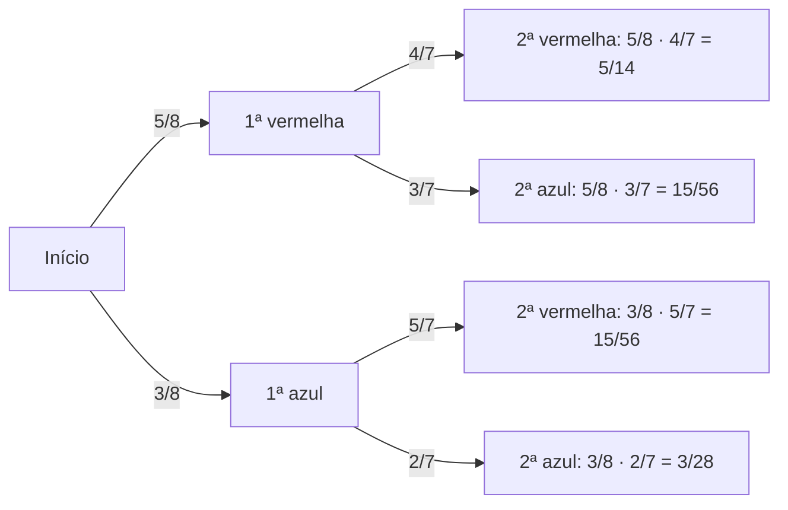

Às vezes sabemos de antemão que algo já aconteceu e queremos saber a chance de outro evento, **dada** essa informação. É a **probabilidade condicional**. Ela muda o espaço amostral: em vez de olhar todos os casos, olhamos só aqueles em que a condição é verdadeira. Disso saem duas regras de ouro do assunto, a **regra da multiplicação**, que dá a chance de dois eventos ocorrerem juntos, e o conceito de **independência**, que descreve eventos que não influenciam um ao outro. É o capítulo de maior peso do volume, e suas ideias reaparecem no teorema de Bayes.

> [!objetivos]
> - Calcular a probabilidade condicional pela definição e pelo espaço amostral reduzido.
> - Aplicar a regra da multiplicação, com e sem reposição.
> - Verificar a independência de dois eventos.
> - Resolver problemas de "pelo menos um" com eventos independentes.

## Probabilidade condicional

A probabilidade de A **dado** que B ocorreu, indicada por P(A | B), é:

    P(A | B) = P(A ∩ B) / P(B),    com P(B) > 0

Em palavras: entre os casos em que B ocorre (denominador), qual a fração em que A também ocorre (numerador)? Quando os casos são equiprováveis, equivale a contar elementos: P(A | B) = n(A ∩ B) / n(B). Dizemos que o espaço amostral foi **reduzido** a B.

> [!resolvido] Condicional no lançamento de dois dados
> **Enunciado.** Dois dados honestos são lançados. Sabendo que o primeiro mostrou 3, qual é a probabilidade de a soma ser 8?
>
> **Raciocínio.** Com a condição "o primeiro dado é 3", o espaço amostral reduzido tem 6 resultados: (3,1), (3,2), (3,3), (3,4), (3,5) e (3,6).
>
> **Conta.** Somente (3,5) tem soma 8. Então P(soma 8 | primeiro é 3) = 1/6. Pela fórmula: P(A ∩ B) = 1/36 e P(B) = 6/36, logo (1/36)/(6/36) = 1/6.
>
> **Resposta.** A probabilidade é de 1/6.

> [!resolvido] Condicional com cartas
> **Enunciado.** Uma carta é retirada ao acaso de um baralho de 52 cartas, e se sabe que é uma figura (valete, dama ou rei, que são 12 cartas). Qual é a probabilidade de ser um rei?
>
> **Raciocínio.** O espaço reduzido é o das 12 figuras, e há 4 reis.
>
> **Conta.** P(rei | figura) = 4/12 = 1/3. Note que a probabilidade incondicional de rei é 4/52 = 1/13, bem menor.
>
> **Resposta.** A probabilidade é de 1/3.

### Tabelas de dupla entrada

Uma forma de organizar dados é a tabela de dupla entrada. Em um grupo de 100 pessoas, classificadas por fumar ou não e por ter ou não uma doença respiratória:

| Grupo | Com a doença | Sem a doença | Total |
| --- | --- | --- | --- |
| Fumantes | 24 | 16 | 40 |
| Não fumantes | 12 | 48 | 60 |
| Total | 36 | 64 | 100 |

A probabilidade de ter a doença é 36/100. A de ter a doença **dado** que fuma é 24/40 = 0,6, bem maior. A de fumar, dado que tem a doença, é 24/36 = 2/3. Veja que P(A | B) e P(B | A) são **diferentes**: o numerador é o mesmo (a interseção), mas o denominador muda.

> [!pegadinha]
> Confundir P(A | B) com P(B | A). A probabilidade de ter a doença sendo fumante (24/40) não é a de ser fumante tendo a doença (24/36). A condição define o denominador. Quem inverte a ordem troca o grupo de referência e erra a conta.

## Regra da multiplicação

Isolando a interseção na definição da condicional, obtém-se a **regra da multiplicação**:

    P(A ∩ B) = P(A) · P(B | A) = P(B) · P(A | B)

Ela serve para encontrar a chance de dois eventos acontecerem em sequência. Para três eventos, a regra se estende: P(A ∩ B ∩ C) = P(A) · P(B | A) · P(C | A ∩ B). Cada fator é a probabilidade de um evento, **dada** a ocorrência dos anteriores.

### Retiradas sem reposição

Em retiradas **sem reposição**, a composição da urna muda a cada retirada, e as probabilidades seguintes são condicionais.

> [!resolvido] Duas bolas vermelhas sem reposição
> **Enunciado.** Uma urna tem 5 bolas vermelhas e 3 azuis. Duas bolas são retiradas sem reposição. Qual é a probabilidade de ambas serem vermelhas?
>
> **Raciocínio.** Na primeira retirada, 5 das 8 são vermelhas. Se a primeira foi vermelha, restam 4 vermelhas entre 7 bolas.
>
> **Conta.** P = 5/8 · 4/7 = 20/56 = 5/14. Conferência por combinações: C(5, 2)/C(8, 2) = 10/28 = 5/14.
>
> **Resposta.** A probabilidade é de 5/14, cerca de 35,7%.

A **árvore de probabilidades** ajuda a organizar. Cada ramo tem a probabilidade condicional, e o caminho completo é o produto dos ramos.

As quatro folhas somam 20/56 + 15/56 + 15/56 + 6/56 = 56/56 = 1, como deve ser. Se a pergunta fosse "uma de cada cor", somam-se os ramos vermelha-azul e azul-vermelha: 15/56 + 15/56 = 30/56 = 15/28.

### Retiradas com reposição

Quando a bola retirada é **devolvida** à urna, a composição não muda, e as retiradas são **independentes**. Na mesma urna, a probabilidade de duas vermelhas com reposição é 5/8 · 5/8 = 25/64.

| Tipo de retirada | Composição da urna | Probabilidade da 2ª retirada | Relação entre os eventos |
| --- | --- | --- | --- |
| Com reposição | Constante | Igual à da 1ª | Independentes |
| Sem reposição | Muda a cada retirada | Condicional à 1ª | Dependentes |

> [!bizu]
> Para o caso de "sem reposição", use a **regra da multiplicação em cadeia**, com o numerador e o denominador diminuindo a cada retirada. Para a retirada de várias bolas ao mesmo tempo, o resultado é o mesmo que o das retiradas sucessivas sem reposição, e pode ser calculado por combinações. Escolha o caminho de que você tem mais segurança.

## Independência de eventos

Dois eventos A e B são **independentes** quando a ocorrência de um não altera a probabilidade do outro:

    P(A | B) = P(A)        ou, de forma equivalente,        P(A ∩ B) = P(A) · P(B)

A segunda forma é a mais usada para **testar** a independência: calcula-se P(A ∩ B) e compara-se com o produto P(A) · P(B). Se forem iguais, os eventos são independentes. Na tabela de fumantes, P(fumante) = 40/100 = 0,4 e P(doença) = 36/100 = 0,36, e o produto é 0,144. Mas P(fumante e doença) = 24/100 = 0,24, diferente do produto. Os eventos são **dependentes**: fumar e ter a doença estão associados.

> [!resolvido] Testando a independência
> **Enunciado.** Um dado honesto é lançado. A é o evento "número par" e B, "número menor ou igual a 4". Os eventos são independentes?
>
> **Raciocínio.** Calculam-se as probabilidades e compara-se a interseção com o produto.
>
> **Conta.** A = {2, 4, 6}, P(A) = 1/2. B = {1, 2, 3, 4}, P(B) = 2/3. A ∩ B = {2, 4}, P(A ∩ B) = 2/6 = 1/3. O produto é 1/2 · 2/3 = 1/3, igual à interseção.
>
> **Resposta.** São independentes, pois P(A ∩ B) = P(A) · P(B). Em termos de condicional, P(A | B) = (1/3)/(2/3) = 1/2 = P(A).

Algumas propriedades são importantes. Se A e B são independentes, também o são A e B', A' e B, e A' e B'. E a independência **não** é o mesmo que a exclusão mútua.

> [!atencao] Independentes não são excludentes
> Eventos mutuamente excludentes, com probabilidades positivas, são **dependentes**: se um ocorre, o outro é impossível, e P(A | B) = 0 ≠ P(A). Já eventos independentes podem ocorrer juntos, e a chance de ocorrerem juntos é o produto das probabilidades. É a pegadinha mais frequente do tema.

### Eventos independentes em sequência

Para eventos independentes, a probabilidade de todos ocorrerem é o produto das probabilidades. Um dado e uma moeda lançados juntos têm resultados independentes: a chance de sair 6 e cara é 1/6 · 1/2 = 1/12. Três lançamentos de moeda dão três caras com probabilidade (1/2)³ = 1/8.

### "Pelo menos um" com eventos independentes

Combinando o complementar com a independência, a probabilidade de **pelo menos um** de vários eventos independentes é:

    P(pelo menos um) = 1 − (1 − p₁) · (1 − p₂) · ... · (1 − pₙ)

> [!resolvido] Três tiros independentes
> **Enunciado.** Um atirador acerta o alvo em cada tiro com probabilidade 0,6, independentemente dos demais. Em 3 tiros, qual é a probabilidade de acertar pelo menos uma vez? E de acertar exatamente uma?
>
> **Raciocínio.** O complementar de "pelo menos um acerto" é "errar os três". Para "exatamente um", há 3 posições possíveis para o acerto.
>
> **Conta.** P(errar) = 0,4. P(errar os 3) = 0,4³ = 0,064, logo P(pelo menos um acerto) = 1 − 0,064 = 0,936. P(exatamente um) = 3 · 0,6 · 0,4² = 3 · 0,6 · 0,16 = 0,288.
>
> **Resposta.** A probabilidade de acertar ao menos uma vez é de 93,6%, e a de acertar exatamente uma vez é de 28,8%.

## Aplicações em contextos de prova

**Famílias com dois filhos.** Um casal tem dois filhos, e cada nascimento tem a mesma chance de ser homem ou mulher. O espaço amostral é {HH, HM, MH, MM}, com 4 resultados equiprováveis. Sabendo que a família tem pelo menos um homem (HH, HM e MH, ou seja, 3 casos), a probabilidade de os dois serem homens é 1/3, e não 1/2. Já se a informação for que o filho mais velho é homem, o espaço reduzido é {HH, HM}, e a probabilidade de ambos serem homens é 1/2. A diferença está no que a condição elimina, e este é um dos exemplos mais cobrados de condicional.

**Enfermeiros em um hospital.** Em um hospital há 60 enfermeiros: 45 mulheres e 15 homens. Entre as mulheres, 30 têm emprego em dois turnos; entre os homens, 6. Sorteando um enfermeiro, a probabilidade de ele trabalhar em dois turnos, dado que é homem, é 6/15 = 0,4. A probabilidade de ser homem, dado que trabalha em dois turnos, é 6/36 = 1/6. Os dois números são bem diferentes, por causa dos denominadores. A probabilidade de ser mulher e trabalhar em dois turnos é 30/60 = 0,5.

**Detentos.** Em uma unidade prisional, 200 detentos foram classificados em primários (120) e reincidentes (80). Entre os reincidentes, 20 já foram condenados por furto, e entre os primários, 30. Sorteando um detento condenado por furto (50 ao todo), a probabilidade de ser reincidente é 20/50 = 0,4. Sorteando um reincidente, a probabilidade de ter condenação por furto é 20/80 = 0,25.

**Doença e exame.** Um homem e uma mulher fazem o mesmo exame. A chance de contrair uma doença é de 2% para cada um, independentemente. A probabilidade de os dois contraírem a doença é 0,02 · 0,02 = 0,0004. A de pelo menos um contrair é 1 − 0,98 · 0,98 = 0,0396. Se a doença fosse contagiosa entre eles, os eventos deixariam de ser independentes.

**Três alunos.** Peter, Gödel e Russell são três alunos, e dois serão sorteados, um após o outro, sem reposição, para apresentar a matéria. A probabilidade de Peter ser o primeiro é 1/3. A de Peter ser o primeiro e Gödel o segundo é 1/3 · 1/2 = 1/6. A de Russell ser sorteado em alguma das duas posições é 1 − P(Russell não é sorteado) = 1 − (2/3 · 1/2) = 2/3. As contas usam a regra da multiplicação e o complementar.

### Sistemas em série e em paralelo

A independência é muito usada em confiabilidade de sistemas, que falham ou funcionam. Suponha dois componentes independentes, com probabilidades de falhar de 0,1 e 0,2, ou seja, de funcionar com 0,9 e 0,8:

| Arranjo | Funciona quando | Probabilidade de funcionar |
| --- | --- | --- |
| Em série | Os dois funcionam | 0,9 · 0,8 = 0,72 |
| Em paralelo | Pelo menos um funciona | 1 − 0,1 · 0,2 = 0,98 |

Em um sistema em série, basta um componente falhar para o sistema falhar, e por isso a confiabilidade é o produto. Em paralelo, o sistema só falha se todos falharem, e a confiabilidade é 1 menos o produto das falhas. É a mesma lógica de "pelo menos um" já estudada.

> [!atencao] Condição em cadeia
> Quando a questão traz uma sequência de informações ("sabe-se que... e que..."), cada informação restringe o espaço amostral. Reduza o espaço **uma informação por vez** e conte os casos no espaço reduzido. Isso evita aplicar a fórmula com os eventos trocados e torna a conta quase sempre mais simples do que a fórmula geral.

## A condicional é uma probabilidade

Fixada a condição B, a função P(· dado B) obedece aos três axiomas, e por isso herda todas as propriedades vistas no capítulo anterior. Assim, P(A' dado B) = 1 − P(A dado B), e P((A ∪ C) dado B) = P(A dado B) + P(C dado B) − P((A ∩ C) dado B). Na tabela dos fumantes, a probabilidade de **não** ter a doença, dado que fuma, é 16/40 = 0,4, que é 1 − 0,6. Esse fato é muito útil: quando a pergunta é "dado que..., qual a chance de pelo menos um...", pode-se aplicar o complementar dentro do espaço reduzido.

### Regra da multiplicação para três eventos

> [!resolvido] Três retiradas sem reposição
> **Enunciado.** Uma caixa tem 4 peças boas e 6 defeituosas. Três peças são retiradas ao acaso, uma após a outra e sem reposição. Qual é a probabilidade de as três serem boas? E de a primeira ser defeituosa e as outras duas boas?
>
> **Raciocínio.** Aplica-se a regra da multiplicação em cadeia, atualizando a composição da caixa a cada retirada.
>
> **Conta.** Três boas: 4/10 · 3/9 · 2/8 = 24/720 = 1/30. Primeira defeituosa e as outras duas boas: 6/10 · 4/9 · 3/8 = 72/720 = 1/10. Conferência da primeira por combinações: C(4, 3)/C(10, 3) = 4/120 = 1/30.
>
> **Resposta.** A probabilidade de três peças boas é de 1/30, e a de defeituosa seguida de duas boas é de 1/10.

Um ponto prático: a probabilidade de uma sequência específica (por exemplo, defeituosa, boa, boa) é um produto, mas a probabilidade de "uma defeituosa e duas boas em qualquer ordem" é a soma das três sequências possíveis, que são igualmente prováveis. No exemplo, cada sequência tem probabilidade 1/10, e a soma é 3/10.

### Multiplicação e a ordem dos eventos

A regra vale em qualquer ordem: P(A ∩ B) = P(A) · P(B dado A) = P(B) · P(A dado B). Na prática, escolhe-se a ordem em que as condicionais são mais fáceis de calcular. Em um problema com dependência temporal, como retiradas sucessivas, segue-se a ordem cronológica. Em um problema de tabela, escolhe-se a ordem que corresponde às linhas ou colunas totalizadas.

## Independência em experimentos repetidos

Em experimentos repetidos nas mesmas condições, como lançamentos de uma moeda, as repetições são independentes. Isso permite calcular a probabilidade de um padrão: em 4 lançamentos de uma moeda honesta, a probabilidade de a sequência ser cara, coroa, cara, coroa é (1/2)⁴ = 1/16, como a de qualquer outra sequência específica. A probabilidade de obter **exatamente duas** caras, em qualquer ordem, é C(4, 2) · (1/2)⁴ = 6/16 = 3/8, porque há 6 sequências com duas caras. Esse é o início da distribuição binomial, que costuma aparecer em provas mais adiante.

Há também a ideia de **independência condicional** e a de que a independência é uma propriedade dos números, e não da intuição. Dois eventos que "parecem" ligados podem ser independentes, e dois que "parecem" separados podem não ser. A única forma segura de afirmar é verificar P(A ∩ B) = P(A) · P(B), como no exemplo do dado, em que "par" e "menor ou igual a 4" são independentes, embora ambos dependam do mesmo número sorteado.

## Relação entre condicional, interseção e união

Reunindo as regras do capítulo e dos anteriores, é possível transitar entre as probabilidades de A, B, A ∩ B, A ∪ B e as condicionais. Se P(A) = 0,5, P(B) = 0,4 e P(A ∩ B) = 0,2, então P(A | B) = 0,2/0,4 = 0,5, P(B | A) = 0,2/0,5 = 0,4 e P(A ∪ B) = 0,5 + 0,4 − 0,2 = 0,7. Como P(A | B) = P(A), esses eventos são independentes. Para eventos independentes, a união também se simplifica: P(A ∪ B) = P(A) + P(B) − P(A) · P(B) = 1 − (1 − P(A))(1 − P(B)).

| Situação | Fórmula |
| --- | --- |
| Condicional | P(A dado B) = P(A ∩ B) / P(B) |
| Multiplicação | P(A ∩ B) = P(A) · P(B dado A) |
| Independência | P(A ∩ B) = P(A) · P(B) |
| União de independentes | 1 − (1 − P(A))(1 − P(B)) |

## Roteiro de resolução

Para resolver uma questão de probabilidade condicional ou de independência, vale seguir uma ordem de passos. Primeiro, identifique se o texto traz uma condição, com expressões como "sabendo que", "dado que", "entre os que" ou "se já ocorreu". Segundo, escreva os eventos com letras, A e B, e anote as probabilidades que o enunciado fornece. Terceiro, decida se há dependência: retiradas sem reposição e informações sobre grupos indicam dependência, e repetições do mesmo experimento indicam independência. Quarto, escolha o caminho: espaço amostral reduzido (contagem) para casos pequenos e fórmula para casos com dados numéricos. Por fim, confira o resultado com um teste de sanidade, como a soma das folhas da árvore igual a 1, ou a comparação com a probabilidade sem condição.

Um erro que merece atenção é supor independência sem que o enunciado a garanta. Em um sorteio sem reposição, a segunda retirada depende da primeira; em um sistema com componentes que dividem a mesma fonte de energia, as falhas podem estar ligadas. A palavra "independentemente" no enunciado é a autorização para multiplicar as probabilidades. Se ela faltar, convém verificar pelo teste P(A ∩ B) = P(A) · P(B) ou, se os dados não bastarem, tratar os eventos como dependentes e usar a condicional.

## Como a banca cobra este assunto

Os padrões mais frequentes são:

- **Condicional em tabelas:** probabilidade de um grupo, dado outro, com atenção ao denominador.
- **Sem reposição:** produto de probabilidades condicionais e árvore de decisões.
- **Teste de independência:** comparar a interseção com o produto das probabilidades.
- **Pegadinha:** confundir independentes com excludentes.
- **Pelo menos um:** complementar combinado com a independência.

## Mapa do capítulo

| Tema | Fórmula | Cuidado |
| --- | --- | --- |
| Condicional | P(A ∩ B) / P(B) | O denominador é a condição |
| Multiplicação | P(A) · P(B dado A) | Sem reposição, a urna muda |
| Independência | P(A ∩ B) = P(A) · P(B) | Equivale a P(A dado B) = P(A) |
| Complementos | A, B independentes implica A', B independentes | Vale para todos os pares |
| Excludentes | Interseção vazia | Não são independentes |
| Pelo menos um | 1 − produto dos complementos | Só para independentes |

### Para fixar

- A probabilidade condicional restringe o espaço amostral ao evento dado.
- P(A | B) é a interseção dividida pela probabilidade de B.
- P(A | B) e P(B | A) são, em geral, diferentes.
- A regra da multiplicação dá P(A ∩ B) = P(A) · P(B | A).
- Sem reposição, as retiradas são dependentes; com reposição, são independentes.
- A, B são independentes quando P(A ∩ B) = P(A) · P(B).
- Eventos excludentes com probabilidade positiva nunca são independentes.
- "Pelo menos um", com eventos independentes, é 1 menos o produto dos complementos.
