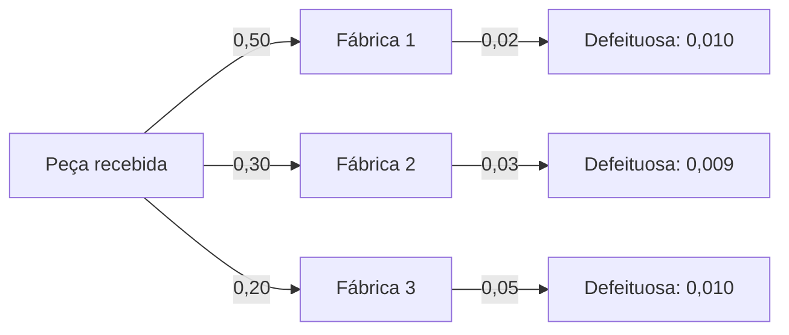

Este capítulo fecha o bloco de probabilidade condicional com três ideias que se complementam. A primeira é a **independência de três eventos**, em que não basta que sejam independentes dois a dois. A segunda é o **teorema da probabilidade total**, que calcula a chance de um evento "somando por cenários". A terceira é o **teorema de Bayes**, que faz o caminho inverso: dado que o evento ocorreu, qual a chance de cada cenário ter sido o responsável? São assuntos de tom mais sofisticado, mas cuja resolução obedece a um roteiro fixo de árvore e tabela.

> [!objetivos]
> - Distinguir independência dois a dois e independência mútua de três eventos.
> - Aplicar o teorema da probabilidade total a uma partição do espaço amostral.
> - Aplicar o teorema de Bayes e interpretar as probabilidades a priori e a posteriori.
> - Resolver problemas de testes diagnósticos e de defeitos por origem.

## Independência de três eventos

Para três eventos A, B e C, a independência exige mais do que a de cada par. Os eventos são **mutuamente independentes** quando valem, ao mesmo tempo, quatro igualdades:

    P(A ∩ B) = P(A) · P(B)
    P(A ∩ C) = P(A) · P(C)
    P(B ∩ C) = P(B) · P(C)
    P(A ∩ B ∩ C) = P(A) · P(B) · P(C)

As três primeiras garantem a independência **dois a dois**; a quarta, a **independência conjunta**. Pode ocorrer que os eventos sejam independentes dois a dois e **não** sejam mutuamente independentes.

> [!resolvido] Independentes dois a dois, mas não mutuamente
> **Enunciado.** Uma moeda honesta é lançada duas vezes. Sejam A = "cara no primeiro", B = "cara no segundo" e C = "os dois resultados são iguais". Verifique a independência.
>
> **Raciocínio.** O espaço amostral é {CC, CK, KC, KK}, e cada resultado vale 1/4. Calculam-se as probabilidades individuais, as interseções duas a duas e a tripla.
>
> **Conta.** P(A) = P(B) = P(C) = 1/2. P(A ∩ B) = P(CC) = 1/4 = 1/2 · 1/2. P(A ∩ C) = P(CC) = 1/4. P(B ∩ C) = P(CC) = 1/4. Os três pares são independentes. Mas P(A ∩ B ∩ C) = P(CC) = 1/4, enquanto o produto das três é 1/8.
>
> **Resposta.** Os eventos são independentes dois a dois, mas **não são mutuamente independentes**, porque a interseção tripla (1/4) difere do produto (1/8). Saber A e B determina C.

Quando os três eventos são de fato independentes, a probabilidade de todos ocorrerem é o produto das três, e a de pelo menos um é 1 − (1 − P(A))(1 − P(B))(1 − P(C)).

> [!pegadinha]
> Concluir que três eventos são independentes só porque cada par é. É preciso verificar também a interseção tripla. A expressão "mutuamente independentes" (ou "independentes", sem mais) exige as quatro igualdades; "independentes dois a dois" exige só as três primeiras.

## Partição e probabilidade total

Uma **partição** do espaço amostral é um conjunto de eventos B₁, B₂, ..., Bₙ, mutuamente excludentes, com probabilidades positivas, cuja união é todo o espaço. Eles representam "cenários" que não se sobrepõem e que cobrem todas as possibilidades. Qualquer evento A pode ser decomposto segundo os cenários, e pela regra da multiplicação resulta o **teorema da probabilidade total**:

    P(A) = P(B₁) · P(A | B₁) + P(B₂) · P(A | B₂) + ... + P(Bₙ) · P(A | Bₙ)

A probabilidade de A é a média das probabilidades condicionais em cada cenário, **ponderada** pela probabilidade do cenário. Na árvore, é a soma dos caminhos que levam a A.

> [!resolvido] Defeitos por fábrica
> **Enunciado.** Uma empresa recebe peças de três fábricas: a fábrica 1 fornece 50% das peças, a 2 fornece 30% e a 3 fornece 20%. As proporções de peças defeituosas são de 2%, 3% e 5%, respectivamente. Qual é a probabilidade de uma peça sorteada ser defeituosa?
>
> **Raciocínio.** As três fábricas formam uma partição. Aplica-se a probabilidade total.
>
> **Conta.** P(D) = 0,50 · 0,02 + 0,30 · 0,03 + 0,20 · 0,05 = 0,010 + 0,009 + 0,010 = 0,029.
>
> **Resposta.** A probabilidade de uma peça sorteada ser defeituosa é de 2,9%.

| Fábrica | P(fábrica) | P(defeito dado a fábrica) | Contribuição ao total |
| --- | --- | --- | --- |
| 1 | 0,50 | 0,02 | 0,010 |
| 2 | 0,30 | 0,03 | 0,009 |
| 3 | 0,20 | 0,05 | 0,010 |
| Soma | 1,00 | | 0,029 |

## Teorema de Bayes

Agora a pergunta inversa: sabendo que a peça é defeituosa, qual a probabilidade de ela vir da fábrica 1? O **teorema de Bayes** responde. Para um cenário Bᵢ da partição e um evento A com P(A) > 0:

    P(Bᵢ | A) = P(Bᵢ) · P(A | Bᵢ) / P(A)

com o denominador calculado pela probabilidade total. As probabilidades P(Bᵢ) são as probabilidades **a priori** (antes de saber que A ocorreu), e as P(Bᵢ | A), as **a posteriori** (depois de saber). A informação de que A ocorreu "atualiza" a chance de cada cenário.

No exemplo das fábricas, sabendo que a peça é defeituosa:

- Fábrica 1: 0,010 / 0,029 = 10/29, cerca de 34,5%.
- Fábrica 2: 0,009 / 0,029 = 9/29, cerca de 31,0%.
- Fábrica 3: 0,010 / 0,029 = 10/29, cerca de 34,5%.

As três somam 1, como deve ser. Note como a fábrica 3, que fornece apenas 20% das peças, é responsável por 34,5% dos defeitos, porque tem a maior taxa de defeito.

> [!resolvido] Teste diagnóstico
> **Enunciado.** Uma doença atinge 2% da população. Um teste dá resultado positivo em 90% dos doentes e, por engano, em 5% dos sadios. Uma pessoa é escolhida ao acaso e o teste dá positivo. Qual é a probabilidade de ela estar doente?
>
> **Raciocínio.** Os cenários são "doente" e "sadio". Calcula-se a probabilidade total de positivo e, em seguida, aplica-se Bayes.
>
> **Conta.** P(+) = 0,02 · 0,90 + 0,98 · 0,05 = 0,018 + 0,049 = 0,067. P(doente | +) = 0,018 / 0,067 ≈ 0,2687.
>
> **Resposta.** A probabilidade é de cerca de 26,9%, apesar de o teste ter 90% de acerto entre os doentes. O resultado é baixo porque a doença é rara, e os falsos positivos entre os sadios, que são muitos, superam os verdadeiros positivos.

> [!bizu]
> Para Bayes, desenhe a árvore e responda a duas perguntas em ordem: **quais caminhos levam ao evento observado?** (some seus pesos para obter o denominador) e **qual desses caminhos é o do cenário pedido?** (o peso desse caminho é o numerador). A resposta é o numerador sobre o denominador, isto é, a fração do evento que veio do cenário.

### Relação entre as quatro quantidades

O mesmo exemplo pode ser organizado em uma tabela de 1.000 pessoas, que torna o raciocínio concreto:

| Resultado do teste | Doentes (20) | Sadios (980) | Total |
| --- | --- | --- | --- |
| Positivo | 18 | 49 | 67 |
| Negativo | 2 | 931 | 933 |
| Total | 20 | 980 | 1.000 |

Dos 67 positivos, 18 estão doentes: 18/67 ≈ 26,9%. É o mesmo valor, obtido por contagem. Já dos 933 negativos, 931 estão sadios, o que dá ao teste um alto valor de exclusão: P(sadio | −) = 931/933 ≈ 99,8%. Nota-se, assim, que um teste pode ser ótimo em excluir a doença e fraco em confirmá-la, dependendo da raridade da doença.

> [!atencao] Sensibilidade, especificidade e valores preditivos
> A **sensibilidade** é P(+ | doente), 90% no exemplo. A **especificidade** é P(− | sadio), 95%. O **valor preditivo positivo** é P(doente | +), que se obtém com Bayes e depende da prevalência. Confundir P(+ | doente) com P(doente | +) é o erro mais comum, e é a inversão das condicionais que o teorema de Bayes corrige.

### Bayes com urnas

Duas urnas são escolhidas ao acaso, com probabilidade 1/2 cada. A urna I tem 3 bolas vermelhas e 1 azul. A urna II tem 1 vermelha e 3 azuis. Uma bola é retirada da urna escolhida e é vermelha. A probabilidade de que tenha vindo da urna I é

P(I | vermelha) = (1/2 · 3/4) / (1/2 · 3/4 + 1/2 · 1/4) = (3/8)/(4/8) = 3/4.

O resultado confere com a intuição: como a urna I tem mais bolas vermelhas, ver uma bola vermelha aumenta a chance de ter vindo dela, de 1/2 para 3/4.

## Aplicações em contextos de prova

**Vacinação e dose.** Em uma campanha, 80% da população recebeu a dose completa da vacina e passou a ser considerada imunizada, e 20% não a recebeu. Entre as pessoas imunizadas, 2% ainda contraem a doença quando expostas; entre as não imunizadas, 20%. Para uma pessoa exposta escolhida ao acaso, a probabilidade de adoecer é 0,80 · 0,02 + 0,20 · 0,20 = 0,016 + 0,040 = 0,056. Sabendo que a pessoa adoeceu, a probabilidade de que estivesse imunizada é 0,016/0,056 = 2/7, cerca de 28,6%. Embora a vacina seja eficaz, a maior parte dos casos ocorre entre os não imunizados (5/7), porque a taxa de adoecimento deles é dez vezes maior.

**Lâmpadas.** Uma loja compra lâmpadas de dois fornecedores: 70% vêm do fornecedor X e 30% do Y. A proporção de lâmpadas que duram mais de 1000 h é de 80% no fornecedor X e de 60% no Y. A probabilidade de uma lâmpada sorteada durar mais de 1000 h é 0,7 · 0,8 + 0,3 · 0,6 = 0,56 + 0,18 = 0,74. Se uma lâmpada durou mais de 1000 h, a probabilidade de ser do fornecedor X é 0,56/0,74 = 28/37, cerca de 75,7%. Se não durou, é 0,7 · 0,2/0,26 = 0,14/0,26 = 7/13, cerca de 53,8%.

**Inadimplência e modelo computacional.** Um banco estima que 10% de seus clientes são inadimplentes e 90% são bons pagadores. Um modelo computacional de risco classifica como "alto risco" 80% dos inadimplentes e 10% dos bons pagadores. A probabilidade de um cliente ser classificado como alto risco é 0,10 · 0,80 + 0,90 · 0,10 = 0,08 + 0,09 = 0,17. Dado que foi classificado como alto risco, a probabilidade de realmente ser inadimplente é 0,08/0,17 = 8/17, cerca de 47,1%: quase metade dos clientes de alto risco são bons pagadores. Esse é o mesmo padrão do teste médico, e mostra que um modelo de boa sensibilidade pode ter baixa precisão.

**Ações em uma vara.** Em uma vara judicial, 40% das ações têm natureza agropecuária e 60% são de outras atividades. A gratuidade da justiça é concedida em 70% das ações agropecuárias e em 30% das demais. A probabilidade de que uma ação sorteada tenha gratuidade é 0,40 · 0,70 + 0,60 · 0,30 = 0,28 + 0,18 = 0,46. Se a ação sorteada tem gratuidade, a probabilidade de ser agropecuária é 0,28/0,46 = 14/23, cerca de 60,9%. O advogado Carlos, ao pegar uma ação com gratuidade, pode então estimar que ela é agropecuária com cerca de 61% de chance.

| Exemplo | Probabilidade total | Bayes (cenário dado o evento) |
| --- | --- | --- |
| Fábricas e defeitos | 0,029 | Fábrica 1: 10/29 |
| Teste diagnóstico | 0,067 | Doente dado positivo: 26,9% |
| Vacinação | 0,056 | Imunizado dado adoecer: 2/7 |
| Lâmpadas | 0,74 | Fornecedor X dado duração longa: 28/37 |
| Inadimplência | 0,17 | Inadimplente dado alto risco: 8/17 |
| Vara judicial | 0,46 | Agropecuária dado gratuidade: 14/23 |

### Outros contextos que costumam aparecer

**Lâmpadas que queimam.** Se 15% das lâmpadas de um lote queimam antes de 1000h, a probabilidade de uma lâmpada sorteada durar mais de 1000h é 0,85. Em 3 lâmpadas independentes, a chance de nenhuma queimar antes de 1000h é 0,85³ ≈ 0,614, e a de pelo menos uma queimar é 1 − 0,614 = 0,386. A taxa de 0,015 (1,5%) de uma peça defeituosa por viabilidade de projeto, em um processo com 100 peças independentes, dá a chance de nenhuma defeituosa de 0,985¹⁰⁰ ≈ 0,22, e a de pelo menos uma de cerca de 0,78.

**Varas criminais.** Em duas varas criminais, a vara 1 analisa 60% das demandas, e a vara 2, 40%. Os pedidos são indeferidos em 25% das demandas da vara 1 e em 10% das da vara 2. A probabilidade de uma demanda sorteada ser indeferida é 0,6 · 0,25 + 0,4 · 0,10 = 0,15 + 0,04 = 0,19. Sabendo que foi indeferida, a chance de ser da vara 1 é 0,15/0,19 = 15/19, cerca de 78,9%. Os dados analisados nesse formato de pesquisa, como a quantidade de ações por vara, são típicos de provas para as carreiras jurídicas.

**Bebedores e ausentes.** Em um grupo de estudantes, 30% são bebedores habituais e 70% não bebem. A chance de estar ausente no período da manhã é de 20% entre os bebedores e de 5% entre os demais. Assim, a probabilidade de um estudante estar ausente é 0,3 · 0,2 + 0,7 · 0,05 = 0,06 + 0,035 = 0,095. Se um estudante esteve ausente, a probabilidade de ser bebedor é 0,06/0,095 = 12/19, cerca de 63,2%. Quem estiver presente, por outro lado, é bebedor com probabilidade 0,3 · 0,8/0,905 = 0,24/0,905 ≈ 26,5%.

**Preenchimento de formulário.** Um sistema computacional exige o preenchimento de um formulário que três funcionários completam de modo independente, com probabilidades de erro de 10%, 5% e 20%. A chance de o formulário sair sem erro é 0,9 · 0,95 · 0,8 = 0,684. A de pelo menos um erro é 0,316. Se o erro foi detectado, a chance de que tenha sido do terceiro funcionário não é 20%, porque outros podem ter errado também; esse é um problema de Bayes com mais de um cenário, que se resolve com a tabela das combinações de erros.

Esses exemplos reforçam que o teorema de Bayes é, no fundo, um problema de proporções: do total de casos em que o evento ocorre, quanto veio de cada cenário. Traduzir os percentuais para números absolutos em uma população de 1.000 ou 10.000 pessoas costuma tornar o raciocínio intuitivo e dispensar a fórmula.

Vale notar, por fim, que muitas dessas questões trazem alternativas que correspondem a erros típicos: uma delas é a probabilidade a priori do cenário, outra é a probabilidade condicional direta, e outra é o complemento. Saber quais são as armadilhas ajuda a descartá-las logo, antes mesmo de concluir toda a conta.

### Como montar o problema

Em todos os exemplos, o roteiro foi o mesmo. Primeiro, identifique os **cenários** (fábricas, imunizados e não, fornecedores) e confira que formam uma partição, isto é, não se sobrepõem e cobrem todos os casos. Segundo, anote para cada cenário a probabilidade a priori e a probabilidade do evento dentro dele. Terceiro, multiplique em cada ramo e some os ramos que levam ao evento, obtendo a probabilidade total. Quarto, para a pergunta inversa, divida o ramo do cenário pedido pela probabilidade total. Se a soma das probabilidades a posteriori dos cenários não der 1, houve erro de conta.

Convém ainda estar atento à redação do enunciado. A expressão "entre os que..." indica a probabilidade condicional com a condição escolhida. A expressão "um cliente selecionado ao acaso" indica que os pesos são as proporções da população. A expressão "sabendo que o resultado foi..." indica a inversão, isto é, Bayes. Uma boa prática é traduzir o enunciado em símbolos antes de calcular: escrever P(cenário), P(evento dado o cenário) e a pergunta P(cenário dado o evento).

## Como a banca cobra este assunto

Os padrões mais frequentes são:

- **Independência de três eventos:** verificar a interseção tripla, além dos pares.
- **Probabilidade total:** peças de várias origens, urnas e grupos de pessoas.
- **Bayes:** exames, defeitos por fábrica e urnas, com a pergunta "dado que... qual a chance de ter sido...?".
- **Inversão de condicionais:** distinguir P(A | B) de P(B | A).
- **Tabelas:** reorganizar os dados em uma tabela de contagem para facilitar.

## Mapa do capítulo

| Tema | Fórmula | Cuidado |
| --- | --- | --- |
| Independência mútua | Pares e interseção tripla | Pares não bastam |
| Partição | Cenários excludentes e exaustivos | Somam 1 |
| Probabilidade total | Soma de P(cenário) · P(A dado o cenário) | É a média ponderada |
| Bayes | P(cenário) · P(A dado o cenário) / P(A) | Denominador pela probabilidade total |
| A priori e a posteriori | Antes e depois da informação | A posteriori soma 1 |
| Teste diagnóstico | P(doente dado positivo) | Depende da prevalência |

### Para fixar

- Três eventos são mutuamente independentes se os pares e a interseção tripla seguem o produto.
- Independência dois a dois não implica independência mútua.
- Uma partição é um conjunto de cenários excludentes cuja união é todo o espaço.
- A probabilidade total pondera as condicionais pelas probabilidades dos cenários.
- O teorema de Bayes inverte a condicional: dado o evento, calcula a chance de cada cenário.
- As probabilidades a posteriori de uma partição somam 1.
- Um teste com alta sensibilidade pode ter baixo valor preditivo positivo se a doença for rara.
- Em dúvida, organize os dados em uma árvore ou em uma tabela de 1.000 casos.
