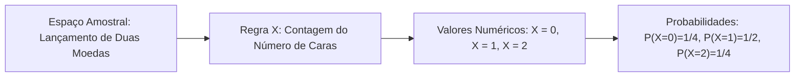
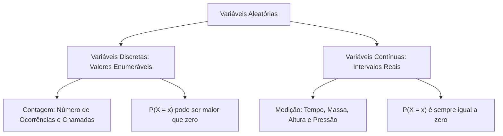
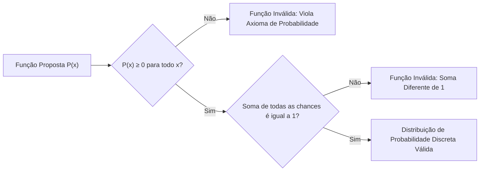
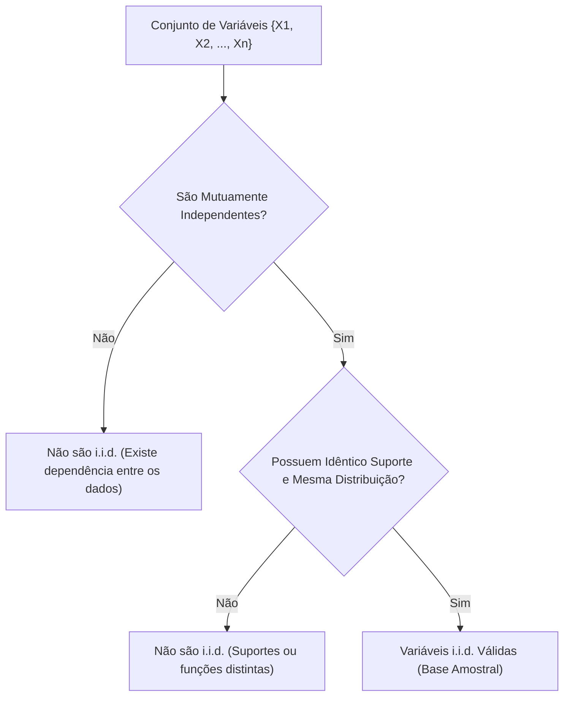
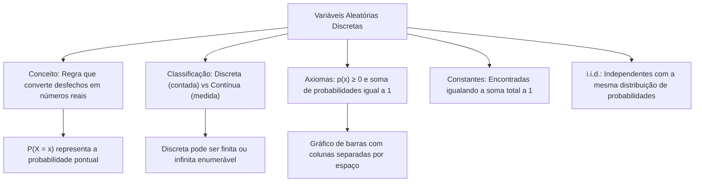

A tomada de decisões em cenários de incerteza operacional exige métodos quantitativos consistentes. No planejamento de ações do Corpo de Bombeiros e da Polícia Militar, os gestores lidam com grandezas imprevisíveis. Exemplos comuns incluem o número de chamados em um plantão e a quantidade de viaturas operacionais. Para analisar esses fenômenos com exatidão, a Estatística Inferencial utiliza o conceito de variável aleatória. Este capítulo inicial apresenta a inferência estatística. Aqui você entenderá a diferença entre variáveis discretas e contínuas e verá a função de probabilidade.

> [!objetivos]
> - Compreender a lógica da inferência estatística, diferenciando parâmetros populacionais de estimadores amostrais.
> - Definir formalmente uma variável aleatória como regra que associa eventos a números reais.
> - Diferenciar variáveis discretas e contínuas com base na contagem e na medição.
> - Dominar os axiomas da função de probabilidade discreta e calcular constantes desconhecidas.
> - Compreender o conceito de variáveis independentes e identicamente distribuídas (i.i.d.).

## A Inferência e Amostras (Introdução - Variáveis Aleatórias Discretas)

Na maior parte dos problemas práticos, é inviável pesquisar todos os elementos de uma população. Uma população pode reunir todos os cidadãos brasileiros ou a totalidade de bebês nascidos em hospitais em um ano. Fazer um censo completo consome muitos recursos. Demanda também um tempo incompatível com a urgência do serviço público.

A inferência estatística resolve essa dificuldade por meio da amostragem aleatória:

Três noções técnicas fundamentam esse processo:

1. Parâmetro populacional: medida numérica fixa que descreve uma característica da população. Quase sempre permanece desconhecida pelo analista.
2. Estimador amostral: grandeza numérica calculada com os dados observados na amostra sorteada.
3. Inferência estatística: procedimento que estende os resultados da amostra para toda a população.

Cada amostra sorteada ao acaso produz resultados ligeiramente diferentes. Em razão dessa oscilação natural, as estimativas amostrais são tratadas como variáveis aleatórias.

| Termo Técnico | Significado Estatístico | Exemplo Prático |
| --- | --- | --- |
| População | Conjunto total de indivíduos | Todos os cidadãos brasileiros |
| Amostra | Subconjunto representativo | Amostra de mil pessoas sorteadas |
| Parâmetro | Medida fixa da população | Média real de renda populacional |
| Estimador | Valor calculado na amostra | Média observada no grupo amostrado |

## O Conceito de Variável Aleatória (Variável Aleatória Discreta)

Experimentos aleatórios produzem desfechos descritos por palavras ou códigos. No lançamento de uma moeda honesta, os resultados são cara ou coroa. Em um tratamento médico com pacientes, o desfecho pode ser a melhora clínica ou a ausência de melhora. A modelagem matemática requer traduzir esses desfechos em valores numéricos.

Uma **variável aleatória (v.a.)** é uma função matemática bem definida. Ela transforma cada resultado do espaço amostral em um único número real. Denota-se habitualmente por letras maiúsculas como X, Y ou Z.

Pontos centrais definem a variável aleatória:

- Incerteza do valor: o valor exato que a variável assumirá antes do teste é incerto.
- Regularidade probabilística: apesar da incerteza pontual, os valores seguem uma distribuição de probabilidades estável.
- Notação técnica: a probabilidade de a variável X assumir um valor específico x é indicada por P(X = x) ou simplesmente P(x).

> [!exemplo] Registro de Melhora Clínica
> Em um teste com 50 pacientes enfermos, 35 apresentaram melhora no quadro de saúde. Podemos definir a variável aleatória Y indicando o resultado de um paciente sorteado. Atribuímos Y = 1 para o caso de melhora e Y = 0 para ausência de melhora. As probabilidades associadas serão P(Y = 1) = 35/50 = 0,70 e P(Y = 0) = 15/50 = 0,30. A soma dessas probabilidades resulta em exatamente 1,00.

## Variáveis Discretas versus Variáveis Contínuas

A teoria estatística divide as variáveis em duas classes principais: discretas e contínuas. Essa classificação orienta a escolha dos testes e das fórmulas.

### Variáveis Discretas

Uma variável é **discreta** quando seu conjunto de valores possíveis é enumerável. Isso significa que seus valores podem ser listados em uma sequência contada, finita ou infinita. Embora na prática muitas variáveis discretas assumam valores inteiros ou racionais, a regra formal exige apenas a enumerabilidade.

Características marcantes:

- Origem em contagem: a grandeza foi contada peça por peça. O resultado é contado em unidades discretas.
- Suporte pontual: os valores encontram-se isolados na reta numérica real.
- Probabilidade pontual positiva: um valor exato pode ter probabilidade estritamente positiva, ou seja, P(X = x) > 0.

Exemplos típicos:

- Número de viaturas em patrulhamento em um bairro.
- Quantidade diária de navios que atracam em um porto marítimo.
- Contagem de bebês nascidos em uma maternidade durante o plantão.

### Variáveis Contínuas

Uma variável é **contínua** quando seus valores possíveis cobrem um intervalo contínuo de números reais. O conjunto de valores não pode ser enumerado.

Aspectos essenciais:

- Origem em medição: a grandeza foi obtida por um instrumento que produziu um valor medido contínuo.
- Probabilidade pontual nula: para qualquer ponto isolado x, a probabilidade matemática é sempre zero: P(X = x) = 0.
- Cálculo em intervalos: probabilidades só existem para faixas e intervalos de valores, calculadas pela área sob a curva.

Exemplos práticos:

- Tempo de espera entre a chegada de dois navios consecutivos no cais.
- Peso medido de uma carga de suprimentos de socorro.
- Pressão de operação de um extintor de incêndio.

| Critério de Comparação | Variável Discreta | Variável Contínua |
| --- | --- | --- |
| Conjunto de Valores | Enumerável (finito ou infinito contável) | Intervalo real contínuo (não enumerável) |
| Método de Obtenção | Dado contado por unidades inteiras | Dado medido por instrumentos graduados |
| Probabilidade Pontual | Pode ser positiva: P(X = x) > 0 | Sempre nula: P(X = x) = 0 |
| Instrumento de Análise | Somatório de termos individuais | Integral sob curva de densidade |
| Gráfico Adequado | Gráfico de barras verticais separadas | Histograma com barras encostadas |

> [!pegadinha] Discreto versus Finito
> Não confunda suporte discreto com suporte finito. Uma variável discreta pode ter infinitos valores possíveis. O número de tentativas até obter sucesso em um teste mecânico assume valores no conjunto infinito {1, 2, 3, ...}. Esse suporte é infinito, porém enumerável e discreto. A regra prática é simples: se foi contado, é discreto; se foi medido, é contínuo.

## A Função de Probabilidade Discreta

A **função de probabilidade** associa a cada valor possível x da variável discreta X sua respectiva probabilidade P(X = x).

### Axiomas Fundamentais

Toda função de probabilidade discreta deve obedecer a duas condições obrigatórias:

1. Não negatividade: a probabilidade de cada valor não pode ser negativa: P(X = x) ≥ 0 para todo x.
2. Soma unitária: a soma das probabilidades de todos os valores possíveis deve ser igual a 1.

A soma de todas as probabilidades pontuais deve ser igual a 1: Σ P(X = x) = 1.

Se qualquer uma dessas duas condições for descumprida, a função não é válida. A função de probabilidade apenas conecta cada valor à sua chance. Ela não calcula médias nem probabilidades acumuladas.

### Determinação de Constantes em Funções

Em questões de concurso, é comum a função conter uma constante desconhecida k. Para encontrar esse valor, somam-se todas as probabilidades e iguala-se o total a 1.

Considere uma variável discreta X assumindo os valores 1, 2, 3 e 4. Sua lei é dada por P(X = x) = x / k.

Para que a função seja válida, impõe-se a soma unitária:

(1/k) + (2/k) + (3/k) + (4/k) = 1

(1 + 2 + 3 + 4) / k = 1

10 / k = 1, logo k = 10.

Com k = 10, as probabilidades pontuais ficam determinadas:
- P(X = 1) = 1/10 = 0,10
- P(X = 2) = 2/10 = 0,20
- P(X = 3) = 3/10 = 0,30
- P(X = 4) = 4/10 = 0,40

A soma confirma o fechamento unitário: 0,10 + 0,20 + 0,30 + 0,40 = 1,00.

### Suportes Infinitos e Séries Geométricas

Se o suporte for infinito contável {1, 2, 3, ...}, a verificação exige a soma de uma progressão geométrica (PG). A soma de uma PG infinita com razão q em módulo menor que 1 tem fórmula:

Soma = primeiro termo / (1 - razão)

Seja P(X = x) = (1/2)^x para x = 1, 2, 3, ... O primeiro termo é 1/2 e a razão é 1/2.
A soma total vale (1/2) / (1 - 1/2) = (1/2) / (1/2) = 1. A distribuição é perfeitamente válida.

> [!resolvido] Determinação de Parâmetro e Cálculo de Intervalo
> Uma escala de triagem classifica ocorrências de emergência em três níveis discretos: X pertencente a {1, 2, 4}. A probabilidade de ocorrência do nível x é dada pela função P(X = x) = c / x, sendo c uma constante positiva.
> 
> a) Encontre o valor da constante c.  
> b) Calcule a probabilidade do evento P(1 ≤ X ≤ 2).
> 
> **Resolução passo a passo:**  
> **Passo 1:** Para achar c, aplicamos o axioma da soma unitária sobre os valores do suporte:  
> P(X = 1) + P(X = 2) + P(X = 4) = 1  
> (c / 1) + (c / 2) + (c / 4) = 1  
> Colocando c em evidência:  
> c · (1 + 1/2 + 1/4) = 1  
> Reduzindo as frações ao mesmo denominador comum:  
> c · (4/4 + 2/4 + 1/4) = 1  
> c · (7/4) = 1  
> Multiplicando ambos os lados por 4/7:  
> c = 4/7  
> 
> **Passo 2:** Com c = 4/7, calculamos as probabilidades individuais:  
> P(X = 1) = (4/7) / 1 = 4/7  
> P(X = 2) = (4/7) / 2 = 2/7  
> P(X = 4) = (4/7) / 4 = 1/7  
> A soma total confere: 4/7 + 2/7 + 1/7 = 7/7 = 1.  
> 
> **Passo 3:** Para o intervalo 1 ≤ X ≤ 2, somamos os valores válidos:  
> P(1 ≤ X ≤ 2) = P(X = 1) + P(X = 2) = 4/7 + 2/7 = 6/7.  
> O resultado procurado é 6/7 (aproximadamente 85,7%).

## Apresentação e Gráficos da Distribuição

Uma distribuição de probabilidade pode ser exposta em tabela ou em gráfico.

### Tabela de Probabilidades

A tabela organiza os valores da variável na primeira linha ou coluna e suas probabilidades na linha ou coluna seguinte:

| Valor da Variável x | Probabilidade P(X = x) | Probabilidade Percentual |
| --- | --- | --- |
| 0 | 0,10 | 10% |
| 1 | 0,25 | 25% |
| 2 | 0,35 | 35% |
| 3 | 0,20 | 20% |
| 4 | 0,10 | 10% |
| **Total** | **1,00** | **100%** |

Para calcular P(X ≥ 2), basta somar as probabilidades dos valores correspondentes:
P(X ≥ 2) = P(X = 2) + P(X = 3) + P(X = 4) = 0,35 + 0,20 + 0,10 = 0,65 (65%).

### Gráficos de Barras e Histogramas

O tipo de gráfico deve acompanhar a natureza da variável:

- Gráfico de barras separadas: próprio para variáveis discretas. Sobre cada valor do eixo horizontal ergue-se uma barra vertical. A altura representa a probabilidade daquele ponto isolado. As barras são separadas por espaços livres.
- Histograma com barras unidas: utilizado para variáveis contínuas agrupadas em classes. As barras ficam coladas umas às outras, sem intervalos vagos entre si.

> [!bizu] Identificação Visual nas Provas
> Se uma questão apresentar um gráfico com colunas **separadas por espaços vazios**, a variável é **discreta**. Se as colunas estiverem **juntas e coladas**, trata-se de um histograma de **variável contínua**. Esse detalhe visual resolve muitos itens objetivos.

## Variáveis Independentes e Identicamente Distribuídas (i.i.d.)

A expressão **i.i.d.** sintetiza duas propriedades fundamentais da Estatística Amostral.

Um conjunto de variáveis X1, X2, ..., Xn é dito i.i.d. quando cumpre dois requisitos simultâneos:

1. Independência estatística: o resultado de qualquer variável não altera as probabilidades das outras.
2. Identidade distributiva: todas as variáveis compartilham o mesmo suporte de valores e a mesma função de probabilidade.

### O Cuidado com os Valores do Suporte

Para haver distribuição idêntica, não basta ter números de probabilidades iguais. Os valores assumidos também precisam ser idênticos.

Considere a variável Y1 que assume os valores -1 e +1 com probabilidade 0,5 cada. Considere agora a variável Y2 que assume os valores -2 e +2 com probabilidade 0,5 cada. Ambas possuem as mesmas probabilidades (50%), mas seus valores são diferentes. Por isso, Y1 e Y2 não são identicamente distribuídas.

O exemplo clássico de variáveis i.i.d. são sucessivos lançamentos de um mesmo dado equilibrado. Cada lançamento é independente dos demais. Todos têm suporte nos números 1 a 6 com probabilidade 1/6 em cada face.

> [!atencao] Reposição na Amostragem
> Ao retirar componentes de um lote com reposição, cada sorteio é independente e mantém a mesma urna. As variáveis geradas são i.i.d. Porém, se o sorteio for realizado **sem reposição**, a proporção dos componentes restantes muda a cada retirada. Isso gera dependência entre as extrações e impede a classificação como variáveis i.i.d. Em um lote com 63 peças perfeitas e 79 defeituosas, a retirada sem reposição altera as probabilidades a cada passo.

## Mapa do capítulo

### Para fixar

- Inferência estatística usa estimadores da amostra para tirar conclusões sobre parâmetros da população.
- Variável aleatória é uma regra que transforma cada desfecho do espaço amostral em um número real.
- Variáveis discretas têm suporte enumerável e decorrem de processos em que a grandeza é contada.
- Variáveis contínuas cobrem intervalos reais, decorrem de dados em que a grandeza é medida e têm probabilidade pontual nula.
- A função de probabilidade exige probabilidades não negativas e soma total exatamente igual a 1.
- Constantes desconhecidas na função de probabilidade são calculadas igualando a soma de todas as chances a 1.
- Gráficos de barras separadas representam variáveis discretas; histogramas de barras coladas retratam variáveis contínuas.
- Variáveis i.i.d. são mutuamente independentes e apresentam o mesmo suporte e a mesma lei de probabilidade.
