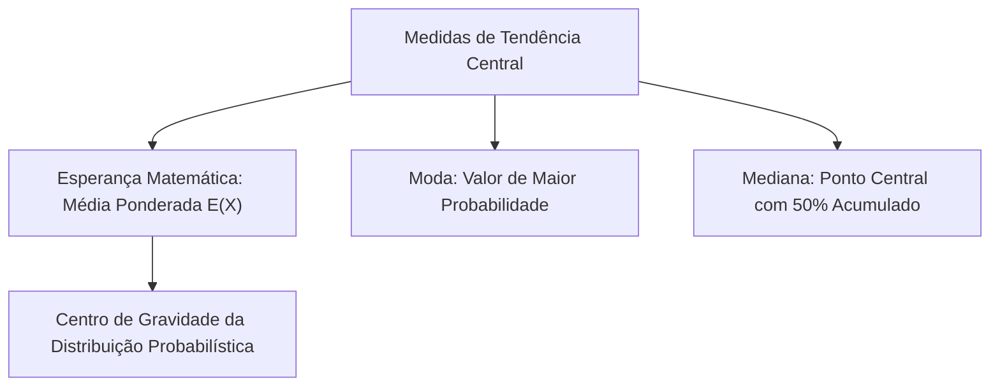
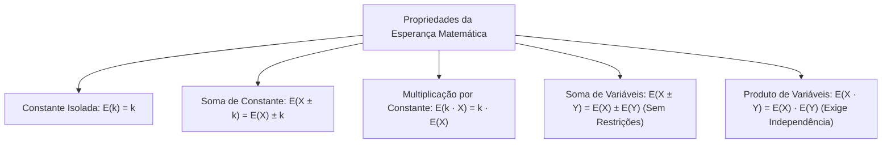
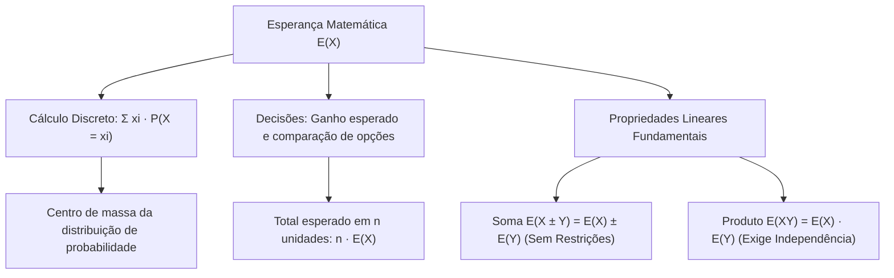

As medidas de posição resumem a distribuição de uma variável aleatória em um único valor representativo. Dentre essas medidas, a esperança matemática ocupa posição de destaque na tomada de decisões. Ela indica o valor médio esperado em longo prazo. No Corpo de Bombeiros e na Polícia Militar, a esperança auxilia no dimensionamento de equipes e na previsão de perdas materiais. Este capítulo estuda as medidas de tendência central com foco na esperança matemática. Você aprenderá sua definição formal, seu cálculo em tabelas e suas propriedades operatórias lineares.

> [!objetivos]
> - Compreender a esperança matemática como média ponderada das probabilidades.
> - Calcular o valor esperado em variáveis discretas finitas e identificar casos equiprováveis.
> - Aplicar a esperança matemática na análise de riscos operacionais e decisões financeiras.
> - Dominar as cinco propriedades operatórias lineares da esperança matemática.
> - Diferenciar a esperança da soma, válida sem restrições, da esperança do produto, restrita a variáveis independentes.

## O Conceito de Tendência Central (Medidas de Tendência Central)

A análise exploratória e inferencial de variáveis aleatórias exige sínteses numéricas objetivas para descrever conjuntos volumosos de dados. As medidas de tendência central indicam a localização do centro de massa probabilístico da variável. Elas informam em torno de qual valor os dados observados tendem a se agrupar. As três principais medidas de posição estudadas são a média (esperança matemática), a moda e a mediana.

Digamos que estamos avaliando o fluxo de pessoas transportadas em uma rodovia estadual monitorada pela polícia rodoviária. Em uma contagem amostral com 400 veículos fiscalizados, registrou-se um total de 1260 pessoas transportadas. As pessoas que chegaram aos postos geraram uma média calculada de 1260 dividido por 400, resultando em 3,15 passageiros por automóvel.

Confirmamos assim que uma única medida de tendência central resume com clareza o comportamento geral do conjunto. Este capítulo dedica-se integralmente à **esperança matemática**. A moda e a mediana serão aprofundadas com todos os detalhes no capítulo seguinte.

## A Esperança Matemática: Definição e Interpretação

A esperança matemática também é conhecida como valor esperado ou média populacional da variável. Representa-se habitualmente por E(X) ou pela letra grega μ.

Em termos conceituais, a esperança é o centro de gravidade da distribuição. Para ilustrar essa noção prática, se pensarmos no trajeto diário de cada carro utilizado por patrulheiros brasileiros, ao investir em manutenção preventiva a frota passaria a operar com maior eficiência média. Se um experimento aleatório for repetido sob as mesmas condições milhares de vezes, a média aritmética dos resultados observados convergirá para a esperança matemática teórica.

### Definição Formal para Variáveis Discretas

Para uma variável aleatória discreta X com valores possíveis x1, x2, ..., xn e probabilidades P(X = xi), a esperança matemática é a soma dos produtos de cada valor por sua respectiva probabilidade:

E(X) = Σ xi · P(X = xi)

Multiplica-se cada valor numérico que a variável pode assumir pela sua chance teórica de ocorrência. Em seguida, somam-se todas essas parcelas.

### Casos Equiprováveis

Quando todos os desfechos possíveis possuem a mesma probabilidade, a esperança matemática coincide com a média aritmética simples dos valores.

- Moeda honesta codificada com 0 para coroa e 1 para cara: cada desfecho tem probabilidade 1/2.  
  E(X) = 0 · (1/2) + 1 · (1/2) = 0 + 1/2 = 0,5.
- Dado equilibrado de seis faces numeradas de 1 a 6: cada face tem probabilidade 1/6.  
  E(X) = 1 · (1/6) + 2 · (1/6) + 3 · (1/6) + 4 · (1/6) + 5 · (1/6) + 6 · (1/6)  
  E(X) = (1 + 2 + 3 + 4 + 5 + 6) / 6 = 21 / 6 = 3,5.

> [!pegadinha] A Média Não Precisa Ser Valor Realizável
> É erro comum supor que a esperança matemática deve ser um dos valores possíveis da variável. No lançamento do dado, a média teórica é 3,5. Nenhuma face exibe o valor 3,5. A média indica apenas a tendência central do processo e não um desfecho obrigatório.

### Roteiro Prático de Cálculo com Tabela

Para calcular a esperança a partir de uma tabela de distribuição, adicione uma terceira coluna contendo os produtos xi · P(xi):

| Ocorrências xi | Probabilidade P(X = xi) | Produto xi · P(X = xi) |
| --- | --- | --- |
| 0 | 0,20 | 0,00 |
| 1 | 0,40 | 0,40 |
| 2 | 0,25 | 0,50 |
| 3 | 0,15 | 0,45 |
| **Total** | **1,00** | **E(X) = 1,35** |

A soma da coluna dos produtos revela diretamente a esperança matemática: E(X) = 1,35 ocorrências por período.

## Aplicações da Esperança em Decisões Operacionais

A esperança matemática é ferramenta indispensável na análise de riscos e tomadas de decisão sob incerteza.

### Ganho ou Perda Esperada

Em problemas que envolvem ganhos, lucro e perdas financeiras ou operacionais, os valores negativos entram na fórmula com seu respectivo sinal algébrico.

Considere um jogo com lançamento de moedas honestas formulado em manuais pelo autor Moacyr. Caso o apostador ganhe a rodada, ele obtém um lucro líquido de 90 reais com probabilidade 0,20. Caso ele perca a aposta, ele terá que perder 20 reais (valor registrado como -20) com probabilidade complementar de 0,80. O ganho líquido esperado será:

E(Ganho) = 90 · 0,20 + (-20) · 0,80 = 18 - 16 = 2 reais de lucro esperado por partida.

Se o participante disputar muitas rodadas, o valor esperado positivo de 2 reais confirma que ele acumula lucro médio. Caso o resultado fosse negativo, a expectativa matemática seria perder recursos continuamente.

### Escolha entre Linhas de Ação Alternativas

Quando um comandante dispõe de diferentes planos de atuação em um cenário de crise, a esperança matemática permite comparar a eficácia média esperada de cada opção:

| Cenário Climático | Probabilidade | Rendimento da Opção 1 | Rendimento da Opção 2 |
| --- | --- | --- | --- |
| Tempo Seco | 0,40 | 100 pontos | 80 pontos |
| Tempo Chuvoso | 0,60 | 50 pontos | 70 pontos |
| **Total** | **1,00** | **E(Opção 1) = 70** | **E(Opção 2) = 74** |

Cálculo da Opção 1: E(1) = 100 · 0,40 + 50 · 0,60 = 40 + 30 = 70 pontos.  
Cálculo da Opção 2: E(2) = 80 · 0,40 + 70 · 0,60 = 32 + 42 = 74 pontos.  

A Opção 2 oferece maior rendimento esperado médio em longo prazo.

### Estimativa de Totais Amostrais

Se a esperança média de atendimentos por viatura é igual a E(X), em uma frota de n viaturas operando em condições similares o total esperado de atendimentos será dado por:

Total Esperado = n · E(X)

Se cada equipe realiza em média 3,2 atendimentos por turno, 50 equipes realizarão aproximadamente 50 · 3,2 = 160 atendimentos.

### Variáveis Aleatórias Simétricas em Torno da Origem

Se uma variável discreta assume valores opostos +j e -j com idêntica probabilidade 1/2, sua esperança matemática é sempre nula:

E(Y) = (+j) · (1/2) + (-j) · (1/2) = j/2 - j/2 = 0.

Essa propriedade é válida para qualquer valor real de j.

> [!resolvido] Determinação de Incógnita e Cálculo da Esperança
> A distribuição do número diário de inspeções técnicas de segurança em edificações prediais realizadas por um perito militar X é expressa pela tabela abaixo, na qual k representa uma constante real:
> 
> | Número de Inspeções x | 1 | 2 | 3 | 4 |
> | --- | --- | --- | --- | --- |
> | Probabilidade P(X = x) | 0,10 | k | 0,30 | 0,20 |
> 
> a) Determine o valor da constante k.  
> b) Calcule o número médio esperado de inspeções diárias E(X).
> 
> **Resolução passo a passo:**  
> **Passo 1:** Para determinar k, aplicamos o axioma do fechamento unitário das probabilidades:  
> 0,10 + k + 0,30 + 0,20 = 1,00  
> k + 0,60 = 1,00  
> k = 1,00 - 0,60  
> k = 0,40  
> 
> **Passo 2:** Com k = 0,40, montamos os produtos xi · P(xi):  
> Para x = 1: 1 · 0,10 = 0,10  
> Para x = 2: 2 · 0,40 = 0,80  
> Para x = 3: 3 · 0,30 = 0,90  
> Para x = 4: 4 · 0,20 = 0,80  
> 
> **Passo 3:** Somamos os produtos para obter a esperança matemática:  
> E(X) = 0,10 + 0,80 + 0,90 + 0,80 = 2,60.  
> O perito realiza em média 2,60 inspeções técnicas diárias.

## As Cinco Propriedades Fundamentais (Propriedades da Esperança)

As propriedades operatórias simplificam cálculos algébricos complexos, dispensando a reconstrução exaustiva de distribuições inteiras. Essas propriedades são válidas tanto para variáveis discretas quanto para variáveis contínuas.

### Propriedade 1: Esperança de uma Constante

A esperança matemática de uma constante k é a própria constante:

E(k) = k

Se uma grandeza assume invariavelmente o valor k com probabilidade igual a 1, sua média é evidentemente igual a k.

### Propriedade 2: Soma ou Subtração de uma Constante

Ao somar ou subtrair uma constante k a uma variável aleatória X, a esperança da nova variável será igual à esperança original acrescida ou diminuída dessa mesma constante:

E(X + k) = E(X) + k  
E(X - k) = E(X) - k

Intuição: se todos os salários de um pelotão receberem um abono fixo de 500 reais, a média salarial do grupo aumentará exatamente 500 reais. A adição de uma constante desloca a posição central da distribuição na reta numérica, preservando intactas as distâncias relativas entre os dados.

### Propriedade 3: Multiplicação ou Divisão por uma Constante

Ao multiplicar uma variável aleatória X por uma constante real k, a esperança matemática também é multiplicada por k:

E(k · X) = k · E(X)

Como a divisão por k é equivalente à multiplicação pelo inverso 1/k, vale identicamente para a divisão:

E(X / k) = E(X) / k, para k diferente de zero.

Intuição: se todas as ocorrências forem convertidas de horas para minutos (multiplicação por 60), o tempo médio esperado também ficará multiplicado por 60. A multiplicação por constante reescala a distribuição.

### Propriedade 4: Esperança da Soma e da Diferença de Variáveis

A esperança da soma (ou da diferença) de duas variáveis aleatórias X e Y é sempre igual à soma (ou à diferença) das respectivas esperanças:

E(X + Y) = E(X) + E(Y)  
E(X - Y) = E(X) - E(Y)

Essa propriedade decorre diretamente da linearidade do operador somatório.

> [!bizu] Independência Não é Exigida na Soma
> Grave com extrema atenção para as provas: a propriedade aditiva da esperança **não exige independência estatística**. E(X + Y) = E(X) + E(Y) é válida para quaisquer variáveis aleatórias, sejam elas dependentes, correlacionadas ou independentes. A regra estende-se para qualquer quantidade finita de variáveis:  
> E(X1 + X2 - X3) = E(X1) + E(X2) - E(X3).

### Propriedade 5: Esperança do Produto de Variáveis Independentes

Se duas variáveis aleatórias X e Y forem **estatisticamente independentes**, a esperança do produto será igual ao produto de suas esperanças:

E(X · Y) = E(X) · E(Y), se X e Y forem independentes.

> [!atencao] A Independência é Requisito Obrigatório
> Ao contrário da soma, a fatoração do produto exige estritamente a condição de **independência estatística**. Se X e Y forem dependentes, em geral E(X · Y) será diferente de E(X) · E(Y). Além disso, a recíproca não é automática: obter casualmente E(X · Y) = E(X) · E(Y) em um problema numérico não comprova que as variáveis sejam independentes.

### Combinações Lineares Gerais

Reunindo todas as propriedades operatórias anteriores, a esperança matemática atua como um operador linear completo:

E(a · X + b · Y + c) = a · E(X) + b · E(Y) + c

Em que a, b e c são constantes reais quaisquer.

Considere que E(X) = 4, E(Y) = 8 e E(Z) = 1. Para calcular a média da combinação linear W = 3·X + Y/4 - 2·Z + 1, aplica-se a linearidade direta:

E(W) = 3 · E(X) + (1/4) · E(Y) - 2 · E(Z) + 1  
E(W) = 3 · 4 + (1/4) · 8 - 2 · 1 + 1  
E(W) = 12 + 2 - 2 + 1 = 13.

Se uma transformação for expressa por Y = a + b·X e E(X) = μ, a nova média será:

E(Y) = a + b · μ.

| Propriedade Algébrica | Expressão Matemática | Condição de Validade |
| --- | --- | --- |
| Constante Isolada | E(k) = k | Sempre válida |
| Soma de Constante | E(X + k) = E(X) + k | Sempre válida |
| Produto por Constante | E(k · X) = k · E(X) | Sempre válida |
| Soma de Variáveis | E(X + Y) = E(X) + E(Y) | Sempre válida (não exige independência) |
| Diferença de Variáveis | E(X - Y) = E(X) - E(Y) | Sempre válida (não exige independência) |
| Produto de Variáveis | E(X · Y) = E(X) · E(Y) | Exige independência estocástica entre X e Y |

## Mapa do capítulo

### Para fixar

- A esperança matemática é a média ponderada de uma variável aleatória discreta, dada por E(X) = Σ xi · P(xi).
- Em experimentos equiprováveis, a esperança matemática coincide com a média aritmética simples dos valores.
- A esperança não precisa coincidir com nenhum valor realizável do suporte da variável aleatória.
- Em problemas de decisão, o ganho ou perda esperada soma os valores com seus respectivos sinais multiplicados pelas chances.
- A esperança de uma constante é a própria constante: E(k) = k.
- Somar uma constante desloca a média no mesmo valor: E(X ± k) = E(X) ± k.
- Multiplicar por uma constante multiplica a média: E(k · X) = k · E(X).
- A esperança da soma e da diferença vale para quaisquer variáveis, sem exigir independência: E(X ± Y) = E(X) ± E(Y).
- A esperança do produto é igual ao produto das esperanças exclusivamente quando as variáveis são independentes.
