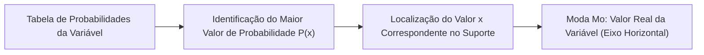
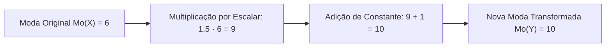
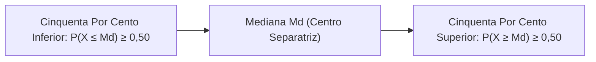
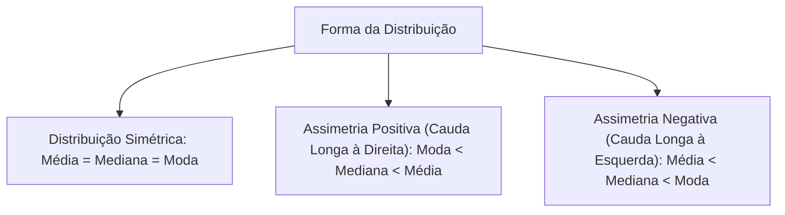

A esperança matemática sintetiza o centro de gravidade de uma variável aleatória. Contudo, a média é altamente sensível a valores extremos discrepantes. Para contornar essa sensibilidade e descrever a distribuição com maior fidelidade, a Estatística utiliza duas outras medidas de posição: a moda e a mediana. A comparação simultânea entre média, mediana e moda permite identificar o grau de assimetria de uma distribuição probabilística. Este capítulo detalha as definições, as propriedades operatórias e o cálculo prático da moda e da mediana. Você também estudará a classificação das formas das distribuições.

> [!objetivos]
> - Definir moda em distribuições de probabilidade discretas e reconhecer casos multimodais e amodais.
> - Compreender a mediana como divisor de cinquenta por cento da massa probabilística e calculá-la pela função acumulada.
> - Aplicar as propriedades de transformações lineares sobre a moda e a mediana.
> - Comparar média, mediana e moda para classificar distribuições simétricas e assimétricas.
> - Avaliar a sensibilidade diferencial dessas medidas frente a valores discrepantes.

## A Moda em Variáveis Aleatórias (Moda)

A **moda** de uma variável aleatória discreta, indicada habitualmente por Mo, é o valor numérico que possui a maior probabilidade de ocorrência. No caso de uma amostra observada de dados, a moda amostral representa o valor que se repete com maior frequência absoluta.

Considere o lançamento de duas moedas equilibradas, em que a variável X conta o número de caras obtidas:
- P(X = 0) = 0,25 (25%)
- P(X = 1) = 0,50 (50%)
- P(X = 2) = 0,25 (25%)

O valor com probabilidade máxima é x = 1, cuja probabilidade atinge 0,50. Portanto, a moda é Mo = 1.

> [!pegadinha] A Moda é um Valor da Variável
> As bancas examinadoras frequentemente tentam induzir o candidato ao erro afirmando que a moda é o maior valor numérico registrado ou a própria probabilidade. Isso é incorreto. A moda é **um valor do suporte da variável** (eixo horizontal), e nunca o valor da probabilidade (eixo vertical). Em um registro de incidentes onde o valor 2 ocorre com 50% e o valor 4 ocorre com 10%, a moda é 2, e não 4 nem 0,50.

### Classificação quanto ao Número de Modas

Ao contrário da média e da mediana, que são sempre únicas para uma dada distribuição, a moda pode se apresentar de diferentes maneiras:

1. Unimodal: a distribuição possui uma única moda bem definida (apenas um ponto de probabilidade máxima).
2. Bimodal: ocorrem dois valores distintos empatados com a mesma probabilidade máxima.
3. Trimodal ou Multimodal: três ou mais valores distintos compartilham a probabilidade máxima.
4. Amodal: todos os valores possíveis possuem exatamente a mesma probabilidade. Nesse caso, a distribuição não tem moda.

Exemplos práticos:
- Um dado honesto de seis faces possui probabilidade 1/6 para todas as faces de 1 a 6. Trata-se de uma distribuição perfeitamente **amodal**.
- Uma amostra com os dados {2, 2, 4, 4, 7} apresenta duas modas (2 e 4), sendo uma distribuição **bimodal**.

## Propriedades Operatórias da Moda (Propriedades da Moda)

A moda comporta-se de maneira linear frente a transformações aritméticas aplicadas aos valores da variável. Sejam X uma variável aleatória discreta e k uma constante real arbitrária:

### Multiplicação e Divisão por Constante

Ao multiplicar a variável X por uma constante real k, a moda da nova variável será igual à moda original multiplicada por k:

Mo(k · X) = k · Mo(X)

Como a divisão por k equivale à multiplicação pelo inverso 1/k, a propriedade estende-se identicamente à divisão:

Mo(X / k) = Mo(X) / k, para k diferente de zero.

### Soma e Subtração de Constante

Ao somar ou subtrair uma constante real k a uma variável X, a nova moda será deslocada exatamente pela mesma constante:

Mo(X + k) = Mo(X) + k  
Mo(X - k) = Mo(X) - k

Para ilustrar, se cada servidor receber um aumento de 3 mil reais, a nova moda passará a ser Mo(X + k) = Mo(X) + k. Se os valores dobram duplicando a escala, a moda passaria a ser o dobro: Mo(2·X) = 2·Mo(X). Caso a pontuação seja reduzida à metade, a medida fica reduzida proporcionalmente. Se a nota modal for 6 e for aplicada a regra Y = 1,5·X + 1, a nova moda será: Mo(Y) = 1,5 · 6 + 1 = 10 pontos.

## A Mediana de Variáveis Aleatórias (Mediana)

A **mediana**, indicada habitualmente por Md, é o ponto de corte central que reparte a distribuição de probabilidades em duas metades rigorosamente equivalentes.

Em termos formais, a mediana é o valor para o qual:

- A probabilidade acumulada referente a desfechos até a mediana atinge patamar de 50% ou mais: P(X ≤ Md) ≥ 0,50.
- A probabilidade de valores maiores ou iguais à mediana também alcança a cota de 50% ou mais: P(X ≥ Md) ≥ 0,50.

A mediana divide a massa probabilística total em duas metades de 0,50 cada.

### Determinação Prática pela Função Acumulada

Para encontrar a mediana em uma tabela de probabilidades discretas, calcula-se a probabilidade acumulada F(x) = P(X ≤ x) em ordem crescente:

1. O primeiro valor do suporte cuja probabilidade acumulada alcançar ou ultrapassar 0,50 é o candidato a mediana.
2. Caso a probabilidade acumulada atinja exatamente 0,50 em determinado valor xi, a mediana adotada por convenção será a média aritmética simples entre esse valor xi e o valor imediatamente seguinte xi+1:

Md = (xi + xi+1) / 2

Considere a distribuição de ocorrências de busca e salvamento:

| Chamados x | Probabilidade P(X = x) | Acumulada F(x) |
| --- | --- | --- |
| 1 | 0,20 | 0,20 |
| 2 | 0,30 | 0,50 |
| 3 | 0,30 | 0,80 |
| 4 | 0,20 | 1,00 |

A probabilidade acumulada atinge exatamente 0,50 no valor x = 2. O valor seguinte na tabela é x = 3. Logo, a mediana é a média entre 2 e 3:

Md = (2 + 3) / 2 = 2,5 chamados.

> [!resolvido] Determinação de Mediana e Média em Dados Discretos
> Uma escala de penalidades administrativas por infrações de trânsito assume os valores X pertencente a {0, 1, 2, 3} com as probabilidades dadas na tabela:
> 
> | Penalidade x | 0 | 1 | 2 | 3 |
> | --- | --- | --- | --- | --- |
> | Probabilidade P(X = x) | 0,10 | 0,40 | 0,30 | 0,20 |
> 
> a) Encontre a mediana Md da distribuição.  
> b) Calcule a média aritmética esperada E(X).  
> c) Classifique a moda Mo da distribuição.
> 
> **Resolução passo a passo:**  
> **Passo 1:** Calculamos a probabilidade acumulada F(x):  
> - Para x = 0: F(0) = 0,10  
> - Para x = 1: F(1) = 0,10 + 0,40 = 0,50  
> Como F(1) alcança exatamente 0,50, a mediana situa-se entre 1 e o próximo valor 2:  
> Md = (1 + 2) / 2 = 1,5.  
> 
> **Passo 2:** Calculamos a média E(X) multiplicando os valores pelas probabilidades:  
> E(X) = 0 · 0,10 + 1 · 0,40 + 2 · 0,30 + 3 · 0,20  
> E(X) = 0,00 + 0,40 + 0,60 + 0,60 = 1,60.  
> 
> **Passo 3:** Identificamos a moda observando a maior probabilidade pontual.  
> A maior probabilidade é 0,40, associada ao valor x = 1.  
> Logo, a distribuição é unimodal com Mo = 1.

## Propriedades da Mediana (Propriedades da Mediana)

A mediana obedece rigorosamente às mesmas propriedades lineares observadas para a moda:

- Multiplicação por constante: Md(k · X) = k · Md(X).
- Divisão por constante: Md(X / k) = Md(X) / k, para k diferente de zero.
- Adição de constante: Md(X + k) = Md(X) + k.
- Subtração de constante: Md(X - k) = Md(X) - k.
- Notação de translação combinada: Md(X ± k) = Md(X) ± k, análogo à moda Mo(X ± k) = Mo(X) ± k.

Considere uma variável R representando o tempo de ronda, cuja mediana seja Md(R) = 80 minutos. Se uma transformação gerar a variável U = R / 10 - 7, a nova mediana será calculada diretamente pelas regras lineares:

Md(U) = Md(R) / 10 - 7 = 80 / 10 - 7 = 8 - 7 = 1 minuto.

> [!bizu] Mediana e Moda não se Confundem com Variância
> Em questões de prova que fornecem média, mediana, moda e variância para calcular uma transformação do tipo Y = a·X + b, lembre-se: média, mediana e moda seguem exatamente a mesma transformação a·(Medida) + b. Em contrapartida, a variância ignora a constante b somada e eleva a constante a ao quadrado (a²·Var). Nunca aplique a regra da variância para a mediana ou para a moda.

## Comparação entre Média, Mediana e Moda: Formas de Assimetria

O posicionamento relativo entre a média, a mediana e a moda reflete a forma gráfica e a simetria da distribuição de probabilidade. O coeficiente de assimetria mede o quanto a curva observada se afasta da simetria perfeita em ambos os lados.

### Distribuição Perfeitamente Simétrica

Em uma distribuição simétrica, os valores distribuem-se com idêntica probabilidade em ambos os lados do centro. Nesse caso ideal, as três medidas coincidem:

Média = Mediana = Moda

Exemplo clássico: curva normal padrão e distribuições binomiais simétricas com p = 0,5.

### Distribuição Assimétrica Positiva (à Direita)

Em uma distribuição assimétrica positiva, a cauda da direita é mais longa. Há concentração de dados em valores menores e alguns valores muito elevados. A média é puxada para cima pelos extremos:

Moda < Mediana < Média

Exemplo: salários corporativos, em que poucos vencimentos altos elevam a média.

### Distribuição Assimétrica Negativa (à Esquerda)

Em uma distribuição assimétrica negativa, a cauda da esquerda é mais estendida. Os valores baixos arrastam a média para baixo:

Média < Mediana < Moda

Exemplo: idade de aposentadoria de policiais veteranos, com raras baixas precoces.

| Tipo de Distribuição | Padrão Geométrico das Caudas | Relação entre as Medidas | Medida Mais Representativa |
| --- | --- | --- | --- |
| Simétrica | Caudas perfeitamente equilibradas | Média = Mediana = Moda | Média aritmética E(X) |
| Assimétrica Positiva | Cauda longa estendida à direita | Moda < Mediana < Média | Mediana (resistente a extremos) |
| Assimétrica Negativa | Cauda longa estendida à esquerda | Média < Mediana < Moda | Mediana (resistente a extremos) |

## Sensibilidade a Valores Discrepantes (Outliers)

A resistência de uma medida estatística frente à inclusão de valores extremos determina sua escolha em relatórios técnicos periciais. Na gestão de segurança pública, dados atípicos surgem com frequência. Isso ocorre, por exemplo, na contagem de motins em uma penitenciária ou nas apreensões excepcionais de grandes carregamentos de entorpecentes em um aeroporto internacional. Em jogos com um dado viciado, a assimetria e os pontos anômalos alteram a média sem mudar a moda.

As três medidas reagem de modos distintos diante de dados atípicos:

- A média aritmética é a medida **menos resistente** e mais vulnerável. A introdução de um único dado muito discrepante distorce significativamente o resultado numérico final.
- A mediana é uma medida **robusta e resistente**. Ela é condicionada pela posição relativa dos postos centrais, não sendo afetada pela magnitude numérica excessiva dos extremos.
- A moda é a medida **mais resistente**. A adição de dados esparsos nas extremidades do suporte não altera o valor de maior frequência absoluta da distribuição observada.

## Mapa do capítulo

```mermaid Síntese de Moda, Mediana e Assimetria
flowchart TD
    A["Medidas de Posição e Assimetria"] --> B["Moda: Ponto de maior probabilidade pontual"]
    A --> C["Mediana: Ponto de corte dos 50% acumulados"]
    A --> D["Assimetria: Comparação Média vs Mediana vs Moda"]
    B --> E["Classificação: Unimodal, bimodal, multimodal e amodal"]
    C --> F["Transformação Linear: Md(aX + b) = a·Md(X) + b"]
    D --> G["Positiva: Moda < Mediana < Média / Negativa: Média < Mediana < Moda"]
```

### Para fixar

- A moda é o valor da variável aleatória associado à maior probabilidade pontual na distribuição.
- Uma distribuição pode ser unimodal, bimodal, multimodal ou amodal (quando os valores são equiprováveis).
- A moda é um valor do eixo da variável, e nunca o valor da probabilidade correspondente.
- A mediana reparte a distribuição em duas metades com cinquenta por cento de probabilidade acumulada.
- Na tabela discreta, a mediana é encontrada onde a probabilidade acumulada alcança ou supera 0,50.
- Moda e mediana obedecem às propriedades lineares: a multiplicação por constante multiplica a medida e a soma desloca a medida.
- Numa distribuição simétrica, média, mediana e moda coincidem no mesmo valor central.
- Na assimetria positiva (cauda longa à direita), a ordem crescente é moda, mediana e média.
- Na assimetria negativa (cauda longa à esquerda), a média é puxada para baixo, sendo superada pela mediana e pela moda.
