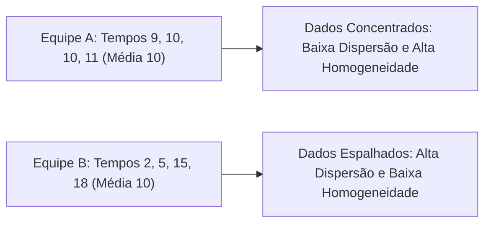
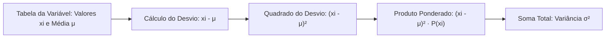
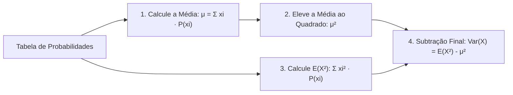
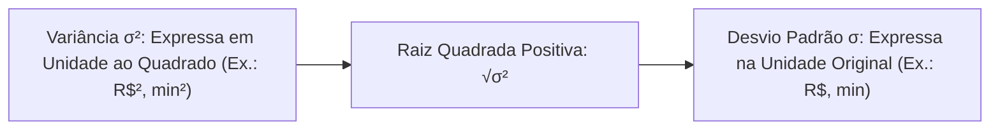
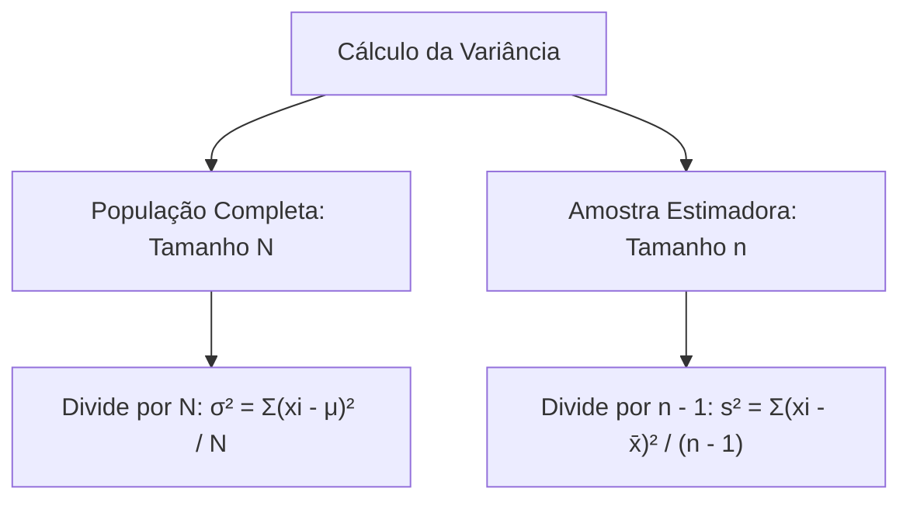
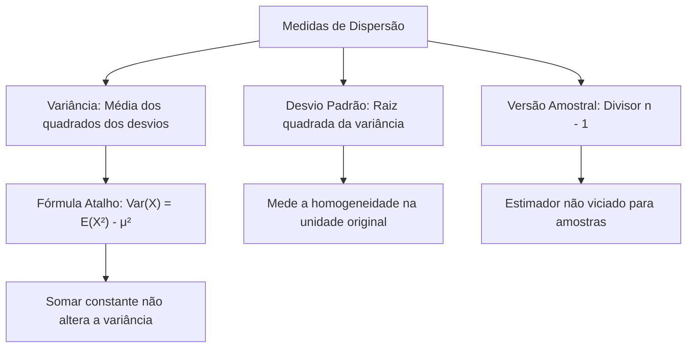

As medidas de tendência central indicam a posição média de uma variável aleatória. Contudo, duas distribuições podem apresentar exatamente a mesma média e possuir dispersões totalmente distintas. Para avaliar o grau de afastamento e a homogeneidade dos dados em torno do centro, a Estatística utiliza medidas de dispersão. As mais importantes são a variância e o desvio padrão. Este capítulo aborda a variância e o desvio padrão de variáveis discretas. Você verá a dedução do atalho de cálculo, a distinção entre parâmetros populacionais e estimadores amostrais e suas aplicações práticas.

> [!objetivos]
> - Compreender a variância como a média dos desvios quadráticos em relação à média.
> - Dominar a fórmula abreviada da variância: Var(X) = E(X²) - [E(X)]².
> - Calcular o desvio padrão e interpretar seu significado na unidade de medida original.
> - Diferenciar a variância populacional da variância amostral com divisor n - 1.
> - Reconhecer que somar uma constante não altera a variância nem o desvio padrão.

## A Necessidade das Medidas de Dispersão (Variância e Desvio Padrão)

A média aritmética informa o centro da distribuição, mas não revela se os dados estão concentrados perto dela ou espalhados.

Considere duas equipes de bombeiros militares avaliadas em quatro ocorrências de resgate. A equipe A realizou os atendimentos nos tempos de 9, 10, 10 e 11 minutos. A média é igual a 10 minutos. A equipe B realizou os atendimentos nos tempos de 2, 5, 15 e 18 minutos. A média também é de 10 minutos. Embora as médias sejam idênticas, o comportamento operacional da equipe A é homogêneo, enquanto o da equipe B é heterogêneo e instável.

### Por que Elevar os Desvios ao Quadrado?

O **desvio** de cada valor individual x em relação à média μ é calculado pela diferença simples:

Desvio = x - μ

Se somarmos todos os desvios ponderados por suas respectivas probabilidades, o resultado será sempre nulo:

Σ (x - μ) · P(X = x) = Σ x · P(x) - μ · Σ P(x) = μ - μ · 1 = 0.

Os desvios positivos cancelam os desvios negativos. Por essa razão matemática, a soma dos desvios simples não serve para medir a dispersão.

Para solucionar essa anulação mútua, a Estatística eleva cada desvio ao quadrado. Com essa operação, todas as distâncias tornam-se positivas ou nulas.

### Definição Formal da Variância Populacional

A **variância** de uma variável aleatória discreta X, indicada por Var(X), V(X) ou pela letra grega σ², é definida como a esperança dos desvios elevados ao quadrado:

Var(X) = σ² = E[(X - μ)²]

Expandindo a fórmula para variáveis discretas:

Var(X) = Σ (xi - μ)² · P(X = xi)

Multiplica-se o quadrado do desvio de cada valor pela sua respectiva probabilidade. Em seguida, somam-se todas as parcelas.

## O Atalho de Cálculo da Variância

Calcular a variância pela fórmula da definição pode ser trabalhoso, pois exige subtrair a média de cada valor e elevar decimais ao quadrado. 

Para agilizar o cálculo, a álgebra estatística desenvolveu uma fórmula abreviada consagrada em provas:

Var(X) = E(X²) - [E(X)]²

Ou na notação equivalente com μ:

Var(X) = E(X²) - μ²

Em que:
- E(X) é a esperança da variável (primeiro momento ordinário), calculada por Σ xi · P(xi).
- E(X²) é a esperança dos quadrados dos valores (segundo momento ordinário), calculada por Σ xi² · P(xi).
- A variância recebe o nome técnico de **segundo momento central**.

> [!pegadinha] Não Confunda E(X²) com a Variância
> O engano mais frequente dos candidatos é calcular E(X²) e achar que já obteve a variância. Lembre-se: E(X²) é apenas uma etapa intermediária da conta. Para encontrar a variância real, é obrigatório subtrair o quadrado da média: Var(X) = E(X²) - μ². As alternativas incorretas da banca sempre trazem o valor isolado de E(X²) como distrator.

### Exemplo de Cálculo com Tabela Completa

Considere uma variável discreta X representando o número de alarmes falsos em um batalhão, com os valores e probabilidades dados abaixo:

| Alarmes xi | Probabilidade P(xi) | Produto xi · P(xi) | Quadrado xi² | Produto xi² · P(xi) |
| --- | --- | --- | --- | --- |
| 0 | 0,10 | 0,00 | 0 | 0,00 |
| 1 | 0,40 | 0,40 | 1 | 0,40 |
| 2 | 0,30 | 0,60 | 4 | 1,20 |
| 3 | 0,20 | 0,60 | 9 | 1,80 |
| **Total** | **1,00** | **μ = 1,60** | - | **E(X²) = 3,40** |

Cálculo passo a passo:
1. Média: μ = E(X) = 1,60 alarmes.
2. Quadrado da média: μ² = (1,60)² = 2,56.
3. Segundo momento: E(X²) = 3,40.
4. Variância: Var(X) = 3,40 - 2,56 = 0,84 (alarmes)².

### A Variância do Dado Equilibrado

No lançamento de um dado honesto de seis faces equiprováveis:
- A média é μ = 3,5 = 7/2.
- O quadrado da média vale μ² = 49/4 = 12,25.
- Calculando E(X²):
  E(X²) = (1² + 2² + 3² + 4² + 5² + 6²) / 6  
  E(X²) = (1 + 4 + 9 + 16 + 25 + 36) / 6 = 91 / 6 ≈ 15,167.
- Aplicando o atalho da variância:
  Var(X) = 91/6 - 49/4 = (182 - 147) / 12 = 35/12 ≈ 2,917.

## O Desvio Padrão e sua Interpretação (Desvio Padrão)

A variância expressa a dispersão em uma unidade de medida elevada ao quadrado. Se os dados forem medidos em reais, a variância resultará em reais quadrados (R$²). Se medidos em metros, resultará em metros quadrados (m²). Essa escala quadrática dificulta a interpretação física direta.

O **desvio padrão**, denotado por σ, DP(X) ou D(X), resolve essa limitação sendo definido como a raiz quadrada positiva da variância:

σ = √Var(X) = √σ²

Ao extrair a raiz quadrada, o desvio padrão retorna exatamente à mesma unidade de medida dos dados originais da variável.

Para a variável do exemplo anterior de alarmes:
Var(X) = 0,84 (alarmes)²  
σ = √0,84 ≈ 0,9165 alarmes.

Para o dado equilibrado:
Var(X) = 35/12 ≈ 2,9167  
σ = √(35/12) ≈ 1,7078 pontos.

### O Desvio Padrão como Medida de Homogeneidade

O desvio padrão é a medida por excelência da variabilidade e da homogeneidade de um conjunto:

- Quanto menor o desvio padrão, menor é o espalhamento dos dados ao redor da média e mais **homogêneo** é o grupo analisado.
- Quanto maior o desvio padrão, maior é a dispersão dos valores e mais **heterogêneo** é o conjunto.

Se uma questão de concurso indagar qual parâmetro mede a homogeneidade de uma turma de formandos em um teste, a resposta correta será o desvio padrão (ou a variância), e não a média ou a mediana.

> [!bizu] Translação Não Altera a Dispersão
> Somar ou subtrair uma constante numérica a todos os valores de uma variável não altera em nada o espalhamento dos dados. Deslocar o conjunto para frente ou para trás na reta real preserva intactas as distâncias relativas entre os pontos. Portanto:  
> Var(X ± k) = Var(X)  
> DP(X ± k) = DP(X).  
> Os conjuntos {1, 3, 5, 7, 9} e {11, 13, 15, 17, 19} possuem exatamente a mesma variância e o mesmo desvio padrão.

## Variância e Desvio Padrão Amostrais (Variância e Desvio Padrão Amostrais)

Existe uma distinção técnica decisiva entre dados que representam uma população completa e dados obtidos a partir de uma amostra.

Quando calculamos a variância com todos os N elementos da população, dividimos a soma dos desvios quadráticos por N. Trata-se da variância populacional σ².

Em contrapartida, quando trabalhamos com uma amostra de tamanho n para **estimar** a variância da população global, a fórmula divide a soma dos desvios quadráticos por n - 1, e não por n:

s² = Σ (xi - x̄)² / (n - 1)

O desvio padrão amostral é a raiz quadrada dessa estimativa:

s = √s²

### O Motivo da Divisão por n - 1 (Correção de Bessel)

Por que a fórmula amostral divide por n - 1 em vez de n?

A média amostral x̄ tende a se posicionar mais próxima dos dados da amostra do que a média populacional verdadeira μ. Em consequência disso, os desvios em relação a x̄ são ligeiramente menores do que seriam em relação a μ.

Se dividíssemos a soma por n, a variância amostral resultante tenderia a subestimar sistematicamente a dispersão real da população. Para corrigir esse viés estatístico e transformar s² em um **estimador não tendencioso (não viciado)** da variância populacional, divide-se por n - 1.

O termo n - 1 representa o número de **graus de liberdade** da amostra, refletindo que a soma dos desvios amostrais é forçada a ser zero.

> [!exemplo] Comparação entre Divisor N e Divisor n - 1
> Considere o conjunto numérico {2, 2, 4, 8}.  
> A média aritmética simples é (2 + 2 + 4 + 8) / 4 = 16 / 4 = 4.  
> Os desvios em relação à média são: 2 - 4 = -2; 2 - 4 = -2; 4 - 4 = 0; 8 - 4 = 4.  
> Elevando os desvios ao quadrado: (-2)² = 4; (-2)² = 4; 0² = 0; 4² = 16.  
> A soma dos quadrados dos desvios é igual a 4 + 4 + 0 + 16 = 24.  
> 
> - Se os dados representarem uma população completa (N = 4):  
>   σ² = 24 / 4 = 6.  
> - Se os dados representarem uma amostra (n = 4):  
>   s² = 24 / (4 - 1) = 24 / 3 = 8.  
> Note que a variância amostral s² = 8 é superior à populacional σ² = 6, compensando a variabilidade da amostragem.

> [!resolvido] Determinação de Constante, Média, Mediana e Variância
> Um equipamento de telecomunicação militar opera com níveis de ruído estático X pertencentes a {1, 2, 3, 4}. A função de probabilidade é dada por P(X = x) = c · x, em que c é uma constante real positiva.  
> 
> a) Encontre a constante c.  
> b) Determine a média esperada E(X).  
> c) Calcule a mediana Md da distribuição.  
> d) Calcule a variância populacional Var(X) e o desvio padrão σ.
> 
> **Resolução passo a passo:**  
> **Passo 1:** Pelo axioma da soma unitária:  
> c · 1 + c · 2 + c · 3 + c · 4 = 1  
> c · (1 + 2 + 3 + 4) = 1  
> 10 · c = 1, logo c = 1/10 = 0,10.  
> As probabilidades são: P(1) = 0,10; P(2) = 0,20; P(3) = 0,30; P(4) = 0,40.  
> 
> **Passo 2:** Cálculo da média E(X):  
> E(X) = 1 · 0,10 + 2 · 0,20 + 3 · 0,30 + 4 · 0,40  
> E(X) = 0,10 + 0,40 + 0,90 + 1,60 = 3,00.  
> 
> **Passo 3:** Determinação da mediana Md:  
> Calculando as probabilidades acumuladas F(x):  
> F(1) = 0,10  
> F(2) = 0,10 + 0,20 = 0,30  
> F(3) = 0,30 + 0,30 = 0,60.  
> O primeiro valor onde F(x) alcança ou supera 0,50 é x = 3.  
> Logo, a mediana é Md = 3.  
> 
> **Passo 4:** Cálculo da variância pelo atalho:  
> Primeiro calculamos o segundo momento E(X²):  
> E(X²) = 1² · 0,10 + 2² · 0,20 + 3² · 0,30 + 4² · 0,40  
> E(X²) = 1 · 0,10 + 4 · 0,20 + 9 · 0,30 + 16 · 0,40  
> E(X²) = 0,10 + 0,80 + 2,70 + 6,40 = 10,00.  
> Aplicando o atalho:  
> Var(X) = E(X²) - [E(X)]² = 10,00 - (3,00)² = 10,00 - 9,00 = 1,00.  
> O desvio padrão é σ = √Var(X) = √1,00 = 1,00.

| Medida | Simbologia | Fórmula de Cálculo | Unidade |
| --- | --- | --- | --- |
| Variância Populacional | σ² ou Var(X) | E(X²) - μ² ou Σ (x - μ)² · P(x) | Unidade ao quadrado |
| Desvio Padrão Populacional | σ ou DP(X) | √Var(X) | Mesma unidade dos dados |
| Variância Amostral | s² | Σ (x - x̄)² / (n - 1) | Unidade ao quadrado |
| Desvio Padrão Amostral | s | √s² | Mesma unidade dos dados |

## Mapa do capítulo

### Para fixar

- A soma dos desvios simples de uma variável em relação à sua média é sempre igual a zero.
- A variância eleva os desvios ao quadrado para quantificar a dispersão sem anulação de sinais.
- O atalho fundamental da variância é Var(X) = E(X²) - μ², em que E(X²) é a média dos quadrados.
- Nunca confunda E(X²) com a variância; subtrair o quadrado da média é etapa obrigatória.
- O desvio padrão é a raiz quadrada da variância e expressa a dispersão na unidade original dos dados.
- O desvio padrão mede a homogeneidade do conjunto: menor desvio padrão indica maior homogeneidade.
- A variância populacional divide por N, enquanto a variância amostral divide por n - 1 para corrigir o viés.
- Somar ou subtrair uma constante não altera a variância nem o desvio padrão da variável aleatória.
