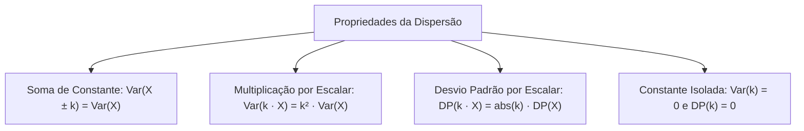
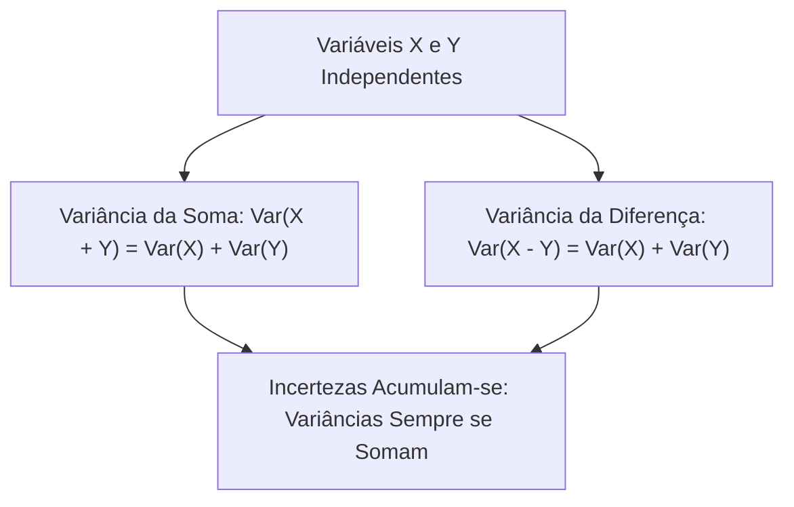
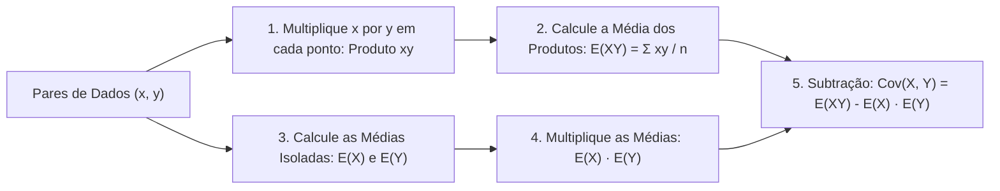
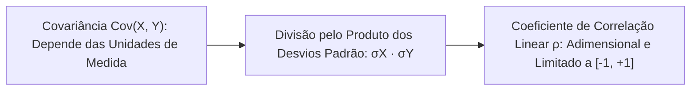
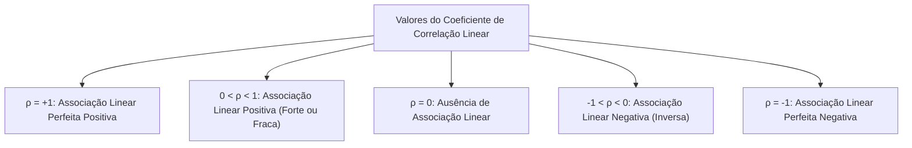
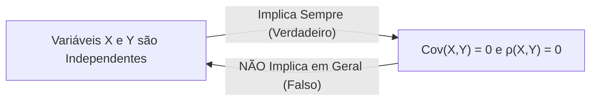
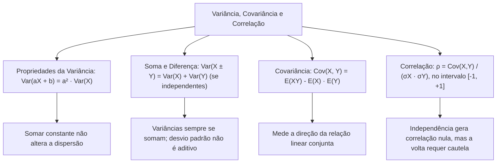

O cálculo da variância e do desvio padrão permite quantificar a dispersão de uma variável isolada. No entanto, o trabalho de inteligência e planejamento operacional frequentemente investiga o comportamento conjunto de duas ou mais variáveis aleatórias. Interessa saber se o aumento no número de patrulhas reduz a incidência de crimes, ou se a intensidade do vento afeta o tempo de propagação do fogo. Para responder a essas indagações, a Estatística desenvolveu a covariância e o coeficiente de correlação linear. Este capítulo estuda as propriedades operatórias da variância e apresenta as medidas de associação linear entre variáveis aleatórias.

> [!objetivos]
> - Aplicar as propriedades da variância e do desvio padrão sob transformações lineares.
> - Compreender a propriedade aditiva da variância para soma e diferença de variáveis independentes.
> - Definir covariância e utilizar sua fórmula abreviada: Cov(X, Y) = E(X · Y) - E(X) · E(Y).
> - Calcular o coeficiente de correlação linear de Pearson e interpretar seus valores no intervalo entre -1 e +1.
> - Analisar a relação entre independência estatística e correlação nula, reconhecendo suas exceções.

## Propriedades da Variância e do Desvio Padrão (Propriedades)

As propriedades operatórias da variância e do desvio padrão decorrem da presença do operador quadrático na sua definição teórica. Essas propriedades aplicam-se identicamente a variáveis aleatórias discretas e contínuas.

Sejam X uma variável aleatória qualquer com variância Var(X) e desvio padrão DP(X), e k uma constante real arbitrária.

### Soma ou Subtração de uma Constante

Ao somar ou subtrair uma constante real k a uma variável X, a variância e o desvio padrão permanecem rigorosamente inalterados:

Var(X + k) = Var(X)  
Var(X - k) = Var(X)  
DP(X + k) = DP(X)  
DP(X - k) = DP(X)

A justificativa matemática é direta. Quando somamos k a todos os valores, a média da variável também é acrescida de k: E(X + k) = μ + k. Ao calcular o desvio de cada ponto:

Desvio = (x + k) - (μ + k) = x + k - μ - k = x - μ.

A constante k cancela-se inteiramente na subtração da média. Como os desvios não se alteram, os quadrados dos desvios mantêm-se idênticos. Geometricamente, adicionar uma constante apenas translada os dados ao longo da reta real. Essa translação não afeta o espaçamento nem a dispersão mútua dos valores.

### Multiplicação ou Divisão por uma Constante

Ao multiplicar uma variável aleatória X por uma constante real k, a variância da nova variável será multiplicada por k ao quadrado:

Var(k · X) = k² · Var(X)

Como a divisão por k equivale à multiplicação por 1/k, para a divisão temos:

Var(X / k) = Var(X) / k², para k diferente de zero.

Por que a constante sai elevada ao quadrado?  
Quando multiplicamos os valores por k, a média também é multiplicada por k: E(k · X) = k · μ. Os novos desvios tornam-se k · (x - μ). Como a fórmula da variância eleva os desvios ao quadrado, o fator multiplicativo transforma-se em [k · (x - μ)]² = k² · (x - μ)².

Para o desvio padrão, extrai-se a raiz quadrada:

DP(k · X) = √(k² · Var(X)) = √k² · √Var(X) = abs(k) · DP(X)

O desvio padrão é multiplicado pelo módulo (valor absoluto) da constante k. Como o desvio padrão representa uma distância física, ele nunca assume valor negativo.

Se k for um número negativo (como -3), a variância será multiplicada por (-3)² = 9. O desvio padrão será multiplicado por abs(-3) = 3:

Var(-3 · X) = 9 · Var(X)  
DP(-3 · X) = 3 · DP(X).

### Variância de uma Constante Isolada

Uma grandeza constante k não sofre variação alguma em seu valor. Todos os dados são rigorosamente iguais a k e a média é o próprio valor k.

Em decorrência disso, todos os desvios são identicamente nulos:

Var(k) = 0  
DP(k) = 0.

### Transformação Linear Completa da Variância

Reunindo as propriedades anteriores para uma transformação linear geral do tipo Y = a + b · X, em que a e b são constantes reais:

Var(Y) = Var(a + b · X) = b² · Var(X)  
DP(Y) = abs(b) · DP(X)

Observe que a constante somada a desaparece completamente da fórmula da variância. O coeficiente multiplicativo b sai elevado ao quadrado.

> [!exemplo] Aplicação Direta de Transformação Linear
> Uma variável aleatória X possui variância Var(X) = 9 e desvio padrão DP(X) = 3.  
> 
> - Para Y1 = X + 10:  
>   Var(Y1) = Var(X) = 9; DP(Y1) = DP(X) = 3.  
> - Para Y2 = 3 · X - 5:  
>   Var(Y2) = 3² · Var(X) = 9 · 9 = 81; DP(Y2) = 3 · 3 = 9.  
> - Para Y3 = -2 · X + 7:  
>   Var(Y3) = (-2)² · Var(X) = 4 · 9 = 36; DP(Y3) = abs(-2) · 3 = 2 · 3 = 6.

## Soma e Diferença de Variáveis Aleatórias Independentes

A determinação da variância da soma e da diferença de variáveis exige extrema atenção dos candidatos.

Quando duas grandezas aleatórias X e Y apresentam independência mútua, a variabilidade do somatório equivale à adição dos valores individuais:

Var(X + Y) = Var(X) + Var(Y), para X e Y independentes.

Para a subtração X - Y entre variáveis independentes, o resultado igualmente corresponde à soma aditiva das parcelas:

Var(X - Y) = Var(X) + Var(Y), para X e Y independentes.

Por que a variância da diferença soma em vez de subtrair?  
Podemos reescrever a diferença X - Y como uma soma da variável X com a variável transformada (-1) · Y:

Var(X - Y) = Var(X + (-1) · Y).

Pela propriedade da multiplicação por constante, a variância de (-1) · Y é (-1)² · Var(Y) = 1 · Var(Y) = Var(Y). Como as variáveis são independentes, somamos as parcelas:

Var(X - Y) = Var(X) + (-1)² · Var(Y) = Var(X) + Var(Y).

A subtração entre variáveis não reduz a incerteza do sistema. Ao combinar grandezas aleatórias sujeitas a erros e oscilações, as variabilidades sempre se acumulam.

> [!pegadinha] Nunca Subtraia Variâncias e Não Some Desvios Padrão
> Dois erros graves e recorrentes devem ser evitados em concursos:  
> 1. Afirmar que Var(X - Y) = Var(X) - Var(Y). Isso é absurdo; variâncias nunca se subtraem. A variabilidade da diferença é sempre a soma das variâncias: Var(X) + Var(Y).  
> 2. Somar diretamente os desvios padrão: DP(X + Y) = DP(X) + DP(Y). O desvio padrão **não é uma função aditiva**. O desvio padrão da soma é a raiz quadrada da soma das variâncias: DP(X + Y) = √(Var(X) + Var(Y)). Se Var(X) = 9 e Var(Y) = 16, o desvio padrão da soma é √(9 + 16) = √25 = 5, e não 3 + 4 = 7.

| Operação com Independentes | Expressão da Variância | Expressão do Desvio Padrão |
| --- | --- | --- |
| Soma: X + Y | Var(X) + Var(Y) | √(Var(X) + Var(Y)) |
| Diferença: X - Y | Var(X) + Var(Y) | √(Var(X) + Var(Y)) |
| Combinação: a · X + b · Y | a² · Var(X) + b² · Var(Y) | √(a² · Var(X) + b² · Var(Y)) |

## O Conceito de Covariância (Covariância e Correlação)

Quando duas variáveis aleatórias não são independentes, elas tendem a oscilar juntas de forma associada. Para mensurar a direção e a intensidade dessa relação linear simultânea, a Estatística define a **covariância**.

A covariância entre duas variáveis aleatórias X e Y, indicada por Cov(X, Y), é definida formalmente como a esperança do produto dos desvios de cada variável em relação às suas médias:

Cov(X, Y) = E[(X - μX) · (Y - μY)]

### O Atalho de Cálculo da Covariância

Expandindo algebricamente o produto interno da definição:

E[(X - μX) · (Y - μY)] = E[X · Y - X · μY - μX · Y + μX · μY]

Aplicando a linearidade da esperança matemática:

Cov(X, Y) = E(X · Y) - E(X) · μY - μX · E(Y) + μX · μY

Como E(X) = μX e E(Y) = μY:

Cov(X, Y) = E(X · Y) - μX · μY - μX · μY + μX · μY

Chega-se à célebre **fórmula abreviada da covariância**:

Cov(X, Y) = E(X · Y) - E(X) · E(Y)

Em que:
- E(X · Y) é a esperança do produto das variáveis, obtida pela média ponderada dos produtos x · y pelas probabilidades conjuntas. Para n pares observados equiprováveis: E(X · Y) = Σ (x · y) / n.
- E(X) e E(Y) são as médias individuais de cada variável.

### O Significado do Sinal da Covariância

O valor numérico da covariância pode ser positivo, negativo ou nulo:

- Covariância positiva: Cov(X, Y) > 0. Indica que as variáveis variam predominantemente no mesmo sentido. Quando os valores de X estão acima de sua média, os valores de Y também tendem a ficar acima da média correspondente.
- Covariância negativa: Cov(X, Y) < 0. Indica que as variáveis variam em sentidos opostos. Quando os valores de X aumentam, os valores de Y tendem a diminuir.
- Covariância nula: Cov(X, Y) = 0. Indica ausência de qualquer padrão de associação linear entre as duas variáveis.

### Covariância Amostral

Quando os pares de dados provêm de uma amostra observada de tamanho n, divide-se a soma dos produtos dos desvios por n - 1 em vez de n:

sXY = Σ (xi - x̄) · (yi - ȳ) / (n - 1)

Essa correção transforma a covariância amostral em um estimador não tendencioso da covariância populacional. Para converter uma covariância populacional calculada com divisor n em covariância amostral, basta multiplicá-la pelo fator n / (n - 1).

> [!resolvido] Cálculo Prático da Covariância Amostral
> Uma equipe de bombeiros registrou em quatro chamados o número de viaturas enviadas (X) e o tempo total de controle do sinistro em horas (Y), obtendo os seguintes pares ordenados equiprováveis (x, y): (1, 2), (2, 4), (3, 5) e (4, 9).
> 
> a) Calcule as médias amostrais x̄ e ȳ.  
> b) Determine a esperança do produto E(X · Y).  
> c) Calcule a covariância populacional e a covariância amostral entre X e Y.
> 
> **Resolução passo a passo:**  
> **Passo 1:** Cálculo das médias individuais:  
> x̄ = (1 + 2 + 3 + 4) / 4 = 10 / 4 = 2,5 viaturas.  
> ȳ = (2 + 4 + 5 + 9) / 4 = 20 / 4 = 5,0 horas.  
> 
> **Passo 2:** Cálculo dos produtos x · y para cada par:  
> - Par 1: 1 · 2 = 2  
> - Par 2: 2 · 4 = 8  
> - Par 3: 3 · 5 = 15  
> - Par 4: 4 · 9 = 36  
> A soma dos produtos é 2 + 8 + 15 + 36 = 61.  
> Como os 4 pares são equiprováveis:  
> E(X · Y) = 61 / 4 = 15,25.  
> 
> **Passo 3:** Aplicação da fórmula abreviada para a covariância populacional:  
> Cov(X, Y) = E(X · Y) - E(X) · E(Y)  
> Cov(X, Y) = 15,25 - (2,5 · 5,0) = 15,25 - 12,50 = 2,75.  
> 
> **Passo 4:** Cálculo da covariância amostral com divisor n - 1 = 3:  
> sXY = Cov(X, Y) · [n / (n - 1)] = 2,75 · (4 / 3) = 11 / 3 ≈ 3,67.  
> O sinal positivo confirma que o tempo de controle aumenta conforme cresce a complexidade e o número de viaturas.

> [!exemplo] Como Duas Variáveis se Relacionam: Preço e Demanda
> Para compreender como duas grandezas se relacionam e medir a força da associação, considere o preço de galões d'água mineral adquiridos para tropas e o volume total demandado. Em certos cenários, se o preço unitário aumenta, as compras feitas tendem a cair, gerando covariância negativa. Em contrapartida, em contratos com promessas mantidas de fornecimento constante, as quantidades encomendadas relacionam-se diretamente com o efetivo empenhado.

## O Coeficiente de Correlação Linear de Pearson

Embora a covariância informe com clareza o sinal da associação (positivo ou negativo), ela apresenta uma limitação prática expressiva: seu valor numérico depende das unidades físicas de medida das variáveis. Se multiplicarmos uma das grandezas por mil (convertendo de quilômetros para metros), a covariância ficará multiplicada por mil. Torna-se impossível avaliar apenas pelo número 2,75 se a relação é fraca, moderada ou forte.

Para superar essa dependência de escala, Karl Pearson formulou o **coeficiente de correlação linear populacional**, indicado pela letra grega ρ (ou simplesmente r para dados amostrais).

O coeficiente de correlação é definido como a covariância padronizada dividida pelo produto dos respectivos desvios padrão:

ρ(X, Y) = Cov(X, Y) / [σX · σY]

Na notação amostral correspondente:

r = sXY / [sX · sY]

Como o numerador e o denominador compartilham exatamente o mesmo produto de unidades de medida, essas unidades cancelam-se na divisão. O coeficiente de correlação é uma **grandeza adimensional (número puro)**.

### O Intervalo Obrigatório de Variação

Por razões matemáticas decorrentes da desigualdade de Cauchy-Schwarz, o coeficiente de correlação linear situa-se estritamente delimitado no intervalo fechado entre -1 e +1:

-1 ≤ ρ(X, Y) ≤ +1

Qualquer resultado numérico que produza valor estritamente menor que -1 ou estritamente maior que +1 constitui erro aritmético grosseiro.

### Interpretação dos Níveis de Correlação

O valor numérico e o sinal do coeficiente de correlação informam com exatidão a natureza da relação linear:

- ρ = +1: correlação linear perfeita positiva. Todos os pontos ordenados situam-se exatamente alinhados sobre uma reta crescente com inclinação positiva: Y = a · X + b, com a > 0.
- ρ = -1: correlação linear perfeita negativa. Todos os pontos encontram-se rigorosamente alinhados sobre uma reta decrescente com inclinação negativa: Y = a · X + b, com a < 0.
- De 0,7 a 1,0 em valor absoluto (módulo de ρ): correlação linear forte (positiva ou negativa).
- De 0,3 a 0,7 em valor absoluto (módulo de ρ): correlação linear moderada.
- Menor que 0,3 em valor absoluto (módulo de ρ): correlação linear fraca.
- ρ = 0: ausência completa de correlação linear. As variáveis são classificadas como **não correlacionadas**.

> [!bizu] Denominador Usa Desvios Padrão, Não Variâncias
> Atenção com uma armadilha clássica da banca: fornecer as variâncias das variáveis e pedir o coeficiente de correlação. A fórmula do coeficiente divide pelo produto dos **desvios padrão** σX · σY. Se a questão informar que Var(X) = 8, Var(Y) = 2 e Cov(X, Y) = 3:  
> σX = √8 e σY = √2.  
> O produto dos desvios padrão vale √8 · √2 = √16 = 4.  
> A correlação vale ρ = 3 / 4 = 0,75.  
> Se o candidato dividir pelo produto das variâncias (8 · 2 = 16), errará a questão encontrando o distrator 3/16 = 0,1875.

## Independência Estatística versus Covariância Nula

A relação entre independência estatística e covariância nula constitui um dos tópicos conceituais mais cobrados em provas de concurso.

### Independência Implica Covariância e Correlação Nulas

Se duas variáveis aleatórias X e Y são estatisticamente independentes, a esperança do produto é igual ao produto das esperanças: E(X · Y) = E(X) · E(Y).

Substituindo essa igualdade na fórmula da covariância:

Cov(X, Y) = E(X · Y) - E(X) · E(Y) = E(X) · E(Y) - E(X) · E(Y) = 0.

Como a covariância é nula, o numerador da correlação anula-se, resultando em:

ρ(X, Y) = 0.

Conclusão obrigatória: **a independência estocástica implica necessariamente covariância nula e correlação linear nula**.

### Covariância Nula Não Garante Independência

A recíproca desse teorema é **falsa**. Obter Cov(X, Y) = 0 ou ρ(X, Y) = 0 garante apenas a ausência de relação **linear**. Podem existir relações não lineares determinísticas perfeitas entre as variáveis mesmo com covariância igual a zero.

Considere o exemplo clássico de relação quadrática determinística. Uma variável aleatória X assume os valores discretos -1, 0 e +1 com idêntica probabilidade 1/3. Definimos a variável Y pela regra determinística Y = X².

Calculando as médias:
- E(X) = (-1) · (1/3) + 0 · (1/3) + 1 · (1/3) = 0.
- Valores de Y: para x = -1, y = 1; para x = 0, y = 0; para x = 1, y = 1.
- E(Y) = 1 · (1/3) + 0 · (1/3) + 1 · (1/3) = 2/3.
- Calculando o produto X · Y = X · X² = X³:  
  Para x = -1, x³ = -1; para x = 0, x³ = 0; para x = 1, x³ = +1.  
  E(X · Y) = E(X³) = (-1) · (1/3) + 0 · (1/3) + 1 · (1/3) = 0.

Calculando a covariância:
Cov(X, Y) = E(X · Y) - E(X) · E(Y) = 0 - 0 · (2/3) = 0.

A covariância é rigorosamente igual a zero e a correlação linear é nula. Contudo, as variáveis X e Y **são totalmente dependentes**: o valor de Y é calculado diretamente a partir de X sem qualquer incerteza. A covariância é zero apenas porque a relação entre elas é uma parábola perfeita e não uma linha reta.

> [!atencao] A Exceção das Variáveis Binárias
> Existe uma importante exceção formal a essa regra. Se X e Y forem **variáveis aleatórias binárias** (variáveis que assumem apenas dois valores possíveis, como zero ou um no modelo de Bernoulli), a covariância nula **implica sim independência estatística mútua**. Para variáveis binárias, a equivalência é bilateral completa.

| Situação Analisada | Covariância | Correlação Linear | Grau de Independência |
| --- | --- | --- | --- |
| Variáveis Independentes | Cov(X, Y) = 0 | ρ(X, Y) = 0 | Perfeitamente independentes |
| Relação Linear Forte | Cov(X, Y) ≠ 0 | abs(ρ) próximo de 1 | Fortemente dependentes |
| Relação Não Linear Perfeita | Cov(X, Y) = 0 | ρ(X, Y) = 0 | Totalmente dependentes (ex.: Y = X²) |
| Variáveis Binárias com Cov = 0 | Cov(X, Y) = 0 | ρ(X, Y) = 0 | Independentes (exceção comprovada) |

## Mapa do capítulo

### Para fixar

- Somar ou subtrair uma constante não altera a variância nem o desvio padrão da variável aleatória.
- Multiplicar por uma constante multiplica a variância pelo quadrado da constante: Var(k · X) = k² · Var(X).
- O desvio padrão é multiplicado pelo módulo da constante: DP(k · X) = abs(k) · DP(X).
- A variância de uma constante isolada é sempre igual a zero: Var(k) = 0.
- Para variáveis independentes, a variância da soma e a da diferença são iguais: Var(X ± Y) = Var(X) + Var(Y).
- A covariância mede a variação linear conjunta de duas variáveis: Cov(X, Y) = E(X · Y) - E(X) · E(Y).
- O coeficiente de correlação de Pearson é adimensional e situa-se obrigatoriamente no intervalo entre -1 e +1.
- Valores extremos de correlação (ρ = +1 ou ρ = -1) expressam relação linear perfeita entre as variáveis.
- Variáveis independentes possuem covariância e correlação nulas; a recíproca só vale para variáveis binárias.
