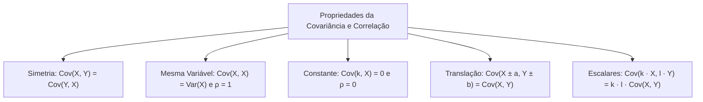
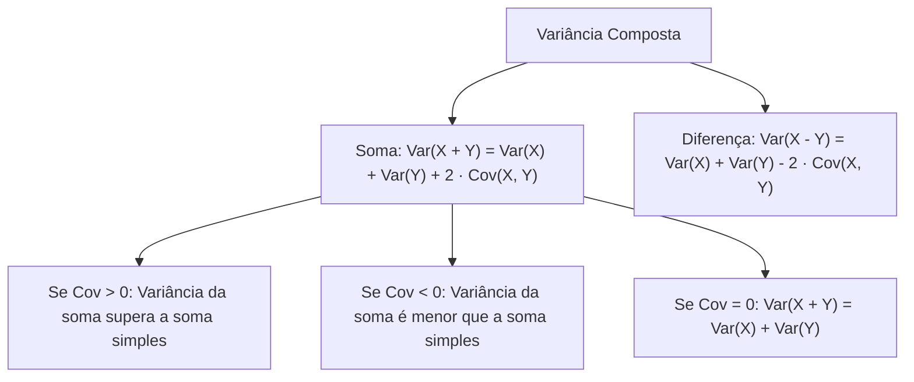
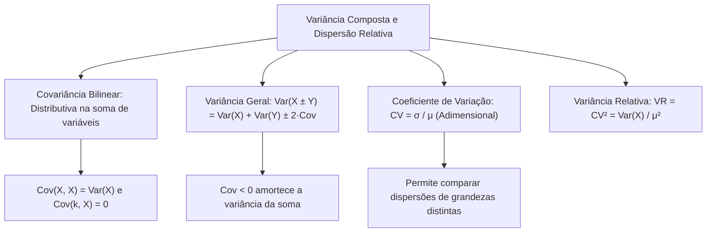

O estudo das variáveis aleatórias culmina na análise de combinações lineares. Em operações reais, os comandantes precisam calcular o risco de equipes atuando juntas. Além disso, é necessário comparar a dispersão entre variáveis com grandezas distintas. Um exemplo comum é comparar tempo de atendimento com custo de combustível. Para resolver essas demandas, a Estatística utiliza a variância da soma e o coeficiente de variação. Este capítulo final aprofunda a covariância. Você aprenderá a calcular a variância da soma de variáveis dependentes e dominará a dispersão relativa.

> [!objetivos]
> - Dominar as propriedades da covariância e da correlação sob transformações lineares.
> - Calcular a variância da soma e da diferença no caso geral de variáveis dependentes.
> - Generalizar o cálculo da variância para três ou mais variáveis correlacionadas.
> - Isolar a covariância e o coeficiente de correlação a partir de variâncias conhecidas.
> - Aplicar o coeficiente de variação e a variância relativa para comparar dispersões relativas.

## Propriedades da Covariância e da Correlação (Propriedades)

A covariância e a correlação possuem propriedades operatórias fundamentais. Essas regras decorrem da bilinearidade do operador estatístico. Elas facilitam cálculos em variáveis discretas e contínuas.

Considere as variáveis X, Y e Z e as constantes reais k, l, a e b.

### Propriedade da Simetria

A ordem das variáveis não altera o resultado da covariância nem da correlação:

Cov(X, Y) = Cov(Y, X)  
ρ(X, Y) = ρ(Y, X)

A comutação é válida em qualquer contexto. O produto dos desvios (x - μX) · (y - μY) é idêntico a (y - μY) · (x - μX).

### Covariância de uma Variável com Ela Mesma

A covariância de uma variável consigo mesma é igual à sua própria variância:

Cov(X, X) = Var(X)

Veja a demonstração:  
Cov(X, X) = E[(X - μ) · (X - μ)] = E[(X - μ)²] = Var(X).

Para o coeficiente de correlação linear, temos:  
ρ(X, X) = Cov(X, X) / [σX · σX] = Var(X) / Var(X) = 1.

A correlação de qualquer variável consigo mesma é sempre igual a 1.

### Covariância com Constante Isolada

A covariância entre uma variável aleatória X e uma constante fixa k é nula:

Cov(k, X) = 0  
ρ(k, X) = 0

Uma constante não varia. Seus desvios são sempre nulos. Por isso, grandezas fixas não covariam com nenhuma variável.

### Adição e Subtração de Constantes

Somar ou subtrair constantes não altera a covariância nem a correlação:

Cov(X ± a, Y ± b) = Cov(X, Y)  
ρ(X ± a, Y ± b) = ρ(X, Y)

Adicionar constantes apenas desloca a origem dos dados na reta. Mudar o ponto de partida não altera a forma como as variáveis oscilam juntas.

### Multiplicação por Constantes e Efeito no Sinal

Ao multiplicar as variáveis por constantes k e l, os coeficientes multiplicam a covariância:

Cov(k · X, l · Y) = k · l · Cov(X, Y)

Se as duas variáveis forem multiplicadas pelo mesmo fator k:  
Cov(k · X, k · Y) = k² · Cov(X, Y).

Na divisão por uma constante c, multiplica-se pelo inverso 1/c:  
Cov(X, Y / c) = Cov(X, Y) / c.

Para a correlação, os desvios padrão recebem o módulo dos escalares:  
ρ(k · X, l · Y) = [k · l / (abs(k) · abs(l))] · ρ(X, Y).

Essa regra gera dois desfechos possíveis:
- Se k e l têm o mesmo sinal, o produto k · l é positivo. O fator vale +1. A correlação mantém o mesmo valor e o mesmo sinal.
- Se k e l têm sinais opostos, o produto k · l é negativo. O fator vale -1. A correlação inverte seu sinal algébrico, mantendo o mesmo valor absoluto.

> [!pegadinha] O Sinal na Relação Linear Exata
> Quando Y decorre de uma relação linear exata Y = c + k · X, com k não nulo:  
> - A constante c não afeta o resultado.  
> - O valor de ρ depende unicamente do sinal de k:  
>   Se k > 0, então ρ(X, Y) = +1.  
>   Se k < 0, então ρ(X, Y) = -1.  
> Para Y = 15 - 4 · X, o coeficiente de X é negativo (-4). Logo, ρ = -1 diretamente. Não é preciso calcular variâncias.

### A Bilinearidade da Covariância

A covariância distribui-se em relação à soma e à subtração de variáveis:

Cov(X + Y, Z) = Cov(X, Z) + Cov(Y, Z)  
Cov(X - Y, Z) = Cov(X, Z) - Cov(Y, Z)

Se Cov(X, Z) = 2 e Cov(Y, Z) = -5, temos:  
Cov(X + Y, Z) = 2 + (-5) = -3  
Cov(X - Y, Z) = 2 - (-5) = 7.

## Variância Geral (Variância da Soma e da Diferença)

Estudamos antes a soma de variáveis sob independência. Agora analisamos o caso geral com variáveis dependentes e correlacionadas.

### A Fórmula da Soma e da Diferença

Para quaisquer variáveis aleatórias X e Y:

Var(X + Y) = Var(X) + Var(Y) + 2 · Cov(X, Y)  
Var(X - Y) = Var(X) + Var(Y) - 2 · Cov(X, Y)

A regra assemelha-se ao quadrado da soma e da diferença da álgebra básica. O termo central é o dobro da covariância.

Pontos de máxima atenção:
- As variâncias individuais sempre entram somando. Var(X) e Var(Y) nunca se subtraem.
- O único sinal que se altera é o termo cruzado da covariância. Ele é positivo na soma (+2 · Cov) e negativo na diferença (-2 · Cov).
- Se as variáveis forem independentes, Cov(X, Y) = 0. A fórmula reduz-se à soma simples das variâncias.

### Coeficientes Escalares na Variância Composta

Quando as variáveis aparecem multiplicadas por escalares k e l:

Var(k · X + l · Y) = k² · Var(X) + l² · Var(Y) + 2 · k · l · Cov(X, Y)  
Var(k · X - l · Y) = k² · Var(X) + l² · Var(Y) - 2 · k · l · Cov(X, Y)

Podemos escrever a covariância usando a correlação: Cov(X, Y) = ρ · σX · σY.  
A fórmula alternativa fica:

Var(X + Y) = Var(X) + Var(Y) + 2 · ρ · σX · σY.

> [!exemplo] Aplicação Numérica com Variâncias e Covariância
> Considere duas variáveis com Var(X) = 9, Var(Y) = 16 e Cov(X, Y) = 6.  
> 
> - Variância da soma:  
>   Var(X + Y) = 9 + 16 + 2 · 6 = 25 + 12 = 37.  
> - Variância da diferença:  
>   Var(X - Y) = 9 + 16 - 2 · 6 = 25 - 12 = 13.  
> - Combinação linear 2 · X - 3 · Y:  
>   Var(2X - 3Y) = 2² · 9 + (-3)² · 16 + 2 · 2 · (-3) · 6  
>   Var(2X - 3Y) = 4 · 9 + 9 · 16 - 72  
>   Var(2X - 3Y) = 36 + 144 - 72 = 108.

### Três ou Mais Variáveis Correlacionadas

Para a soma de três variáveis aleatórias X, Y e Z:

Var(X + Y + Z) = Var(X) + Var(Y) + Var(Z) + 2 · [Cov(X, Y) + Cov(X, Z) + Cov(Y, Z)]

Para n variáveis aleatórias, a variância da soma é a soma de todas as variâncias individuais mais o dobro das covariâncias de todos os pares distintos. Cada par entra uma única vez na soma.

Se todas as variáveis forem independentes, as covariâncias anulam-se. Sobra apenas a soma direta das variâncias individuais.

> [!resolvido] Determinação de Correlação a partir de Variâncias
> Em uma operação de socorro, o tempo de deslocamento X tem variância Var(X) = 16. O tempo de atendimento Y tem variância Var(Y) = 9. O tempo total da missão é T = X + Y, com variância observada Var(T) = 19.  
> 
> a) Calcule a covariância Cov(X, Y).  
> b) Encontre os desvios padrão σX e σY.  
> c) Calcule o coeficiente de correlação ρ(X, Y).  
> d) Interprete o efeito prático do sinal negativo.
> 
> **Resolução passo a passo:**  
> **Passo 1:** Escrevemos a fórmula da variância da soma no caso geral:  
> Var(X + Y) = Var(X) + Var(Y) + 2 · Cov(X, Y)  
> Substituímos os valores dados:  
> 19 = 16 + 9 + 2 · Cov(X, Y)  
> 19 = 25 + 2 · Cov(X, Y)  
> 
> **Passo 2:** Isolamos a covariância:  
> 2 · Cov(X, Y) = 19 - 25  
> 2 · Cov(X, Y) = -6  
> Cov(X, Y) = -6 / 2 = -3.  
> 
> **Passo 3:** Calculamos os desvios padrão:  
> σX = √16 = 4 minutos.  
> σY = √9 = 3 minutos.  
> 
> **Passo 4:** Calculamos o coeficiente de correlação:  
> ρ(X, Y) = Cov(X, Y) / [σX · σY]  
> ρ(X, Y) = -3 / (4 · 3) = -3 / 12 = -0,25.  
> 
> **Passo 5:** O valor de ρ = -0,25 indica correlação negativa moderada a fraca. Equipes com deslocamentos mais longos tendem a ser mais ágeis no local do socorro. Como Cov < 0, a variância da soma (19) é menor do que a soma das variâncias (25).

| Situação | Relação entre Var(X + Y) e Var(X) + Var(Y) | Sinal de Cov(X, Y) |
| --- | --- | --- |
| Variáveis Independentes | Var(X + Y) = Var(X) + Var(Y) | Cov(X, Y) = 0 |
| Correlação Positiva | Var(X + Y) > Var(X) + Var(Y) | Cov(X, Y) > 0 |
| Correlação Negativa | Var(X + Y) < Var(X) + Var(Y) | Cov(X, Y) < 0 |

## Dispersão Relativa (Coeficiente de Variação e Variância Relativa)

As medidas absolutas de dispersão possuem limites claros. Elas não permitem comparar diretamente variáveis com médias muito diferentes. Também não comparam grandezas medidas em unidades físicas distintas.

Considere duas equipes em treinamento:
- Equipe 1: tempo médio de resposta de 100 minutos com desvio padrão de 20 minutos.
- Equipe 2: tempo médio de resposta de 10 minutos com desvio padrão de 5 minutos.

Se olharmos só o desvio padrão absoluto, a Equipe 1 parece quatro vezes mais dispersa (20 contra 5). Mas uma oscilação de 20 minutos em média de 100 representa apenas 20%. Já uma oscilação de 5 minutos em média de 10 representa 50%. A Equipe 2 é proporcionalmente muito mais instável e heterogênea.

### O Coeficiente de Variação

Para realizar comparações relativas consistentes, a Estatística adota o **coeficiente de variação (CV)**. Ele também é denominado desvio padrão relativo.

O coeficiente de variação é a razão entre o desvio padrão e a média:

CV = σ / μ

Na versão amostral, a expressão utiliza os estimadores correspondentes:

CV = s / x̄

Frequentemente, expressa-se o resultado em percentual:

CV% = (σ / μ) · 100%

Propriedades fundamentais do CV:

1. Grandeza adimensional: o desvio padrão e a média têm a mesma unidade física. As unidades cancelam-se na divisão. O CV é um número puro.
2. Comparação intergrupos: permite comparar variáveis de naturezas distintas. Podemos comparar a dispersão da altura em metros com salários em reais.
3. Exigência matemática: só pode ser calculado se a média for diferente de zero (μ ≠ 0).

Calculando para as equipes citadas:
- Equipe 1: CV1 = 20 / 100 = 0,20 (20%).
- Equipe 2: CV2 = 5 / 10 = 0,50 (50%).

A Equipe 1 apresenta menor coeficiente de variação. Ela é relativamente mais homogênea.

### A Variância Relativa

A **variância relativa (VR)** é o quadrado do coeficiente de variação:

VR = CV² = σ² / μ² = Var(X) / μ²

Ela expressa a razão entre a variância e o quadrado da média aritmética.

Exemplos numéricos diretos:
- Se CV = 0,20 (20%), a variância relativa é VR = (0,20)² = 0,04.
- Se CV = 0,50 (50%), a variância relativa é VR = (0,50)² = 0,25.
- Se CV = 0,10 (10%), a variância relativa é VR = (0,10)² = 0,01.

> [!bizu] O Significado Percentual do CV
> Fique atento às pegadinhas de enunciados: um coeficiente de variação de 50% significa que o **desvio padrão é igual a metade da média**. Não significa que ele é "50% maior" nem "50% menor" que a média. Trata-se da proporção direta: σ = 0,50 · μ.

> [!atencao] Comparação Isolada de CV
> Conhecer apenas o coeficiente de variação não informa qual grupo tem o maior desvio padrão absoluto. Um batalhão com CV = 10% e média de 500 horas tem desvio de 50 horas. Outro com CV = 30% e média de 10 horas tem desvio de 3 horas. Para comparar valores absolutos, é obrigatório conhecer as médias.

| Medida Relativa | Simbologia | Fórmula de Cálculo | Propriedade Central |
| --- | --- | --- | --- |
| Coeficiente de Variação | CV ou CV% | σ / μ ou (σ / μ) · 100% | Adimensional; compara grupos com médias distintas |
| Variância Relativa | VR | CV² = Var(X) / μ² | Quadrado do coeficiente de variação |

## Análise Comparativa e Exercícios de Fixação Conceitual

Para consolidar os conceitos operatórios deste capítulo, analisamos a interação entre variância, covariância e dispersão relativa em problemas típicos de avaliação de desempenho militar.

### Efeito de Choques Positivos e Negativos na Covariância

Considere duas variáveis X e Y com variâncias Var(X) = 25 e Var(Y) = 16, e covariância Cov(X, Y) = -10.

- A variância da soma é calculada diretamente:  
  Var(X + Y) = Var(X) + Var(Y) + 2 · Cov(X, Y)  
  Var(X + Y) = 25 + 16 + 2 · (-10) = 41 - 20 = 21.  
  Como a covariância é negativa, a variância conjunta diminui expressivamente. O desvio padrão da soma é √21 ≈ 4,58. Se as variáveis fossem independentes, a variância seria 41 e o desvio padrão seria √41 ≈ 6,40. A correlação negativa atua como um amortecedor natural da variabilidade do sistema.

- A variância da diferença no mesmo cenário:  
  Var(X - Y) = Var(X) + Var(Y) - 2 · Cov(X, Y)  
  Var(X - Y) = 25 + 16 - 2 · (-10) = 41 + 20 = 61.  
  O desvio padrão da diferença atinge √61 ≈ 7,81. Na presença de covariância negativa, a diferença amplia a oscilação total.

### Comparação de Desempenho entre Grupamentos Operacionais

Considere a avaliação de tempo de resposta em dois grupamentos de bombeiros em áreas urbanas distintas:
- Grupamento Alfa: atua em área metropolitana densa. Registrou tempo médio de atendimento de 40 minutos com desvio padrão de 8 minutos.
- Grupamento Beta: atua em cidade do interior. Registrou tempo médio de atendimento de 15 minutos com desvio padrão de 6 minutos.

Avaliando apenas o desvio padrão absoluto, o Grupamento Beta parece apresentar menor oscilação (6 minutos contra 8 minutos de Alfa). Contudo, a análise técnica exige o cálculo do coeficiente de variação:
- CV(Alfa) = 8 / 40 = 0,20 (20%).
- CV(Beta) = 6 / 15 = 0,40 (40%).

Conclui-se que o Grupamento Alfa é duas vezes mais homogêneo e previsível em seus atendimentos operacionais do que o Grupamento Beta. O desvio de Beta representa quarenta por cento de sua média, evidenciando maior instabilidade relativa.

Calculando as variâncias relativas correspondentes:
- VR(Alfa) = (0,20)² = 0,04.
- VR(Beta) = (0,40)² = 0,16.

A variância relativa de Beta é quatro vezes superior à de Alfa, reforçando a dispersão proporcional muito mais expressiva.

### Escalas com Múltiplas Variáveis

Considere três variáveis X, Y e Z com os seguintes parâmetros:  
Var(X) = 2, Var(Y) = 3, Var(Z) = 4.  
As covariâncias entre os pares são: Cov(X, Y) = 1, Cov(X, Z) = -1 e Cov(Y, Z) = 0,5.

A variância da soma combinada T = X + Y + Z é calculada passo a passo:  
Var(T) = Var(X) + Var(Y) + Var(Z) + 2 · [Cov(X, Y) + Cov(X, Z) + Cov(Y, Z)]  
Var(T) = (2 + 3 + 4) + 2 · [1 + (-1) + 0,5]  
Var(T) = 9 + 2 · [0,5] = 9 + 1 = 10.

O valor final de 10 reflete o impacto compensatório das correlações cruzadas entre os três componentes.

## Mapa do capítulo

### Para fixar

- A covariância é comutativa: Cov(X, Y) = Cov(Y, X). A covariância de X consigo mesma é sua variância: Cov(X, X) = Var(X).
- A covariância com uma constante é nula. Somar constantes não altera a covariância nem a correlação linear.
- Multiplicar variáveis por constantes altera a covariância pelo produto k · l. A correlação só inverte de sinal se k · l < 0.
- Numa relação linear exata Y = c + k · X, a correlação é +1 se k for positivo e -1 se k for negativo.
- A fórmula da variância da soma no caso geral é Var(X + Y) = Var(X) + Var(Y) + 2 · Cov(X, Y).
- A fórmula da variância da diferença é Var(X - Y) = Var(X) + Var(Y) - 2 · Cov(X, Y). As variâncias sempre somam.
- Se a covariância for negativa, a variância da soma é estritamente menor que a soma simples das variâncias.
- O coeficiente de variação é adimensional e calculado por CV = σ / μ, comparando dispersões com médias distintas.
- A variância relativa é o quadrado do coeficiente de variação: VR = CV² = Var(X) / μ².
